<!--
=====================================================================
 PLANTILLA — Informe de Trabajo Final · 1ASI0732 Diseño de Experimentos
 Un solo archivo README.md (archivo principal del repositorio del informe).
 Estructura completa según el statement: 3 Partes, 8 Capítulos + anexos.
 Reemplazar cada <placeholder> y cada bloque > _Guía:_ con el contenido real.
 Recordar: actualizar y VERIFICAR la Tabla de Contenidos antes de cada entrega.
=====================================================================
-->


<!-- CARÁTULA -->

<div align="center">


# Universidad Peruana de Ciencias Aplicadas

---

## Carrera de Ingeniería de Software

---

**1ASI0732**

**Diseño de Experimentos de Ingeniería de Software**

**NRC**

9100

## Informe del Avance 2 (AV2)

**Docente**

Sanchez Ponce, Alex Humberto

**Startup**

CareStacks

**Producto**

CareConnect

**Integrantes**

</div>
<div align="center">
 
| Código | Apellidos y Nombres |
|---|---|
| U202319881 | Baldeon Armas, Santiago Armando |
| U202415495 | Espinoza Cruz, Angela Milagros |
| U202319563 | Muñiz Huayanca, Percy Alonso |
| U20221G099 | Nikaido Vargas, Javier Masaru |
| U202319698 | Salcedo Champi, Matias Rodolfo |


**Período 2026-20**

Noviembre, 2026

</div>

---

# REGISTRO DE VERSIONES DEL INFORME

| **Versión** | **Fecha** | **Autor** | **Descripción de modificación** |
|:---:|:---:|---|---|
| 0.1.0 | 31/08/2026 | Matias Salcedo | Creó la plantilla base del informe final (`main`) |
| 0.2.0 | 01/09/2026 – 08/09/2026 | Matias Salcedo | Redactó el Capítulo III, desarrollando las user stories, el product backlog, el impact mapping, el to-be scenario mapping y el llenado de la carátula (`chapter-3`) |
| 0.3.0 | 04/09/2026 – 05/09/2026 | Angela Espinoza | Desarrolló el Capítulo II a partir de las personas, los empathy maps, los journey maps y el análisis de needfinding (`chapter-2`) |
| 0.4.0 | 07/09/2026 | Javier Nikaido | Elaboró los diagramas de arquitectura, de clases y de base de datos del Capítulo IV (`chapter-4`) |
| 0.5.0 | 07/09/2026 | Angela Espinoza | Amplió el Capítulo II incorporando el enfoque Lean UX (problem statement, hipótesis y canvas), los segmentos objetivo y el análisis competitivo (`chapter-2`) |
| 0.6.0 | 08/09/2026 | Matias Salcedo | Completó la especificación de requerimientos del Capítulo III y afinó el backlog junto con el impact map (`chapter-3`) |
| 0.7.0 | 09/09/2026 | Angela Espinoza / Santiago Baldeon | Redactaron el Capítulo I describiendo el perfil de la startup y los perfiles de los integrantes del equipo (`chapter-1`, `chapter-2`) |
| 0.8.0 | 09/09/2026 – 10/09/2026 | Javier Nikaido | Implementó y documentó la Landing Page junto con su configuración de despliegue para el Capítulo V (`chapter-5`) |
| 0.9.0 | 10/09/2026 | Percy Muñiz | Incorporó la evidencia de la aplicación móvil en iOS, el prototipado y los sprint backlogs del Capítulo V (`chapter-5`) |
| 0.10.0 | 10/09/2026 | Javier Nikaido | Revisó los perfiles de los integrantes y ajustó la guía de requisitos del Capítulo IV (`chapter-1`, `chapter-4`) |
| 0.11.0 | 11/09/2026 | Matias Salcedo | Completó la sección de diseño UX web del Capítulo II (`chapter-2`) |
| 0.12.0 | 14/09/2026 | Angela Espinoza | Añadió el As-Is Scenario Mapping, el glosario de ubiquitous language, las referencias en formato APA 7 y reescribió el proceso Lean UX (`chapter-1`, `chapter-2`) |
| 0.13.0 | 14/09/2026 | Javier Nikaido / Percy Muñiz | Revisaron el class dictionary y el stack tecnológico, migraron el frontend a Flutter y ajustaron la configuración de despliegue (`chapter-4`, `chapter-5`) |
| 0.14.0 | 15/09/2026 | Santiago Baldeon | Elaboró los wireframes y mockups de la aplicación móvil del Capítulo IV (`chapter-4`) |
| 1.0.0 | 16/09/2026 | Matias Salcedo | AV1 Report |
| 1.1.0 | 30/09/2026 | Matias Salcedo | Implementó el i18n (español/inglés) en la Landing Page y documentó su verificación (`docs/landing-i18n`) |
| 1.2.0 | 01/10/2026 | Javier Nikaido | Desarrolló la sección 7.1 Continuous Integration del Capítulo VII (`chapter-7`) |
| 1.3.0 | 03/10/2026 | Matias Salcedo | Desarrolló el Capítulo VI: Product Verification & Validation (`chapter-6`) |
| 1.4.0 | 03/10/2026 | Percy Muñiz | Desarrolló las secciones 7.2 Continuous Delivery y 7.3 Continuous Deployment (`chapter-7`) |
| 1.5.0 | 04/10/2026 | Javier Nikaido | Rediseñó la base de datos con diagramas UML normalizados por Bounded Context (`chapter-4`) |
| 1.6.0 | 04/10/2026 | Angela Espinoza | Homogeneizó los criterios de aceptación en Gherkin y completó los precios del análisis competitivo (`chapter-2`, `chapter-3`, `chapter-5`) |
| 1.7.0 | 01/10/2026 | Angela Espinoza | Actualizó la carátula, el Student Outcome y el Team Collaboration Insights del TB1 (`develop`) |
| 1.8.0 | 04/10/2026 | Santiago Baldeon | Desarrolló el Acuerdo de Servicio SaaS y las conclusiones, y elaboró el guion y el video de exposición del TB1 (`develop`) |
| 2.0.0 | 04/10/2026 | Matias Salcedo | Consolidó la verificación TB1, corrigió los resultados y conclusiones, e incorporó el capítulo 7 y el acuerdo SaaS con evidencia y límites de entrega |
| 2.1.0 | 21/10/2026 | Matias Salcedo | Desarrolló el Capítulo VIII: Experiment Planning (8.1) y Experiment Design inicial (8.2) con Question Backlog, Experiment Cards, Hipótesis Null/Alternative, Domain Metrics y Condiciones (`chapter-8`) |
| 2.1.1 | 24/10/2026 | Matias Salcedo | Revisó el bloque D contra la guía AV2 y el enunciado: corrigió el As-Is, trazó preguntas y tarjetas, unificó hipótesis y métricas, explicitó condiciones y separó planificación de resultados (`chapter-8`) |
| 2.2.0 | 07/11/2026 | Matias Salcedo | Consolidó D con los cuatro commits de Emy127: alineó escala, métodos, tracking e historias con el As-Is real; completó las tarjetas con cálculos reproducibles y documentó la corrección de enlaces de la landing en `chapter-8` |
| 2.3.0 | 08/11/2026 | Matias Salcedo / equipo CareStacks | Integró los aportes AV2 de los capítulos IV, VI, VII y VIII en `develop`, conservando la carátula y conclusiones AV2; corrigió referencias y registró la [verificación y los vacíos de entrega](assets/integration/av2-2026-11-08/verification.md). |
| 2.3.1 | 08/11/2026 | Matias Salcedo | Completó la planificación del Sprint Backlog To-Be y la comparación de herramientas DevOps; corrigió compatibilidad Android y controles del backend, con [resultados y faltantes actualizados](assets/experiments/av2-completion-2026-11-08/verification.md). |

# Project Report Collaboration Insights

Enlace de la organización para el reporte del proyecto: https://github.com/upc-pre-202620-1asi0732-9100-carestacks/carestacks-report

La [verificación de integración TB1](assets/integration/tb1/verification.md) registra las ramas de los capítulos I–VII, la resolución de conflictos y las comprobaciones del informe consolidado.

AV1:
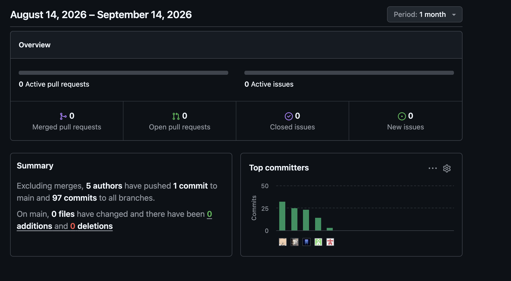
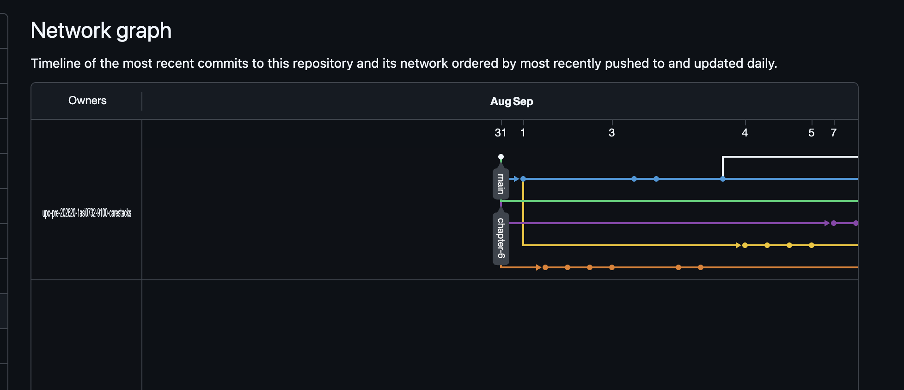
TB1:
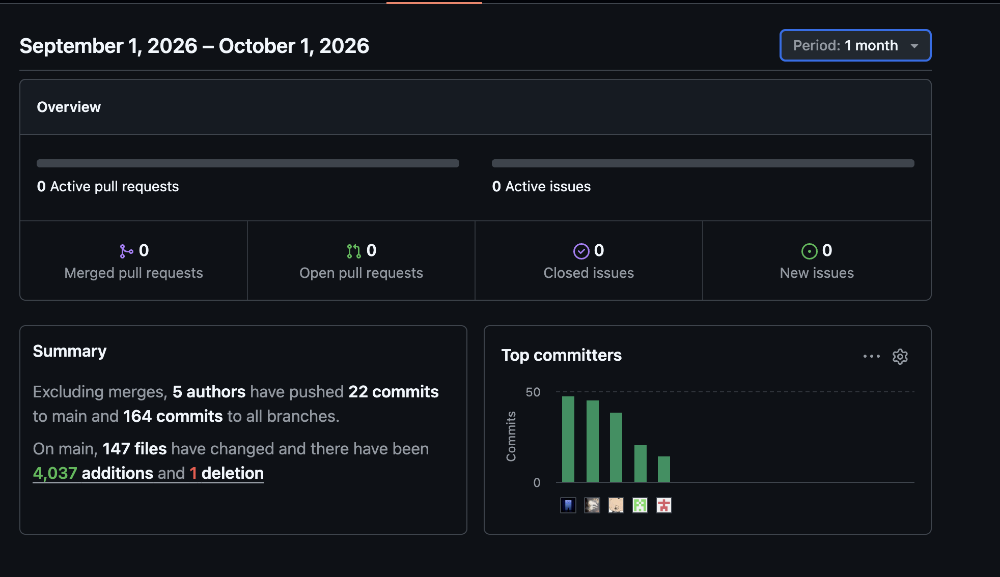
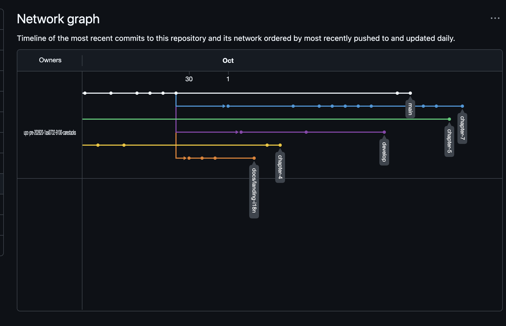
## Tabla de Contenidos

<!-- 4 niveles. Verificar los anclajes (#) antes de cada entrega: GitHub genera el ancla a partir del texto del título. -->

- [Student Outcome](#student-outcome)
- [Part I: As-Is Software Project](#part-i-as-is-software-project)
  - [Capítulo I: Introducción](#capítulo-i-introducción)
    - [1.1. Startup Profile](#11-startup-profile)
      - [1.1.1. Descripción de la Startup](#111-descripción-de-la-startup)
      - [1.1.2. Perfiles de integrantes del equipo](#112-perfiles-de-integrantes-del-equipo)
    - [1.2. Solution Profile](#12-solution-profile)
      - [1.2.1. Antecedentes y problemática](#121-antecedentes-y-problemática)
      - [1.2.2. Lean UX Process](#122-lean-ux-process)
        - [1.2.2.1. Lean UX Problem Statements](#1221-lean-ux-problem-statements)
        - [1.2.2.2. Lean UX Assumptions](#1222-lean-ux-assumptions)
        - [1.2.2.3. Lean UX Hypothesis Statements](#1223-lean-ux-hypothesis-statements)
        - [1.2.2.4. Lean UX Canvas](#1224-lean-ux-canvas)
    - [1.3. Segmentos objetivo](#13-segmentos-objetivo)
    - [Segmento Objetivo 1: Cuidadores de pacientes geriátricos](#segmento-objetivo-1-cuidadores-de-pacientes-geriátricos)
    - [Segmento Objetivo 2: Pacientes geriátricos](#segmento-objetivo-2-pacientes-geriátricos)
  - [Capítulo II: Requirements Elicitation & Analysis](#capítulo-ii-requirements-elicitation--analysis)
    - [2.1. Competidores](#21-competidores)
      - [2.1.1. Análisis competitivo](#211-análisis-competitivo)
      - [2.1.2. Estrategias y tácticas frente a competidores](#212-estrategias-y-tácticas-frente-a-competidores)
    - [2.2. Entrevistas](#22-entrevistas)
      - [2.2.1. Diseño de entrevistas](#221-diseño-de-entrevistas)
      - [Segmento 1: Cuidadores de pacientes geriátricos](#segmento-1-cuidadores-de-pacientes-geriátricos)
      - [Segmento 2: Pacientes geriátricos](#segmento-2-pacientes-geriátricos)
      - [2.2.2. Registro de entrevistas](#222-registro-de-entrevistas)
      - [Segmento 1: Cuidadores de pacientes geriátricos](#segmento-1-cuidadores-de-pacientes-geriátricos-1)
      - [Segmento 2: Pacientes geriátricos](#segmento-2-pacientes-geriátricos-1)
      - [2.2.3. Análisis de entrevistas](#223-análisis-de-entrevistas)
      - [Segmento 1: Cuidadores de pacientes geriátricos](#segmento-1-cuidadores-de-pacientes-geriátricos-2)
      - [Segmento 2: Pacientes geriátricos](#segmento-2-pacientes-geriátricos-2)
      - [Conclusión general del análisis](#conclusión-general-del-análisis)
    - [2.3. Needfinding](#23-needfinding)
      - [2.3.1. User Personas](#231-user-personas)
      - [2.3.2. User Task Matrix](#232-user-task-matrix)
      - [2.3.3. User Journey Mapping](#233-user-journey-mapping)
      - [2.3.4. Empathy Mapping](#234-empathy-mapping)
      - [2.3.5. As-is Scenario Mapping](#235-as-is-scenario-mapping)
        - [User Persona 1 — Valeria Huamán](#user-persona-1--valeria-huamán)
        - [User Persona 2 — Rafael Medina](#user-persona-2--rafael-medina)
        - [Hallazgos transversales](#hallazgos-transversales)
    - [2.4. Ubiquitous Language](#24-ubiquitous-language)
        - [Actores del cuidado](#actores-del-cuidado)
        - [Agenda y eventos de salud](#agenda-y-eventos-de-salud)
        - [Medicación y adherencia](#medicación-y-adherencia)
        - [Continuidad del cuidado](#continuidad-del-cuidado)
        - [Documentación y evolución](#documentación-y-evolución)
  - [Capítulo III: Requirements Specification](#capítulo-iii-requirements-specification)
    - [3.1. To-Be Scenario Mapping](#31-to-be-scenario-mapping)
        - [Comparación con el As-Is Scenario Mapping (sección 2.3.5)](#comparación-con-el-as-is-scenario-mapping-sección-235)
    - [3.2. User Stories](#32-user-stories)
    - [3.3. Product Backlog](#33-product-backlog)
    - [3.4. Impact Mapping](#34-impact-mapping)
  - [Capítulo IV: Product Design](#capítulo-iv-product-design)
    - [4.1. Style Guidelines](#41-style-guidelines)
      - [4.1.1. General Style Guidelines](#411-general-style-guidelines)
      - [4.1.2. Web Style Guidelines](#412-web-style-guidelines)
      - [4.1.3. Mobile Style Guidelines](#413-mobile-style-guidelines)
        - [4.1.3.1. iOS Mobile Style Guidelines](#4131-ios-mobile-style-guidelines)
        - [4.1.3.2. Android Mobile Style Guidelines](#4132-android-mobile-style-guidelines)
    - [4.2. Information Architecture](#42-information-architecture)
      - [4.2.1. Organization Systems](#421-organization-systems)
      - [4.2.2. Labeling Systems](#422-labeling-systems)
      - [4.2.3. SEO Tags and Meta Tags](#423-seo-tags-and-meta-tags)
      - [4.2.4. Searching Systems](#424-searching-systems)
      - [4.2.5. Navigation Systems](#425-navigation-systems)
    - [4.3. Landing Page UI Design](#43-landing-page-ui-design)
      - [4.3.1. Landing Page Wireframe](#431-landing-page-wireframe)
      - [4.3.2. Landing Page Mock-up](#432-landing-page-mock-up)
    - [4.4. Mobile Applications UX/UI Design](#44-mobile-applications-uxui-design)
      - [4.4.1. Mobile Applications Wireframes](#441-mobile-applications-wireframes)
      - [4.4.2. Mobile Applications Wireflow Diagrams](#442-mobile-applications-wireflow-diagrams)
        - [User Goal 1: Registro y selección de rol](#user-goal-1-registro-y-selección-de-rol)
        - [User Goal 2: Inicio de sesión](#user-goal-2-inicio-de-sesión)
        - [User Goal 3: Confirmar toma de medicación (Cuidador)](#user-goal-3-confirmar-toma-de-medicación-cuidador)
        - [User Goal 4: Compartir el perfil con un nuevo cuidador (Paciente)](#user-goal-4-compartir-el-perfil-con-un-nuevo-cuidador-paciente)
        - [User Goal 5: Revisar y resolver notificaciones (Cuidador)](#user-goal-5-revisar-y-resolver-notificaciones-cuidador)
        - [User Goal 6: Registrar un evento en Agenda](#user-goal-6-registrar-un-evento-en-agenda)
        - [User Goal 7: Subir un documento médico](#user-goal-7-subir-un-documento-médico)
      - [4.4.3. Mobile Applications Mock-ups](#443-mobile-applications-mock-ups)
      - [4.4.4. Mobile Applications User Flow Diagrams](#444-mobile-applications-user-flow-diagrams)
    - [4.5. Mobile Applications Prototyping](#45-mobile-applications-prototyping)
      - [4.5.1. Android Mobile Applications Prototyping](#451-android-mobile-applications-prototyping)
      - [4.5.2. iOS Mobile Applications Prototyping](#452-ios-mobile-applications-prototyping)
    - [4.6. Web Applications UX/UI Design](#46-web-applications-uxui-design)
      - [4.6.1. Web Applications Wireframes](#461-web-applications-wireframes)
      - [4.6.2. Web Applications Wireflow Diagrams](#462-web-applications-wireflow-diagrams)
      - [4.6.3. Web Applications Mock-ups](#463-web-applications-mock-ups)
      - [4.6.4. Web Applications User Flow Diagrams](#464-web-applications-user-flow-diagrams)
    - [4.7. Web Applications Prototyping](#47-web-applications-prototyping)
    - [4.8. Domain-Driven Software Architecture](#48-domain-driven-software-architecture)
      - [4.8.1. Software Architecture Context Diagram](#481-software-architecture-context-diagram)
        - [Elementos del Context Diagram](#elementos-del-context-diagram)
        - [Relaciones principales](#relaciones-principales)
      - [4.8.2. Software Architecture Container Diagrams](#482-software-architecture-container-diagrams)
        - [Containers de CareConnect](#containers-de-careconnect)
        - [Relaciones entre containers](#relaciones-entre-containers)
        - [Consideración tecnológica](#consideración-tecnológica)
      - [4.8.3. Software Architecture Components Diagrams](#483-software-architecture-components-diagrams)
        - [Componentes principales](#componentes-principales)
        - [Relaciones principales entre componentes](#relaciones-principales-entre-componentes)
    - [4.9. Software Object-Oriented Design](#49-software-object-oriented-design)
      - [4.9.1. Class Diagrams](#491-class-diagrams)
        - [Bounded Context: Agenda](#bounded-context-agenda)
        - [Bounded Context: Notificaciones](#bounded-context-notificaciones)
        - [Bounded Context: Diario de Seguimiento](#bounded-context-diario-de-seguimiento)
        - [Bounded Context: Gestión de Consentimiento](#bounded-context-gestión-de-consentimiento)
        - [Bounded Context: Documentos](#bounded-context-documentos)
        - [Bounded Context: Autenticación / IAM](#bounded-context-autenticación--iam)
      - [4.9.2. Class Dictionary](#492-class-dictionary)
        - [Bounded Context Agenda](#bounded-context-agenda-1)
        - [Bounded Context Notifications](#bounded-context-notifications)
        - [Bounded Context Diary Tracking](#bounded-context-diary-tracking)
        - [Bounded Context Consent Management](#bounded-context-consent-management)
        - [Bounded Context Documents](#bounded-context-documents)
        - [Bounded Context Authentication / IAM](#bounded-context-authentication--iam)
        - [Resumen del Diccionario de Clases](#resumen-del-diccionario-de-clases)
    - [4.10. Database Design](#410-database-design)
      - [4.10.1. Relational/Non-Relational Database Diagram](#4101-relationalnon-relational-database-diagram)
  - [Capítulo V: Product Implementation](#capítulo-v-product-implementation)
    - [5.1. Software Configuration Management](#51-software-configuration-management)
      - [5.1.1. Software Development Environment Configuration](#511-software-development-environment-configuration)
        - [Herramientas por actividad](#herramientas-por-actividad)
        - [Configuración de la Native Mobile Application](#configuración-de-la-native-mobile-application)
        - [Configuración del Backend RESTful API](#configuración-del-backend-restful-api)
        - [Variables de entorno del Backend](#variables-de-entorno-del-backend)
        - [Configuración de la Landing Page](#configuración-de-la-landing-page)
        - [Configuración de la Frontend Web Application](#configuración-de-la-frontend-web-application)
        - [Consideración sobre el stack del curso](#consideración-sobre-el-stack-del-curso)
      - [5.1.2. Source Code Management](#512-source-code-management)
      - [Repositorio del informe](#repositorio-del-informe)
      - [Estrategia de ramas](#estrategia-de-ramas)
      - [Convenciones para nombres de ramas](#convenciones-para-nombres-de-ramas)
      - [Repositorios de producto](#repositorios-de-producto)
      - [Convenciones de GitFlow para los repositorios de producto](#convenciones-de-gitflow-para-los-repositorios-de-producto)
      - [Versionado Semántico (Semantic Versioning)](#versionado-semántico-semantic-versioning)
      - [Conventional Commits](#conventional-commits)
      - [5.1.3. Source Code Style Guide & Conventions](#513-source-code-style-guide--conventions)
        - [Convenciones generales](#convenciones-generales)
        - [Organización del Backend](#organización-del-backend)
        - [Convenciones Java / Spring Boot](#convenciones-java--spring-boot)
        - [Convenciones Kotlin / Android](#convenciones-kotlin--android)
        - [Convenciones TypeScript / Frontend](#convenciones-typescript--frontend)
        - [Convenciones REST](#convenciones-rest)
        - [Convenciones de Base de Datos](#convenciones-de-base-de-datos)
        - [Convenciones Gherkin](#convenciones-gherkin)
        - [Buenas prácticas](#buenas-prácticas)
      - [5.1.4. Software Deployment Configuration](#514-software-deployment-configuration)
        - [Landing Page](#landing-page)
        - [Frontend Web Application](#frontend-web-application)
        - [RESTful API](#restful-api)
        - [Configuración objetivo de la RESTful API](#configuración-objetivo-de-la-restful-api)
        - [PostgreSQL](#postgresql)
        - [Supabase Storage](#supabase-storage)
        - [Native Mobile Application](#native-mobile-application)
        - [Firebase Cloud Messaging](#firebase-cloud-messaging)
        - [SendGrid](#sendgrid)
        - [Gestión de variables de entorno](#gestión-de-variables-de-entorno)
        - [Entornos de despliegue](#entornos-de-despliegue)
        - [Estado actual del despliegue](#estado-actual-del-despliegue)
        - [Criterios de validación del despliegue](#criterios-de-validación-del-despliegue)
        - [Seguridad de la configuración](#seguridad-de-la-configuración)
    - [5.2. Product Implementation & Deployment](#52-product-implementation--deployment)
      - [5.2.1. Sprint Backlogs](#521-sprint-backlogs)
      - [Sprint 1](#sprint-1)
        - [Sprint Planning 1](#sprint-planning-1)
        - [Aspect Leaders and Collaborators](#aspect-leaders-and-collaborators)
        - [Sprint Backlog 1](#sprint-backlog-1)
      - [5.2.2. Implemented Landing Page Evidence](#522-implemented-landing-page-evidence)
        - [Deployment Evidence](#deployment-evidence)
        - [Home and Problem Section](#home-and-problem-section)
        - [Features Section](#features-section)
        - [Product, Benefits and How It Works](#product-benefits-and-how-it-works)
        - [Plans, Contact and Footer](#plans-contact-and-footer)
      - [5.2.3. Implemented Frontend-Web Application Evidence](#523-implemented-frontend-web-application-evidence)
      - [5.2.4. Implemented Native-Mobile Application Evidence](#524-implemented-native-mobile-application-evidence)
      - [5.2.5. Implemented RESTful API and/or Serverless Backend Evidence](#525-implemented-restful-api-andor-serverless-backend-evidence)
      - [5.2.6. RESTful API documentation](#526-restful-api-documentation)
      - [5.2.7. Team Collaboration Insights](#527-team-collaboration-insights)
      - [Repositorio del Informe (`carestacks-report`)](#repositorio-del-informe-carestacks-report)
      - [Repositorio del Backend (`carestacks-backend-api`)](#repositorio-del-backend-carestacks-backend-api)
      - [Repositorio de la Aplicación Móvil (`carestacks-mobile-app`)](#repositorio-de-la-aplicación-móvil-carestacks-mobile-app)
      - [Repositorio de la Aplicación Web (`carestacks-web`)](#repositorio-de-la-aplicación-web-carestacks-web)
      - [Interpretación](#interpretación)
      - [5.2.8. Acuerdo de Servicio - SaaS](#528-acuerdo-de-servicio---saas-saas-agreement)
        - [5.2.8.17. Alineación ética y profesional](#52817-alineación-ética-y-profesional)
        - [5.2.8.18. Claridad y accesibilidad](#52818-claridad-y-accesibilidad)
    - [5.3. Video About-the-Product](#53-video-about-the-product)
- [Part II: Verification, Validation & Pipeline](#part-ii-verification-validation--pipeline)
  - [Capítulo VI: Product Verification & Validation](#capítulo-vi-product-verification--validation)
    - [6.1. Testing Suites & Validation](#61-testing-suites--validation)
      - [6.1.1. Core Entities Unit Tests](#611-core-entities-unit-tests)
      - [6.1.2. Core Integration Tests](#612-core-integration-tests)
      - [6.1.3. Core Behavior-Driven Development](#613-core-behavior-driven-development)
      - [6.1.4. Core System Tests](#614-core-system-tests)
    - [6.2. Static testing & Verification](#62-static-testing--verification)
      - [6.2.1. Static Code Analysis](#621-static-code-analysis)
        - [6.2.1.1. Coding standard & Code conventions](#6211-coding-standard--code-conventions)
        - [6.2.1.2. Code Quality & Code Security](#6212-code-quality--code-security)
      - [6.2.2. Reviews](#622-reviews)
    - [6.3. Validation Interviews](#63-validation-interviews)
      - [6.3.1. Diseño de Entrevistas](#631-diseño-de-entrevistas)
      - [6.3.2. Registro de Entrevistas](#632-registro-de-entrevistas)
      - [6.3.3. Evaluaciones según heurísticas](#633-evaluaciones-según-heurísticas)
    - [6.4. Auditoría de Experiencias de Usuario](#64-auditoría-de-experiencias-de-usuario)
      - [6.4.1. Auditoría realizada](#641-auditoría-realizada)
        - [6.4.1.1. Información del grupo auditado](#6411-información-del-grupo-auditado)
        - [6.4.1.2. Cronograma de auditoría realizada](#6412-cronograma-de-auditoría-realizada)
        - [6.4.1.3. Contenido de auditoría realizada](#6413-contenido-de-auditoría-realizada)
      - [6.4.2. Auditoría recibida](#642-auditoría-recibida)
        - [6.4.2.1. Información del grupo auditor](#6421-información-del-grupo-auditor)
        - [6.4.2.2. Cronograma de auditoría recibida](#6422-cronograma-de-auditoría-recibida)
        - [6.4.2.3. Contenido de auditoría recibida](#6423-contenido-de-auditoría-recibida)
        - [6.4.2.4. Resumen de modificaciones para subsanar hallazgos](#6424-resumen-de-modificaciones-para-subsanar-hallazgos)
  - [Capítulo VII: DevOps Practices](#capítulo-vii-devops-practices)
    - [7.1. Continuous Integration](#71-continuous-integration)
      - [7.1.1. Tools and Practices](#711-tools-and-practices)
      - [7.1.2. Build & Test Suite Pipeline Components](#712-build--test-suite-pipeline-components)
    - [7.2. Continuous Delivery](#72-continuous-delivery)
      - [7.2.1. Tools and Practices](#721-tools-and-practices)
      - [7.2.2. Stages Deployment Pipeline Components](#722-stages-deployment-pipeline-components)
    - [7.3. Continuous deployment](#73-continuous-deployment)
      - [7.3.1. Tools and Practices](#731-tools-and-practices)
      - [7.3.2. Production Deployment Pipeline Components](#732-production-deployment-pipeline-components)
    - [7.4. Continuous Monitoring](#74-continuous-monitoring)
      - [7.4.1. Tools and Practices](#741-tools-and-practices)
      - [7.4.2. Monitoring Pipeline Components](#742-monitoring-pipeline-components)
      - [7.4.3. Alerting Pipeline Components](#743-alerting-pipeline-components)
      - [7.4.4. Notification Pipeline Components](#744-notification-pipeline-components)
      - [7.4.5. Benchmark](#745-benchmark)
        - [7.4.5.1. Selección de herramientas para el pipeline](#7451-selección-de-herramientas-para-el-pipeline)
        - [7.4.5.2. Mediciones del software frente a metas](#7452-mediciones-del-software-frente-a-metas)
- [Part III: Experiment-Driven Lifecycle](#part-iii-experiment-driven-lifecycle)
  - [Capítulo VIII: Experiment-Driven Development](#capítulo-viii-experiment-driven-development)
    - [8.1. Experiment Planning](#81-experiment-planning)
      - [8.1.1. As-Is Summary](#811-as-is-summary)
      - [8.1.2. Raw Material: Assumptions, Knowledge Gaps, Ideas, Claims](#812-raw-material-assumptions-knowledge-gaps-ideas-claims)
      - [8.1.3. Experiment-Ready Questions](#813-experiment-ready-questions)
      - [8.1.4. Question Backlog](#814-question-backlog)
      - [8.1.5. Experiment Cards](#815-experiment-cards)
    - [8.2. Experiment Design](#82-experiment-design)
      - [8.2.1. Hypotheses](#821-hypotheses)
      - [8.2.2. Measures](#822-measures)
        - [8.2.2.1. Domain Business Metrics](#8221-domain-business-metrics)
        - [8.2.2.2. Variables y selección de medidas](#8222-variables-y-selección-de-medidas)
        - [8.2.2.3. Instrumentos, trazabilidad y calidad de datos](#8223-instrumentos-trazabilidad-y-calidad-de-datos)
      - [8.2.3. Conditions](#823-conditions)
      - [8.2.4. Scale Calculations and Decisions](#824-scale-calculations-and-decisions)
      - [8.2.5. Methods Selection](#825-methods-selection)
      - [8.2.6. Data Analytics: Goals, KPIs and Metrics Selection](#826-data-analytics-goals-kpis-and-metrics-selection)
      - [8.2.7. Web and Mobile Tracking Plan](#827-web-and-mobile-tracking-plan)
    - [8.3. Experimentation](#83-experimentation)
      - [8.3.1. To-Be User Stories](#831-to-be-user-stories)
      - [8.3.2. To-Be Product Backlog](#832-to-be-product-backlog)
      - [8.3.3. Pipeline-supported, Experiment-Driven To-Be Software Platform Lifecycle](#833-pipeline-supported-experiment-driven-to-be-software-platform-lifecycle)
        - [8.3.3.1. To-Be Sprint Backlogs](#8331-to-be-sprint-backlogs)
        - [8.3.3.2. Implemented To-Be Landing Page Evidence](#8332-implemented-to-be-landing-page-evidence)
        - [8.3.3.3. Implemented To-Be Frontend-Web Application Evidence](#8333-implemented-to-be-frontend-web-application-evidence)
        - [8.3.3.4. Implemented To-Be Native-Mobile Application Evidence](#8334-implemented-to-be-native-mobile-application-evidence)
        - [8.3.3.5. Implemented To-Be RESTful API and/or Serverless Backend Evidence](#8335-implemented-to-be-restful-api-andor-serverless-backend-evidence)
        - [8.3.3.6. Team Collaboration Insights](#8336-team-collaboration-insights)
      - [8.3.4. To-Be Validation Interviews](#834-to-be-validation-interviews)
        - [8.3.4.1. Diseño de Entrevistas](#8341-diseño-de-entrevistas)
        - [8.3.4.2. Registro de Entrevistas](#8342-registro-de-entrevistas)
    - [8.4. Experiment Aftermath & Analysis](#84-experiment-aftermath--analysis)
      - [8.4.1. Analysis and Interpretation of Results](#841-analysis-and-interpretation-of-results)
      - [8.4.2. Re-scored and Re-prioritized Question Backlog](#842-re-scored-and-re-prioritized-question-backlog)
    - [8.5. Continuous Learning](#85-continuous-learning)
      - [8.5.1. Shareback Session Artifacts: Learning Workflow](#851-shareback-session-artifacts-learning-workflow)
    - [8.6. To-Be Software Platform Pre-launch](#86-to-be-software-platform-pre-launch)
      - [8.6.1. About-the-Product Intro Video](#861-about-the-product-intro-video)
      - [8.6.2. Resumen usando Gees Framework](#862-resumen-usando-gees-framework)
  - [Conclusiones](#conclusiones)
    - [Conclusiones y recomendaciones](#conclusiones-y-recomendaciones)
      - [Conclusiones del AV2](#conclusiones-del-av2)
      - [Recomendaciones](#recomendaciones)
  - [Bibliografía](#bibliografía)
  - [Anexos](#anexos)
    - [Anexo A: Archivo de Figma](#anexo-a-archivo-de-figma)
    - [Anexo B: Video de Entrevistas](#anexo-b-video-de-entrevistas)
    - [Anexo C: Repositorios de Producto](#anexo-c-repositorios-de-producto)
    - [Anexo: Videos](#anexo-videos)

<div style="page-break-before: always"></div>

# Student Outcome

Cada participante del equipo debe sustentar evidencia de cómo las actividades realizadas en el trabajo final han ayudado a desarrollar las dimensiones del student outcome. Por ello en esta sección debe haber una subsección por cada alumno donde éste describa por escrito la relación entre el outcome, sus dimensiones y el trabajo que ha realizado. Esto se complementa con lo reflejado en los testimonios expuestos que forman parte del video About The Team.

**ABET – EAC - Student Outcome 4**

| Criterio específico | Acciones realizadas | Conclusiones |
|----|----|----|
|4.c.1 Reconoce responsabilidad ética y profesional en situaciones de ingeniería de software|**Espinoza Cruz, Angela Milagros**<br>**AV1**<br>Realicé el needfinding y las entrevistas a cuidadores de pacientes geriátricos asumiendo la responsabilidad deontológica de proteger la privacidad y confidencialidad de la información clínica y personal recolectada. Comprendí que indagar en la intimidad del cuidado de un adulto mayor sin resguardos adecuados podía vulnerar su dignidad en nombre de la investigación. Apliqué entonces consentimiento informado en cada entrevista y me comprometí a sostener ese principio ético en toda recolección de datos sensibles.<br><br>**TB1**<br>Homogeneicé los criterios de aceptación bajo la estructura Gherkin para eliminar ambigüedades funcionales en los flujos de administración de medicamentos. Comprendí que una especificación imprecisa en el dominio de salud no es solo un defecto técnico, sino un riesgo directo para el paciente, por lo que antepuse la precisión operativa sobre la celeridad de entrega. Me comprometí a mantener ese estándar de rigor en cada iteración futura del producto.<br><br>**AV2**<br>Diseñé las entrevistas de validación y la auditoría de experiencia de usuario estableciendo protocolos para evaluar la interacción de cuidadores y adultos mayores. Comprendí que un protocolo mal calibrado podía generarles sobrecarga cognitiva o estrés innecesario, precisamente a la población más vulnerable que buscábamos proteger. Me comprometí a garantizar siempre un trato ético y una retroalimentación constructiva hacia el grupo auditado.<br><br>**Salcedo Champi, Matias Rodolfo**<br>**AV1**<br>Especifiqué los requisitos y prioricé el backlog asumiendo la responsabilidad profesional de jerarquizar los componentes de seguridad y validación de dosis médicas antes que features accesorias. Entendí que anteponer funcionalidades vistosas a la integridad asistencial podía poner en riesgo directo la salud del paciente. Me comprometí a que todo criterio de priorización técnica respondiera primero a la seguridad del usuario final.<br><br>**TB1**<br>Verifiqué las pruebas del sistema y documenté con transparencia los defectos reales encontrados en la autorización de rutas de Agenda y en la falta de sesiones persistentes en la API. Reconocí que ocultar o maquillar esos hallazgos ante el evaluador habría comprometido la confiabilidad del producto y mi propia formación como ingeniero. Asumí entonces la honestidad intelectual como un principio no negociable en la verificación de software crítico para la salud.<br><br>**AV2**<br>Revisé la planificación experimental del Capítulo VIII y distinguí los antecedentes cualitativos de los resultados aún no recolectados, retirando cifras sin sustento. Reconocí que presentar una estimación como si fuera evidencia ya medida habría comprometido la integridad del reporte y la confianza del evaluador. Propuse entonces escenarios con datos sintéticos, consentimiento y métricas de corrección y silenciamiento para estudiar la coordinación sin modificar tratamientos reales ni presentar un registro del software como evidencia clínica.<br><br>**Nikaido Vargas, Javier Masaru**<br>**AV1**<br>Diseñé la arquitectura y el modelado de datos aplicando Domain-Driven Design para aislar los datos clínicos y de identidad en Bounded Contexts independientes. Reconocí que mezclar esos dominios habría violado el principio de mínimo privilegio en el acceso a historiales médicos sensibles. Asumí la responsabilidad profesional de sostener esa separación como una decisión ética de diseño, no solo técnica.<br><br>**TB1**<br>Rediseñé la base de datos por contextos delimitados para corregir la persistencia de datos y garantizar la integridad referencial y confidencialidad clínica. Estructuré la integración continua con pruebas automatizadas obligatorias al identificar que un defecto crítico podía pasar desapercibido hacia ramas productivas si dependía solo de la revisión manual. Entendí que la responsabilidad ética sobre datos sensibles se traduce en decisiones concretas de arquitectura, no solo en declaraciones de intención.<br><br>**AV2**<br>Configuré el análisis estático de código y las políticas de revisión por pares (Code Reviews) implementando reglas estrictas para detectar vulnerabilidades de seguridad, manejo indebido de credenciales y deuda técnica. Entendí que una sola vulnerabilidad no detectada en este tipo de plataforma podía traducirse en la exposición de datos de salud de personas vulnerables. Asumí la responsabilidad de blindar la plataforma contra intrusiones bajo ese estándar de exigencia.<br><br>**Baldeon Armas, Santiago Armando**<br>**AV1**<br>Concebí visualmente las interfaces móviles cumpliendo los lineamientos de diseño inclusivo para adultos mayores, seleccionando contrastes, tamaños tipográficos y áreas de toque según la norma WCAG 2.2. Comprendí que un detalle visual descuidado podía traducirse en un error real de lectura de una prescripción médica. Asumí la responsabilidad ética de priorizar la accesibilidad sobre la estética en cada decisión de interfaz.<br><br>**TB1**<br>Formulé el Acuerdo de Servicio SaaS reconociendo el deber ético y legal de transparentar los niveles de servicio y las responsabilidades mutuas entre CareConnect y sus usuarios. Evité cláusulas abusivas y delimité con claridad que la herramienta es un soporte de gestión que no reemplaza el criterio médico profesional, pues comprendí que una redacción ambigua podría inducir a los cuidadores a sustituir decisiones clínicas por la aplicación. Aprendí que la ética profesional también se ejerce en la letra de un contrato, no únicamente en el código.<br><br>**AV2**<br>Ejecuté la auditoría de experiencia de usuario evaluando con imparcialidad y rigor técnico las barreras de accesibilidad del software evaluado. Comprendí que una recomendación poco fundamentada podía inducir a otro equipo a priorizar cambios equivocados, por lo que sustenté cada observación en normas internacionales de accesibilidad. Me propuse mantener ese mismo rigor técnico en toda auditoría futura, priorizando el impacto real sobre los usuarios finales.<br><br>**Muñiz Huayanca, Percy Alonso**<br>**AV1**<br>Implementé el cliente móvil en Flutter optimizando el consumo de batería y la estabilidad en segundo plano. Reconocí que un fallo en el dispositivo móvil durante un turno nocturno podía dejar incomunicado al cuidador ante una emergencia médica real. Asumí la responsabilidad técnica de tratar la estabilidad de la aplicación como una condición de seguridad del paciente, no como un detalle de rendimiento.<br><br>**TB1**<br>Construí los pipelines de entrega y despliegue continuo estableciendo compuertas de calidad automáticas que bloquean la creación de imágenes Docker ante cualquier fallo en las pruebas. Asumí la responsabilidad de evitar que versiones inestables se liberaran al entorno de producción, al identificar que un despliegue fallido en un sistema de cuidado geriátrico podía traducirse en una interrupción real del seguimiento médico de un paciente. Reforcé mi compromiso de tratar cada compuerta de calidad como una salvaguarda ética, no solo como un requisito técnico.<br><br>**AV2**<br>Instrumenté la telemetría y el monitoreo operativo asegurando que la recolección de eventos y analítica respetara la privacidad del usuario. Reconocí que ampliar el alcance del monitoreo sin límites claros podía convertirse en una forma de vigilancia no consentida sobre personas vulnerables. Limité entonces el monitoreo a parámetros de salud del sistema y rendimiento, sin exponer datos sensibles ni identificadores personales sin consentimiento.|**AV1**<br><br>Como equipo, abordamos el inicio del ciclo de vida del software asumiendo una postura profesional y ética frente a la vulnerabilidad de nuestro público objetivo. Comprendimos que concebir el desarrollo como una mera tarea técnica nos habría hecho pasar por alto la realidad asistencial de los cuidadores y el riesgo de desatender la dignidad del adulto mayor. Nos comprometimos a fundamentar nuestras decisiones de modelado y UX en el respeto a la privacidad y en la comprensión profunda del cuidado domiciliario.<br><br>**TB1**<br><br>Como equipo, consolidamos nuestra responsabilidad profesional al priorizar la honestidad técnica y la transparencia en los reportes de verificación, al corregir la estructura de base de datos y garantizar que el pipeline de entrega protegiera la calidad del producto. Reconocimos que ocultar defectos o suavizar un acuerdo de servicio habría trasladado el riesgo ético hacia nuestros usuarios, por lo que asumimos con madurez el reporte de defectos reales y establecimos delimitaciones contractuales rigurosas. Nos comprometemos a sostener este mismo estándar de transparencia en las entregas siguientes del proyecto.<br><br>**AV2**<br><br>En la fase de experimentación y verificación estática, reafirmamos como equipo nuestro compromiso deontológico al conducir el diseño experimental bajo estrictas salvaguardas éticas que protegen la salud del paciente geriátrico. Reconocimos que la presión por mostrar resultados podía tentarnos a forzar conclusiones o sesgar el tratamiento de los datos, por lo que evitamos sesgos que alteraran el tratamiento médico y transparentamos los hallazgos en la auditoría cruzada. Nos comprometemos a sostener ese mismo rigor ético en cualquier experimentación futura con usuarios reales.|
|4.c.2 Emite juicios informados considerando el impacto de las soluciones de ingeniería de software en contextos globales, económicos, ambientales y sociales|**Espinoza Cruz, Angela Milagros**<br>**AV1**<br>Emití juicios informados sobre el impacto social de la brecha en el cuidado informal en el Perú, analizando cómo la falta de herramientas accesibles genera sobrecarga física y emocional desproporcionada en las familias. Comprendí que ignorar esa realidad social nos habría llevado a construir un producto técnicamente correcto pero socialmente irrelevante. Sustenté entonces la necesidad de un producto centrado en la coordinación colaborativa entre cuidadores.<br><br>**TB1**<br>Juzgué el impacto económico de los modelos de precios del mercado frente al poder adquisitivo local y fundamenté que la monetización de CareConnect debía contemplar un esquema freemium con barreras mínimas. Comprendí que replicar sin cuestionamiento los modelos de suscripción de la competencia excluiría a familias de sectores socioeconómicos vulnerables, que son precisamente nuestro público objetivo. Me comprometí a mantener este criterio de accesibilidad económica en las decisiones de negocio futuras del producto.<br><br>**AV2**<br>Evalué el impacto sociocultural de la transición desde bitácoras en papel hacia un flujo digital. Comprendí que imponer un cambio tecnológico abrupto podía chocar con las costumbres de los cuidadores adultos mayores y profundizar la brecha digital en lugar de reducirla. Determiné entonces que la solución debía incluir curvas de aprendizaje suaves que respetaran esas costumbres.<br><br>**Salcedo Champi, Matias Rodolfo**<br>**AV1**<br>Evalué el impacto social y global al diseñar la experiencia web multidispositivo, ponderando la necesidad de garantizar interfaces fluidas tanto en entornos urbanos con alta conectividad como en zonas con acceso intermitente a internet. Reconocí que optimizar solo para el mejor escenario de red excluiría a cuidadores en zonas con conectividad limitada. Prioricé entonces un diseño resiliente que no dependiera de una conexión constante.<br><br>**TB1**<br>Evalué el impacto global y cultural de la solución al implementar la internacionalización bilingüe en español e inglés, y fundamenté que el software debía ser accesible para comunidades con diversas realidades sociolingüísticas. Identifiqué que limitar el idioma a uno solo reduciría artificialmente el alcance social de CareConnect y excluiría a cuidadores migrantes o familias transnacionales. Asumí el compromiso de seguir evaluando barreras lingüísticas y culturales en cada expansión futura del producto.<br><br>**AV2**<br>Evalué el posible impacto social de ampliar los avisos a co-cuidadores, reconociendo que podría mejorar la coordinación pero también aumentar la carga de supervisión sobre las familias. Entendí que asumir un beneficio aún no demostrado habría sido una conclusión apresurada, por lo que vinculé la propuesta a consentimiento vigente, recolección mínima de datos y una meta de silenciamiento de notificaciones. Dejé su efecto pendiente de medición en lugar de presentarlo como un resultado ya comprobado.<br><br>**Nikaido Vargas, Javier Masaru**<br>**AV1**<br>Emití juicios fundamentados sobre el impacto económico del ciclo de vida del software al aplicar una arquitectura desacoplada basada en Domain-Driven Design. Demostré que esa decisión reduce drásticamente los costos de mantenimiento y facilita la escalabilidad del producto en la nube. Comprendí que una arquitectura mal planificada desde el inicio se traduce en sobrecostos económicos difíciles de revertir más adelante.<br><br>**TB1**<br>Evalué el impacto ambiental del software en términos de consumo energético y huella de carbono, y optimicé los pasos de compilación y pruebas en el pipeline de GitHub Actions. Reconocí que cada minuto innecesario de cómputo en servidores cloud representa un costo ambiental acumulativo poco visible pero real para un producto que se ejecutará de forma continua. Me propuse incorporar la eficiencia energética como un criterio permanente de diseño técnico, y no solo como una optimización puntual.<br><br>**AV2**<br>Ponderé el impacto global de la interoperabilidad en salud digital y juzgué la necesidad de alinear los endpoints de la API con estándares de comunicación. Reconocí que una integración mal estandarizada hoy podía convertirse en una barrera costosa para conectar el sistema con hospitales y servicios de telemedicina en el futuro. Prioricé entonces esos estándares para permitir una futura integración segura y eficiente con sistemas hospitalarios y de telemedicina.<br><br>**Baldeon Armas, Santiago Armando**<br>**AV1**<br>Juzgué el impacto social de la exclusión digital en la tercera edad, sustentando que una interfaz adaptada a capacidades motrices y visuales reducidas fomenta la independencia del paciente geriátrico. Comprendí que una interfaz diseñada sin considerar esas limitaciones perpetuaría la dependencia del adulto mayor hacia terceros. Determiné que ese diseño inclusivo debía promover un envejecimiento activo en lugar de solo facilitar una tarea puntual.<br><br>**TB1**<br>Evalué el impacto económico y legal de los términos de servicio SaaS, analizando cómo la claridad en la propiedad de los datos clínicos y la protección ante interrupciones del servicio protegen la economía familiar de nuestros usuarios. Comprendí que un contrato ambiguo trasladaría el riesgo económico y legal del proveedor hacia las familias que menos capacidad tienen de asumirlo. Me comprometí a revisar los términos de servicio bajo ese mismo criterio de equidad en cada actualización contractual.<br><br>**AV2**<br>Emití juicios informados sobre el impacto ambiental y social derivado de sustituir bitácoras físicas de papel por registros digitales compartidos. Sopesé la reducción de residuos materiales frente a la demanda energética de almacenamiento en la nube, reconociendo que digitalizar no es automáticamente más sostenible si no se mide su consumo real. Me comprometí a considerar ese balance ambiental en cada decisión de digitalización futura.<br><br>**Muñiz Huayanca, Percy Alonso**<br>**AV1**<br>Evalué el impacto socioeconómico al seleccionar Flutter como framework de desarrollo móvil. Reconocí que elegir un framework con requisitos de hardware elevados habría excluido a usuarios con dispositivos Android de gama de entrada. Fundamenté entonces que esa elección democratiza el acceso a la teleasistencia en estratos de menores recursos económicos.<br><br>**TB1**<br>Juzgué el impacto social y operativo de la alta disponibilidad en un sistema de salud, y determiné que los mecanismos de despliegue continuo en contenedores debían garantizar resiliencia y tiempos mínimos de inactividad (*downtime*) ante fallos imprevistos del servidor. Entendí que una caída del servicio, por breve que fuera, podía traducirse en la pérdida de un recordatorio de medicación crítico para un paciente geriátrico. Me comprometí a priorizar la continuidad del servicio como un requisito social, no solo como una métrica de infraestructura.<br><br>**AV2**<br>Evalué el impacto ambiental de la infraestructura de monitoreo continuo y seleccioné herramientas de telemetría livianas. Reconocí que una telemetría sobredimensionada incrementaría innecesariamente la transferencia de datos y la sobrecarga de procesamiento en los dispositivos móviles de los usuarios, muchos de ellos con equipos de gama baja. Prioricé entonces la eficiencia del monitoreo sobre la cantidad de datos recolectados.|**AV1**<br><br>Como equipo, incorporamos una visión sistémica de ingeniería que trasciende el código, evaluando el impacto de nuestras soluciones en contextos sociales reales: la sobrecarga de los cuidadores, la exclusión digital del adulto mayor y las limitaciones económicas familiares. Reconocimos que diseñar sin considerar esas dimensiones habría producido un software funcional pero inequitativo. Nos comprometimos a sostener un diseño tecnológico responsable y accesible en cada decisión posterior del proyecto.<br><br>**TB1**<br><br>Como equipo, fundamentamos en el TB1 nuestras decisiones sobre pruebas, pipelines, arquitectura de datos, modelo SaaS e i18n considerando su impacto económico, social y ambiental. Reconocimos que cada decisión técnica —desde un pipeline hasta un contrato— tiene consecuencias que trascienden el código y alcanzan directamente la economía familiar y el bienestar del paciente geriátrico. Nos comprometemos a seguir evaluando el impacto de nuestras soluciones en contextos reales antes de priorizar la velocidad de entrega.<br><br>**AV2**<br><br>En este hito evaluamos integralmente, como equipo, las consecuencias sociales y ambientales de la experimentación y el monitoreo en producción, relacionando el monitoreo con la detección de fallos técnicos y la continuidad del servicio. Reconocimos que el efecto sobre la salud del paciente, la inclusión y la sostenibilidad aún requiere evidencia adicional y no fue medido en esta entrega. Nos comprometemos a diseñar, en la siguiente fase, mecanismos de medición que permitan sustentar ese impacto en lugar de asumirlo.|

# Part I: As-Is Software Project

## Capítulo I: Introducción

### 1.1. Startup Profile

#### 1.1.1. Descripción de la Startup
CareStacks es una startup de tecnología orientada al sector salud y bienestar social, fundada por estudiantes de Ingeniería de Software de la Universidad Peruana de Ciencias Aplicadas. Nacimos para resolver una necesidad concreta y cotidiana: los cuidadores y los pacientes geriátricos no cuentan con herramientas digitales realmente pensadas para organizar el cuidado diario, dar seguimiento a los tratamientos y mantener una comunicación clara entre todos los involucrados. Competimos en un mercado donde las soluciones existentes se concentran en recordatorios individuales de medicación o en el almacenamiento aislado de información médica, y nos diferenciamos al integrar la coordinación entre múltiples cuidadores dentro de una misma plataforma.

Nuestra misión es brindar a cuidadores y pacientes geriátricos una herramienta móvil accesible que facilite el seguimiento del bienestar del paciente y mejore la coordinación de las actividades de cuidado.

Nuestra visión es consolidarnos como la plataforma de referencia en Latinoamérica para la gestión del cuidado geriátrico, apostando por soluciones tecnológicas que pongan a las personas en el centro.

Nuestro producto, CareConnect, es una aplicación móvil nativa y multiplataforma pensada para el día a día del cuidado. Integra un calendario de medicación y terapias programadas, un sistema de alertas y recordatorios en tiempo real, una carpeta digital para documentos clínicos y tratamientos, un historial de notas y registro de evolución del paciente, y la compartición de perfiles entre cuidadores para garantizar continuidad en la atención. Todas estas capacidades conviven en una sola interfaz, de modo que la información crítica del paciente deja de estar dispersa entre cuadernos, alarmas y conversaciones de mensajería.

#### 1.1.2. Perfiles de integrantes del equipo

| Integrantes | Descripción |
| --- | --- |
| 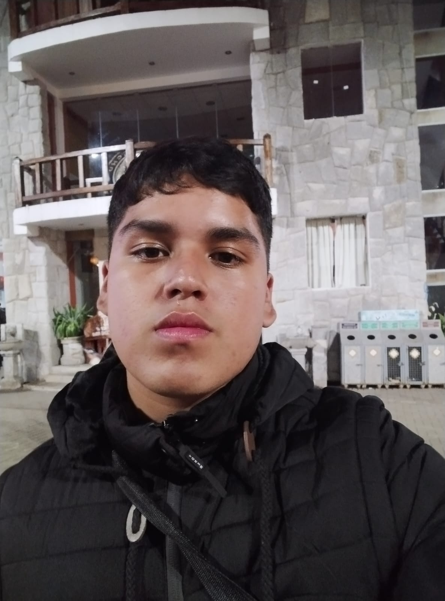 | **Nombres y Apellidos:** Matias Rodolfo Salcedo Champi <br> **Código:** U202319698 <br> **Carrera:** Ingeniería de Software <br> Soy una persona orientada a la construcción de producto, con experiencia en el desarrollo de aplicaciones móviles y web y participación previa en proyectos de investigación y desarrollo. Cuento con conocimientos en Flutter, Dart, Node.js, Express.js, MongoDB, PostgreSQL, Git y GitHub, lo que me permite aportar tanto en la capa móvil como en los servicios que la soportan. Me motiva llevar una idea desde el prototipo hasta una versión funcional y desplegada. |
|  | **Nombres y Apellidos:** Santiago Armando Baldeon Armas<br> **Código:** U202319881 <br> **Carrera:** Ingeniería de Software <br> Mi nombre es Santiago Armando Baldeon y tengo 20 años. Actualmente estoy cursando la carrera de Ingeniería de Software en la Universidad Peruana de Ciencias Aplicadas. En mi caso elegí esta carrera porque desde chico sentí gran pasión por la tecnología y siempre quise ser alguien importante en este mundo, brindando mis aportes a la humanidad. Creo que voy por buen camino y espero en un futuro cumplir estos sueños y objetivos que tengo. |
|  | **Nombres y Apellidos:** Javier Masaru Nikaido Vargas <br> **Código:** U20221G099 <br> **Carrera:** Ingeniería de Software <br> Soy estudiante del octavo ciclo de Ingeniería de Software y contribuyo al equipo en el desarrollo estructural de la solución y en la validación funcional de lo implementado. Me enfoco en verificar que lo construido responda efectivamente a los requisitos definidos y en detectar inconsistencias antes de que lleguen a la entrega. Me motiva el trabajo metódico y la mejora continua del producto. |
|  | **Nombres y Apellidos:** Angela Milagros Espinoza Cruz <br> **Código:** U202415495 <br> **Carrera:** Ingeniería de Software <br> Soy una persona curiosa, creativa y resiliente, cualidades que me impulsan a aportar innovación en cada uno de mis trabajos. Cuento con conocimientos en Python, Figma y C++, además de experiencia en el diseño y desarrollo de páginas web. Me motiva el aprendizaje constante, la exploración de nuevas herramientas y la creación de soluciones innovadoras aplicadas a problemas existentes. Asimismo, considero que la proactividad y la comunicación asertiva son fundamentales para llevar a cabo los proyectos de manera efectiva. |
|   | **Nombres y Apellidos:** Percy Alonso Muñiz Huayanca <br> **Código:** U202319563 <br> **Carrera:** Ingeniería de Software <br> Soy Alonso, estudiante de Ingeniería de Software de la Universidad Peruana de Ciencias Aplicadas, actualmente en octavo ciclo. Me interesa especialmente el desarrollo backend y fullstack, y en los últimos ciclos he ido inclinándome también hacia el área de Inteligencia Artificial y Data Science, sin dejar de lado buenas prácticas de ciberseguridad. Me gusta trabajar apoyándome en herramientas de IA para programar de forma más eficiente, dividiendo el trabajo en tareas claras para cumplir con los plazos sin perder calidad. Como líder de equipo, procuro mantener una comunicación constante con mis compañeros y asegurarme de que cada entregable avance de forma ordenada, coordinando responsabilidades según las fortalezas de cada uno.|


### 1.2. Solution Profile

#### 1.2.1. Antecedentes y problemática

Aplicamos la técnica de las 5W y 2H para examinar los antecedentes y la problemática que aborda nuestro proyecto.

| 5W / 2H | Pregunta | Descripción |
| --- | --- | --- |
| **Who?** | ¿Quién es afectado? | Los más afectados son los cuidadores formales e informales y los pacientes geriátricos que dependen de una rutina de atención constante. Ambos segmentos viven de forma directa las consecuencias de una mala coordinación, ya sea por sobrecarga en el cuidado o por falta de seguimiento oportuno. |
| **What?** | ¿Cuál es el problema? | No existe una plataforma que centralice de forma práctica los tratamientos, rutinas, recordatorios, documentos clínicos e historial de evolución de un paciente geriátrico. Esa ausencia hace que coordinarse entre varios cuidadores sea difícil y que el propio paciente tenga poca visibilidad de su proceso de cuidado. |
| **Where?** | ¿Dónde sucede el problema? | El problema ocurre principalmente en entornos de cuidado domiciliario, comunitario y de atención particular en el Perú, aunque la situación es comparable en otros países de Latinoamérica, donde gran parte del cuidado geriátrico también recae en las familias y cuidadores externos. |
| **When?** | ¿Cuándo sucede el problema? | No es algo que ocurra de vez en cuando. Se presenta todos los días: al coordinar la medicación, al hacer el cambio de turno entre cuidadores, al buscar el historial clínico o al intentar registrar si el paciente mejoró o empeoró. |
| **Why?** | ¿Cuál es la causa del problema? | El cuidado geriátrico involucra a varios actores, entre ellos el paciente, los familiares, enfermeros, médicos y cuidadores contratados, pero no hay herramientas móviles accesibles que conecten esa información y la mantengan actualizada, en línea con lo señalado sobre la necesidad de nuevos modelos de cuidado integrados que combinen tecnología y soporte comunitario (Beard et al., 2016). El resultado es que muchas decisiones se toman con datos incompletos o tardíos, lo que incrementa el riesgo para el paciente. |
| **How?** | ¿Cómo se manifiesta el problema? | Se traduce en situaciones concretas: medicamentos olvidados o duplicados, citas médicas mal registradas, signos de alerta que no se comunican a tiempo, documentos clínicos dispersos y una dependencia excesiva de llamadas o mensajes informales para coordinar el cuidado. |
| **How much?** | ¿Cuál es la magnitud del problema? | La magnitud es significativa y creciente. El 13,9 % de la población peruana tiene 60 años o más y se proyecta que supere el 22 % hacia 2050, lo que amplía de forma sostenida la base de personas que requieren seguimiento continuo (INEI, 2024). Sobre esa base, cerca del 50 % de los pacientes crónicos no adhiere correctamente a su tratamiento por olvidos y desorganización, con el consiguiente aumento de complicaciones y reingresos hospitalarios (OMS, 2025). En el plano cotidiano, el impacto se refleja en tiempo perdido, errores evitables en la administración del cuidado, mayor carga física y emocional para los cuidadores y un seguimiento menos seguro para los pacientes. Cuando no existe una herramienta común de coordinación, aumentan los costos asociados a consultas repetidas, omisiones en tratamientos y desorganización en la atención diaria. |

**Restricciones del proyecto**

- El alcance se limita a una aplicación móvil nativa y multiplataforma acompañada de los servicios necesarios para su funcionamiento. No contempla integración con historias clínicas electrónicas de instituciones de salud.
- La solución está dirigida a entornos de cuidado domiciliario, comunitario y de atención particular en el Perú. No cubre la gestión operativa de clínicas u hospitales.
- El diseño debe ajustarse a dispositivos móviles de gama media, que son los de mayor uso entre los segmentos objetivo.
- Los usuarios de ambos segmentos presentan niveles heterogéneos de alfabetización digital, por lo que los flujos deben resolverse con un número mínimo de pasos y sin requerir formación técnica previa.
  
- El modelo de negocio previsto es freemium, lo que condiciona qué funcionalidades se ofrecen de forma gratuita y cuáles quedan reservadas al plan de pago.

#### 1.2.2. Lean UX Process

El proceso Lean UX permite articular la visión del modelo de negocio que será soportado por CareConnect, partiendo del problema identificado en la sección anterior. A continuación se desarrolla el Problem Statement que delimita el dominio y la brecha a abordar, los supuestos que el equipo asume sobre el negocio, los usuarios y las funcionalidades, las hipótesis que se derivan de dichos supuestos y, finalmente, el Lean UX Canvas que sintetiza todo el proceso.

##### 1.2.2.1. Lean UX Problem Statements

Se elabora un único Problem Statement para todo el proyecto, considerando ambos segmentos dentro del mismo enunciado.

**Problem Statement**

El estado actual del cuidado geriátrico domiciliario se sostiene sobre la coordinación cotidiana entre varias personas: familiares, cuidadores contratados y el propio paciente. Una vez que el profesional de salud establece el tratamiento, son los cuidadores quienes deben aplicarlo día a día, alternando turnos, administrando medicación, acompañando controles médicos y observando cambios en el estado del paciente. Este seguimiento ocurre fuera de cualquier institución de salud y sin supervisión directa del profesional que indicó el tratamiento.

La brecha que buscamos abordar frente a los productos y servicios utilizados actualmente se encuentra en la coordinación entre quienes cuidan a un mismo paciente. Durante la jornada, la información sobre lo que ya ocurrió depende de lo que cada cuidador recuerda y logra comunicar por medios que no fueron diseñados para preservarla: cuadernos de bitácora, alarmas del celular y grupos de mensajería. Esto genera tres consecuencias concretas, todas verificadas en nuestras entrevistas: el cuidador no puede confirmar si otra persona ya administró una dosis; el paciente, ante la duda de haberla tomado, prefiere omitirla; y el historial de evolución debe reconstruirse manualmente cada vez que el médico lo solicita. Las alternativas disponibles en el mercado resuelven el recordatorio individual de medicación o la coordinación familiar, pero ninguna integra ambas dimensiones en un mismo producto.

Nuestro producto, CareConnect, busca abordar esta brecha mediante una aplicación móvil que vincula digitalmente al paciente geriátrico con los cuidadores que él autoriza, centralizando la agenda de medicación y controles, las alertas, los documentos clínicos y el registro de evolución en un único lugar compartido. De este modo, cada participante sabe qué se hizo, qué queda pendiente y en qué estado se encuentra el paciente, manteniendo las decisiones clínicas exclusivamente bajo criterio del profesional de salud.

Nuestro enfoque inicial estará puesto en cuidadores informales de pacientes geriátricos, de 25 a 60 años, residentes en zonas urbanas y periurbanas de Lima, que actualmente coordinan el cuidado combinando cuadernos, alarmas y mensajería, y que comparten la responsabilidad del paciente con al menos otra persona. Este subconjunto concentra la fricción que el producto busca resolver y es el más accesible para validar la propuesta en las primeras iteraciones.

Sabremos que hemos tenido éxito cuando observemos que los cuidadores vinculados a un mismo paciente confirman de manera sostenida las actividades de cuidado dentro de la plataforma, que el relevo de turno se resuelve consultando la aplicación en lugar de reconstruir la información por mensajería, y que los pacientes geriátricos consultan o confirman por sí mismos al menos una actividad de su rutina diaria.

**Elementos del Problem Statement**

| Elemento | Contenido |
| :--- | :--- |
| **Domain** | Cuidado geriátrico domiciliario, comunitario y de atención particular, entendido como el seguimiento cotidiano de la medicación, los controles médicos, la documentación clínica y la evolución de un paciente adulto mayor fuera de una institución de salud. |
| **Customer segments** | Cuidadores formales e informales de pacientes geriátricos, responsables de la ejecución diaria del cuidado; y pacientes geriátricos con autonomía parcial o acompañada, que participan de su propia rutina de cuidado. |
| **Pain points** | Imposibilidad de confirmar si otro cuidador ya administró una dosis; pérdida de información durante el relevo de turno; omisión de dosis por parte del paciente ante la duda de haberla tomado; reconstrucción manual del historial de evolución cuando el médico lo solicita; dispersión de documentos clínicos entre medios físicos y digitales; y alta carga mental derivada de sostener toda la coordinación en la memoria. |
| **Gap** | No existe una plataforma que combine el seguimiento clínico de la medicación con la coordinación en tiempo real entre varias personas que cuidan a un mismo paciente. Las soluciones actuales resuelven una dimensión u otra, pero no ambas dentro de un mismo producto. |
| **Vision / Strategy** | Convertirse en la plataforma de referencia en Latinoamérica para la gestión del cuidado geriátrico compartido, ofreciendo continuidad real entre turnos al cuidador y una experiencia simple y legible al paciente, sin sustituir el criterio del profesional de salud. La estrategia de entrada es un modelo freemium que permite comenzar a usar la plataforma sin fricción y reserva al plan de pago las capacidades de coordinación avanzada. |
| **Initial segment** | Cuidadores informales de 25 a 60 años en zonas urbanas y periurbanas de Lima, que comparten la responsabilidad de un mismo paciente geriátrico con al menos otra persona y que hoy se coordinan mediante cuadernos, alarmas y mensajería. |

##### 1.2.2.2. Lean UX Assumptions

***Business Assumptions:***

a) Creemos que existe una oportunidad de negocio en ofrecer a cuidadores de pacientes geriátricos una herramienta digital enfocada en la coordinación entre varias personas que atienden a un mismo paciente, y no únicamente en el recordatorio individual de medicación.

b) Creemos que CareConnect puede diferenciarse de las soluciones actuales del mercado al integrar en un solo producto la coordinación entre cuidadores y el seguimiento clínico de la medicación, dimensiones que hoy las alternativas existentes resuelven por separado.

c) Creemos que los cuidadores adoptarán una herramienta digital si su configuración inicial es breve y no exige formación técnica previa.

d) Creemos que un modelo freemium permitirá reducir las barreras de acceso y llegar tanto a usuarios individuales como a instituciones de salud, capturando distintos perfiles de uso sin que el costo represente una limitación inicial.

e) Creemos que la descoordinación entre cuidadores genera costos concretos y evitables, tanto para las familias como para las instituciones de salud, que justifican la adopción de una solución como la nuestra.

f) Creemos que como equipo contamos con las capacidades técnicas y organizativas necesarias para desarrollar y validar una primera versión funcional de CareConnect dentro de los alcances y recursos disponibles para el proyecto.

---

***Business Outcome Assumptions:***

a) Creemos que CareConnect estará teniendo éxito si logra reducir los errores de medicación reportados por los usuarios, en particular las dosis duplicadas y las dosis omitidas.

b) Creemos que CareConnect estará teniendo éxito si mantiene una tasa de retención superior al 60 % al tercer mes de uso.

c) Creemos que CareConnect estará aportando valor si el tiempo promedio de transferencia de información entre cuidadores durante el cambio de turno se reduce respecto del proceso manual actual.

d) Creemos que CareConnect estará mostrando potencial de crecimiento si aumenta progresivamente la cantidad de pacientes con más de un cuidador vinculado activo en la plataforma.

e) Creemos que CareConnect estará consolidando su propuesta de valor si una proporción creciente de cuidadores utiliza la aplicación como fuente principal de consulta durante el relevo de turno, en lugar de la mensajería informal.

---

***User Assumptions:***

a) Creemos que uno de nuestros principales segmentos de usuario está conformado por cuidadores formales e informales de pacientes geriátricos, que asumen la responsabilidad operativa del cuidado diario en entornos domiciliarios o comunitarios.

b) Creemos que nuestro segundo segmento de usuario está conformado por pacientes geriátricos con autonomía parcial o acompañada, que requieren seguimiento frecuente de su medicación y actividades diarias.

c) Creemos que el cuidador utilizará CareConnect varias veces al día y en momentos breves, como parte de su jornada de cuidado, para confirmar actividades, registrar observaciones y consultar el estado del paciente.

d) Creemos que el paciente geriátrico utilizará CareConnect principalmente para consultar qué actividades tiene pendientes, confirmar que cumplió una indicación y comunicar cómo se siente.

e) Creemos que ambos segmentos interactuarán dentro de un mismo proceso de cuidado manteniendo funciones diferenciadas por rol, y que el paciente conservará la facultad de decidir qué información comparte y con qué cuidador.

f) Creemos que dentro del segmento de pacientes geriátricos conviven perfiles con niveles muy distintos de alfabetización digital, por lo que la interfaz debe dimensionarse para el perfil de menor manejo sin limitar al de mayor manejo.

---

***User Outcome and Benefit Assumptions:***

a) Creemos que el cuidador busca confirmar y consultar el estado del cuidado de forma rápida, con flujos que se resuelvan en pocos pasos y no añadan carga a una jornada ya saturada.

b) Creemos que el cuidador obtiene valor al saber con certeza qué actividades ya fueron realizadas por otro cuidador, sin necesidad de preguntar ni de esperar respuesta.

c) Creemos que el cuidador obtiene valor al disponer del historial de evolución y de los documentos clínicos organizados cuando el profesional de salud los solicita.

d) Creemos que el cuidador obtiene valor al reducir la carga mental asociada a recordar y comunicar cada detalle del cuidado a las demás personas involucradas.

e) Creemos que el paciente geriátrico busca conocer con claridad qué le corresponde hacer durante el día, sin depender de otra persona para cada consulta.

f) Creemos que el paciente geriátrico obtiene valor al poder confirmar que ya cumplió una indicación, eliminando la duda que hoy lo lleva a omitir dosis.

g) Creemos que ambos segmentos obtienen valor de una herramienta que apoye la organización del cuidado sin emitir diagnósticos ni sustituir el criterio del profesional de salud.

---

***Feature Assumptions:***

a) Creemos que ofrecer una agenda que integre la medicación y los controles programados del paciente permitirá a cuidadores y pacientes conocer con claridad qué actividades corresponden a cada momento del día.

b) Creemos que permitir la confirmación explícita de cada actividad de cuidado, visible para todos los cuidadores vinculados, eliminará la incertidumbre sobre si una dosis ya fue administrada.

c) Creemos que enviar alertas y recordatorios en tiempo real a todos los cuidadores vinculados, y no únicamente a uno designado, permitirá reaccionar oportunamente ante incumplimientos o situaciones críticas.

d) Creemos que disponer de una carpeta digital de documentos clínicos dentro de la aplicación evitará que recetas, resultados e informes queden dispersos entre medios físicos y digitales.

e) Creemos que ofrecer un diario de seguimiento con registro de evolución permitirá reconstruir con facilidad lo ocurrido durante el periodo previo a una consulta médica.

f) Creemos que permitir al paciente compartir su perfil con cuidadores autorizados, controlando qué información expone cada uno, hará posible la continuidad del cuidado entre turnos preservando su capacidad de decisión sobre su propia información.

##### 1.2.2.3. Lean UX Hypothesis Statements

Se elabora un Hypothesis Statement por cada Feature Assumption, siguiendo la plantilla: *We believe we will achieve [business outcome] if [these personas] attain [benefit/user outcome] with [feature or solution].*

**Hypothesis Statement 1**

Creemos que la reducción de los errores de medicación reportados por los usuarios se logrará si los cuidadores formales e informales y los pacientes geriátricos logran conocer con claridad qué actividades corresponden a cada momento del día, con una agenda que integre la medicación y los controles programados del paciente.

**Hypothesis Statement 2**

Creemos que la reducción del tiempo de transferencia de información durante el cambio de turno se logrará si los cuidadores vinculados a un mismo paciente logran saber con certeza qué actividades ya fueron realizadas por otro cuidador, con una función de confirmación explícita de cada actividad de cuidado visible para todos ellos.

**Hypothesis Statement 3**

Creemos que el uso recurrente de CareConnect durante la jornada de cuidado se logrará si los cuidadores formales e informales logran reaccionar oportunamente ante incumplimientos o situaciones críticas, con una función de alertas y recordatorios en tiempo real dirigida a todos los cuidadores vinculados al paciente.

**Hypothesis Statement 4**

Creemos que la incorporación recurrente de CareConnect en la rutina de cuidado se logrará si los cuidadores formales e informales logran disponer de los documentos clínicos organizados cuando el profesional de salud los solicita, con una carpeta digital de documentos integrada en la aplicación.

**Hypothesis Statement 5**

Creemos que la retención de los usuarios a lo largo del tratamiento se logrará si los cuidadores formales e informales logran reconstruir con facilidad lo ocurrido durante el periodo previo a una consulta médica, con un diario de seguimiento que registre la evolución del paciente.

**Hypothesis Statement 6**

Creemos que el crecimiento de la cantidad de pacientes con más de un cuidador vinculado activo se logrará si los pacientes geriátricos logran mantener la continuidad de su cuidado entre turnos conservando la decisión sobre su propia información, con una función de compartición de perfil que permita autorizar cuidadores y controlar qué información expone cada uno.

**Trazabilidad y criterios de validación**

| Hipótesis | Feature Assumption | Business Outcome asociado | Criterio de validación |
| :---: | :--- | :--- | :--- |
| **H1** | a) Agenda integrada de medicación y controles | Reducción de errores de medicación | Disminución de las dosis duplicadas y omitidas reportadas por los usuarios respecto de la línea base declarada al registrarse. |
| **H2** | b) Confirmación explícita de actividades | Reducción del tiempo de relevo de turno | El tiempo promedio de transferencia de información entre cuidadores al cambio de turno se reduce en 50 % respecto del proceso manual, según los registros de actividad de la aplicación. |
| **H3** | c) Alertas y recordatorios en tiempo real | Uso recurrente durante la jornada | El 70 % de los usuarios activos utiliza la función de alertas de medicación al menos una vez por día durante las primeras cuatro semanas. |
| **H4** | d) Carpeta digital de documentos clínicos | Incorporación en la rutina de cuidado | Una proporción creciente de cuidadores consulta o carga documentos en la aplicación durante el periodo previo a una consulta médica. |
| **H5** | e) Diario de seguimiento con evolución | Retención superior al 60 % al tercer mes | La tasa de retención al tercer mes supera el 60 % entre los usuarios que registraron al menos una entrada de diario durante el primer mes. |
| **H6** | f) Compartición de perfil con permisos | Crecimiento de pacientes con varios cuidadores | Aumento sostenido de la cantidad de pacientes con más de un cuidador vinculado activo, y configuración inicial del perfil completada en menos de 10 minutos por cuidadores que la realizan por primera vez. |

##### 1.2.2.4. Lean UX Canvas

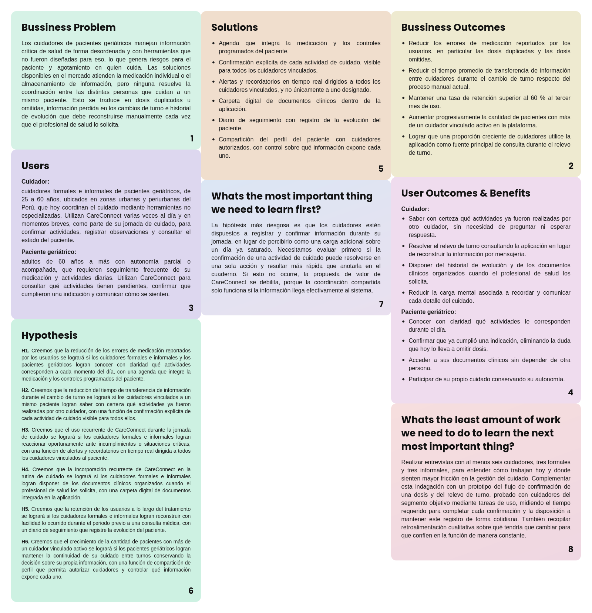

| # | Sección | Contenido |
| --- | --- | --- |
| **1** | **Problema de negocio** | Los cuidadores de pacientes geriátricos manejan información crítica de salud de forma desordenada y con herramientas que no fueron diseñadas para eso, lo que genera riesgos para el paciente y agotamiento en quien cuida. Las soluciones disponibles en el mercado atienden la medicación individual o el almacenamiento de información, pero ninguna resuelve la coordinación entre las distintas personas que cuidan a un mismo paciente. Esto se traduce en dosis duplicadas u omitidas, información perdida en los cambios de turno e historial de evolución que debe reconstruirse manualmente cada vez que el profesional de salud lo solicita. |
| **2** | **Resultados comerciales** | • Reducir los errores de medicación reportados por los usuarios, en particular las dosis duplicadas y las dosis omitidas.<br>• Reducir el tiempo promedio de transferencia de información entre cuidadores durante el cambio de turno respecto del proceso manual actual.<br>• Mantener una tasa de retención superior al 60 % al tercer mes de uso.<br>• Aumentar progresivamente la cantidad de pacientes con más de un cuidador vinculado activo en la plataforma.<br>• Lograr que una proporción creciente de cuidadores utilice la aplicación como fuente principal de consulta durante el relevo de turno. |
| **3** | **Usuarios y clientes** | **Cuidador:** cuidadores formales e informales de pacientes geriátricos, de 25 a 60 años, ubicados en zonas urbanas y periurbanas del Perú, que hoy coordinan el cuidado mediante herramientas no especializadas. Utilizan CareConnect varias veces al día y en momentos breves, como parte de su jornada de cuidado, para confirmar actividades, registrar observaciones y consultar el estado del paciente.<br><br>**Paciente geriátrico:** adultos de 60 años a más con autonomía parcial o acompañada, que requieren seguimiento frecuente de su medicación y actividades diarias. Utilizan CareConnect para consultar qué actividades tienen pendientes, confirmar que cumplieron una indicación y comunicar cómo se sienten. |
| **4** | **Beneficios para el usuario** | **Cuidador:**<br>• Saber con certeza qué actividades ya fueron realizadas por otro cuidador, sin necesidad de preguntar ni esperar respuesta.<br>• Resolver el relevo de turno consultando la aplicación en lugar de reconstruir la información por mensajería.<br>• Disponer del historial de evolución y de los documentos clínicos organizados cuando el profesional de salud los solicita.<br>• Reducir la carga mental asociada a recordar y comunicar cada detalle del cuidado.<br><br>**Paciente geriátrico:**<br>• Conocer con claridad qué actividades le corresponden durante el día.<br>• Confirmar que ya cumplió una indicación, eliminando la duda que hoy lo lleva a omitir dosis.<br>• Acceder a sus documentos clínicos sin depender de otra persona.<br>• Participar de su propio cuidado conservando su autonomía. |
| **5** | **Ideas de las soluciones** | • Agenda que integra la medicación y los controles programados del paciente.<br>• Confirmación explícita de cada actividad de cuidado, visible para todos los cuidadores vinculados.<br>• Alertas y recordatorios en tiempo real dirigidos a todos los cuidadores vinculados, y no únicamente a uno designado.<br>• Carpeta digital de documentos clínicos dentro de la aplicación.<br>• Diario de seguimiento con registro de la evolución del paciente.<br>• Compartición del perfil del paciente con cuidadores autorizados, con control sobre qué información expone cada uno. |
| **6** | **Hipótesis** | **H1.** Creemos que la reducción de los errores de medicación reportados por los usuarios se logrará si los cuidadores formales e informales y los pacientes geriátricos logran conocer con claridad qué actividades corresponden a cada momento del día, con una agenda que integre la medicación y los controles programados del paciente.<br><br>**H2.** Creemos que la reducción del tiempo de transferencia de información durante el cambio de turno se logrará si los cuidadores vinculados a un mismo paciente logran saber con certeza qué actividades ya fueron realizadas por otro cuidador, con una función de confirmación explícita de cada actividad de cuidado visible para todos ellos.<br><br>**H3.** Creemos que el uso recurrente de CareConnect durante la jornada de cuidado se logrará si los cuidadores formales e informales logran reaccionar oportunamente ante incumplimientos o situaciones críticas, con una función de alertas y recordatorios en tiempo real dirigida a todos los cuidadores vinculados al paciente.<br><br>**H4.** Creemos que la incorporación recurrente de CareConnect en la rutina de cuidado se logrará si los cuidadores formales e informales logran disponer de los documentos clínicos organizados cuando el profesional de salud los solicita, con una carpeta digital de documentos integrada en la aplicación.<br><br>**H5.** Creemos que la retención de los usuarios a lo largo del tratamiento se logrará si los cuidadores formales e informales logran reconstruir con facilidad lo ocurrido durante el periodo previo a una consulta médica, con un diario de seguimiento que registre la evolución del paciente.<br><br>**H6.** Creemos que el crecimiento de la cantidad de pacientes con más de un cuidador vinculado activo se logrará si los pacientes geriátricos logran mantener la continuidad de su cuidado entre turnos conservando la decisión sobre su propia información, con una función de compartición de perfil que permita autorizar cuidadores y controlar qué información expone cada uno. |
| **7** | **¿Qué es lo más importante que necesitamos evaluar primero?** | La hipótesis más riesgosa es que los cuidadores estén dispuestos a registrar y confirmar información durante su jornada, en lugar de percibirlo como una carga adicional sobre un día ya saturado. Necesitamos evaluar primero si la confirmación de una actividad de cuidado puede resolverse en una sola acción y resultar más rápida que anotarla en el cuaderno. Si esto no ocurre, la propuesta de valor de CareConnect se debilita, porque la coordinación compartida solo funciona si la información llega efectivamente al sistema. |
| **8** | **¿Cuál es la menor cantidad de trabajo que necesitamos hacer para resolver los supuestos?** | Realizar entrevistas con al menos seis cuidadores, tres formales y tres informales, para entender cómo trabajan hoy y dónde sienten mayor fricción en la gestión del cuidado. Complementar esta indagación con un prototipo del flujo de confirmación de una dosis y del relevo de turno, probado con cuidadores del segmento objetivo mediante tareas de uso, midiendo el tiempo requerido para completar cada confirmación y la disposición a mantener este registro de forma cotidiana. También recopilar retroalimentación cualitativa sobre qué tendría que cambiar para que confíen en la función de manera constante. |

### 1.3. Segmentos objetivo

CareConnect apunta a dos segmentos bien diferenciados, definidos a partir del análisis del problema y de las personas que lo viven de cerca.

### Segmento Objetivo 1: Cuidadores de pacientes geriátricos

Nuestro primer segmento objetivo incluye tanto a cuidadores formales, es decir enfermeros, técnicos de salud y asistentes geriátricos en atención domiciliaria o centros de cuidado, como a cuidadores informales, es decir familiares que asumen el rol principal en casa, muchas veces sin formación especializada pero con responsabilidad directa sobre la rutina del paciente.

**Aspectos demográficos:**

- Sexo: masculino y femenino, con presencia mayoritaria de mujeres en labores de cuidado.
- Edades: 25 a 60 años.
- Nivel socioeconómico: sectores B, C y D.
- Nivel educativo: variable, desde secundaria completa hasta educación superior técnica o universitaria en el caso de cuidadores formales.
- Ocupación: cuidador o cuidadora formal con experiencia en atención geriátrica, o cuidador o cuidadora informal responsable del acompañamiento diario.

**Aspectos geográficos:**

- Nacionalidad: peruana.
- Zona geográfica: urbana y periurbana, donde existe mayor acceso a smartphones y servicios de atención domiciliaria.

**Aspectos psicográficos:**

- Valores: responsabilidad, continuidad del cuidado, seguridad del paciente.
- Estilos de vida: usan el celular con frecuencia para organizar su vida diaria y acceden principalmente desde dispositivos móviles de gama media. Viven bajo presión constante, porque deben controlar medicación, citas, cambios de estado y comunicación con otros actores del cuidado.
- Intereses: organización del tiempo, seguimiento del estado del paciente, comunicación con familiares y personal de salud.
- Personalidad: dispuestos a incorporar aplicaciones que realmente les faciliten el trabajo, pero exigentes con la simplicidad. Si una herramienta les toma demasiado tiempo o esfuerzo, dejan de usarla.
- Frustraciones: perder información en los cambios de turno, no poder confirmar si otra persona ya administró una dosis y depender de múltiples herramientas no integradas.

**Datos estadísticos de sustento:**

Se trata de un segmento en crecimiento debido al aumento sostenido de la población adulta mayor. El 13,9 % de la población peruana tiene 60 años o más y se proyecta que esa proporción supere el 22 % hacia 2050, lo que amplía de forma directa la base de personas que requieren un cuidador (INEI, 2024). La relevancia del segmento también se explica por la carga que asume: cerca del 50 % de los pacientes crónicos no adhiere correctamente a su tratamiento por olvidos y desorganización, situación que recae sobre quien acompaña la rutina diaria (OMS, 2025).

### Segmento Objetivo 2: Pacientes geriátricos

Nuestro segundo segmento objetivo son adultos mayores que requieren seguimiento frecuente de su estado de salud, medicación y actividades diarias. Algunos conservan autonomía parcial y pueden interactuar por sí mismos con la aplicación, mientras que otros necesitan apoyo de un cuidador, pero igualmente se benefician de una herramienta que haga visible su rutina y su progreso.

**Aspectos demográficos:**

- Sexo: masculino y femenino, sin predominancia específica.
- Edades: 60 años a más.
- Nivel socioeconómico: sectores B, C y D.
- Nivel educativo: variable, desde educación básica hasta educación superior.
- Condición de uso: pacientes con autonomía parcial o acompañada que necesitan recordatorios, seguimiento y visualización simple de su cuidado.

**Aspectos geográficos:**

- Nacionalidad: peruana.
- Zona geográfica: urbana y periurbana, donde el acceso a smartphones o al apoyo digital es más viable.

**Aspectos psicográficos:**

- Valores: autonomía, tranquilidad, no representar una carga para la familia.
- Estilos de vida: uso básico del celular, orientado a llamadas, mensajería y alarmas simples.
- Intereses: mantener su salud bajo control y conservar la mayor independencia posible en su rutina.
- Personalidad: valoran especialmente la claridad, la legibilidad y la simplicidad. Se incomodan con navegación compleja o formularios extensos.
- Frustraciones: dudar si ya tomaron una dosis, no encontrar sus documentos clínicos y depender de otra persona para resolver asuntos cotidianos de su cuidado.

**Datos estadísticos de sustento:**

La relevancia de este segmento está directamente asociada al envejecimiento de la población peruana, donde el 13,9 % ya tiene 60 años o más con proyección superior al 22 % hacia 2050 (INEI, 2024). A ello se suma la necesidad de promover mayor adherencia a los tratamientos: el 50 % de los pacientes crónicos no cumple correctamente sus indicaciones, principalmente por olvidos y falta de soporte continuo, lo que incrementa complicaciones y reingresos hospitalarios (OMS, 2025). Es un segmento que requiere soluciones digitales con barreras de uso mínimas y utilidad inmediata.

## Capítulo II: Requirements Elicitation & Analysis

### 2.1. Competidores

El mercado de aplicaciones móviles orientadas a la salud personal presenta una oferta consolidada a nivel global, con actores que abordan el seguimiento del tratamiento desde distintos ángulos: recordatorios de medicación, monitoreo de hábitos o almacenamiento de información médica familiar. Sin embargo, ninguno de los productos existentes resuelve la coordinación entre varios cuidadores que atienden a un mismo paciente geriátrico, que es precisamente el espacio que **CareConnect** busca ocupar. Tras el proceso de investigación del landscape competitivo, identificamos tres competidores cuyas propuestas de valor se solapan parcialmente con la nuestra.

**Medisafe** es una aplicación enfocada en recordatorios de medicación para pacientes individuales. Su propuesta central es la alta especialización en el control de la toma de medicamentos, con un modelo freemium y distribución exclusivamente móvil.

**MyTherapy** es una aplicación orientada al seguimiento de salud, hábitos y tratamientos médicos. Su diferencial es una interfaz simple y el monitoreo continuo del estado de salud, dirigido principalmente a personas con enfermedades crónicas. Opera bajo modelo freemium y canal móvil.

**Caring Village** es una plataforma orientada a la coordinación y comunicación entre familiares y cuidadores que atienden a un mismo paciente. Su diferencial es facilitar la organización de tareas, actualizaciones y comunicación entre los miembros de la red de cuidado. Opera bajo un modelo freemium y cuenta con presencia web y móvil.

#### 2.1.1. Análisis competitivo

<table>
  <tr>
    <td colspan="6" align="center"><b>Competitive analysis landscape</b></td>
  </tr>
  <tr>
    <td colspan="2"><b>¿Por qué llevar a cabo este análisis?</b></td>
    <td colspan="4">¿Qué ofrecen los principales competidores del mercado de gestión de medicación y coordinación del cuidado, y en qué aspectos CareConnect puede diferenciarse para capturar a cuidadores y pacientes geriátricos en el mercado peruano y latinoamericano?</td>
  </tr>
  <tr>
    <td colspan="2"><i>Nombre y Logo</i></td>
    <td align="center">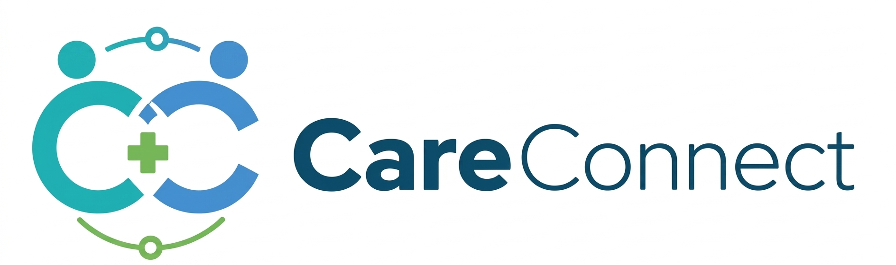<br><b>CareConnect</b></td>
    <td align="center"><br><b>Medisafe</b></td>
    <td align="center"><br><b>MyTherapy</b></td>
    <td align="center"><br><b>Caring Village</b></td>
  </tr>
  <tr>
    <td rowspan="2" align="center"><b>Perfil</b></td>
    <td><b>Overview</b></td>
    <td>Aplicación móvil nativa y multiplataforma en etapa de desarrollo, orientada al cuidado colaborativo de pacientes geriátricos. Integra calendario de medicación y terapias programadas, alertas y recordatorios en tiempo real, carpeta digital de documentos clínicos, historial de notas y registro de evolución, y compartición de perfiles entre cuidadores, dirigida a cuidadores de 25 a 60 años y pacientes geriátricos de 60 años a más en el Perú.</td>
    <td>Aplicación de recordatorios de medicación con más de una década en el mercado, disponible para iOS y Android. Cuenta con más de 101 000 calificaciones en App Store con un promedio de 4.7 estrellas, y su función Medfriends permite notificar a un familiar o cuidador cuando el usuario omite una dosis.</td>
    <td>Aplicación desarrollada por smartpatient GmbH, disponible para iOS y Android en múltiples idiomas, con una calificación de 4.8 en Google Play. Combina recordatorios de medicación con seguimiento de peso, presión arterial, oxígeno en sangre y glucosa, además de un diario de síntomas y estado de ánimo.</td>
    <td>Aplicación de coordinación familiar del cuidado organizada en torno al concepto de Village, donde el usuario principal invita a familiares, amigos y cuidadores profesionales a colaborar en el cuidado de una misma persona. Incluye asistente con inteligencia artificial llamado Julia, calendario compartido sincronizable con Google Calendar, Apple Calendar y Outlook, almacenamiento de documentos y mensajería segura, con una calificación de 4.6 sobre 5 en App Store.</td>
  </tr>
  <tr>
    <td><b>Ventaja competitiva</b><br><i>¿Qué valor ofrece a los clientes?</i></td>
    <td>Permite que varios cuidadores compartan en tiempo real el estado y la evolución de un mismo paciente geriátrico dentro de una sola aplicación, cubriendo la coordinación de turnos que ninguno de los tres competidores investigados ofrece de forma nativa.</td>
    <td>Ofrece seguridad en la administración de medicamentos mediante su verificador de interacciones entre fármacos y la alerta Medfriends, aunque ese aviso llega a una sola persona designada y no sostiene una coordinación continua entre varios cuidadores a la vez.</td>
    <td>Da al propio paciente una visión clara y exportable de su tratamiento y de sus signos vitales a lo largo del tiempo mediante su reporte mensual, pensado para que lo revise el usuario y su médico, y no para que lo compartan varios cuidadores en simultáneo.</td>
    <td>Ofrece a la familia un espacio único de coordinación con calendario, documentos y mensajería compartidos entre todos los miembros de un mismo Village, apoyado en el asistente Julia, aunque su plan gratuito limita ese círculo a solo 2 miembros y no incluye recordatorios de medicación.</td>
  </tr>
  <tr>
    <td rowspan="2" align="center"><b>Perfil de Marketing</b></td>
    <td><b>Mercado Objetivo</b></td>
    <td>Cuidadores formales e informales de 25 a 60 años y pacientes geriátricos de 60 años a más, en zonas urbanas y periurbanas del Perú que hoy coordinan el cuidado mediante herramientas no especializadas.</td>
    <td>Personas que gestionan tratamientos médicos individuales, incluidos pacientes con enfermedades crónicas que toman varios medicamentos a la vez, con fuerte presencia en Estados Unidos y otros mercados donde ya opera su plan de pago.</td>
    <td>Personas con tratamientos médicos y enfermedades crónicas que buscan registrar su medicación y sus signos vitales de forma autónoma, con alcance en múltiples países gracias a su disponibilidad en distintos idiomas.</td>
    <td>Familias que coordinan el cuidado de un adulto mayor o de un familiar con una condición de salud, incluidos cuidadores principales, familiares a distancia, amigos y cuidadores profesionales invitados a un mismo Village.</td>
  </tr>
  <tr>
    <td><b>Estrategias de Marketing</b></td>
    <td>Aún no ha desplegado campañas de marketing por encontrarse en etapa de desarrollo como proyecto universitario, aunque contempla campañas en redes sociales y alianzas con centros de salud según lo definido en la sección de estrategias frente a competidores.</td>
    <td>Sostiene su visibilidad principalmente en las tiendas de aplicaciones, apoyada en más de una década de trayectoria y en una calificación promedio de 4.7 sobre 5 en más de 101 000 reseñas de usuarios.</td>
    <td>Se posiciona como una aplicación reconocida para el manejo de medicación, apoyada en una calificación de 4.8 en Google Play y en su disponibilidad en múltiples idiomas para llegar a audiencias de distintos países.</td>
    <td>Construye su reputación mediante testimonios reales de familias publicados en su propio sitio y en las tiendas de aplicaciones, sostenida en una calificación de 4.6 sobre 5 en App Store y en contenido de blog orientado a distintos perfiles de cuidadores, como familias con hijos y padres mayores a la vez.</td>
  </tr>
  <tr>
    <td rowspan="3" align="center"><b>Perfil de Producto</b></td>
    <td><b>Productos &amp; Servicios</b></td>
    <td>Calendario de medicación y terapias programadas, alertas y recordatorios en tiempo real, carpeta digital de documentos clínicos, historial de notas y registro de evolución del paciente, y compartición de perfiles entre cuidadores.</td>
    <td>Recordatorios de medicación, verificador de interacciones entre fármacos, alertas de reposición, función Medfriends para notificar a un cuidador ante una dosis omitida, y sincronización con Apple HealthKit.</td>
    <td>Recordatorios de medicación y de reposición de recetas, registro de peso, presión arterial, oxígeno en sangre y glucosa, diario de síntomas y estado de ánimo, seguimiento de rachas de cumplimiento y reporte mensual de salud exportable.</td>
    <td>Calendario compartido sincronizable con Google Calendar, Apple Calendar y Outlook, listas de tareas, almacenamiento de documentos, mensajería segura, planes de cuidado personalizables y exportación de un diario de bienestar, todo organizado en torno a un Village por persona cuidada, con el asistente de inteligencia artificial Julia como soporte adicional.</td>
  </tr>
  <tr>
    <td><b>Precios &amp; Costos</b></td>
    <td>Modelo de suscripción con dos planes: Plan Mensual a 15 dólares al mes y Plan Anual a 150 dólares al año (equivale a 12.50 dólares al mes, un ahorro aproximado del 17 %), con acceso compartido para múltiples cuidadores.</td>
    <td>Desde enero de 2026 el nivel gratuito (0 dólares) quedó limitado a 2 medicamentos, y el acceso completo requiere una suscripción de aproximadamente 4.99 dólares al mes o 39.99 dólares al año (cerca de 3.33 dólares al mes).</td>
    <td>Actualmente se distribuye para iOS y Android sin cobro directo, sostenida mediante publicidad dentro de la aplicación. Para efectos comparativos, se estima un costo referencial simulado de aproximadamente 3 dólares al mes (cerca de 36 dólares al año) por un servicio equivalente de seguimiento de medicación y signos vitales, cifra alineada con la suscripción de Medisafe, su competidor más cercano en funcionalidad.</td>
    <td>Ofrece un plan gratuito limitado a un Village de hasta 2 miembros, un plan Circle de 14.99 dólares al mes con hasta 2 Villages de 5 miembros cada uno, y un plan Village de 24.99 dólares al mes con hasta 5 Villages de 50 miembros cada uno, con descuento del 17 % en facturación anual (aproximadamente 12.45 y 20.75 dólares al mes, respectivamente, al pagar por año).</td>
  </tr>
  <tr>
    <td><b>Canales de distribución</b><br><i>(Web y/o Móvil)</i></td>
    <td>Móvil. Aplicación nativa multiplataforma para iOS y Android, sin versión web contemplada en el alcance actual.</td>
    <td>Móvil. Disponible en App Store y Google Play, sin versión web.</td>
    <td>Móvil. Disponible en App Store y Google Play, sin versión web.</td>
    <td>Web y móvil. Disponible en App Store y Google Play, con un portal web propio para la gestión de la cuenta y la suscripción.</td>
  </tr>
  <tr>
    <td rowspan="5" align="center"><b>Análisis SWOT</b></td>
    <td colspan="5"><i>Realice esto para su startup y sus competidores. Sus fortalezas deberían apoyar sus oportunidades y contribuir a lo que ustedes definen como su posible ventaja competitiva.</i></td>
  </tr>
  <tr>
    <td><b>Fortalezas</b></td>
    <td>Coordinación en tiempo real entre múltiples cuidadores dentro de una sola plataforma. Al comparar esta fortaleza con la competencia, se observa que Medisafe solo notifica a un cuidador designado mediante Medfriends, que MyTherapy concentra el seguimiento en el propio paciente sin compartirlo activamente, y que Caring Village sí coordina a varios miembros de la familia pero sin integrar el seguimiento clínico de medicación como parte central de su producto, por lo que CareConnect es el único que combina ambas dimensiones.</td>
    <td>Verificador de interacciones entre medicamentos y alerta Medfriends, respaldados por más de una década de trayectoria y una calificación de 4.7 sobre más de 101 000 reseñas. Al comparar esta fortaleza con la competencia, se observa que ese nivel de validación y confianza de usuarios supera al de CareConnect, que aún no cuenta con historial de uso real.</td>
    <td>Seguimiento integral de signos vitales junto con la medicación, con reporte mensual exportable y calificación de 4.8 en Google Play. Al comparar esta fortaleza con la competencia, se observa que ese nivel de detalle clínico individual es mayor al que ofrece hoy CareConnect, aunque no incluye coordinación entre distintos cuidadores.</td>
    <td>Coordinación familiar organizada por Villages, con asistente de inteligencia artificial Julia, calendario sincronizable con Google, Apple y Outlook, y una calificación de 4.6 sobre 5 en App Store. Al comparar esta fortaleza con la competencia, se observa que su enfoque en coordinación familiar es el más cercano al de CareConnect, aunque no incluye recordatorios ni verificación de medicación como parte de su producto principal.</td>
  </tr>
  <tr>
    <td><b>Debilidades</b></td>
    <td>Al ser un proyecto en etapa de desarrollo, no cuenta aún con usuarios activos, calificaciones ni validación de mercado. Al comparar esta debilidad con la competencia, se observa que Medisafe, MyTherapy y Caring Village ya tienen miles de reseñas y presencia consolidada, lo que exige a CareConnect construir confianza desde cero.</td>
    <td>Desde 2026 su nivel gratuito quedó limitado a solo 2 medicamentos, lo que la vuelve poco viable para pacientes geriátricos con regímenes de tratamiento más complejos. Al comparar esta debilidad con la competencia, se observa que esa restricción abre una oportunidad concreta para el modelo freemium de CareConnect, pensado para regímenes de cuidado más amplios.</td>
    <td>No ofrece verificador de interacciones entre medicamentos ni mecanismos de coordinación entre múltiples cuidadores. Al comparar esta debilidad con la competencia, se observa que ambas funciones sí forman parte del alcance de Medisafe y de CareConnect respectivamente, lo que deja a MyTherapy enfocada únicamente en el autoseguimiento individual.</td>
    <td>Su plan gratuito limita el Village a solo 2 miembros y no incluye recordatorios de medicación, que quedan fuera incluso de sus planes pagos según su propia página de precios. Al comparar esta debilidad con la competencia, se observa que Caring Village resuelve la coordinación familiar pero no el seguimiento clínico de medicamentos, brecha que sí cubre CareConnect dentro de una sola aplicación.</td>
  </tr>
  <tr>
    <td><b>Oportunidades</b></td>
    <td>La fragmentación entre soluciones de coordinación familiar como Caring Village y soluciones de medicación como Medisafe deja sin cubrir a los usuarios que buscan ambas funciones en una sola aplicación. Al comparar esta oportunidad con la competencia, se observa que ninguno de los tres competidores investigados ofrece hoy esa combinación, lo que deja a CareConnect en posición de capturar primero ese espacio en Latinoamérica.</td>
    <td>Podría extender su función Medfriends para notificar a varios cuidadores a la vez en lugar de a uno solo. Al comparar esta oportunidad con la competencia, se observa que si lo hiciera se acercaría directamente a la propuesta de coordinación que hoy diferencia a CareConnect.</td>
    <td>Podría integrar alertas dirigidas a un cuidador externo a partir de los datos que ya recopila del paciente. Al comparar esta oportunidad con la competencia, se observa que esa integración la acercaría a un modelo más colaborativo similar al de CareConnect.</td>
    <td>Podría incorporar recordatorios y verificación de medicación dentro de sus planes Circle o Village. Al comparar esta oportunidad con la competencia, se observa que si lo hiciera competiría de forma directa con CareConnect en el eje que hoy nos diferencia, la integración de coordinación familiar y seguimiento clínico en un solo producto.</td>
  </tr>
  <tr>
    <td><b>Amenazas</b></td>
    <td>Medisafe, MyTherapy y Caring Village ya cuentan con miles de usuarios y calificaciones consolidadas en las tiendas de aplicaciones. Al comparar esta amenaza con la competencia, se observa que CareConnect debe superar esa barrera de confianza inicial además de la baja alfabetización digital de parte de su segmento de pacientes geriátricos.</td>
    <td>El endurecimiento de su modelo de pago en 2026 generó una ola de usuarios buscando alternativas gratuitas, lo que puede favorecer tanto a aplicaciones gratuitas como MyTherapy como a nuevas propuestas como CareConnect. Al comparar esta amenaza con la competencia, se observa que Medisafe corre el riesgo de perder usuarios frente a alternativas mejor valoradas en precio.</td>
    <td>La saturación del mercado de aplicaciones de seguimiento de salud gratuitas, incluidas alternativas que surgieron tras el cambio de modelo de Medisafe. Al comparar esta amenaza con la competencia, se observa que MyTherapy compite por el mismo usuario individual que buscan captar varias aplicaciones similares, mientras que CareConnect se diferencia al dirigirse a la coordinación entre cuidadores.</td>
    <td>Su plan gratuito limitado a 2 miembros puede empujar a familias con más de un cuidador hacia alternativas que resuelvan coordinación y medicación en un solo pago. Al comparar esta amenaza con la competencia, se observa que CareConnect puede capturar a esas familias si su propio modelo freemium ofrece un umbral gratuito más amplio que el de Caring Village.</td>
  </tr>
</table>

#### 2.1.2. Estrategias y tácticas frente a competidores

A partir del análisis competitivo realizado en la sección anterior, se identificaron diversas oportunidades y debilidades en los competidores actuales, Medisafe, MyTherapy y Caring Village. En base a estos hallazgos, se plantean las siguientes estrategias y tácticas para afrontar las fortalezas de la competencia y aprovechar sus debilidades, posicionando a CareConnect como una solución diferenciada en el mercado.

**1. Diferenciación mediante coordinación en tiempo real con seguimiento clínico integrado**

Se identificó que Medisafe notifica únicamente a un cuidador designado a través de su función Medfriends, que MyTherapy concentra el seguimiento en el propio paciente sin coordinación activa entre terceros, y que Caring Village coordina bien a la familia mediante calendarios y mensajería compartida pero no incluye recordatorios ni verificación de medicación dentro de su producto.

*Estrategia:* implementar un sistema de coordinación en tiempo real entre cuidadores y familiares que integre, en la misma aplicación, el seguimiento de la medicación que Caring Village no ofrece.

*Tácticas:*
- Sistema de notificaciones en tiempo real sobre medicación y eventos, enviado a todos los cuidadores vinculados y no solo a uno.
- Confirmación de actividades realizadas, por ejemplo la medicación administrada.
- Alertas automáticas en caso de incumplimiento o eventos críticos.

**2. Plataforma integral de cuidado**

Los competidores actuales ofrecen soluciones parciales: Medisafe se enfoca en medicación con verificación de interacciones, MyTherapy en seguimiento de salud y signos vitales del propio paciente, y Caring Village en coordinación familiar mediante calendarios, documentos y mensajería, sin que ninguno integre las tres dimensiones a la vez.

*Estrategia:* ofrecer una plataforma integral que centralice todos los aspectos del cuidado en una sola aplicación.

*Tácticas:*
- Integración de calendario de medicación y terapias.
- Registro de historial clínico y evolución del paciente.
- Almacenamiento de documentos médicos en una carpeta digital.
- Unificación de todas las funcionalidades en una sola interfaz.

**3. Enfoque en el cuidado colaborativo accesible**

Caring Village resuelve bien la coordinación entre varios miembros de la familia, pero limita su plan gratuito a un solo Village de hasta 2 miembros, y sus planes de pago parten en 14.99 dólares al mes, una barrera de adopción para familias con más cuidadores o con menor capacidad de pago.

*Estrategia:* permitir la gestión colaborativa del cuidado mediante perfiles compartidos, con un umbral gratuito más amplio que el de Caring Village para familias con varios cuidadores.

*Tácticas:*
- Sistema de usuarios múltiples vinculados a un mismo paciente.
- Acceso compartido a historial, eventos y registros.
- Control de permisos según tipo de usuario, cuidador o familiar.

**4. Mejora de la experiencia del usuario**

Se observó que Medisafe restringió su nivel gratuito a solo 2 medicamentos desde 2026, lo que la vuelve poco viable para regímenes de cuidado geriátrico más complejos, y que varias soluciones no están diseñadas para contextos de uso bajo presión ni para usuarios con bajo conocimiento tecnológico.

*Estrategia:* desarrollar una interfaz intuitiva, rápida y centrada en el usuario, con un nivel gratuito que cubra realmente las necesidades de un paciente geriátrico con múltiples medicamentos.

*Tácticas:*
- Diseño mobile first enfocado en dispositivos Android de gama media.
- Navegación simple con flujos cortos.
- Interfaces claras para tareas críticas como registro, consulta y alertas.
- Pruebas de usabilidad con cuidadores reales.

**5. Enfoque en un nicho específico**

Ninguno de los tres competidores está especializado en el cuidado de pacientes geriátricos: Medisafe y MyTherapy se dirigen al paciente individual sin distinción etaria, y Caring Village se dirige a la coordinación familiar en general, sin distinguir entre tipos de condición de salud ni especializarse en el cuidado geriátrico.

*Estrategia:* posicionar a CareConnect como una solución especializada en el cuidado geriátrico compartido entre varios cuidadores.

*Tácticas:*
- Adaptación de funcionalidades a rutinas complejas de cuidado con múltiples actores.
- Diseño accesible y comprensible para pacientes de 60 años a más.
- Comunicación centrada en el bienestar del paciente y en el apoyo al cuidador.

**6. Estrategia de crecimiento y adopción**

Se identificó que Medisafe, MyTherapy y Caring Village tienen alcance internacional pero no están enfocados específicamente en Latinoamérica, y que los planes pagos de Caring Village, desde 14.99 dólares al mes, resultan menos accesibles para el poder adquisitivo de familias en la región.

*Estrategia:* expandir la plataforma mediante estrategias digitales y alianzas estratégicas, capturando primero el mercado peruano y latinoamericano con precios adaptados a la región.

*Tácticas:*
- Campañas en redes sociales dirigidas a cuidadores y familias.
- Alianzas con centros de salud y organizaciones de apoyo.
- Modelo freemium para facilitar la adopción inicial, con un nivel gratuito más amplio que el de Medisafe y de Caring Village.
- Programas de recomendación entre usuarios.

**7. Mejora continua basada en datos**

Los competidores presentan limitaciones distintas en personalización y evolución del producto: Medisafe endureció su modelo de pago en 2026, MyTherapy no ofrece coordinación entre cuidadores, y Caring Village no integra el seguimiento de medicación dentro de su propuesta principal.

*Estrategia:* implementar un modelo de mejora continua basado en datos y en el feedback de los usuarios, cerrando de forma iterativa las brechas que dejan los tres competidores.

*Tácticas:*
- Recolección de métricas de uso dentro de la aplicación.
- Análisis del comportamiento del usuario.
- Iteraciones frecuentes del producto.
- Incorporación de feedback directo de cuidadores y familiares.
  
### 2.2. Entrevistas

Esta sección presenta el diseño, el registro y el análisis de las entrevistas realizadas a los segmentos objetivo, con el fin de comprender sus necesidades, sus problemas actuales y las oportunidades de mejora en la gestión del cuidado geriátrico.

#### 2.2.1. Diseño de entrevistas

Diseñamos entrevistas semiestructuradas con preguntas diferenciadas según cada segmento objetivo, organizadas en bloques temáticos que permiten recopilar información sobre el perfil del usuario, sus hábitos actuales y la validación de las funcionalidades propuestas. Los bloques fueron definidos de modo que la información recogida alimente directamente la construcción de los arquetipos: el bloque de perfil captura características demográficas, el bloque de hábitos captura comportamientos, herramientas y canales de interacción, y el bloque de validación captura objetivos y expectativas.

#### Segmento 1: Cuidadores de pacientes geriátricos

El objetivo es entender cómo gestionan actualmente el cuidado diario, qué herramientas utilizan y qué dificultades enfrentan.

**Bloque 1: Perfil y biografía**

1. ¿Nos podría indicar su nombre, edad y cuánto tiempo lleva realizando actividades de cuidado?
2. ¿En qué distrito reside y en qué distrito realiza sus actividades de cuidado?
3. ¿A qué se dedica además del cuidado y cuál es su situación familiar actual?
4. ¿El cuidado que realiza es formal o informal, y a cuántas personas atiende?
5. ¿Qué marcas de salud conoce, cómo las conoció, y desde qué dispositivo y navegador navega por internet?

**Bloque 2: Gestión actual del cuidado y herramientas**

6. ¿Cómo organiza actualmente la medicación y las terapias del paciente?
7. ¿Qué herramientas utiliza en su día a día?
8. ¿Qué dispositivo usa principalmente y qué aplicaciones abre con más frecuencia durante su jornada?
9. ¿Ha tenido problemas por falta de coordinación o de información?
10. ¿Cómo se comunica con otros cuidadores o familiares y por qué canal?
11. ¿Qué aspectos considera más difíciles en el cuidado diario?

**Bloque 3: Validación de funcionalidades y expectativas**

12. ¿Qué funcionalidades le gustaría tener en una aplicación de apoyo?
13. Si una aplicación permitiera que varios cuidadores registren y confirmen en tiempo real la medicación administrada, ¿la usaría? ¿Por qué?
14. ¿Qué espera mejorar con una solución digital?
15. ¿Qué tendría que ocurrir para que dejara de usar una aplicación de este tipo?

#### Segmento 2: Pacientes geriátricos

El objetivo es comprender cómo los pacientes gestionan su propio cuidado, qué dificultades tienen para seguir sus tratamientos y qué tipo de apoyo digital necesitan para mejorar su autonomía.

**Bloque 1: Perfil y biografía**

1. ¿Nos podría indicar su nombre, edad y si actualmente recibe apoyo de un cuidador?
2. ¿En qué distrito vive y con quiénes vive actualmente?
3. ¿A qué se dedicaba antes y cómo describiría su rutina de un día normal?
4. ¿Qué tan independiente se siente para resolver sus actividades diarias?
5. ¿Qué marcas de salud conoce, cómo las conoció, y desde qué dispositivo y navegador navega por internet?

**Bloque 2: Gestión actual del cuidado y uso de tecnología**

6. ¿Cómo recuerda tomar sus medicamentos o asistir a sus citas médicas?
7. ¿Ha tenido dificultades para seguir su tratamiento o su rutina diaria?
8. ¿Qué es lo que más le cuesta recordar o controlar en su día a día?
9. ¿Utiliza celular o alguna aplicación actualmente? ¿Para qué?
10. ¿Utiliza algún otro dispositivo, como tablet o computadora?
11. ¿Qué tan fácil o difícil le resulta usar aplicaciones móviles?
12. ¿Dónde guarda actualmente sus recetas, resultados y documentos médicos?

**Bloque 3: Validación de funcionalidades y expectativas**

13. ¿Qué tipo de recordatorios le ayudarían más: alarmas, notificaciones o mensajes?
14. ¿Le gustaría poder ver sus actividades o medicamentos en una sola pantalla?
15. ¿Qué le haría sentir más seguro o tranquilo respecto a su cuidado?
16. ¿Qué funcionalidades le gustaría tener en una aplicación que le ayude en su cuidado?

#### 2.2.2. Registro de entrevistas

#### Segmento 1: Cuidadores de pacientes geriátricos

| Segmento: Cuidadores | Entrevista #1 |
| --- | --- |
| **Nombres y Apellidos** | Giancarlo Castañeda |
| **Edad** | 25 |
| **Distrito** | Lima |
| **Ocupación** | Cuidador de adultos mayores a domicilio |
| **Tiempo como cuidador** | 1 año |
| **Timing inicio** | 0:00 |
| **Duración** | 5:09 |
| **URL** | [Video Entrevistas](https://upcedupe-my.sharepoint.com/:v:/g/personal/u202319881_upc_edu_pe/IQAd7joONgjbTYJ4N_xUFvPXAcOMtAz8WbmokiYYCP5M3T0?nav=eyJyZWZlcnJhbEluZm8iOnsicmVmZXJyYWxBcHAiOiJPbmVEcml2ZUZvckJ1c2luZXNzIiwicmVmZXJyYWxBcHBQbGF0Zm9ybSI6IldlYiIsInJlZmVycmFsTW9kZSI6InZpZXciLCJyZWZlcnJhbFZpZXciOiJNeUZpbGVzTGlua0NvcHkifX0&e=mumL28) |
| **Screenshot** | 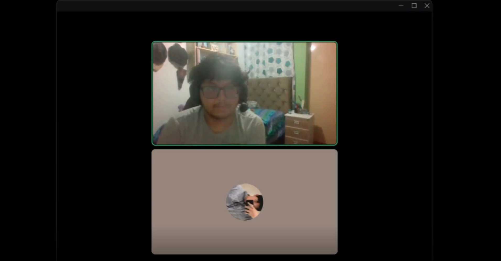 |
| **Resumen** | Giancarlo gestiona el cuidado del paciente mediante herramientas mayormente manuales. Para la medicación utiliza pastilleros semanales organizados con base en recetas médicas, complementados con alarmas en su celular para recordar los horarios. Las terapias y citas médicas las registra en un cuaderno físico junto con el historial del paciente. Entre sus herramientas cotidianas menciona dispositivos médicos básicos como tensiómetro, oxímetro y termómetro, además de un cuaderno de bitácora para registrar eventos relevantes. A nivel digital emplea principalmente alarmas y WhatsApp para comunicarse con los familiares. Señaló que uno de los principales problemas es la falta de coordinación durante los cambios de turno, donde la información no siempre se transmite correctamente, lo que puede generar pérdida de datos importantes sobre el estado del paciente. Respecto a las dificultades del cuidado diario, mencionó el manejo de cambios de humor y episodios de confusión del paciente, así como la falta de apoyo inmediato de profesionales de salud para resolver dudas. En relación con una posible solución digital, destacó la necesidad de registro compartido en tiempo real entre cuidadores, confirmación de administración de medicamentos, recordatorios automáticos, historial de signos vitales y una sección de notas para el relevo de turno. Espera que una solución digital le permita reducir la carga mental, mejorar la organización del cuidado y generar mayor confianza con los familiares al brindarles visibilidad del estado del paciente en tiempo real. |

| Segmento: Cuidadores | Entrevista #2 |
| --- | --- |
| **Nombres y Apellidos** | Renzo Uribe |
| **Edad** | 28 |
| **Distrito** | Lima |
| **Ocupación** | Cuidador de adultos mayores a domicilio |
| **Tiempo como cuidador** | 2 años |
| **Timing inicio** | 5:10 |
| **Duración** | 6:55 |
| **URL** | [Video Entrevistas](https://upcedupe-my.sharepoint.com/:v:/g/personal/u202319881_upc_edu_pe/IQAd7joONgjbTYJ4N_xUFvPXAcOMtAz8WbmokiYYCP5M3T0?nav=eyJyZWZlcnJhbEluZm8iOnsicmVmZXJyYWxBcHAiOiJPbmVEcml2ZUZvckJ1c2luZXNzIiwicmVmZXJyYWxBcHBQbGF0Zm9ybSI6IldlYiIsInJlZmVycmFsTW9kZSI6InZpZXciLCJyZWZlcnJhbFZpZXciOiJNeUZpbGVzTGlua0NvcHkifX0&e=mumL28) |
| **Screenshot** | 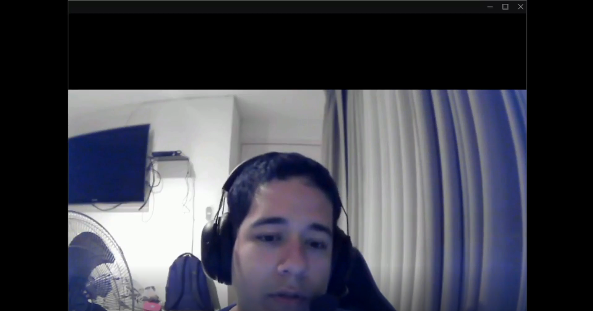 |
| **Resumen** | Renzo gestiona el cuidado del paciente mediante una combinación de herramientas manuales y digitales. Para la medicación utiliza un pastillero semanal organizado por horarios de mañana, tarde y noche. Para terapias y citas médicas emplea tanto un calendario físico como Google Calendar. Entre las herramientas de su día a día mencionó hojas de papel, aplicaciones de notas y múltiples alarmas en su celular, donde además registra información relevante como alimentación, signos vitales y cambios de ánimo. Indicó que uno de los principales problemas es la falta de coordinación e información, especialmente durante los cambios de turno o cuando los familiares no comunican cambios en la medicación, lo que genera incertidumbre sobre si el paciente ya recibió una dosis o si hubo modificaciones en el tratamiento. Para comunicarse utiliza principalmente WhatsApp, aunque considera que no es eficiente porque la información se pierde entre mensajes y dificulta la búsqueda de datos importantes en situaciones críticas. Entre las principales dificultades del cuidado diario destacó la responsabilidad de manejar múltiples pacientes, el control del stock de medicamentos y suministros, la necesidad de recordar citas y tareas, la gestión de cambios de ánimo en los pacientes y la dependencia de la memoria ante la falta de un sistema centralizado. Propuso funcionalidades como registro compartido de medicación con confirmación de dosis, alertas automáticas en caso de olvido, bitácora de salud con registro de signos vitales, visualización gráfica para seguimiento médico y un botón de emergencia con notificación a familiares y envío de ubicación. Espera que una solución digital le permita mejorar la organización, reducir errores en el cuidado y contar con un historial claro del paciente, evitando depender únicamente de la memoria o de la comunicación informal. |

| Segmento: Cuidadores | Entrevista #3 |
| --- | --- |
| **Nombres y Apellidos** | Sebastián Rubio Ortiz |
| **Edad** | 26 |
| **Distrito** | Lima |
| **Ocupación** | Cuidador informal, con inicio familiar y experiencia progresiva |
| **Tiempo como cuidador** | Aproximadamente 1 año |
| **Timing inicio** | 12:05 |
| **Duración** | 4:28 |
| **URL** | [Video Entrevistas](https://upcedupe-my.sharepoint.com/:v:/g/personal/u202319881_upc_edu_pe/IQAd7joONgjbTYJ4N_xUFvPXAcOMtAz8WbmokiYYCP5M3T0?nav=eyJyZWZlcnJhbEluZm8iOnsicmVmZXJyYWxBcHAiOiJPbmVEcml2ZUZvckJ1c2luZXNzIiwicmVmZXJyYWxBcHBQbGF0Zm9ybSI6IldlYiIsInJlZmVycmFsTW9kZSI6InZpZXciLCJyZWZlcnJhbFZpZXciOiJNeUZpbGVzTGlua0NvcHkifX0&e=mumL28) |
| **Screenshot** | 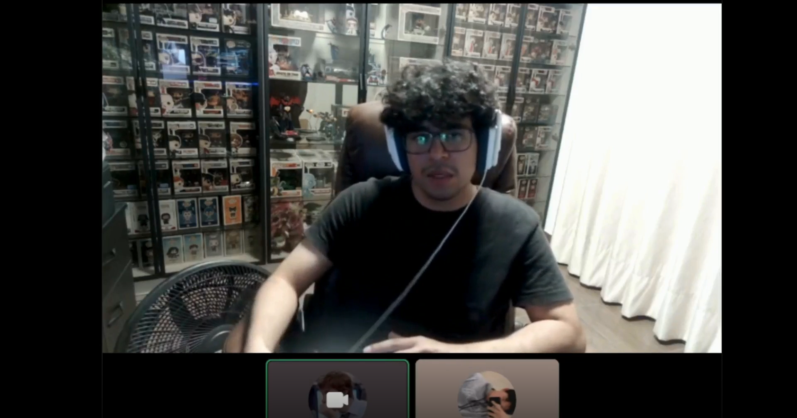 |
| **Resumen** | Sebastián organiza el cuidado del paciente utilizando principalmente herramientas digitales. Para la programación de citas y terapias emplea aplicaciones como Google Calendar, mientras que para la medicación combina pastilleros físicos con recordatorios digitales en su celular. Mencionó el uso constante del teléfono móvil para alarmas, cronómetros, notas y comunicación mediante WhatsApp, y señaló que estas herramientas son útiles pero no están integradas entre sí. Destacó que uno de los principales problemas es la falta de coordinación entre cuidadores, especialmente por el uso de métodos distintos, digitales y manuales. Indicó que el choque generacional dificulta la organización, ya que algunos cuidadores prefieren registrar información en papel, lo que puede generar pérdida de datos o falta de actualización ante cambios de medicación. La comunicación se realiza principalmente a través de grupos de WhatsApp, lo cual genera desorden y dificulta el acceso rápido a información relevante. Entre las principales dificultades del cuidado diario mencionó la alta carga mental asociada a la responsabilidad del cuidado, el riesgo de cometer errores en la administración de medicación, la dificultad para organizar información de manera eficiente y la falta de un sistema unificado entre cuidadores. Propuso funcionalidades como una interfaz intuitiva y de uso rápido, un sistema de checklist sincronizado entre cuidadores, la centralización de la información médica del paciente y la gestión del stock de medicamentos. Espera que una solución digital le permita centralizar toda la información del paciente en un solo lugar, mejorar la coordinación entre cuidadores y facilitar la organización del cuidado diario de manera más eficiente. |

#### Segmento 2: Pacientes geriátricos

| Segmento: Pacientes geriátricos | Entrevista #1 |
| --- | --- |
| **Nombres y Apellidos** | Rosa María Quispe |
| **Edad** | 68 |
| **Distrito** | Lima |
| **Apoyo de cuidador** | Sí, su hija |
| **Nivel de autonomía** | Media |
| **Uso de celular** | Sí, uso básico |
| **Timing inicio** | 16:34 |
| **Duración** | 2:42 |
| **URL** | [Video Entrevistas](https://upcedupe-my.sharepoint.com/:v:/g/personal/u202319881_upc_edu_pe/IQAd7joONgjbTYJ4N_xUFvPXAcOMtAz8WbmokiYYCP5M3T0?nav=eyJyZWZlcnJhbEluZm8iOnsicmVmZXJyYWxBcHAiOiJPbmVEcml2ZUZvckJ1c2luZXNzIiwicmVmZXJyYWxBcHBQbGF0Zm9ybSI6IldlYiIsInJlZmVycmFsTW9kZSI6InZpZXciLCJyZWZlcnJhbFZpZXciOiJNeUZpbGVzTGlua0NvcHkifX0&e=mumL28) |
| **Screenshot** | 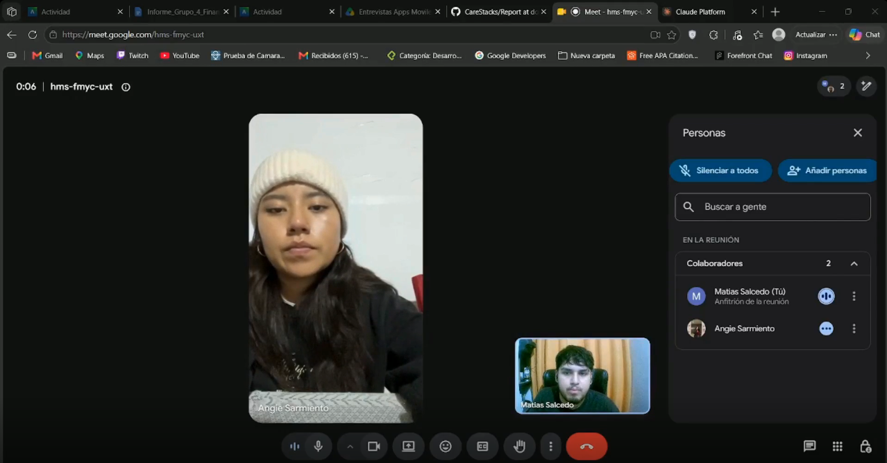 |
| **Resumen** | Rosa María depende parcialmente de su hija para organizar su medicación y sus citas médicas. Utiliza alarmas en su celular para recordar algunos medicamentos, pero en ocasiones olvida si ya los tomó, y las citas médicas las anota en un cuaderno. Entre sus dificultades identificó el olvido de medicación en algunos momentos, la confusión sobre si ya tomó una dosis y la dependencia de otra persona para confirmar información. Utiliza el celular principalmente para llamadas, WhatsApp y alarmas, e indica que no está familiarizada con aplicaciones complejas. Le gustaría contar con una herramienta simple que le indique claramente qué medicamentos debe tomar y en qué momento, sin generar confusión. Entre las funcionalidades sugeridas mencionó recordatorios claros con sonido, confirmación visual de la medicación tomada y una pantalla simple con las actividades del día. Espera que una solución digital le ayude a sentirse más segura y menos dependiente, especialmente para recordar su medicación diaria. |

| Segmento: Pacientes geriátricos | Entrevista #2 |
| --- | --- |
| **Nombres y Apellidos** | Luis Alberto Rojas |
| **Edad** | 74 |
| **Distrito** | *Pendiente. El documento base registra únicamente Arequipa, Perú.* |
| **Apoyo de cuidador** | No, vive con su esposa |
| **Nivel de autonomía** | Alta |
| **Uso de celular** | Sí |
| **Timing inicio** | 19:16 |
| **Duración** | 4:44 |
| **URL** | [Video Entrevistas](https://upcedupe-my.sharepoint.com/:v:/g/personal/u202319881_upc_edu_pe/IQAd7joONgjbTYJ4N_xUFvPXAcOMtAz8WbmokiYYCP5M3T0?nav=eyJyZWZlcnJhbEluZm8iOnsicmVmZXJyYWxBcHAiOiJPbmVEcml2ZUZvckJ1c2luZXNzIiwicmVmZXJyYWxBcHBQbGF0Zm9ybSI6IldlYiIsInJlZmVycmFsTW9kZSI6InZpZXciLCJyZWZlcnJhbFZpZXciOiJNeUZpbGVzTGlua0NvcHkifX0&e=mumL28) |
| **Screenshot** | 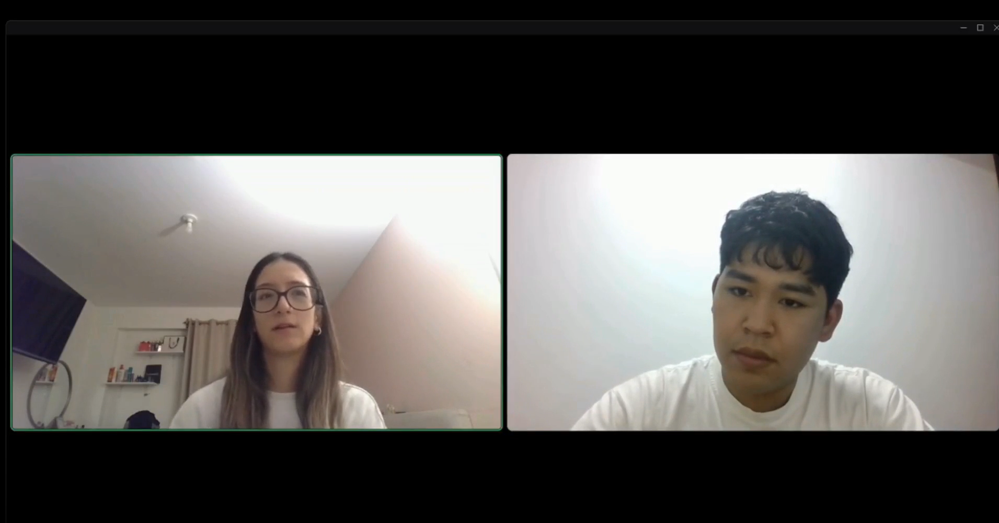 |
| **Resumen** | Luis Alberto gestiona su cuidado de forma independiente, apoyándose principalmente en su memoria y en algunos recordatorios del celular, aunque reconoce que en ocasiones olvida detalles de su tratamiento o de sus citas médicas. Las citas las anota en un calendario físico. Entre sus dificultades identificó el olvido ocasional de medicamentos, la falta de organización centralizada y la dificultad para llevar un historial de su salud. Utiliza el celular para llamadas, WhatsApp y ocasionalmente para alarmas, y se siente relativamente cómodo con tecnología básica. Busca una herramienta que le permita tener todo organizado en un solo lugar y evitar olvidos. Entre las funcionalidades sugeridas mencionó recordatorios automáticos, registro de medicamentos tomados e historial simple de salud. Espera mejorar su organización diaria y reducir los errores en su tratamiento mediante una herramienta fácil de usar. |

| Segmento: Pacientes geriátricos | Entrevista #3 |
| --- | --- |
| **Nombres y Apellidos** | Laura Marcela Rios |
| **Edad** | 78 |
| **Distrito** | Magdalena, Lima |
| **Apoyo de cuidador** | No, pero vive con su familia |
| **Nivel de autonomía** | Alta |
| **Uso de celular** | Sí, junto con tablet |
| **Timing inicio** | 24:01 |
| **Duración** | 4:21 |
| **URL** | [Video Entrevistas](https://upcedupe-my.sharepoint.com/:v:/g/personal/u202319881_upc_edu_pe/IQAd7joONgjbTYJ4N_xUFvPXAcOMtAz8WbmokiYYCP5M3T0?nav=eyJyZWZlcnJhbEluZm8iOnsicmVmZXJyYWxBcHAiOiJPbmVEcml2ZUZvckJ1c2luZXNzIiwicmVmZXJyYWxBcHBQbGF0Zm9ybSI6IldlYiIsInJlZmVycmFsTW9kZSI6InZpZXciLCJyZWZlcnJhbFZpZXciOiJNeUZpbGVzTGlua0NvcHkifX0&e=mumL28) |
| **Screenshot** | 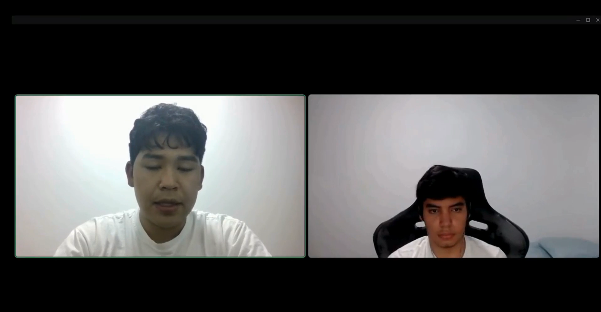 |
| **Resumen** | Laura Marcela gestiona su cuidado de forma independiente, apoyándose principalmente en alarmas y recordatorios de su celular y de su tablet. Reconoce que en ocasiones olvida, y son sus hijos o las propias alarmas quienes le recuerdan los medicamentos que debe tomar. Camina y asiste a sus citas de manera presencial y sin ayuda en la mayoría de casos. Entre sus dificultades identificó el olvido ocasional de fechas, la discapacidad física en ciertos momentos y la dificultad para guardar sus documentos de manera centralizada. Utiliza el celular para llamadas, WhatsApp y de forma intensiva para alarmas y calendario, además de usar frecuentemente la tablet para entretenimiento y comunicación, por lo que se siente cómoda con la tecnología. Busca una herramienta que le permita tener todo organizado en un solo lugar, evitar olvidos y transmitir información rápidamente a sus hijos en caso necesiten ayudarla. Entre las funcionalidades sugeridas mencionó recordatorios automáticos, agendado de citas acompañada e historial de documentos y citas pasadas. Espera mejorar su organización diaria y reducir los errores y accidentes que pueda sufrir en su tratamiento o en el camino hacia este, mediante una herramienta fácil de usar. |

#### 2.2.3. Análisis de entrevistas


#### Segmento 1: Cuidadores de pacientes geriátricos

**Características objetivas**

Los tres entrevistados de este segmento, es decir el 100 %, se encuentran dentro del rango de 25 a 60 años definido para cuidadores (Giancarlo 25, Sebastián 26 y Renzo 28 años) y residen en el Perú. La experiencia acumulada en actividades de cuidado varía entre uno y dos años: el 67 %, correspondiente a Giancarlo y Sebastián, lleva aproximadamente un año, mientras que el 33 %, correspondiente a Renzo, acumula dos años. Respecto al tipo de cuidado, el 67 %, es decir Giancarlo y Renzo, se desempeña como cuidador de adultos mayores a domicilio, y el 33 %, es decir Sebastián, ejerce como cuidador informal que inició en el ámbito familiar y fue ganando experiencia de manera progresiva.

En cuanto a la infraestructura de trabajo, el 100 % utiliza el celular como herramienta principal de su jornada y el 100 % utiliza alarmas para recordar la medicación. El 100 % combina herramientas físicas, como pastilleros y cuadernos, con herramientas digitales, sin que ninguna de ellas esté integrada con las demás. El 100 % utiliza WhatsApp como canal de comunicación con familiares y con otros cuidadores. El 67 %, Renzo y Sebastián, incorpora además una herramienta de calendario digital, específicamente Google Calendar, mientras que el 33 %, Giancarlo, se apoya exclusivamente en un cuaderno de bitácora. Un 33 %, Giancarlo, emplea también dispositivos médicos básicos como tensiómetro, oxímetro y termómetro.

**Características subjetivas**

Respecto a los problemas de coordinación, el 100 % declara enfrentarlos y el 100 % ha experimentado pérdida de información. El 67 %, Giancarlo y Renzo, sitúa el momento crítico específicamente en los cambios de turno: Giancarlo señala que la información no siempre se transmite correctamente al relevo, y Renzo indica que la incertidumbre sobre si el paciente ya recibió una dosis se agrava cuando los familiares no comunican cambios en la medicación. Sebastián identifica como causa el choque generacional entre cuidadores que registran en papel y cuidadores que registran de forma digital, lo que produce datos desactualizados.

En cuanto al canal de comunicación, el 67 %, Renzo y Sebastián, califica explícitamente a WhatsApp como insuficiente: Renzo indica que la información se pierde entre mensajes y dificulta encontrar datos importantes en situaciones críticas, mientras que Sebastián describe los grupos como desordenados y poco útiles para acceder rápido a lo relevante. Esto confirma que el problema no es la ausencia de un canal, sino la ausencia de una estructura que preserve la información.

Sobre la carga del rol, el 100 % menciona una alta carga mental y el 100 % expresa preocupación por cometer errores en la medicación. El 67 % refiere dificultades para organizar la información de manera eficiente, y el 33 %, Giancarlo, señala además la falta de apoyo profesional inmediato para resolver dudas clínicas. Renzo agrega dos cargas específicas de su perfil: la responsabilidad de manejar múltiples pacientes y el control del stock de medicamentos y suministros.

Respecto a las funcionalidades solicitadas de forma espontánea, el 100 % pidió registro compartido en tiempo real, confirmación de medicación administrada, alertas automáticas e historial del paciente. El 67 % solicitó una sección de notas o relevo de turno, mientras que el 33 % mencionó un botón de emergencia con envío de ubicación, propuesto por Renzo, y el control de stock de medicamentos, propuesto por Renzo y Sebastián. Sebastián enfatizó además que la interfaz debe ser intuitiva y de uso rápido, condición que aparece como requisito de adopción y no como preferencia estética.

**Conclusión del segmento**

Este grupo no busca simplemente una alarma más. Existe una fuerte dependencia de herramientas manuales y no especializadas, y la coordinación entre cuidadores emerge como el problema más crítico, por encima incluso del olvido individual. La carga mental es alta debido a la responsabilidad que asumen, y por eso valoran una solución que centralice la información y automatice procesos sin añadir pasos a su jornada. La simplicidad y la rapidez son factores determinantes para la adopción: si la herramienta les cuesta tiempo, vuelven al cuaderno.

#### Segmento 2: Pacientes geriátricos

**Características objetivas**

Los tres entrevistados de este segmento tienen entre 68 y 78 años, con un promedio de 73,3 años: Rosa María de 68 años, Luis Alberto de 74 años y Laura Marcela de 78 años. En cuanto a ubicación, el 67 %, Rosa María y Laura Marcela, reside en Lima, y el 33 %, Luis Alberto, en Arequipa. Respecto al apoyo recibido, el 33 %, Rosa María, cuenta con apoyo directo de un cuidador, específicamente su hija, mientras que el 67 %, Luis Alberto y Laura Marcela, no cuenta con cuidador asignado aunque convive con su familia. Coherentemente, el 67 % declara un nivel de autonomía alta y el 33 % un nivel de autonomía media.

El 100 % utiliza celular. En cuanto al nivel de manejo, el 67 %, Rosa María y Luis Alberto, se limita a funciones básicas de llamadas, WhatsApp y alarmas, y el 33 %, Laura Marcela, presenta un uso más intensivo que incluye calendario y el uso frecuente de una tablet para entretenimiento y comunicación. El 33 %, Rosa María, declara explícitamente no estar familiarizada con aplicaciones complejas.

**Características subjetivas**

Respecto a la gestión actual del tratamiento, el 100 % presenta dificultades para recordar la medicación o las actividades del día y el 100 % se apoya en métodos básicos como la memoria, el cuaderno o alarmas simples. Las estrategias difieren: Rosa María combina alarmas con la confirmación de su hija y anota las citas en un cuaderno, Luis Alberto se apoya en su memoria y registra las citas en un calendario físico, y Laura Marcela utiliza alarmas y recordatorios tanto en celular como en tablet.

En cuanto al riesgo asociado, el 100 % presenta riesgo de olvido y el 100 % carece de un sistema centralizado. El 33 %, Rosa María, reporta específicamente confusión sobre si ya tomó una dosis, lo que la lleva a dudar del estado real de su tratamiento. El 33 %, Laura Marcela, identifica además la dificultad para guardar sus documentos de manera centralizada, y menciona la discapacidad física en ciertos momentos como una limitación adicional.

Respecto a las funcionalidades solicitadas, el 100 % pidió recordatorios claros y automáticos, y el 100 % expresó la necesidad de una interfaz sencilla con visualización simple de las actividades. El 67 %, Rosa María y Luis Alberto, solicitó algún mecanismo de confirmación o registro de la medicación tomada. El 67 %, Luis Alberto y Laura Marcela, pidió un historial, orientado al estado de salud en el primer caso y a documentos y citas pasadas en el segundo. El 33 %, Laura Marcela, añadió el agendado de citas acompañada y la posibilidad de transmitir información rápidamente a sus hijos en caso necesiten ayudarla.

**Conclusión del segmento**

Este grupo requiere soluciones extremadamente simples. Existe una dependencia variable de apoyo externo, que va desde la confirmación puntual de un familiar hasta la gestión completa por parte de una hija, pero en los tres casos aparece el mismo deseo de conservar autonomía. La claridad visual y la facilidad de uso son fundamentales, y la solución debe orientarse a reducir la confusión antes que a añadir funciones. Es relevante que la disposición hacia la tecnología no sea uniforme dentro del segmento, lo que obliga a diseñar para el perfil de menor alfabetización digital sin limitar al de mayor manejo.

#### Conclusión general del análisis

A partir de ambos segmentos identificamos los siguientes hallazgos clave. El 100 % de los entrevistados presenta problemas de organización del cuidado y el 100 % utiliza herramientas no especializadas que no conversan entre sí. El 100 % requiere algún grado de centralización de la información. La coordinación entre cuidadores aparece como el mayor problema del primer segmento, mientras que la certeza sobre la dosis ya tomada aparece como el mayor problema del segundo. Ambos segmentos convergen en un mismo punto: necesitan saber con seguridad qué se hizo y qué falta hacer, aunque lo formulen desde posiciones distintas.

**Implicaciones para el diseño de CareConnect**

- Implementar un sistema centralizado de información que sustituya la combinación de cuaderno, alarma y mensajería.
- Diseñar una interfaz simple y accesible, con flujos cortos y textos legibles, dimensionada para el perfil de menor alfabetización digital.
- Incorporar alertas y recordatorios con confirmación explícita de cumplimiento.
- Permitir la colaboración entre múltiples usuarios vinculados a un mismo paciente, con visibilidad del relevo de turno.
- Reducir la dependencia de herramientas externas concentrando historial, documentos y agenda en un solo lugar.

### 2.3. Needfinding

#### 2.3.1. User Personas

En esta sección presentamos los arquetipos construidos a partir de los hallazgos recogidos en el análisis de competencia y en el análisis de entrevistas. Cada ficha concentra datos demográficos, hábitos, objetivos, frustraciones y nivel de adopción tecnológica observados durante la investigación, y sirve de referencia para las decisiones de diseño de CareConnect. Elaboramos una ficha por cada segmento objetivo definido en el Capítulo I, el cuidador de pacientes geriátricos y el paciente geriátrico con autonomía parcial o acompañada.

Los atributos destacados son los que aparecieron de forma transversal en las entrevistas: uso intensivo del celular como herramienta principal, dependencia de soluciones no especializadas como WhatsApp, pastilleros y cuadernos, alta carga mental en cuidadores y necesidad de simplicidad extrema en pacientes. Estos rasgos orientan el tono, la jerarquía de información y las prioridades funcionales del producto.

**Segmento 1: Cuidadores de pacientes geriátricos**

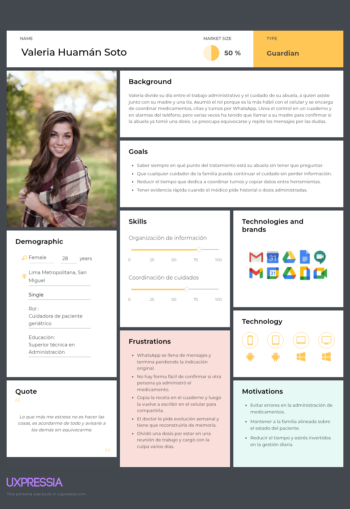

**Segmento 2: Pacientes geriátricos**   

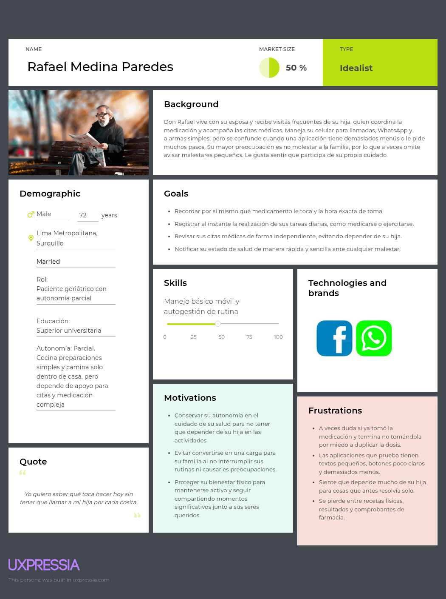

#### 2.3.2. User Task Matrix

A partir de los dos User Personas definidos, Valeria Huamán como cuidadora informal y Rafael Medina como paciente geriátrico, consolidamos las tareas que ambos segmentos realizan en su día a día para llevar adelante el cuidado geriátrico. Es importante precisar que estas tareas se identifican con independencia de la existencia de CareConnect: representan actividades que los usuarios ya ejecutan con las herramientas que tienen a mano, como WhatsApp, cuadernos, alarmas, llamadas y memoria, y que cualquier solución de software debería facilitar, no reemplazar.

Para cada tarea indicamos la frecuencia con la que el segmento la realiza y la importancia que tiene dentro del proceso de cuidado. La escala se apoya en los porcentajes obtenidos en el análisis de entrevistas.

| Tarea | Valeria (cuidadora)<br>Frecuencia | Valeria (cuidadora)<br>Importancia | Rafael (paciente)<br>Frecuencia | Rafael (paciente)<br>Importancia |
|---|:---:|:---:|:---:|:---:|
| Administrar o tomar la medicación según horario | Alta | Alta | Alta | Alta |
| Recordar y confirmar si una dosis ya fue administrada | Alta | Alta | Alta | Alta |
| Registrar observaciones del paciente como síntomas, ánimo y signos | Alta | Alta | Media | Media |
| Consultar la rutina y actividades del día, controles y terapias | Alta | Alta | Alta | Alta |
| Agendar y asistir a citas médicas | Media | Alta | Media | Alta |
| Coordinar el cambio de turno entre cuidadores | Alta | Alta | N/A | N/A |
| Comunicar cambios o malestares del paciente a familiares o médicos | Alta | Alta | Media | Alta |
| Consultar historial clínico y evolución del paciente | Media | Alta | Baja | Media |
| Gestionar documentos médicos como recetas, resultados y comprobantes | Media | Alta | Baja | Media |
| Buscar información sobre tratamiento o medicamentos | Media | Media | Baja | Media |
| Solicitar apoyo a cuidador o familiar ante una duda | Media | Media | Alta | Alta |
| Reportar que una actividad del día fue completada | Alta | Media | Alta | Alta |

**Análisis del User Task Matrix**

Las tareas con mayor frecuencia e importancia en ambos segmentos son la administración y confirmación de la medicación, la consulta de la rutina diaria y el reporte de actividades completadas. Esto es consistente con el 100 % de entrevistados que mencionó la medicación como eje del cuidado y con las funcionalidades más solicitadas en el análisis de entrevistas: recordatorios, confirmación de medicación y visualización simple de actividades.

Respecto a las coincidencias, ambos User Personas necesitan certeza sobre el estado del tratamiento. Valeria necesita saber si alguien más ya administró una dosis, y Rafael necesita saber si él mismo ya la tomó. Ambos usan el celular como herramienta principal y valoran la rapidez para acceder a información crítica. También comparten la tarea de consultar la rutina diaria y reportar su cumplimiento, aunque con matices: Valeria la vive como responsabilidad operativa y Rafael como una forma de participar en su propio cuidado.

Respecto a las diferencias, las tareas vinculadas a la coordinación, es decir el cambio de turno, la gestión documental y la comunicación con múltiples actores, concentran alta frecuencia e importancia solo para Valeria. En Rafael aparecen con baja frecuencia porque las delega en su hija o en su esposa. En contraste, solicitar apoyo es una tarea de alta frecuencia para Rafael y media para Valeria, lo que refleja la asimetría de autonomía entre ambos: el paciente busca apoyo y el cuidador lo provee.

En cuanto a las implicaciones para el diseño, las tareas con alta frecuencia y alta importancia en ambos segmentos deben resolverse con flujos mínimos, de uno o dos toques, y con visibilidad inmediata en la pantalla principal. Las tareas asimétricas, es decir la coordinación para el cuidador y la solicitud de apoyo para el paciente, justifican vistas diferenciadas por rol dentro de una misma aplicación compartida. El resto de tareas, como la consulta de historial, la gestión documental y la búsqueda de información, puede vivir detrás de un segundo nivel de navegación sin perjudicar la experiencia.  

#### 2.3.3. User Journey Mapping

**Segmento 1: Cuidadores de pacientes geriátricos**

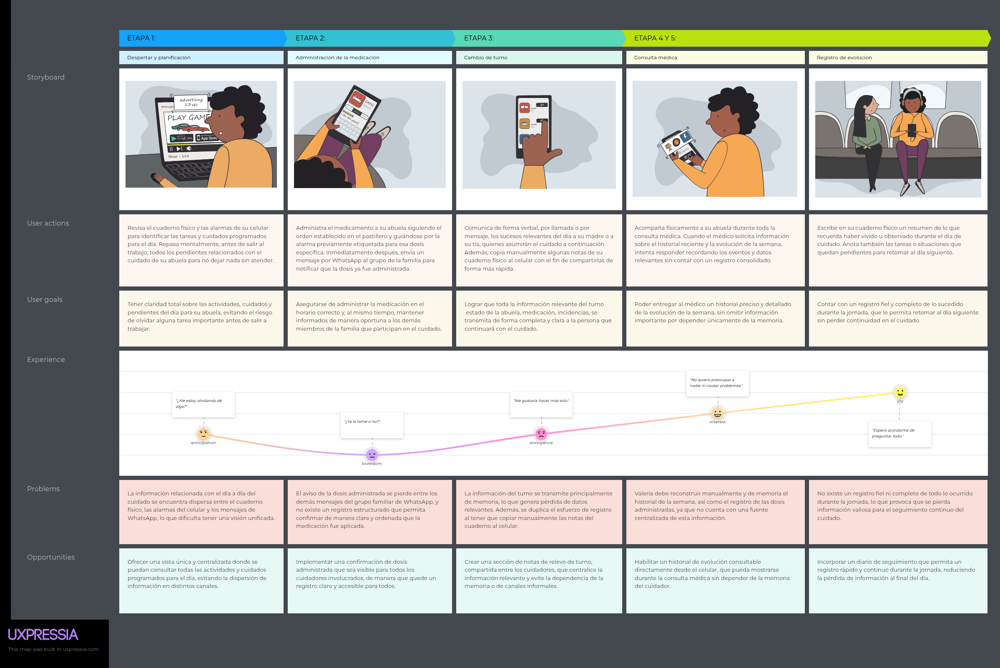

El recorrido de Valeria muestra una caída emocional progresiva a lo largo del día. Arranca con incertidumbre sobre si está olvidando algo, se estabiliza brevemente al administrar la medicación y vuelve a caer en los momentos críticos de cambio de turno y consulta médica, donde la falta de una herramienta centralizada hace que la información dependa de la memoria y del cuaderno. El punto más bajo aparece en la consulta médica, cuando el doctor pide historial y evolución, Valeria debe reconstruirlo a mano. La fase de registro de evolución cierra el día con frustración por no tener un registro fiel de lo ocurrido.

**Segmento 2: Pacientes geriátricos**

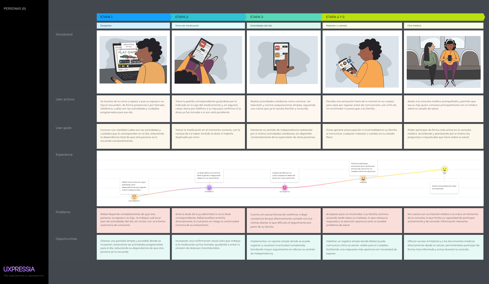

El recorrido de Rafael es más plano pero tiene un valle claro en la fase de malestar o cambio pues debido a su intención de no molestar a la familia, tarda en avisar cuando algo está fuera de lo normal. Al momento de tomar la medicación también baja la curva porque, ante la duda de haberla tomado, prefiere omitirla. La fase de actividades del día es la más positiva, dado que se trata de una rutina conocida que le da sensación de autonomía y la consulta médica recupera cierta estabilidad porque está acompañado, aunque persiste la frustración de no tener su historial al alcance.


#### 2.3.4. Empathy Mapping

**Segmento 1: Cuidadores de pacientes geriátricos**

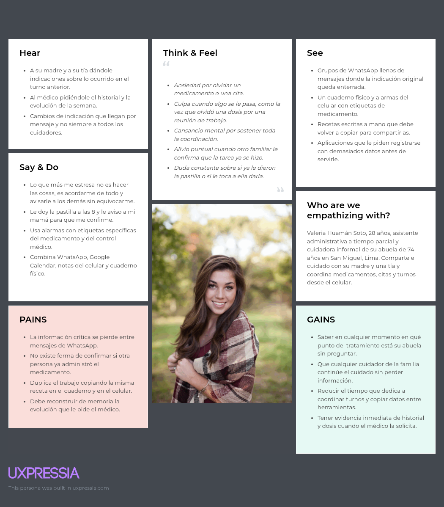

En Valeria destaca una tensión entre el alto nivel de responsabilidad asumido y la falta de herramientas que la acompañen. Lo que dice y lo que piensa convergen en la misma preocupación: olvidar un medicamento o una indicación. Lo que hace muestra un patrón claro de uso intensivo del celular combinado con cuaderno físico, lo que refleja la ausencia de una solución centralizada. Lo que siente combina ansiedad y culpa con momentos puntuales de alivio cuando otro familiar confirma una acción. El mapa evidencia que CareConnect debe reducir la carga mental antes que sumar nuevas funciones.

**Segmento 2: Pacientes geriátricos**

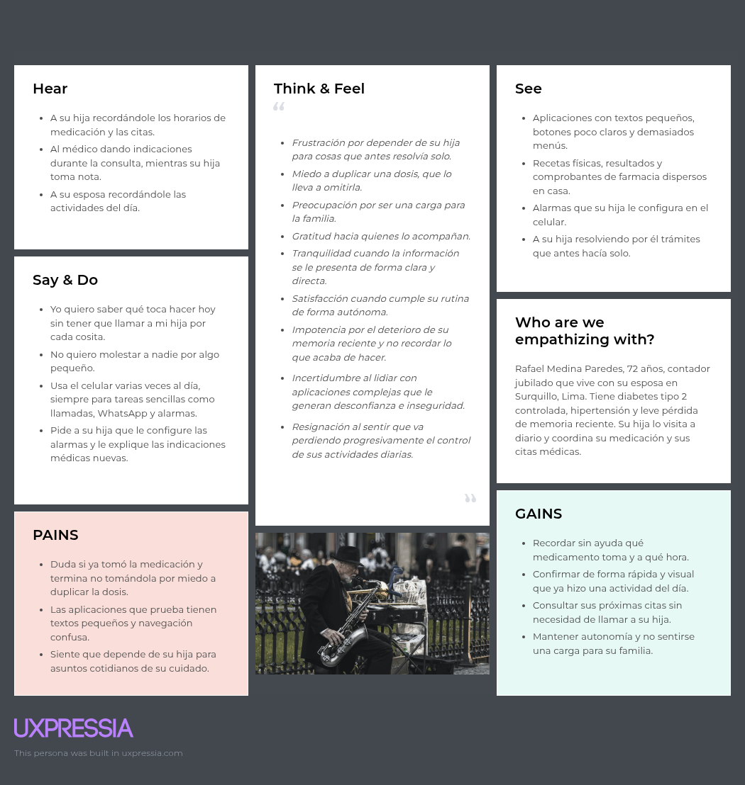

En Rafael el eje emocional dominante es la pérdida progresiva de autonomía. Lo que dice muestra su deseo de resolver lo cotidiano sin tener que llamar a su hija por cada detalle. Lo que piensa revela una regla de decisión riesgosa: ante la duda, prefiere omitir la dosis. Lo que hace confirma un uso muy acotado del celular y un rechazo natural a aplicaciones nuevas si no fueron instaladas por alguien de confianza. Lo que siente mezcla frustración y gratitud, con tranquilidad cuando la información se presenta de forma clara. El mapa refuerza que la interfaz debe priorizar legibilidad, confirmación simple y lenguaje directo.

#### 2.3.5. As-is Scenario Mapping

Se presenta la situación actual (As-Is) de cada User Persona antes de contar con la solución. Cada escenario organiza el recorrido en fases y describe las acciones, pensamientos y emociones que la persona experimenta hoy, apoyándose únicamente en las herramientas que tiene a la mano. Las fases se nombraron de modo que puedan contrastarse una a una con las del To-Be Scenario Mapping.

---

##### User Persona 1 — Valeria Huamán

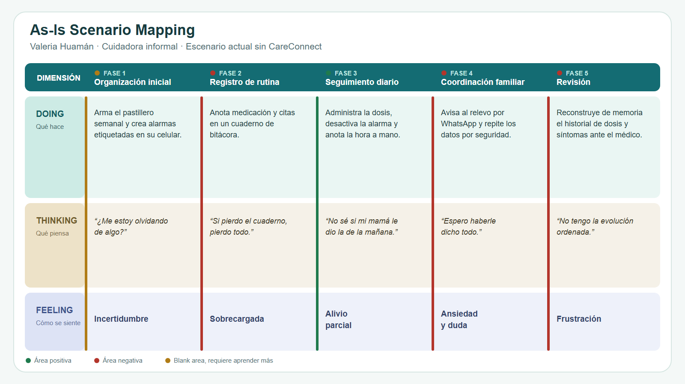

###### Recorrido por fases

| | Fase 1: Organización inicial | Fase 2: Registro de rutina | Fase 3: Seguimiento diario | Fase 4: Coordinación familiar | Fase 5: Revisión |
|---|---|---|---|---|---|
| **Doing** | Arma el pastillero semanal y crea alarmas etiquetadas en su celular | Anota medicación y citas en un cuaderno de bitácora | Administra la dosis, desactiva la alarma y anota la hora a mano | Avisa al relevo por WhatsApp y repite los datos por seguridad | Reconstruye de memoria el historial de dosis y síntomas ante el médico |
| **Thinking** | "¿Me estoy olvidando de algo?" | "Si pierdo el cuaderno, pierdo todo" | "No sé si mi mamá le dio la de la mañana" | "Espero haberle dicho todo" | "No tengo la evolución ordenada" |
| **Feeling** | Incertidumbre | Sobrecargada | Alivio parcial | Ansiedad y duda | Frustración |

###### Áreas identificadas

| Área | Fase | Descripción |
|---|---|---|
| **Positiva** | Fase 3: Seguimiento diario | Es el único momento del día con certeza plena, porque la acción es concreta, inmediata y depende solo de ella |
| **Negativa** | Fase 2: Registro de rutina | Toda la información del tratamiento vive en un soporte único y frágil, sin respaldo ni acceso para el resto de cuidadores |
| **Negativa** | Fase 4: Coordinación familiar | El relevo depende de la memoria y de mensajes informales. Es el problema que los tres cuidadores entrevistados señalaron como principal |
| **Negativa** | Fase 5: Revisión | La información existe pero está dispersa entre cuaderno, alarmas y conversaciones, y debe reconstruirse a mano frente al médico |
| **Blank area** | Fase 1: Organización inicial | No se determinó con qué criterio Valeria decide qué revisar primero cada mañana ni cuánto tiempo le toma. Requiere observación directa |

---

##### User Persona 2 — Rafael Medina

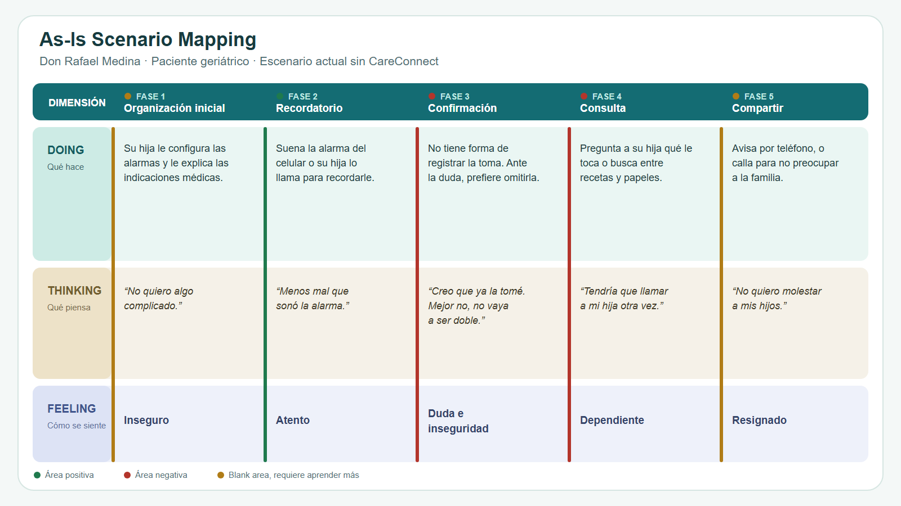

###### Recorrido por fases

| | Fase 1: Organización inicial | Fase 2: Recordatorio | Fase 3: Confirmación | Fase 4: Consulta | Fase 5: Compartir |
|---|---|---|---|---|---|
| **Doing** | Su hija le configura las alarmas y le explica las indicaciones médicas | Suena la alarma del celular o su hija lo llama para recordarle | No tiene forma de registrar la toma. Ante la duda, prefiere omitirla | Pregunta a su hija qué le toca o busca entre recetas y papeles | Avisa por teléfono, o calla para no preocupar a la familia |
| **Thinking** | "No quiero algo complicado" | "Menos mal que sonó la alarma" | "Creo que ya la tomé. Mejor no, no vaya a ser doble" | "Tendría que llamar a mi hija otra vez" | "No quiero molestar a mis hijos" |
| **Feeling** | Inseguro | Atento | Duda e inseguridad | Dependiente | Resignado |

###### Áreas identificadas

| Área | Fase | Descripción |
|---|---|---|
| **Positiva** | Fase 2: Recordatorio | La alarma cumple su función de avisar a tiempo y es el único apoyo que hoy le resulta confiable |
| **Negativa** | Fase 3: Confirmación | La duda sobre la dosis ya tomada deriva en omitir la medicación. Es un riesgo clínico directo, reportado de forma explícita durante las entrevistas al segmento |
| **Negativa** | Fase 4: Consulta | Depende de otra persona para saber qué le corresponde hacer, lo que reduce la autonomía que él mismo declara querer conservar |
| **Blank area** | Fase 1: Organización inicial | No se determinó con qué frecuencia Rafael necesita consultar a su hija ni cuántas de esas consultas podría resolver por sí mismo. Requiere medición |
| **Blank area** | Fase 5: Compartir | Se desconoce en qué medida desea compartir su estado por iniciativa propia o prefiere que lo haga su cuidadora. De ello depende cuánta información mostrarle en la aplicación |

---

##### Hallazgos transversales

En el caso de Valeria, el escenario actual distribuye la información entre cuadernos, alarmas y conversaciones de WhatsApp. Esta fragmentación incrementa la carga mental, dificulta el relevo entre cuidadores y obliga a reconstruir manualmente el historial durante una consulta médica. En el caso de Rafael, la situación actual genera dudas sobre si ya tomó una dosis y lo lleva a depender de otras personas para consultar su rutina.

Al comparar ambos mapas se observa que la fricción no está en la ejecución de las tareas de cuidado, que ambos resuelven, sino en la certeza sobre lo que ya ocurrió. Valeria no puede confirmar si otra persona administró la dosis y Rafael no puede confirmar si él mismo la tomó, de modo que se trata de la misma carencia expresada desde dos posiciones distintas del mismo proceso. Los momentos de mayor deterioro emocional coinciden además con los de mayor riesgo clínico, esto es el relevo de turno para el cuidador y la duda de dosis para el paciente. Las tres blank areas identificadas quedan registradas como preguntas abiertas para las siguientes iteraciones de investigación.


### 2.4. Ubiquitous Language

En esta sección se establece el lenguaje ubicuo del dominio de CareConnect, entendido como el conjunto de términos y conceptos que el equipo de desarrollo y los expertos del dominio del cuidado geriátrico utilizan de manera compartida para referirse a la misma realidad. Mantener este glosario completo y sin ambigüedad permite que las conversaciones sobre el producto, la documentación del informe y el modelo de la solución empleen las mismas palabras con el mismo significado, evitando que un mismo concepto reciba nombres distintos según quién lo mencione.

Siguiendo la práctica establecida por Eric Evans en Domain Driven Design, los términos se expresan en inglés, que es el idioma del modelo del dominio, y se acompañan de su equivalente en español en una columna independiente. Las definiciones se redactan en español. El glosario recoge exclusivamente conceptos propios del dominio del cuidado geriátrico, es decir, aquellos que existen en la realidad del paciente y de sus cuidadores con independencia de la solución de software. Los términos técnicos del área de ingeniería de software quedan fuera de esta sección por pertenecer al lenguaje de la solución y no al del problema.

Los términos se organizan en cinco grupos temáticos que corresponden a los aspectos centrales del dominio: los actores del cuidado, la agenda y el seguimiento de eventos de salud, la medicación y la adherencia al tratamiento, la continuidad del cuidado entre turnos, y la documentación y el registro de la evolución del paciente.

<div style="page-break-after: always"></div>

##### Actores del cuidado

| Término | Equivalente en español | Definición |
| :--- | :--- | :--- |
| **Patient** | Paciente | Persona cuya información de salud se registra y organiza en el marco de un proceso de cuidado, y titular de las decisiones sobre quién puede acceder a dicha información. |
| **Geriatric Patient** | Paciente geriátrico | Paciente adulto mayor, de sesenta años a más, que requiere seguimiento frecuente de su medicación, controles médicos y actividades diarias. |
| **Caregiver** | Cuidador | Persona autorizada por el paciente para acompañar su rutina de cuidado, dar seguimiento a su información de salud y ejecutar las actividades previstas en su tratamiento. |
| **Formal Caregiver** | Cuidador formal | Cuidador con formación o vínculo laboral en la atención de adultos mayores, como un enfermero, un técnico de salud o un asistente geriátrico. |
| **Informal Caregiver** | Cuidador informal | Familiar o allegado que asume el cuidado del paciente sin formación especializada ni relación contractual, generalmente dentro del hogar. |
| **Care Network** | Red de cuidado | Conjunto de cuidadores autorizados por un mismo paciente que se coordinan entre sí para sostener la continuidad de su cuidado. |
| **Health Professional** | Profesional de salud | Médico u otro especialista que evalúa al paciente, establece el tratamiento y conserva la responsabilidad sobre las decisiones clínicas. |

<div style="page-break-after: always"></div>

##### Agenda y eventos de salud

| Término | Equivalente en español | Definición |
| :--- | :--- | :--- |
| **Health Event** | Evento de salud | Actividad relacionada con la salud del paciente que ocurre en un momento determinado, como la toma de un medicamento o la asistencia a una cita médica. |
| **Agenda** | Agenda de cuidado | Organización en el tiempo de todos los eventos de salud previstos para un paciente, que permite conocer qué actividades corresponden a cada momento del día. |
| **Appointment** | Cita médica | Evento de salud programado entre el paciente y un profesional de salud en una fecha y una hora determinadas. |
| **Care Routine** | Rutina de cuidado | Secuencia habitual de actividades que el paciente y sus cuidadores realizan a lo largo del día para sostener el tratamiento indicado. |
| **Event Status** | Estado del evento | Condición en la que se encuentra un evento de salud respecto de su cumplimiento, pudiendo estar pendiente, confirmado o no cumplido. |
| **Event Confirmation** | Confirmación de evento | Registro mediante el cual el paciente o un cuidador dejan constancia de que un evento de salud programado efectivamente ocurrió. |
| **Reschedule** | Reprogramación | Cambio de la fecha o la hora de un evento de salud previamente registrado en la agenda de cuidado. |
| **Reminder** | Recordatorio | Aviso anticipado que se comunica al paciente o a sus cuidadores para que un evento de salud próximo se cumpla a tiempo. |
| **Alert** | Alerta | Aviso de alta prioridad dirigido a los cuidadores cuando se produce un incumplimiento o una situación que requiere atención inmediata. |

<div style="page-break-after: always"></div>

##### Medicación y adherencia

| Término | Equivalente en español | Definición |
| :--- | :--- | :--- |
| **Prescription** | Prescripción médica | Indicación emitida por un profesional de salud que establece qué medicamentos debe tomar el paciente, en qué dosis y con qué frecuencia. |
| **Medication Schedule** | Esquema de medicación | Distribución en el tiempo de los medicamentos prescritos al paciente, que define los horarios en que corresponde tomar cada uno. |
| **Medication Event** | Evento de medicación | Evento de salud que representa la toma o la administración de un medicamento en un horario definido dentro del esquema de medicación. |
| **Dose** | Dosis | Cantidad de un medicamento que corresponde tomar en un momento determinado, según lo establecido en la prescripción médica. |
| **Dose Administration** | Administración de dosis | Acto mediante el cual un cuidador entrega al paciente la dosis que corresponde, o el paciente la toma por sí mismo. |
| **Missed Dose** | Dosis omitida | Dosis que no fue tomada ni administrada dentro del horario previsto en el esquema de medicación. |
| **Duplicate Dose** | Dosis duplicada | Dosis administrada más de una vez en un mismo horario, generalmente por falta de certeza sobre si ya había sido entregada. |
| **Treatment Adherence** | Adherencia al tratamiento | Grado en que el paciente cumple las indicaciones médicas recibidas, especialmente en lo referido a horarios y dosis de medicación. |

<div style="page-break-after: always"></div>

##### Continuidad del cuidado

| Término | Equivalente en español | Definición |
| :--- | :--- | :--- |
| **Care Shift** | Turno de cuidado | Periodo continuo durante el cual un cuidador determinado asume la responsabilidad sobre el paciente. |
| **Shift Handover** | Relevo de turno | Traspaso de la responsabilidad del cuidado y de la información sobre el estado del paciente entre el cuidador que termina su turno y el que lo inicia. |
| **Profile Sharing** | Compartición de perfil | Decisión del paciente de autorizar a un cuidador para que acceda a su información de salud y participe de su proceso de cuidado. |
| **Access Consent** | Consentimiento de acceso | Alcance de la información de salud que el paciente autoriza a conocer a un cuidador determinado, y que puede modificar o retirar en cualquier momento. |
| **Shared Care** | Cuidado compartido | Modalidad de cuidado en la que varias personas atienden a un mismo paciente de manera alternada y requieren información común sobre lo ya realizado. |
| **Caregiver Burden** | Carga del cuidador | Desgaste físico y mental que experimenta el cuidador como consecuencia de la responsabilidad sostenida sobre el paciente. |

<div style="page-break-after: always"></div>

##### Documentación y evolución

| Término | Equivalente en español | Definición |
| :--- | :--- | :--- |
| **Medical Document** | Documento médico | Documento con información clínica del paciente, como un resultado de examen, una receta o un informe emitido por un profesional de salud. |
| **Diary Entry** | Entrada de diario | Registro descrito por el paciente o por un cuidador sobre el estado, la experiencia o el comportamiento del paciente en un momento determinado. |
| **Diary** | Diario de seguimiento | Conjunto ordenado de entradas de diario que permite reconstruir cómo transcurrió el cuidado del paciente a lo largo del tiempo. |
| **Patient Evolution** | Evolución del paciente | Cambio observado en el estado de salud del paciente durante un periodo determinado, y que el profesional de salud consulta para evaluar el tratamiento. |
| **Vital Signs** | Signos vitales | Mediciones básicas del estado del paciente, como la presión arterial, la temperatura corporal y la saturación de oxígeno, registradas durante el cuidado diario. |
| **Warning Sign** | Signo de alerta | Manifestación observada en el paciente que indica un posible deterioro de su estado y que debe comunicarse oportunamente a los demás cuidadores o al profesional de salud. |

<div style="page-break-after: always"></div>

## Capítulo III: Requirements Specification

<!-- ===== CAPÍTULO ASIGNADO A ESTE INTEGRANTE ===== -->
Este capítulo especifica los requisitos funcionales y técnicos de los productos digitales de CareConnect a partir de los hallazgos del proceso de elicitación. Se presentan los escenarios futuros de las personas usuarias, las historias de usuario, el Product Backlog priorizado y el Impact Mapping que conecta las funcionalidades con los objetivos del negocio.

### 3.1. To-Be Scenario Mapping
Se presenta la situación futura (To-Be) de cada User Persona con la solución implementada, en contraste directo con el As-Is Scenario Mapping presentado en la sección [2.3.5](#235-as-is-scenario-mapping). Cada escenario organiza el recorrido en las mismas fases definidas en el As-Is y describe las acciones, pensamientos y emociones esperadas durante el uso de CareConnect.

**User Persona 1 — Valeria Huamán (Cuidadora informal)**

| | Fase 1: Organización inicial | Fase 2: Registro de rutina | Fase 3: Seguimiento diario | Fase 4: Coordinación familiar | Fase 5: Revisión |
|---|---|---|---|---|---|
| **Doing** | Crea su cuenta y registra al paciente | Registra medicación y citas en la agenda | Recibe alertas de incumplimiento y confirma tareas | Comparte el perfil con otro familiar y revisa el diario compartido | Consulta el historial de eventos y documentos |
| **Thinking** | "¿Es fácil de configurar?" | "Ahora todo queda en un solo lugar" | "Me avisa si algo no se cumplió" | "Mi hermana también puede ver el estado" | "Puedo mostrar esto al médico" |
| **Feeling** | Expectante | Aliviada, en control | Segura, respaldada | Acompañada, menos sola | Confiada |

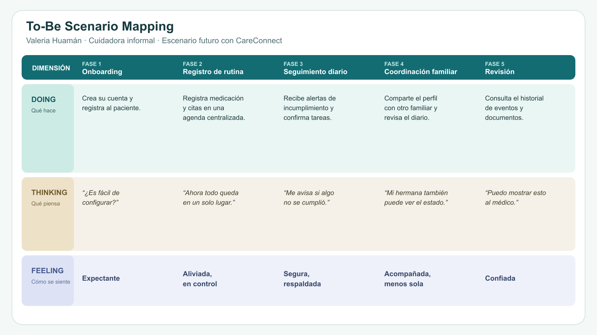

**User Persona 2 — Don Rafael Medina (Paciente geriátrico)**

| | Fase 1: Organización inicial | Fase 2: Recordatorio | Fase 3: Confirmación | Fase 4: Consulta | Fase 5: Compartir |
|---|---|---|---|---|---|
| **Doing** | Un familiar le configura la cuenta | Recibe un recordatorio claro de su medicación | Confirma que tomó su medicamento con un toque | Revisa su agenda del día en letra grande | Comparte su estado con su cuidadora |
| **Thinking** | "No quiero algo complicado" | "Me avisa a tiempo" | "Fue fácil confirmar" | "Entiendo qué me toca hoy" | "Mi hija sabe cómo estoy" |
| **Feeling** | Inseguro al inicio | Tranquilo | Autónomo | Orientado, sin confusión | Acompañado |

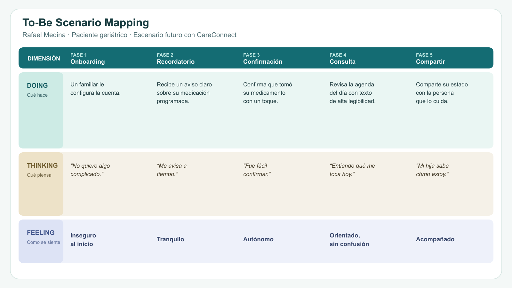

##### Comparación con el As-Is Scenario Mapping (sección [2.3.5](#235-as-is-scenario-mapping))

En el caso de Valeria, el escenario actual distribuye la información entre cuadernos, alarmas y conversaciones de WhatsApp. Esta fragmentación incrementa la carga mental, dificulta el relevo entre cuidadores y obliga a reconstruir manualmente el historial durante una consulta médica. El escenario To-Be centraliza la agenda, las confirmaciones, el diario y los documentos; además, permite compartir el perfil para que la coordinación familiar no dependa de mensajes aislados.

En el caso de Rafael, la situación actual genera dudas sobre si ya tomó una dosis y lo lleva a depender de otras personas para consultar su rutina. El escenario To-Be introduce recordatorios claros, confirmación con un solo toque y una agenda diaria de alta legibilidad. Con ello conserva mayor autonomía y su cuidadora puede conocer el estado de las actividades sin interrumpirlo constantemente.

### 3.2. User Stories
Las historias de usuario se organizaron por producto digital y se redactaron con criterios de aceptación en formato Gherkin (Given-When-Then). Las palabras reservadas de Gherkin (`Given`, `When`, `Then` y `And`) se mantienen en inglés y el resto de la redacción se presenta en español. Se conservaron las historias funcionales validadas durante el ciclo anterior y se incorporaron las correspondientes al Landing Page y a la Frontend Web Application.

**Epics**

| Epic ID | Nombre de la Épica | Descripción |
|---------|--------------------|-------------|
| EP01 | Gestión de Agenda | Como paciente o cuidador, quiero gestionar eventos de salud para organizar medicación y citas en el tiempo. |
| EP02 | Gestión de Notificaciones | Como paciente o cuidador, quiero recibir notificaciones para dar seguimiento oportuno a los eventos de salud. |
| EP03 | Gestión de Documentos | Como paciente o cuidador, quiero gestionar documentos médicos para mantener un registro accesible. |
| EP04 | Gestión de Consentimiento | Como paciente, quiero compartir mi perfil con un cuidador para permitir el seguimiento de mi estado de salud. |
| EP05 | Diario de Seguimiento | Como paciente o cuidador, quiero registrar notas de seguimiento para monitorear la evolución del estado de salud. |
| EP06 | Autenticación | Como paciente o cuidador, quiero acceder al sistema de forma segura para proteger mi información personal. |
| EP07 | Landing Page | Como visitante, quiero conocer la propuesta de valor y las características de CareConnect para decidir si la solución responde a mis necesidades de cuidado. |

**Historias de usuario, historias técnicas y spikes**

El siguiente cuadro consolida todos los elementos especificados para los productos digitales de CareConnect. Las User Stories, Technical Stories y Spikes incluyen criterios de aceptación comprobables en formato Gherkin (en las Technical Stories se describen como escenarios de request/response), mientras que los spikes incluyen, además, su timebox y criterios que definen cuándo se considera completada la investigación.

| Story ID | Tipo | Usuario | Prioridad | Épica | Título | Descripción | Criterios de aceptación |
|----------|------|---------|-----------|--------|--------|-------------|-----------------------------------------------|
| US01 | User Story | Paciente / Cuidador | Alta | Gestión de Agenda | Registrar evento de salud | Como paciente o cuidador, deseo registrar un evento de salud (medicación o cita) para organizar las actividades médicas en un calendario. | Escenario 1: Registro exitoso de evento <br> **Given** que el paciente o cuidador proporciona los datos válidos de un evento de salud <br> **When** registra el evento <br> **Then** el sistema almacena el evento en la agenda <br><br> Escenario 2: Validación de datos obligatorios <br> **Given** que el paciente o cuidador omite datos obligatorios del evento <br> **When** intenta registrar el evento <br> **Then** el sistema rechaza el registro e indica los datos requeridos <br><br> Escenario 3: Consulta del evento registrado <br> **Given** que el evento fue registrado correctamente <br> **When** el paciente o cuidador consulta la agenda <br> **Then** el evento aparece en la fecha correspondiente |
| US02 | User Story | Paciente | Alta | Gestión de Agenda | Confirmar evento de salud | Como paciente, deseo confirmar un evento de salud para registrar el cumplimiento de mi tratamiento. | Escenario 1: Confirmación exitosa <br> **Given** que existe un evento programado para el paciente <br> **When** el paciente confirma el evento <br> **Then** el sistema actualiza el estado del evento a "confirmado" <br><br> Escenario 2: Consulta del estado <br> **Given** que el evento fue confirmado <br> **When** el paciente consulta la agenda <br> **Then** el estado del evento se presenta como confirmado |
| US03 | User Story | Paciente / Cuidador | Media | Gestión de Agenda | Reprogramar evento de salud | Como paciente o cuidador, deseo reprogramar un evento de salud para ajustarlo a cambios en la disponibilidad. | Escenario 1: Reprogramación exitosa <br> **Given** que existe un evento previamente registrado <br> **When** el paciente o cuidador modifica la fecha u hora del evento <br> **Then** el sistema actualiza el evento correctamente <br><br> Escenario 2: Validación de conflicto <br> **Given** que existe otro evento en el mismo horario <br> **When** el paciente o cuidador intenta reprogramar el evento a ese horario <br> **Then** el sistema evita el conflicto y advierte sobre la superposición |
| US04 | User Story | Paciente | Alta | Gestión de Notificaciones | Recibir recordatorios de eventos | Como paciente, deseo recibir recordatorios de mis eventos de salud para cumplir con mis actividades programadas. | Escenario 1: Envío de recordatorio <br> **Given** que existe un evento programado para el paciente <br> **When** se aproxima la hora del evento <br> **Then** el paciente recibe una notificación de recordatorio <br><br> Escenario 2: Contenido de la notificación <br> **Given** que el sistema genera una notificación de recordatorio <br> **When** el paciente la recibe <br> **Then** la notificación contiene la información relevante del evento |
| US05 | User Story | Cuidador | Alta | Gestión de Notificaciones | Recibir alertas de incumplimiento | Como cuidador, deseo recibir alertas cuando un evento no es confirmado para supervisar al paciente. | Escenario 1: Generación de alerta <br> **Given** que un evento no ha sido confirmado por el paciente <br> **When** transcurre el tiempo límite establecido <br> **Then** el cuidador vinculado recibe una alerta de incumplimiento <br><br> Escenario 2: Validación de permisos <br> **Given** que el cuidador no tiene acceso al perfil del paciente <br> **When** el sistema genera la alerta de incumplimiento <br> **Then** el sistema no envía la notificación a ese cuidador |
| US06 | User Story | Cuidador | Media | Gestión de Notificaciones | Visualizar notificaciones | Como cuidador, deseo visualizar las notificaciones recibidas para monitorear el estado del paciente. | Escenario 1: Consulta de notificaciones <br> **Given** que existen notificaciones registradas para el cuidador <br> **When** el cuidador consulta sus notificaciones <br> **Then** el sistema presenta las notificaciones recibidas <br><br> Escenario 2: Orden de presentación <br> **Given** que existen múltiples notificaciones <br> **When** el cuidador las consulta <br> **Then** el sistema las ordena por fecha o prioridad |
| US07 | User Story | Paciente / Cuidador | Alta | Gestión de Documentos | Subir documento médico | Como paciente o cuidador, deseo subir documentos médicos para mantener un registro digital accesible. | Escenario 1: Carga exitosa <br> **Given** que el paciente o cuidador proporciona un archivo con formato y tamaño permitidos <br> **When** sube el documento <br> **Then** el sistema almacena el documento correctamente <br><br> Escenario 2: Validación de archivo <br> **Given** que el archivo no cumple con el formato o tamaño permitido <br> **When** el paciente o cuidador intenta subirlo <br> **Then** el sistema rechaza la carga e informa el error |
| US08 | User Story | Paciente / Cuidador | Media | Gestión de Documentos | Consultar documentos | Como paciente o cuidador, deseo consultar los documentos almacenados para revisar información médica. | Escenario 1: Consulta de documentos <br> **Given** que existen documentos almacenados <br> **When** el paciente o cuidador consulta sus documentos <br> **Then** el sistema presenta los documentos disponibles <br><br> Escenario 2: Consulta del detalle de un documento <br> **Given** que existen documentos almacenados con sus metadatos (tipo, fecha, paciente y descripción) <br> **When** el paciente o cuidador selecciona un documento <br> **Then** el sistema presenta los metadatos del documento |
| US09 | User Story | Cuidador | Media | Gestión de Documentos | Acceder a documentos compartidos | Como cuidador, deseo acceder a los documentos del paciente para apoyar en su seguimiento. | Escenario 1: Acceso autorizado <br> **Given** que el cuidador tiene permisos de acceso sobre el paciente <br> **When** consulta los documentos del paciente <br> **Then** el sistema permite su visualización <br><br> Escenario 2: Acceso denegado <br> **Given** que el cuidador no tiene permisos de acceso sobre el paciente <br> **When** intenta consultar los documentos del paciente <br> **Then** el sistema bloquea el acceso e informa la restricción |
| US10 | User Story | Paciente / Cuidador | Alta | Autenticación | Registrar cuenta | Como usuario, quiero registrar mi propia cuenta para acceder a la plataforma. | Escenario 1: Creación de cuenta <br> **Given** que el usuario proporciona datos válidos de registro <br> **When** registra su cuenta <br> **Then** el sistema crea la cuenta del usuario <br><br> Escenario 2: Creación denegada <br> **Given** que el correo proporcionado ya está registrado <br> **When** el usuario intenta registrarse <br> **Then** el sistema rechaza el registro e informa que "el usuario con este correo ya existe" |
| US11 | User Story | Paciente / Cuidador | Alta | Autenticación | Validar acceso por rol | Como usuario, quiero validar el acceso según el rol que poseo. | Escenario 1: Acceso permitido <br> **Given** que el usuario tiene un rol válido <br> **When** accede a la plataforma <br> **Then** el sistema le otorga acceso solo a las funciones correspondientes a su rol <br><br> Escenario 2: Acceso denegado <br> **Given** que el usuario no tiene permisos para un recurso <br> **When** intenta acceder a ese recurso <br> **Then** el sistema bloquea el acceso e informa la restricción |
| US12 | User Story | Paciente / Cuidador | Media | Diario de Seguimiento | Escribir nota | Como paciente o cuidador, quiero escribir notas en mi diario para registrar mi estado o el de mi familiar. | Escenario 1: Nota registrada <br> **Given** que el paciente o cuidador proporciona contenido válido <br> **When** guarda la nota <br> **Then** el sistema almacena la nota correctamente <br><br> Escenario 2: Nota vacía <br> **Given** que el paciente o cuidador no proporciona contenido <br> **When** intenta guardar la nota <br> **Then** el sistema rechaza el guardado e informa el error |
| US13 | User Story | Cuidador | Media | Diario de Seguimiento | Consultar diarios compartidos | Como cuidador, quiero consultar el diario compartido del paciente para conocer su estado. | Escenario 1: Consulta exitosa <br> **Given** que el cuidador tiene acceso autorizado al diario del paciente <br> **When** consulta el diario <br> **Then** el sistema presenta las notas del paciente <br><br> Escenario 2: Acceso denegado <br> **Given** que el cuidador no tiene permisos de acceso al diario del paciente <br> **When** intenta consultar las notas <br> **Then** el sistema bloquea el acceso e informa la restricción |
| US14 | User Story | Paciente | Alta | Gestión de Consentimiento | Compartir perfil | Como paciente, quiero compartir mi perfil con familiares para que puedan ver mi información. | Escenario 1: Compartir exitoso <br> **Given** que el familiar indicado es un usuario registrado <br> **When** el paciente comparte su perfil <br> **Then** el sistema otorga el acceso al familiar <br><br> Escenario 2: Error al compartir <br> **Given** que el familiar indicado no es un usuario registrado <br> **When** el paciente intenta compartir su perfil <br> **Then** el sistema informa que el usuario no existe |
| US15 | User Story | Cuidador | Media | Gestión de Consentimiento | Consultar perfil compartido | Como cuidador, quiero consultar el perfil compartido del paciente para acceder a su información. | Escenario 1: Consulta exitosa <br> **Given** que el paciente otorgó permiso al cuidador <br> **When** el cuidador consulta el perfil compartido <br> **Then** el sistema presenta la información del perfil <br><br> Escenario 2: Acceso inválido <br> **Given** que el paciente no otorgó permiso al cuidador <br> **When** el cuidador intenta consultar el perfil <br> **Then** el sistema bloquea el acceso e informa la restricción |
| US16 | User Story | Paciente | Media | Gestión de Consentimiento | Revocar acceso | Como paciente, quiero revocar el acceso a mi perfil para controlar quién puede ver mi información. | Escenario 1: Revocación exitosa <br> **Given** que el paciente otorgó acceso a un cuidador <br> **When** el paciente revoca el acceso <br> **Then** el sistema retira los permisos del cuidador <br><br> Escenario 2: Acción no permitida <br> **Given** que el paciente ya revocó el acceso al cuidador <br> **When** el paciente intenta revocarlo nuevamente <br> **Then** el sistema informa el error |
| USL01 | User Story | Visitante | Alta | Landing Page | Conocer la propuesta de valor | Como visitante, deseo conocer la propuesta de valor de CareConnect para entender cómo la solución me ayuda a coordinar el cuidado. | Escenario 1: Presentación de la propuesta <br> **Given** que el visitante ingresa a la landing <br> **When** visualiza el contenido principal <br> **Then** se presenta la propuesta de valor y su beneficio principal <br><br> Escenario 2: Presentación de la problemática <br> **Given** que el visitante ingresa a la landing <br> **When** recorre el contenido inicial <br> **Then** se presenta la problemática que CareConnect busca resolver |
| USL02 | User Story | Visitante (cuidador / paciente) | Alta | Landing Page | Explorar beneficios por segmento | Como visitante, deseo explorar los beneficios dirigidos a mi segmento para evaluar si la solución responde a mi necesidad. | Escenario 1: Contenido por segmento <br> **Given** que el visitante recorre la landing <br> **When** llega al contenido de beneficios <br> **Then** se presentan beneficios diferenciados para cuidadores y pacientes <br><br> Escenario 2: Funcionamiento de la solución <br> **Given** que el visitante recorre la landing <br> **When** consulta cómo funciona CareConnect <br> **Then** se presentan los pasos para comenzar a usar la solución |
| USL03 | User Story | Visitante | Media | Landing Page | Ver testimonios | Como visitante, deseo ver testimonios de usuarios para generar confianza en la solución. | Escenario 1: Presentación de testimonios <br> **Given** que el visitante recorre la landing <br> **When** llega al contenido de testimonios <br> **Then** se presenta al menos un testimonio por segmento objetivo |
| USL04 | User Story | Visitante | Alta | Landing Page | Iniciar registro desde la landing | Como visitante, deseo iniciar mi registro desde la landing para comenzar a usar la plataforma. | Escenario 1: Inicio de registro <br> **Given** que el visitante decide registrarse <br> **When** solicita iniciar su registro <br> **Then** el sistema lo dirige al flujo de creación de cuenta <br><br> Escenario 2: Inicio de registro desde los planes <br> **Given** que el visitante consulta los planes disponibles <br> **When** solicita iniciar su registro desde un plan <br> **Then** el sistema lo dirige al flujo de creación de cuenta |
| USL05 | User Story | Visitante | Media | Landing Page | Implementar Internationalization (i18n) | Como visitante, deseo que la Landing Page implemente Internationalization (i18n) para visualizar el contenido en el idioma de mi preferencia. | Escenario 1: Cambio de locale mediante i18n <br> **Given** que la Landing Page implementa Internationalization (i18n) y dispone de los locales `en_US` y `es_419` <br> **When** el visitante selecciona uno de los locales disponibles <br> **Then** el contenido se presenta utilizando los recursos de traducción correspondientes al locale seleccionado <br><br> Escenario 2: Persistencia del locale <br> **Given** que el visitante seleccionó uno de los locales disponibles <br> **When** recarga la Landing Page <br> **Then** el contenido se mantiene en el locale seleccionado |
| USL06 | User Story | Visitante | Media | Landing Page | Consultar Términos y Condiciones | Como visitante, deseo consultar los Términos y Condiciones desde la landing para conocer los derechos y obligaciones del servicio. | Escenario 1: Acceso a Términos y Condiciones <br> **Given** que el visitante está en la landing <br> **When** solicita consultar los Términos y Condiciones <br> **Then** el sistema presenta el Acuerdo de Servicio (SaaS) <br><br> Escenario 2: Datos de contacto y enlaces del sitio <br> **Given** que el visitante recorre la landing <br> **When** consulta la información de contacto <br> **Then** se presentan los datos de contacto y los enlaces del sitio |
| USW01 | User Story | Cuidador | Alta | Gestión de Agenda | Gestionar agenda desde la web | Como cuidador, deseo gestionar la agenda del paciente desde el navegador para coordinar el cuidado sin depender del móvil. | Escenario 1: Gestión web de eventos <br> **Given** que el cuidador inició sesión en la web application <br> **When** registra o edita un evento de salud <br> **Then** el sistema persiste el cambio y lo refleja en la agenda <br><br> Escenario 2: Consulta de la agenda semanal <br> **Given** que el cuidador inició sesión en la web application <br> **When** consulta la agenda <br> **Then** el sistema presenta los eventos de la semana y permite consultar el detalle de cada evento |
| USW02 | User Story | Cuidador | Media | Diario de Seguimiento | Consultar diario y documentos desde la web | Como cuidador, deseo consultar el diario y los documentos compartidos del paciente desde la web para dar seguimiento en pantalla amplia. | Escenario 1: Consulta web autorizada <br> **Given** que el cuidador tiene acceso autorizado <br> **When** consulta el diario o los documentos compartidos en la web application <br> **Then** el sistema presenta la información correspondiente <br><br> Escenario 2: Consulta web denegada <br> **Given** que el cuidador no tiene acceso autorizado <br> **When** intenta consultar el diario o los documentos compartidos en la web application <br> **Then** el sistema bloquea el acceso e informa la restricción |
| USW03 | User Story | Paciente / Cuidador | Media | Gestión de Notificaciones | Visualizar notificaciones desde la web | Como usuario, deseo visualizar mis notificaciones en la web application para dar seguimiento a los eventos desde cualquier dispositivo. | Escenario 1: Notificaciones en la web application <br> **Given** que existen notificaciones para el usuario <br> **When** accede a sus notificaciones en la web application <br> **Then** el sistema las presenta ordenadas por fecha o prioridad <br><br> Escenario 2: Estado de las notificaciones <br> **Given** que existen notificaciones con distinto estado <br> **When** el usuario las consulta en la web application <br> **Then** el sistema identifica el estado de cada notificación (pendiente, urgente o leído) |
| TS01 | Technical Story | Desarrollador | Alta | Gestión de Agenda | Persistencia de eventos de agenda | Como desarrollador, quiero implementar la persistencia de eventos de salud (citas y medicación) para garantizar su almacenamiento y consulta eficiente. | Escenario 1: Almacenamiento exitoso <br> **Given** que el servicio recibe una solicitud con un evento de salud válido <br> **When** procesa la solicitud <br> **Then** almacena el evento y responde con la confirmación del registro <br><br> Escenario 2: Integridad de datos <br> **Given** que ocurre un error durante el almacenamiento del evento <br> **When** el servicio intenta persistirlo <br> **Then** evita la persistencia de datos incompletos y responde indicando el error |
| TS02 | Technical Story | Desarrollador | Alta | Gestión de Agenda | Gestión de estado de eventos | Como desarrollador, quiero implementar la lógica de cambio de estado de los eventos (pendiente, confirmado, incumplido) para reflejar el seguimiento del paciente. | Escenario 1: Cambio de estado válido <br> **Given** que existe un evento registrado y el servicio recibe una solicitud con un estado válido <br> **When** procesa la solicitud de actualización <br> **Then** persiste el nuevo estado y responde con el evento actualizado <br><br> Escenario 2: Validación de transición <br> **Given** que existe un evento registrado y el servicio recibe una solicitud con un estado inválido <br> **When** intenta procesar la actualización <br> **Then** rechaza la operación y responde indicando el error |
| TS03 | Technical Story | Desarrollador | Alta | Gestión de Notificaciones | Programación de notificaciones | Como desarrollador, quiero implementar un servicio de programación que genere notificaciones basadas en la fecha y hora de los eventos registrados. | Escenario 1: Programación correcta <br> **Given** que existe un evento con fecha definida <br> **When** el servicio agenda la notificación <br> **Then** programa su envío correctamente <br><br> Escenario 2: Reprogramación <br> **Given** que el evento cambia de horario <br> **When** el servicio recibe la actualización del evento <br> **Then** reprograma automáticamente la notificación asociada |
| TS04 | Technical Story | Desarrollador | Alta | Gestión de Notificaciones | Envío de notificaciones | Como desarrollador, quiero implementar el mecanismo de envío de notificaciones push hacia pacientes y cuidadores según reglas de negocio. | Escenario 1: Envío exitoso <br> **Given** que existe una notificación programada <br> **When** se cumple la condición de envío <br> **Then** el servicio envía la notificación al destinatario <br><br> Escenario 2: Manejo de fallos <br> **Given** que falla el envío de la notificación <br> **When** ocurre el error <br> **Then** el servicio registra el incidente y reintenta el envío según la configuración |
| TS05 | Technical Story | Desarrollador | Media | Gestión de Notificaciones | Control de acceso a notificaciones | Como desarrollador, quiero implementar validaciones de permisos para asegurar que solo usuarios autorizados reciban notificaciones. | Escenario 1: Acceso autorizado <br> **Given** que el destinatario tiene permisos sobre el paciente <br> **When** el servicio genera una notificación <br> **Then** permite su envío <br><br> Escenario 2: Acceso restringido <br> **Given** que el destinatario no tiene permisos sobre el paciente <br> **When** el servicio genera una notificación <br> **Then** bloquea el envío |
| TS06 | Technical Story | Desarrollador | Alta | Gestión de Documentos | Almacenamiento de documentos | Como desarrollador, quiero implementar el almacenamiento de documentos médicos en un sistema seguro para garantizar su disponibilidad. | Escenario 1: Almacenamiento correcto <br> **Given** que el servicio recibe una solicitud con un archivo válido <br> **When** procesa la solicitud <br> **Then** almacena el documento y responde con la confirmación del registro <br><br> Escenario 2: Validación de archivo <br> **Given** que el servicio recibe una solicitud con un archivo inválido <br> **When** intenta almacenarlo <br> **Then** rechaza la operación y responde indicando el error |
| TS07 | Technical Story | Desarrollador | Media | Gestión de Documentos | Gestión de metadatos de documentos | Como desarrollador, quiero implementar el registro de metadatos (tipo, fecha, paciente, descripción) asociados a cada documento. | Escenario 1: Registro de metadatos <br> **Given** que se almacena un documento <br> **When** el servicio registra sus atributos (tipo, fecha, paciente y descripción) <br> **Then** guarda correctamente los metadatos <br><br> Escenario 2: Consistencia <br> **Given** que la solicitud contiene datos incompletos <br> **When** el servicio intenta registrar los metadatos <br> **Then** valida y rechaza la operación |
| TS08 | Technical Story | Desarrollador | Alta | Gestión de Documentos | Control de acceso a documentos | Como desarrollador, quiero implementar mecanismos de autorización para controlar el acceso a documentos entre paciente y cuidador. | Escenario 1: Acceso permitido <br> **Given** que el cuidador tiene permisos sobre el paciente <br> **When** solicita acceso a un documento <br> **Then** el servicio permite visualizar el documento <br><br> Escenario 2: Acceso denegado <br> **Given** que el usuario no tiene permisos sobre el paciente <br> **When** intenta acceder a un documento <br> **Then** el servicio bloquea la operación |
| TS09 | Technical Story | Desarrollador | Alta | Autenticación | Persistencia de usuarios | Como desarrollador, quiero implementar la persistencia de usuarios para garantizar el registro correcto en la base de datos. | Escenario 1: Registro exitoso <br> **Given** que el servicio recibe una solicitud de registro con datos válidos <br> **When** procesa el registro <br> **Then** almacena al usuario correctamente en la base de datos <br><br> Escenario 2: Usuario duplicado <br> **Given** que el correo de la solicitud ya está registrado <br> **When** el servicio intenta registrar al usuario <br> **Then** evita el registro duplicado y responde indicando el error |
| TS10 | Technical Story | Desarrollador | Alta | Autenticación | Autorización basada en roles | Como desarrollador, quiero implementar validación de acceso por roles para garantizar seguridad en los recursos. | Escenario 1: Acceso autorizado <br> **Given** que el usuario tiene el rol correcto <br> **When** solicita un recurso <br> **Then** el servicio permite el acceso <br><br> Escenario 2: Acceso denegado <br> **Given** que el usuario no tiene permisos <br> **When** solicita un recurso <br> **Then** el servicio bloquea el acceso |
| TS11 | Technical Story | Desarrollador | Alta | Diario de Seguimiento | Persistencia de notas | Como desarrollador, quiero almacenar notas del diario para asegurar su disponibilidad. | Escenario 1: Guardado exitoso <br> **Given** que la nota tiene contenido válido <br> **When** el servicio guarda la nota <br> **Then** la almacena correctamente <br><br> Escenario 2: Nota inválida <br> **Given** que la nota está vacía <br> **When** el servicio intenta guardarla <br> **Then** rechaza la operación |
| TS12 | Technical Story | Desarrollador | Media | Diario de Seguimiento | Consulta de diario compartido | Como desarrollador, quiero implementar la consulta de diarios compartidos para permitir acceso a cuidadores. | Escenario 1: Consulta autorizada <br> **Given** que el usuario tiene acceso al diario compartido <br> **When** consulta el diario <br> **Then** el servicio responde con las notas <br><br> Escenario 2: Acceso denegado <br> **Given** que el usuario no tiene permisos sobre el diario compartido <br> **When** intenta consultarlo <br> **Then** el servicio bloquea el acceso |
| TS13 | Technical Story | Desarrollador | Media | Gestión de Consentimiento | Consulta de perfil compartido | Como desarrollador, quiero permitir la visualización de perfiles compartidos. | Escenario 1: Consulta exitosa <br> **Given** que el usuario tiene acceso al perfil compartido <br> **When** consulta el perfil <br> **Then** el servicio responde con la información del perfil <br><br> Escenario 2: Acceso inválido <br> **Given** que el usuario no tiene permisos sobre el perfil compartido <br> **When** intenta acceder al perfil <br> **Then** el servicio bloquea el acceso |
| TS14 | Technical Story | Desarrollador | Media | Gestión de Consentimiento | Revocación de acceso | Como desarrollador, quiero implementar la revocación de accesos para controlar permisos. | Escenario 1: Revocación exitosa <br> **Given** que existe un acceso activo sobre el perfil <br> **When** el propietario revoca el acceso <br> **Then** el servicio elimina el permiso <br><br> Escenario 2: Usuario sin permiso <br> **Given** que quien realiza la solicitud no es el propietario del perfil <br> **When** intenta revocar el acceso <br> **Then** el servicio rechaza la acción |
| SP01 | Spike | Desarrollador | Alta | Investigación técnica | Estrategia de notificaciones sin conexión | Como desarrollador, quiero investigar cómo entregar notificaciones push de medicación en dispositivos con conectividad intermitente, comparando Firebase Cloud Messaging vs. AlarmManager local, para decidir la estrategia del Bounded Context de Notificaciones. | Timebox: 2 días. <br><br> Escenario 1: Cierre del spike <br> **Given** que se evalúan Firebase Cloud Messaging y AlarmManager local para entregar notificaciones push de medicación con conectividad intermitente <br> **When** finaliza el timebox de 2 días <br> **Then** se presenta un documento corto con la recomendación y los criterios de decisión (latencia, batería, costo y complejidad) <br> **And** se entrega un prototipo mínimo |
| SP02 | Spike | Desarrollador | Alta | Investigación técnica | Consentimiento y requisitos legales | Como desarrollador, quiero investigar patrones técnicos (tokens firmados con expiración + lista de revocación) y requisitos legales (Ley N° 29733, HIPAA-like) para implementar el otorgamiento y revocación de consentimiento del paciente sobre su información clínica. | Timebox: 3 días. <br><br> Escenario 1: Cierre del spike <br> **Given** que se investigan tokens firmados con expiración, lista de revocación y los requisitos legales (Ley N° 29733, HIPAA-like) para el consentimiento del paciente <br> **When** finaliza el timebox de 3 días <br> **Then** se presenta un documento con el esquema técnico y las referencias normativas aplicables <br> **And** se valida el esquema con el caso de uso de revocación inmediata |
| SP03 | Spike | Desarrollador | Media | Investigación técnica | Evaluación del stack móvil | Como desarrollador, quiero comparar Flutter y Kotlin Multiplatform en términos de productividad, performance, soporte de notificaciones nativas y curva de aprendizaje para decidir el stack móvil del MVP. | Timebox: 2 días. <br><br> Escenario 1: Cierre del spike <br> **Given** que se comparan Flutter y Kotlin Multiplatform según productividad, performance, soporte de notificaciones nativas y curva de aprendizaje <br> **When** finaliza el timebox de 2 días <br> **Then** se presenta una matriz comparativa y la recomendación final del stack móvil <br> **And** se entregan prototipos en cada tecnología que consumen un endpoint REST |
| SP04 | Spike | Desarrollador | Media | Investigación técnica | Almacenamiento cifrado de documentos | Como desarrollador, quiero investigar opciones de almacenamiento cifrado en reposo y en tránsito para documentos clínicos del paciente (recetas, resultados), comparando S3 con SSE-KMS, GCS y un esquema local cifrado. | Timebox: 2 días. <br><br> Escenario 1: Cierre del spike <br> **Given** que se comparan S3 con SSE-KMS, GCS y un esquema local cifrado para el almacenamiento cifrado en reposo y en tránsito de documentos clínicos <br> **When** finaliza el timebox de 2 días <br> **Then** se presenta la recomendación del servicio y el esquema de cifrado <br> **And** se documenta el plan de manejo de claves |
| SP05 | Spike | Desarrollador | Media | Investigación técnica | Sincronización offline | Como desarrollador, quiero definir cómo sincronizar Diario y Agenda entre el dispositivo (SQLite/Room) y el backend tras periodos sin conexión, evitando conflictos y pérdidas de información. | Timebox: 2 días. <br><br> Escenario 1: Cierre del spike <br> **Given** que se define la sincronización de Diario y Agenda entre el dispositivo (SQLite/Room) y el backend tras periodos sin conexión <br> **When** finaliza el timebox de 2 días <br> **Then** se presenta un documento con la estrategia de sincronización y el manejo de conflictos <br> **And** se entrega un prototipo mínimo |
### 3.3. Product Backlog
El Product Backlog integra las historias funcionales de la aplicación, el Landing Page y la Frontend Web Application, además de las historias técnicas y los spikes necesarios para reducir incertidumbre antes de la implementación. El orden considera primero la comunicación y captación inicial del Landing Page y, a continuación, el acceso web y las capacidades principales de seguimiento y cuidado.

Los elementos se ordenan por valor para el negocio e incluyen su estimación en Story Points.

| # Orden | User Story ID | Título | Descripción | Story Points (1/2/3/5/8) |
|--------:|---------------|--------|-------------|:------------------------:|
| 1  | USL01 | Conocer la propuesta de valor | Como visitante, deseo conocer la propuesta de valor de CareConnect para entender cómo la solución me ayuda a coordinar el cuidado. | 2 |
| 2  | USL02 | Explorar beneficios por segmento | Como visitante, deseo explorar los beneficios dirigidos a mi segmento para evaluar si la solución responde a mi necesidad. | 3 |
| 3  | USL04 | Iniciar registro desde la landing | Como visitante, deseo iniciar mi registro desde la landing para comenzar a usar la plataforma. | 2 |
| 4 | USL05 | Implementar Internationalization (i18n) | Como visitante, deseo que la Landing Page implemente Internationalization (i18n) para visualizar el contenido en el idioma de mi preferencia. | 3 |
| 5  | USL06 | Consultar Términos y Condiciones | Como visitante, deseo consultar los Términos y Condiciones desde la landing para conocer los derechos y obligaciones del servicio. | 2 |
| 6  | USL03 | Ver testimonios | Como visitante, deseo ver testimonios de usuarios para generar confianza en la solución. | 2 |
| 7  | USW01 | Gestionar agenda desde la web | Como cuidador, deseo gestionar la agenda del paciente desde el navegador para coordinar el cuidado sin depender del móvil. | 5 |
| 8  | USW02 | Consultar diario y documentos desde la web | Como cuidador, deseo consultar el diario y los documentos compartidos del paciente desde la web para dar seguimiento en pantalla amplia. | 3 |
| 9  | USW03 | Visualizar notificaciones desde la web | Como usuario, deseo visualizar mis notificaciones en la web application para dar seguimiento a los eventos desde cualquier dispositivo. | 2 |
| 10 | US01 | Registrar evento de salud | Como paciente o cuidador, deseo registrar un evento de salud (medicación o cita) para organizar las actividades médicas en un calendario. | 3 |
| 11 | US02 | Confirmar evento de salud | Como paciente, deseo confirmar un evento de salud para registrar el cumplimiento de mi tratamiento. | 3 |
| 12 | US03 | Reprogramar evento de salud | Como paciente o cuidador, deseo reprogramar un evento de salud para ajustarlo a cambios en la disponibilidad. | 3 |
| 13 | US04 | Recibir recordatorios de eventos | Como paciente, deseo recibir recordatorios de mis eventos de salud para cumplir con mis actividades programadas. | 2 |
| 14 | US05 | Recibir alertas de incumplimiento | Como cuidador, deseo recibir alertas cuando un evento no es confirmado para supervisar al paciente. | 2 |
| 15 | US06 | Visualizar notificaciones | Como cuidador, deseo visualizar las notificaciones recibidas para monitorear el estado del paciente. | 1 |
| 16 | US07 | Subir documento médico | Como paciente o cuidador, deseo subir documentos médicos para mantener un registro digital accesible. | 2 |
| 17 | US08 | Consultar documentos | Como paciente o cuidador, deseo consultar los documentos almacenados para revisar información médica. | 1 |
| 18 | US09 | Acceder a documentos compartidos | Como cuidador, deseo acceder a los documentos del paciente para apoyar en su seguimiento. | 3 |
| 19 | US10 | Registrar cuenta | Como usuario, quiero registrar mi propia cuenta para acceder a la plataforma. | 2 |
| 20 | US11 | Validar acceso por rol | Como usuario, quiero validar el acceso según el rol que poseo. | 3 |
| 21 | US12 | Escribir nota | Como paciente o cuidador, quiero escribir notas en mi diario para registrar mi estado o el de mi familiar. | 2 |
| 22 | US13 | Consultar diarios compartidos | Como cuidador, quiero consultar el diario compartido del paciente para conocer su estado. | 3 |
| 23 | US14 | Compartir perfil | Como paciente, quiero compartir mi perfil con familiares para que puedan ver mi información. | 3 |
| 24 | US15 | Consultar perfil compartido | Como cuidador, quiero consultar el perfil compartido del paciente para acceder a su información. | 3 |
| 25 | US16 | Revocar acceso | Como paciente, quiero revocar el acceso a mi perfil para controlar quién puede ver mi información. | 3 |
| 26 | TS01 | Persistencia de eventos de agenda | Como desarrollador, quiero implementar la persistencia de eventos de salud (citas y medicación) para garantizar su almacenamiento y consulta eficiente. | 3 |
| 27 | TS02 | Gestión de estado de eventos | Como desarrollador, quiero implementar la lógica de cambio de estado de los eventos (pendiente, confirmado, incumplido) para reflejar el seguimiento del paciente. | 3 |
| 28 | TS03 | Programación de notificaciones | Como desarrollador, quiero implementar un servicio de programación que genere notificaciones basadas en la fecha y hora de los eventos registrados. | 3 |
| 29 | TS04 | Envío de notificaciones | Como desarrollador, quiero implementar el mecanismo de envío de notificaciones push hacia pacientes y cuidadores según reglas de negocio. | 2 |
| 30 | TS05 | Control de acceso a notificaciones | Como desarrollador, quiero implementar validaciones de permisos para asegurar que solo usuarios autorizados reciban notificaciones. | 3 |
| 31 | TS06 | Almacenamiento de documentos | Como desarrollador, quiero implementar el almacenamiento de documentos médicos en un sistema seguro para garantizar su disponibilidad. | 2 |
| 32 | TS07 | Gestión de metadatos de documentos | Como desarrollador, quiero implementar el registro de metadatos (tipo, fecha, paciente, descripción) asociados a cada documento. | 3 |
| 33 | TS08 | Control de acceso a documentos | Como desarrollador, quiero implementar mecanismos de autorización para controlar el acceso a documentos entre paciente y cuidador. | 3 |
| 34 | TS09 | Persistencia de usuarios | Como desarrollador, quiero implementar la persistencia de usuarios para garantizar el registro correcto en la base de datos. | 2 |
| 35 | TS10 | Autorización basada en roles | Como desarrollador, quiero implementar validación de acceso por roles para garantizar seguridad en los recursos. | 2 |
| 36 | TS11 | Persistencia de notas | Como desarrollador, quiero almacenar notas del diario para asegurar su disponibilidad. | 2 |
| 37 | TS12 | Consulta de diario compartido | Como desarrollador, quiero implementar la consulta de diarios compartidos para permitir acceso a cuidadores. | 3 |
| 38 | TS13 | Consulta de perfil compartido | Como desarrollador, quiero permitir la visualización de perfiles compartidos. | 3 |
| 39 | TS14 | Revocación de acceso | Como desarrollador, quiero implementar la revocación de accesos para controlar permisos. | 5 |
| 40 | SP01 | Estrategia de notificaciones sin conexión | Como desarrollador, quiero investigar cómo entregar notificaciones push de medicación en dispositivos con conectividad intermitente, comparando Firebase Cloud Messaging vs. AlarmManager local, para decidir la estrategia del Bounded Context de Notificaciones. | 3 |
| 41 | SP02 | Consentimiento y requisitos legales | Como desarrollador, quiero investigar patrones técnicos (tokens firmados con expiración + lista de revocación) y requisitos legales (Ley N° 29733, HIPAA-like) para implementar el otorgamiento y revocación de consentimiento del paciente sobre su información clínica. | 5 |
| 42 | SP03 | Evaluación del stack móvil | Como desarrollador, quiero comparar Flutter y Kotlin Multiplatform en términos de productividad, performance, soporte de notificaciones nativas y curva de aprendizaje para decidir el stack móvil del MVP. | 3 |
| 43 | SP04 | Almacenamiento cifrado de documentos | Como desarrollador, quiero investigar opciones de almacenamiento cifrado en reposo y en tránsito para documentos clínicos del paciente (recetas, resultados), comparando S3 con SSE-KMS, GCS y un esquema local cifrado. | 3 |
| 44 | SP05 | Sincronización offline | Como desarrollador, quiero definir cómo sincronizar Diario y Agenda entre el dispositivo (SQLite/Room) y el backend tras periodos sin conexión, evitando conflictos y pérdidas de información. | 3 |

- URL del Product Backlog: https://trello.com/b/slxEXro5/careconnect-product-backlog

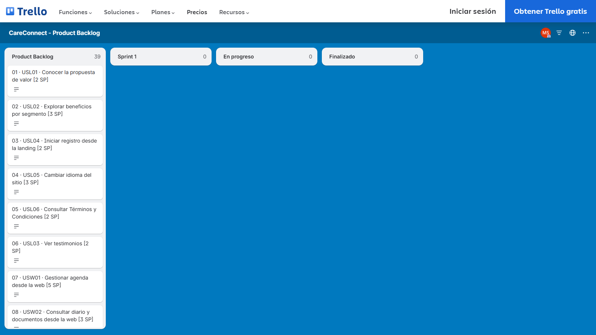


### 3.4. Impact Mapping
El Impact Mapping representa la relación entre las tres metas SMART de CareConnect, los actores que influyen en ellas, los cambios de comportamiento esperados y los entregables que los habilitan. La versión actual incorpora las experiencias móvil, web y Landing Page.

El Impact Map permite visualizar cómo las funcionalidades clave de la aplicación se alinean con los objetivos de negocio, considerando a los actores involucrados y los impactos esperados en su comportamiento.

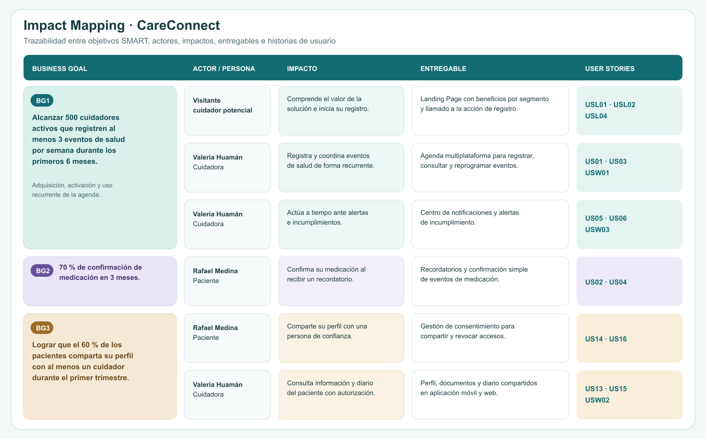

**Business Goals (SMART)**
- **BG1:** Alcanzar 500 cuidadores activos que registren al menos 3 eventos de salud por semana en los primeros 6 meses post-lanzamiento.
- **BG2:** Lograr una tasa de confirmación de eventos de medicación del 70% por parte de los pacientes en los primeros 3 meses.
- **BG3:** Conseguir que el 60% de los pacientes comparta su perfil con al menos un cuidador durante el primer trimestre.

| Business Goal | Actor / Persona | Impact | Deliverable | User Stories |
|---------------|-----------------|--------|-------------|--------------|
| BG1 | Visitante (cuidador potencial) | Comprende el valor de la solución e inicia su registro | Landing Page con beneficios por segmento y llamado a la acción | USL01, USL02, USL04 |
| BG1 | Cuidador (Valeria Huamán) | Registra y coordina los eventos de salud de forma regular | Agenda multiplataforma con registro y reprogramación de eventos | US01, US03, USW01 |
| BG1 | Cuidador (Valeria Huamán) | Actúa a tiempo ante incumplimientos | Centro de notificaciones y alertas de incumplimiento | US05, US06, USW03 |
| BG2 | Paciente (Rafael Medina) | Confirma su medicación al recibir el recordatorio | Recordatorios y confirmación simple de eventos | US02, US04 |
| BG3 | Paciente (Rafael Medina) | Comparte su perfil con un familiar o cuidador | Gestión de consentimiento para compartir y revocar accesos | US14, US16 |
| BG3 | Cuidador (Valeria Huamán) | Consulta el perfil, los documentos y el diario compartidos | Vistas compartidas en la aplicación móvil y web | US13, US15, USW02 |
<!-- ===== FIN CAPÍTULO ASIGNADO ===== -->

## Capítulo IV: Product Design

### 4.1. Style Guidelines

#### 4.1.1. General Style Guidelines

CareConnect busca un tono que transmita **calidez humana, confianza y claridad**, propio de un producto que media el cuidado de personas mayores o dependientes entre pacientes, cuidadores (familiares o profesionales) y personal médico. La comunicación evita la frialdad clínica de un software hospitalario tradicional y prioriza beneficios emocionales antes que técnicos: la propia landing page abre con "Organiza el cuidado diario de tus seres queridos" y "una herramienta diseñada para brindar **paz mental** a las familias", no con una lista de funciones.

**Dimensiones de tono**

| Dimensión | Posición de CareConnect | Justificación |
|---|---|---|
| Divertido ↔ Serio | Cercano al polo **Serio** | Se maneja información de salud (medicación, diagnósticos, adherencia a tratamiento); el copy de la landing usa términos como "ansiedad", "incumplimiento" y "urgente" sin suavizarlos, priorizando la seriedad del caso de uso. |
| Formal ↔ Casual | Punto medio, ligeramente **Casual** | Los saludos personalizados ("Hola, Mariana", "Buenos días") y CTAs cortos ("Comienza ahora") son casuales, pero los formularios (Crear cuenta, Compartir perfil) mantienen etiquetas formales en mayúsculas. |
| Respetuoso ↔ Irreverente | Totalmente **Respetuoso** | Ningún microcopy usa humor; incluso los estados negativos se comunican con vocabulario neutro y accionable ("Omisión de medicación", "Resolver"), nunca alarmista sin salida. |
| Entusiasta ↔ Sereno | Cercano al polo **Sereno** | Paleta suave, tipografía redondeada y mensajes como "Podrás revocar este acceso en cualquier momento" transmiten control y calma frente a una tarea que de por sí genera estrés (cuidar a un familiar). |

**Branding**

El wordmark "Care Connect" se presenta partido en dos líneas con un ícono de conexión (barra vertical + curva) a la izquierda, en el color violeta/índigo institucional. La marca se sostiene en fotografía real de vínculo intergeneracional (abuela y cuidadora abrazadas) tanto en la landing como en la pantalla de bienvenida de la app, reforzando "cuidado que se siente como en casa" por sobre la estética de dashboard médico.

**Typography**

Se identifica una única familia **sans-serif geométrica/redondeada**, con pesos diferenciados por jerarquía (no dos familias como se estimó preliminarmente): peso *bold/extrabold* para titulares y wordmark, peso *regular/medium* para cuerpo de texto, y una variante en mayúsculas con tracking amplio para labels de formulario ("CORREO DEL CUIDADOR", "PERMISOS DE ACCESO"). Jerarquía observada: H1 ~40px (hero de landing), H2 ~28px ("Funciones principales", "Cómo funciona"), H3 ~18–20px (nombre de card/paciente), cuerpo 15–16px, caption/label 11–12px.

**Colors**

| Color | Uso |
|---|---|
| Violeta/Índigo primario (~#6C5CE7) | CTA principal en landing ("Probar app", "Comienza ahora") y en app ("Confirmar toma", "Compartir perfil", "Subir documento"), ícono activo del bottom nav, borde de badge "Cuidador". |
| Navy/Índigo oscuro (~#1E1B4B) | Titulares de landing, wordmark, texto de alto contraste. |
| Negro/Carbón (~#1A1A1A) | Botón "Elegir plan" del Plan Anual y badge "AHORRA MÁS", usado como acento de contraste para el plan destacado, diferenciándolo del violeta usado en el resto del producto. |
| Crema/Arena (~#FDF6EC) | Fondo general de la app (Inicio, Perfil, Documentos, Diario) y de la card "Bienestar hoy" en el hero de landing. |
| Verde salvia / menta (badge "Paciente", card "Bienestar hoy") | Estados positivos y el rol Paciente. |
| Lavanda claro (card "Acceso compartido" en Funciones principales) | Resalta la función diferencial del producto (compartir cuidado) sobre el resto de tarjetas en blanco. |
| Naranja (badge "PENDIENTE", "Evento no confirmado") | Alertas de atención media. |
| Rojo (badge "URGENTE", "Alerta de incumplimiento") | Estados críticos que requieren acción inmediata. |
| Gris/blanco | Badge "LEÍDO", texto secundario, bordes y campos de formulario. |

**Spacing**

Unidad base de 8px. Las tarjetas de landing y de app comparten el mismo radio de borde amplio (16–24px), y los botones usan radio total tipo *pill*. En la landing, las secciones se separan por bandas de fondo alterno (blanco / crema) en vez de líneas divisorias, patrón que se replica en la app entre el header y el contenido scrolleable.

#### 4.1.2. Web Style Guidelines

La landing page de CareConnect ya está en producción como sitio web responsivo y define el estándar a extender a un eventual panel de escritorio para cuidadores profesionales:

- **Header fijo (sticky)**: logo a la izquierda, navegación central (Inicio, Funciones, Beneficios, Precio, Contacto) y CTA violeta "Probar app" a la derecha, visible en todo momento durante el scroll.
- **Grid**: hero en dos columnas (contenido + mockup de teléfono) en desktop, que colapsa a una columna en mobile; las secciones de beneficios y funciones usan grillas de 3 y de 2–3 columnas respectivamente, con gutter generoso.
- **Componentes**: `Card` para beneficios/funciones/planes, `Badge` para "AHORRA MÁS", `Button` primario (violeta, relleno) y secundario (violeta, outline) — mismo componente reutilizado en toda la web y coherente con los botones de la app.
- **Breakpoints**: mobile (<768px, una columna, nav colapsado a menú hamburguesa), tablet (768–1024px), desktop (>1024px, layout de dos columnas en el hero tal como está implementado).
- **Interacción**: transiciones suaves (~200ms) en hover de botones y tarjetas; el mockup del teléfono en el hero refuerza visualmente el producto real sin necesidad de video o animación compleja.

#### 4.1.3. Mobile Style Guidelines

##### 4.1.3.1. iOS Mobile Style Guidelines

- Tipografía del sistema **SF Pro** para elementos nativos (notificaciones push, teclado, `UIDatePicker`), reservando la tipografía de marca para textos propios de la app.
- Respeto de **Safe Area** superior (notch/Dynamic Island): el header "CareConnect" con ícono de escudo/seguridad y campana de notificaciones se ubica debajo del área segura, como se ve en la pantalla de bienvenida implementada.
- Bottom Tab Bar nativo con 5 ítems (Inicio, Agenda, Documentos, Diario, Perfil), ícono e label activos en violeta.
- Selector de fecha (`Fecha del documento` en Subir documento) debe usar el `UIDatePicker` nativo tipo rueda, más apto para usuarios mayores que un teclado numérico libre.

##### 4.1.3.2. Android Mobile Style Guidelines

- Alineado a **Material Design 3**, tipografía Roboto para componentes nativos, manteniendo la tipografía de marca en headers custom.
- **Ripple effect** en botones primarios ("Confirmar toma", "Compartir perfil", "Subir documento") para reforzar feedback táctil.
- Bottom Navigation Bar de Material con indicador tipo "pill" violeta detrás del ítem activo.
- `Snackbar` para confirmaciones no críticas (ej. "Documento subido") y `AlertDialog` reservado para acciones sensibles como revocar el acceso de un cuidador.

### 4.2. Information Architecture

#### 4.2.1. Organization Systems

La arquitectura se organiza en tres capas:

1. **Por rol** (definido en el registro: Paciente o Cuidador), que determina el copy y alcance de cada módulo — ej. Documentos dice "Gestiona y revisa el historial médico de forma segura" para el paciente y "Archivos compartidos de Elena García para su seguimiento médico" para el cuidador.
2. **Por paciente vinculado**: un cuidador puede tener varios "Pacientes asignados"; el dashboard del cuidador lista cada paciente con su estado ("Activo") y permite entrar a su ficha completa (nombre, condición clínica, movilidad, plan emocional y preferencias).
3. **Por permiso granular**: el flujo "Compartir perfil" introduce un sistema de permisos explícito por módulo (Agenda, Documentos, Diario), de forma que el paciente decide **qué** puede ver cada cuidador, no solo **quién** tiene acceso.

#### 4.2.2. Labeling Systems

| Etiqueta | Contenido que representa |
|---|---|
| Inicio | Dashboard con resumen del paciente/pacientes: medicación pendiente, resumen del día. |
| Agenda | Calendario de medicación, terapias y citas médicas del día/mes. |
| Documentos | Historial médico digitalizado (recetas, laboratorios, informes, carnet de vacunación). |
| Diario | Registro del bienestar diario: síntomas, ánimo, alimentación, presión, glucosa. |
| Perfil | Datos de cuenta, rol, verificación y gestión de accesos. |
| Confirmar toma | Registrar que una dosis de medicación fue administrada. |
| Compartir perfil | Invitar a un cuidador por correo y otorgarle permisos específicos. |
| Gestionar accesos | Ver y revocar los permisos otorgados a cuidadores. |
| Pacientes asignados / vinculados | Listado de pacientes bajo cuidado de un cuidador. |
| Resumen del día / de tareas | Contadores de eventos pendientes, confirmados/completados e incumplidos/omitidos. |
| Notificaciones | Centro de alertas: eventos no confirmados, incumplimientos, documentos actualizados, recordatorios. |

#### 4.2.3. SEO Tags and Meta Tags

**Landing Page**

| Tag | Valor |
|---|---|
| Title | CareConnect — Organiza el cuidado diario de tus seres queridos |
| Description | Gestiona tratamientos, citas y recordatorios en un solo lugar. CareConnect brinda paz mental a las familias y el mejor cuidado para los mayores. |
| Keywords | cuidado de adultos mayores, app de cuidadores, agenda de medicación, historial médico digital, diario de bienestar, acceso compartido, cuidado geriátrico. |
| Author | Equipo CareConnect |

**Web / Mobile Application**

| Tag | Valor |
|---|---|
| Title | CareConnect App — Panel de Cuidado y Seguimiento |
| Description | Agenda de medicación, documentos médicos, diario de bienestar y acceso compartido para pacientes y cuidadores. |
| Keywords | agenda de medicación, historial clínico, diario del paciente, cuidador familiar, permisos de acceso, notificaciones de salud. |
| Author | Equipo CareConnect |

#### 4.2.4. Searching Systems

- **Documentos**: barra "Buscar documentos…" que filtra por nombre, tipo (Receta, Laboratorio, Informe, Vacuna, PDF, Digital, Imagen, DOCX) y sección (Recientes / Historial anual), cada resultado con badge de tipo codificado por color.
- **Agenda**: navegación por calendario (mes/día) con selector "◀ Octubre 2023 ▶", en vez de buscador de texto libre, dado que el usuario busca por fecha, no por palabra clave.
- **Notificaciones**: no hay buscador; se resuelve por orden cronológico inverso y por badges de estado (Pendiente, Urgente, Leído) que permiten escanear prioridad visualmente.

#### 4.2.5. Navigation Systems

- **Bottom Nav persistente** (Inicio, Agenda, Documentos, Diario, Perfil) idéntico en estructura para Paciente y Cuidador, con ítem activo resaltado en violeta.
- **Navegación de flujo con retorno explícito** ("←") en tareas puntuales: Subir documento, Compartir perfil, Notificaciones — todas permiten volver sin perder el contexto de origen.
- **Accesos rápidos contextuales**: el dashboard del cuidador incluye botones directos "Revisar agenda", "Ver documentos", "Ver diario" **del paciente actualmente enfocado**, evitando pasar por el bottom nav para tareas de seguimiento inmediato.
- **Navegación cruzada Paciente ↔ Cuidador**: desde el Perfil del paciente, "Compartir perfil" abre el flujo que —del lado del cuidador— se traduce en un nuevo "Paciente vinculado" visible en su propio dashboard y Perfil.

### 4.3. Landing Page UI Design

#### 4.3.1. Landing Page Wireframe

La estructura de la landing sigue una jerarquía descendente clásica de conversión:

1. **Header** fijo: logo, navegación (Inicio, Funciones, Beneficios, Precio, Contacto), selector ES/EN y CTA "Probar app".
2. **Hero**: titular + subtítulo + doble CTA ("Comienza ahora" / "Ver funciones") + mockup del dashboard real de la app.
3. **Beneficios** ("Pensado para pacientes, cuidadores y familias"): 3 columnas con ícono, título y descripción.
4. **Proceso** ("Cómo funciona"): 3 pasos numerados.
5. **Funciones principales**: grilla de 5 tarjetas (una destacada — Acceso compartido).
6. **Planes** ("Planes simples para tu cuidado diario"): 2 tarjetas de precio comparadas.

El alcance lingüístico de la Landing Page para TB1 es **bilingüe: español (`es`) e inglés (`en`)**. El selector ES/EN usa `i18next` y `react-i18next` para cambiar los textos de la interfaz, las etiquetas accesibles y los metadatos de la página. La elección se conserva al recargar. No se contemplan otros idiomas en esta entrega. El mockup del hero es una imagen del prototipo móvil y conserva el idioma de la captura.

La sección **About the Team** muestra una miniatura y un botón para cargar el video incrustado de YouTube cuando el visitante lo solicite. **About the Product** abre el video de CareConnect en Microsoft Stream mediante el botón principal o el enlace directo. Ambos accesos están traducidos a español e inglés. El estado de validación del contenido enlazado se describe en §6.1.4.

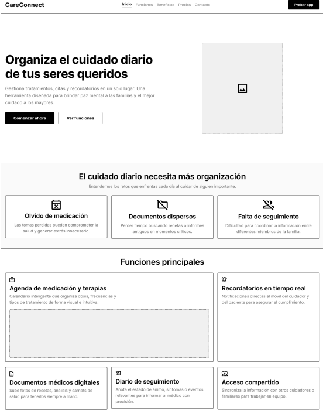
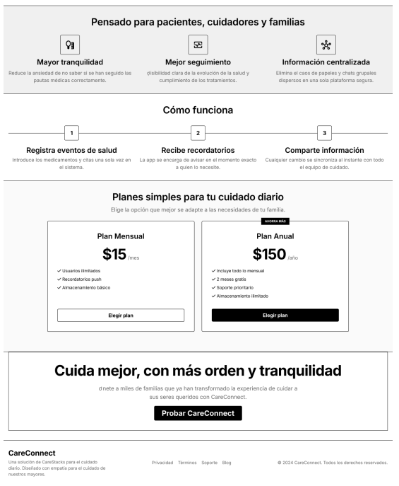

#### 4.3.2. Landing Page Mock-up

**Elementos del Diseño**

| Elemento | Justificación |
|---|---|
| Colour | El violeta se reserva para toda acción de conversión (Probar app, Comienza ahora, Elegir plan del plan mensual, Ver funciones), mientras que el negro/carbón se usa exclusivamente en el "Plan Anual" y su badge "AHORRA MÁS", generando un contraste deliberado que dirige la mirada hacia el plan que la empresa quiere vender más. La tarjeta "Acceso compartido" usa fondo lavanda en lugar de blanco, destacándola visualmente sobre las otras cuatro funciones sin necesidad de texto adicional ("función diferencial"). |
| Shape | Las tarjetas de beneficios, funciones y planes comparten el mismo radio de borde amplio que las tarjetas dentro de la app (Inicio, Documentos, Diario), generando continuidad formal entre el sitio público y el producto. Los pasos de "Cómo funciona" usan círculos numerados en vez de íconos, priorizando la secuencia sobre la ilustración. |
| Size | El titular del hero es el elemento tipográfico más grande de toda la landing, seguido de los títulos de sección ("Funciones principales", "Cómo funciona") y por último el cuerpo de cada tarjeta. Los precios ("$15", "$150") son notablemente más grandes que el resto del texto de su tarjeta, priorizando el dato de decisión de compra. |
| Space | Cada sección de la landing está delimitada por espacio vertical amplio y no por líneas, replicando el patrón "banda de color alterno" (blanco / crema) para separar bloques sin saturar. |
| Direction | El flujo es estrictamente vertical y de conversión creciente: hero (propuesta de valor) → beneficios (por qué importa) → cómo funciona (cómo se usa) → funciones (qué incluye) → planes (cuánto cuesta), acompañando el recorrido natural de decisión de un usuario que evalúa contratar el servicio para su familia. |
| Texture | El mockup del teléfono en el hero muestra la app real en uso (no una ilustración genérica), funcionando como prueba social implícita de que el producto ya existe y funciona. |

**Heurísticas de Usabilidad (Jakob Nielsen)**

| Heurística | Justificación |
|---|---|
| H1 – Visibilidad del estado del sistema | El mockup del hero muestra el estado real de la app (medicación "PENDIENTE", resumen "4 / 12 / 0"), comunicando al visitante qué va a ver exactamente al instalar la app, sin necesidad de descripciones abstractas. |
| H2 – Relación sistema/mundo real | El copy usa vocabulario familiar del cuidado cotidiano ("ansiedad de no saber si se han seguido las pautas", "caos de papeles y chats grupales") en vez de terminología de producto SaaS, conectando directamente con el dolor real del usuario objetivo (familias cuidadoras). |
| H4 – Consistencia y estándares | El botón "Probar app" del header y "Comienza ahora" del hero usan el mismo estilo violeta relleno, mientras "Ver funciones" usa el mismo violeta en outline, estableciendo desde el primer vistazo qué botón es la acción primaria y cuál la secundaria en toda la página. |
| H6 – Reconocer antes que recordar | Las dos tarjetas de precio muestran sus features completas en la misma vista (sin acordeones ni "ver más"), permitiendo comparar Plan Mensual vs. Plan Anual sin necesidad de recordar los datos de una al leer la otra. |
| H8 – Diseño estético y minimalista | Cada sección limita su contenido a lo esencial: 3 beneficios, 3 pasos, 5 funciones, 2 planes — números redondos y escaneables que evitan la fatiga de decisión en una landing dirigida también a usuarios mayores o poco digitales. |

**Principios de Arquitectura de Información**

| Principio | Justificación |
|---|---|
| Choices | La sección de planes ofrece exactamente dos alternativas comparables (Mensual vs. Anual), con el ahorro anual explícito ("2 meses gratis"), simplificando la decisión de compra a un solo criterio dominante (compromiso corto vs. ahorro). |
| Disclosure | La landing revela información en capas: el hero comunica el beneficio central en una frase, "Funciones principales" detalla el qué, y el precio se posterga hasta el final, cuando el usuario ya entendió el valor — evitando anclar la conversación en el costo antes que en el beneficio. |
| Exemplars | El mockup del hero usa un caso concreto y humano ("Hola, Mariana", Losartán 50mg, 8:00 a.m.) en lugar de datos genéricos tipo "Usuario X", haciendo tangible el producto desde el primer segundo. |

**Principios de Inclusive Design**

| Principio | Justificación |
|---|---|
| P2 – Considera la situación del usuario | El público de la landing incluye adultos mayores y familiares con distinta alfabetización digital; el copy evita jerga técnica y los CTAs son cortos y directos ("Comienza ahora"), reduciendo la carga cognitiva de la primera visita. |
| P6 – Prioriza el contenido | La tarjeta "Acceso compartido" se destaca cromáticamente sobre el resto de funciones porque es el diferenciador competitivo real del producto (coordinación entre múltiples cuidadores), priorizándola sin necesidad de agrandar su tamaño. |
| P7 – Agrega valor | Mostrar el resumen del día (pendientes/confirmados/incumplidos) directamente en el hero, antes de que el usuario cree una cuenta, agrega valor al anticipar el tipo de control y tranquilidad que tendrá una vez dentro del producto. |

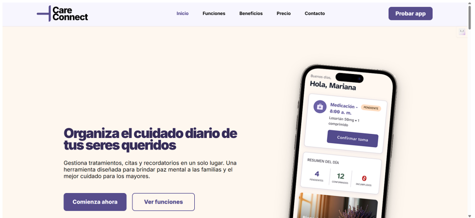
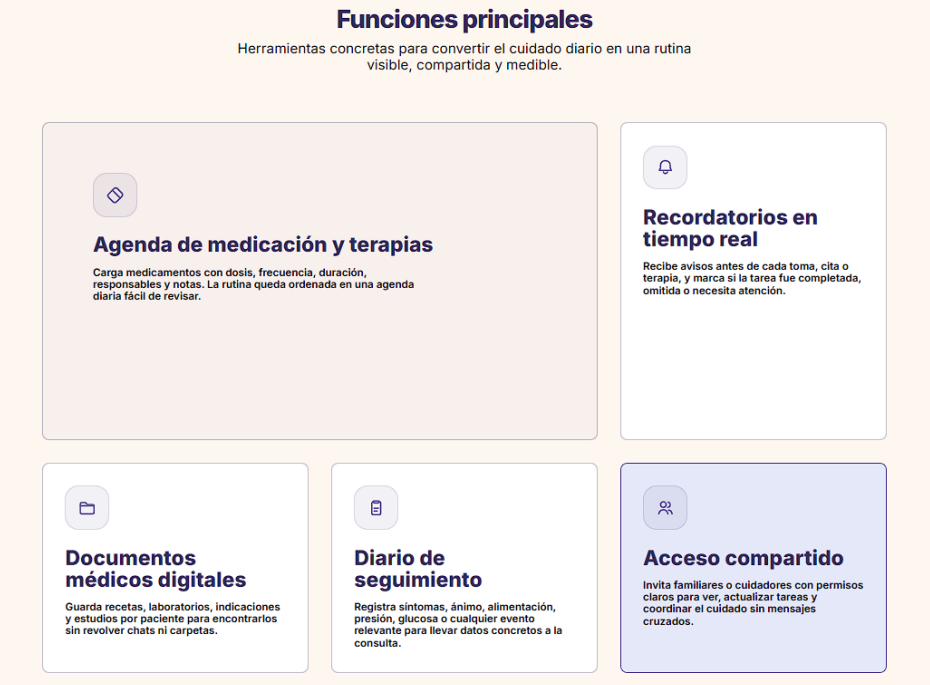

### 4.4. Mobile Applications UX/UI Design

#### 4.4.1. Mobile Applications Wireframes

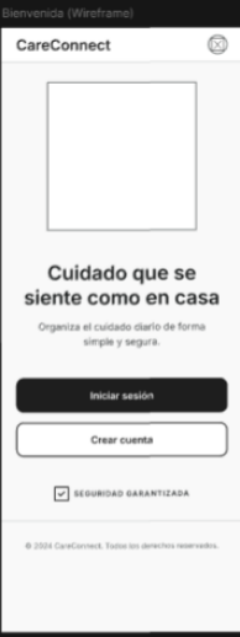

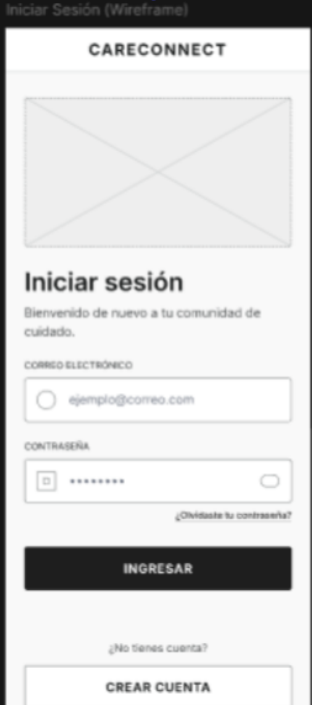

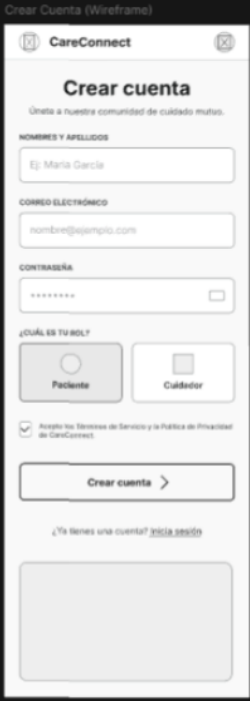

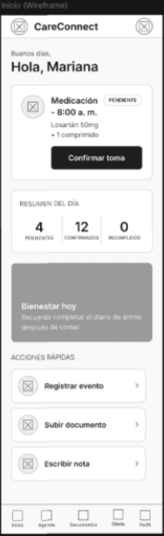

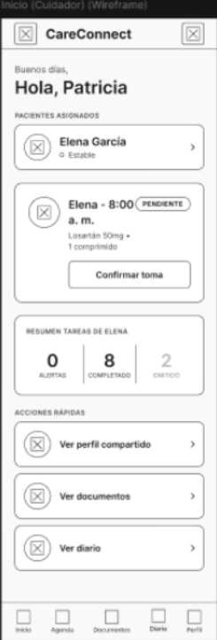

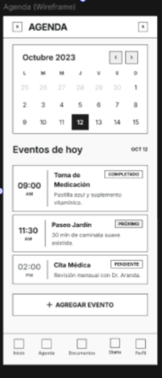

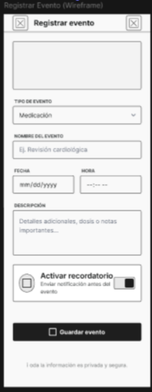

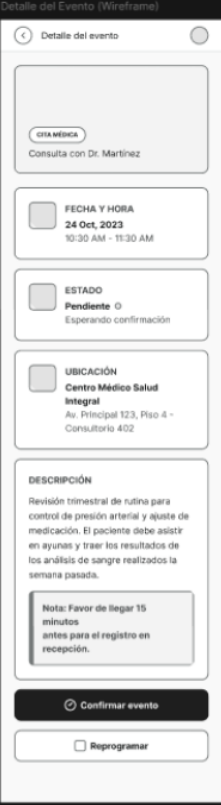

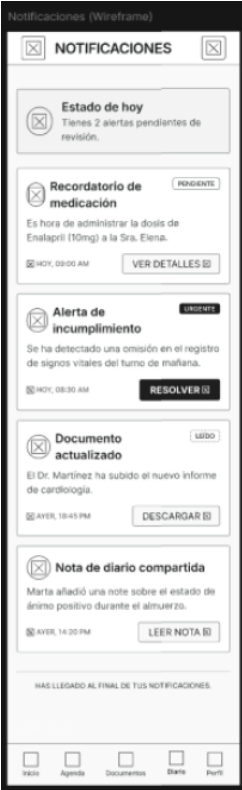

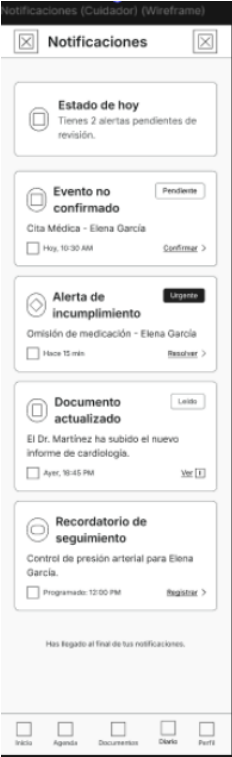


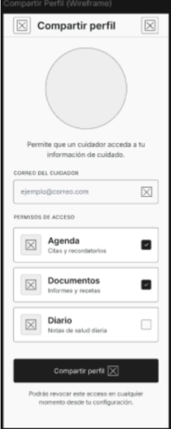

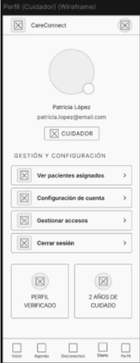

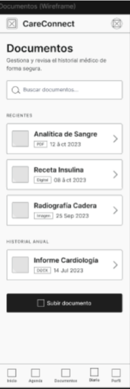

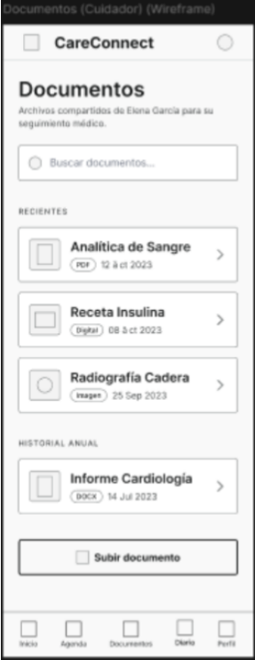

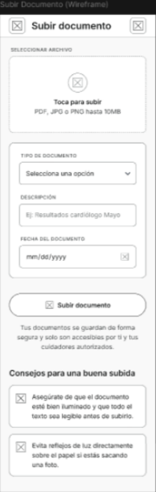

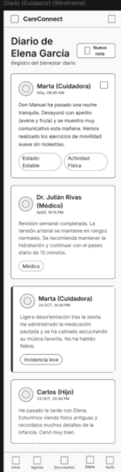

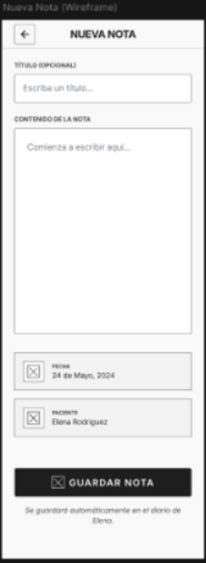

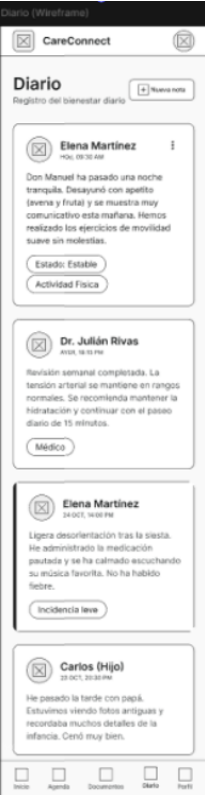


**Elementos del Diseño**

| Elemento | Justificación |
|---|---|
| Shape | Ya desde el wireframe, las tarjetas de tarea (medicación, cita, paseo) y de paciente usan rectángulos de esquinas redondeadas, mientras que los avatares de paciente son placeholders circulares, estableciendo la distinción forma-persona vs. forma-contenido desde la etapa de baja fidelidad. |
| Size | En "Inicio (Cuidador)" el saludo "Hola, Patricia" y el nombre del paciente "Elena García" son los elementos de mayor jerarquía tipográfica de la pantalla, por encima de los datos de la tarea (Losartán 50mg), priorizando el reconocimiento de personas sobre el detalle clínico en el primer vistazo. |
| Space | En Agenda, el espacio entre eventos del día (Toma de Medicación, Paseo Jardín, Cita Médica) es uniforme y suficiente para lectura rápida con el pulgar, consistente con el contexto de uso mientras se atiende a un paciente. |
| Direction | El wireframe de Agenda ordena los eventos del día de forma cronológica ascendente (09:00 → 11:30 → 02:00 PM), replicando el orden natural en que ocurrirán, y coloca "+ Agregar evento" al final del flujo de lectura, no al inicio, para no interrumpir el repaso del día. |
| Line | Los únicos bordes explícitos del wireframe son los del calendario (Agenda) y los campos de formulario (Crear cuenta, Iniciar sesión); el resto de la separación entre secciones se resuelve por espacio, validando que la jerarquía funciona incluso sin color. |

**Heurísticas de Usabilidad (Jakob Nielsen)**

| Heurística | Justificación |
|---|---|
| H1 – Visibilidad del estado del sistema | Cada evento de Agenda muestra su badge de estado (COMPLETADO, PRÓXIMO, PENDIENTE) directamente en la fila, sin necesidad de abrir el detalle, ya desde el wireframe de baja fidelidad. |
| H3 – Libertad y control del usuario | El wireframe de "Compartir Perfil" incluye una "✕" de cierre además del posible retorno, dando al usuario dos formas de abandonar el flujo de invitar a un cuidador sin completar la acción. |
| H4 – Consistencia y estándares | El bottom nav de 5 ítems (Inicio, Agenda, Documentos, Diario, Perfil) aparece idéntico en wireframe tanto para "Inicio (Cuidador)" como en Agenda, confirmando que la estructura de navegación se definió antes que el estilo visual. |
| H5 – Prevención de errores | En Crear Cuenta (wireframe), la selección de rol usa botones exclusivos tipo radio (Paciente / Cuidador) en vez de checkboxes, evitando que el sistema reciba una combinación de roles inválida. |
| H6 – Reconocer antes que recordar | El wireframe de "Compartir Perfil" ya contempla, antes del alto nivel de fidelidad, una lista explícita de permisos por módulo (Agenda, Documentos, Diario) visibles simultáneamente, evitando que el paciente deba recordar qué otorgó al cuidador en una pantalla previa. |

**Principios de Arquitectura de Información**

| Principio | Justificación |
|---|---|
| Objects | Desde el wireframe, cada evento de Agenda se define como un objeto con atributos propios (hora, título, descripción, estado), anticipando la estructura de datos que luego alimentará también las Notificaciones (mismo tipo de evento, distinto canal de visualización). |
| Choices | El wireframe de "Perfil" ofrece explícitamente dos variantes según rol —Perfil (Paciente) con "Gestionar accesos" y Perfil (Cuidador) con "Ver pacientes asignados"— validando la ramificación de la arquitectura por rol antes de invertir en diseño visual. |
| Front doors | Los tres wireframes de Perfil/Compartir Perfil/Perfil (Cuidador) están diseñados para ser autosuficientes: cada uno repite el header con logo y controles de cierre, de modo que un usuario que entra directo a "Compartir Perfil" desde una notificación entiende igual el contexto. |

**Principios de Inclusive Design**

| Principio | Justificación |
|---|---|
| P3 – Sé consistente | El patrón "avatar + nombre + badge de estado" se repite idéntico entre el wireframe de paciente en Inicio (Cuidador) y el de evento en Agenda, reduciendo la curva de aprendizaje entre módulos desde la etapa de boceto. |
| P5 – Ofrece opciones | El wireframe de Iniciar Sesión contempla tanto el ingreso por correo/contraseña como el enlace "¿Olvidaste tu contraseña?", cubriendo desde baja fidelidad el caso de usuario recurrente que no logra autenticarse. |

#### 4.4.2. Mobile Applications Wireflow Diagrams

La aplicación móvil cubre siete *user goals*, cada uno documentado con su propio wireflow.

##### User Goal 1: Registro y selección de rol

<!-- Insertar wireflow del User Goal 1 -->

Bienvenida → Crear cuenta (datos + rol Paciente/Cuidador + aceptación de términos) → Inicio según rol.

##### User Goal 2: Inicio de sesión

<!-- Insertar wireflow del User Goal 2 -->

Bienvenida → Iniciar sesión (correo/contraseña) → [¿Credenciales válidas?] → Sí: Inicio / No: error + "¿Olvidaste tu contraseña?".

##### User Goal 3: Confirmar toma de medicación (Cuidador)

<!-- Insertar wireflow del User Goal 3 -->

Inicio (Cuidador) → tarjeta "Elena – 8:00 a.m. PENDIENTE" → "Confirmar toma" → resumen de tareas se actualiza (COMPLETADO +1) sin salir del dashboard.

##### User Goal 4: Compartir el perfil con un nuevo cuidador (Paciente)

<!-- Insertar wireflow del User Goal 4 -->

Perfil (Paciente) → "Gestionar accesos"/"Compartir perfil" → ingresar correo del cuidador → seleccionar permisos (Agenda/Documentos/Diario) → "Compartir perfil" → confirmación → el paciente aparece como "Paciente vinculado" en el Perfil del cuidador invitado.

##### User Goal 5: Revisar y resolver notificaciones (Cuidador)

<!-- Insertar wireflow del User Goal 5 -->

Inicio (Cuidador) → ícono de campana → Notificaciones → [tipo de alerta] → Evento no confirmado: "Confirmar" / Alerta de incumplimiento: "Resolver" / Documento actualizado: "Ver" → retorno a Notificaciones con el ítem actualizado.

##### User Goal 6: Registrar un evento en Agenda

<!-- Insertar wireflow del User Goal 6 -->

Agenda → "+ Agregar evento" → completar tipo, hora y detalle → guardar → el evento aparece en "Eventos de hoy" en su posición cronológica correspondiente.

##### User Goal 7: Subir un documento médico

<!-- Insertar wireflow del User Goal 7 -->

Documentos → "Subir documento" → seleccionar archivo → tipo/descripción/fecha → "Subir documento" → documento visible en "Recientes".

#### 4.4.3. Mobile Applications Mock-ups

**Elementos del Diseño**

| Elemento | Justificación |
|---|---|
| Colour | El violeta como color de acción única se mantiene disciplinadamente en toda la app de alta fidelidad: "Confirmar toma", "Compartir perfil", "Subir documento" comparten el mismo tono exacto, enseñando al usuario a reconocer la acción principal en cualquier pantalla sin ambigüedad. Los badges de rol usan color semántico propio: verde para "Paciente", violeta/azulado para "Cuidador", distinguiendo identidad de estado. |
| Shape | En "Compartir perfil", la ilustración circular de manos entrelazadas (en violeta) humaniza una pantalla técnica de permisos, coherente con el tono cálido definido en 4.1.1, y contrasta con los checkboxes cuadrados de permisos, diferenciando "emoción" de "configuración" dentro de la misma pantalla. |
| Size | En Documentos, el tipo de archivo (PDF, Digital, Imagen, DOCX) se muestra como badge pequeño bajo el nombre del documento, mientras que el nombre del documento es el elemento de mayor tamaño de cada fila, priorizando qué es el documento sobre en qué formato está. |
| Texture | El ícono de escudo junto a la hora en el header de la app implementada (pantalla de Bienvenida) comunica seguridad de forma persistente y sutil, sin necesidad de un texto explicativo adicional. |

**Heurísticas de Usabilidad (Jakob Nielsen)**

| Heurística | Justificación |
|---|---|
| H1 – Visibilidad del estado del sistema | En Compartir perfil, los checkboxes de "Agenda" y "Documentos" aparecen premarcados mientras "Diario" no, comunicando una configuración de permisos sugerida por defecto (información operativa sí, notas íntimas de bienestar no) que el paciente puede ajustar antes de confirmar. |
| H3 – Libertad y control del usuario | El texto "Podrás revocar este acceso en cualquier momento desde tu configuración" en Compartir perfil reduce la fricción emocional de otorgar acceso a datos de salud, al garantizar reversibilidad antes de que el usuario decida compartir. |
| H5 – Prevención de errores | En Subir documento, el límite de archivo ("PDF, JPG o PNG hasta 10MB") y los consejos de captura ("Evita reflejos de luz directamente sobre el papel") se muestran antes de intentar la subida, anticipando los errores más comunes en usuarios que fotografían documentos físicos. |
| H9 – Reconocer y recuperarse de errores | En Notificaciones, cada alerta trae su propia acción de resolución en el mismo ítem ("Confirmar", "Resolver", "Ver", "Registrar"), evitando que el cuidador deba navegar a otro módulo para atender el problema señalado. |

**Principios de Arquitectura de Información**

| Principio | Justificación |
|---|---|
| Multiple classification | Un documento puede localizarse por tipo (Receta, Laboratorio, Informe, Vacuna), por recencia (Recientes) o por período (Historial anual), atendiendo distintos modelos mentales de búsqueda según si el usuario recuerda el nombre, la fecha o la categoría clínica. |
| Growth | El sistema de permisos de Compartir perfil está preparado para escalar a más módulos sin rediseño: cada nuevo módulo de la app (ej. un futuro "Finanzas del cuidado") solo necesitaría sumarse como una fila más de checkbox en la misma pantalla. |

**Principios de Inclusive Design**

| Principio | Justificación |
|---|---|
| P1 – Proporciona experiencias comparables | Perfil (Paciente) y Perfil (Cuidador) comparten exactamente la misma estructura visual (foto, nombre, badge de rol, acciones de cuenta, métricas destacadas), garantizando una experiencia igualmente completa y reconocible para ambos roles. |
| P4 – Deja al usuario mandar | El paciente decide qué comparte (Compartir perfil) y puede revocarlo después (Gestionar accesos); el sistema nunca otorga visibilidad automática de los datos sensibles del Diario a un cuidador sin consentimiento explícito. |

**Aplicación móvil — pantallas implementadas**

**Bienvenida** — *User Goal 1: Registro y selección de rol / User Goal 2: Inicio de sesión*

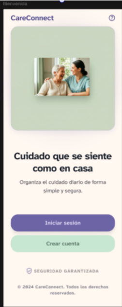

**Iniciar sesión** — *User Goal 2: Inicio de sesión*

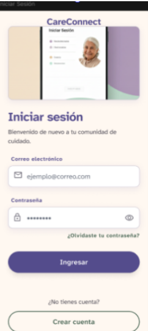

**Crear cuenta** — *User Goal 1: Registro y selección de rol*

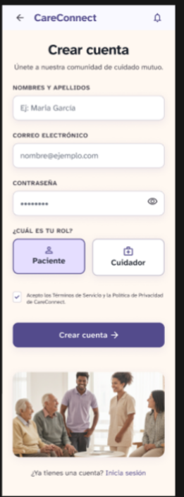

**Inicio (Paciente)** — *User Goal 1: Registro y selección de rol / User Goal 2: Inicio de sesión*


**Inicio (Cuidador)** — *User Goal 3: Confirmar toma de medicación (Cuidador)*


**Agenda** — *User Goal 6: Registrar un evento en Agenda*


**Registrar evento** — *User Goal 6: Registrar un evento en Agenda*


**Detalle del evento** — *Pantalla complementaria de Agenda*


**Notificaciones (Paciente)** — *User Goal 5: Revisar y resolver notificaciones (Cuidador)*


**Notificaciones (Cuidador)** — *User Goal 5: Revisar y resolver notificaciones (Cuidador)*


**Perfil (Paciente)** — *User Goal 4: Compartir el perfil con un nuevo cuidador (Paciente)*


**Compartir perfil** — *User Goal 4: Compartir el perfil con un nuevo cuidador (Paciente)*


**Perfil (Cuidador)** — *Pantalla complementaria de Perfil*


**Documentos (Cuidador)** — *User Goal 7: Subir un documento médico*


**Documentos (Paciente)** — *User Goal 7: Subir un documento médico*


**Subir documento** — *User Goal 7: Subir un documento médico*


**Diario (Paciente)** — *Pantalla complementaria de Diario*


**Nueva nota** — *Pantalla complementaria de Diario*


**Diario (Cuidador)** — *Pantalla complementaria de Diario*


#### 4.4.4. Mobile Applications User Flow Diagrams

Un user flow por objetivo de usuario, contemplando *happy path* y *unhappy path*:

1. **Registrarse en la plataforma**
   - *Happy path*: Bienvenida → Crear cuenta → completar datos → seleccionar rol → aceptar términos → cuenta creada → Inicio.
   - *Unhappy path*: campo obligatorio vacío o términos no aceptados → botón "Crear cuenta" inhabilitado/error inline → usuario corrige → reintenta.

2. **Iniciar sesión**
   - *Happy path*: Iniciar sesión → credenciales correctas → Inicio según rol.
   - *Unhappy path*: credenciales incorrectas → mensaje de error → "¿Olvidaste tu contraseña?" → recuperación → nuevo intento.

3. **Confirmar toma de medicación**
   - *Happy path*: Inicio (Cuidador) → tarea "PENDIENTE" → "Confirmar toma" → contador "COMPLETADOS" se actualiza.
   - *Unhappy path*: el cuidador no confirma en el horario → el sistema reclasifica el evento como "INCUMPLIDO"/"OMITIDO" → se genera una "Alerta de incumplimiento" en Notificaciones para seguimiento.

4. **Compartir el perfil con un cuidador**
   - *Happy path*: Perfil (Paciente) → Compartir perfil → correo del cuidador + permisos seleccionados → "Compartir perfil" → invitación enviada → el cuidador ve al paciente en "Pacientes vinculados".
   - *Unhappy path*: correo inválido o cuidador ya vinculado → el sistema muestra el error en el campo → usuario corrige el correo y reenvía la invitación.

5. **Revisar y resolver una notificación**
   - *Happy path*: campana de notificaciones → alerta "Evento no confirmado" → "Confirmar" → notificación pasa a resuelta.
   - *Unhappy path*: alerta "Urgente" (omisión de medicación) sin resolver a tiempo → permanece visible en "Estado de hoy" hasta que el cuidador ejecuta "Resolver", evitando que se pierda entre notificaciones ya leídas.

6. **Subir un documento médico**
   - *Happy path*: Documentos → Subir documento → archivo válido → tipo/descripción/fecha → "Subir documento" → documento visible en "Recientes".
   - *Unhappy path*: archivo excede 10MB o formato no soportado → el sistema rechaza el archivo mostrando el requisito ("PDF, JPG o PNG hasta 10MB") → usuario selecciona un archivo válido y reintenta.

7. **Registrar un evento en Agenda**
   - *Happy path*: Agenda → "+ Agregar evento" → completar hora, tipo y detalle → guardar → evento visible en "Eventos de hoy" en su horario correspondiente.
   - *Unhappy path*: hora del evento en conflicto con otro ya registrado → el sistema advierte el solapamiento antes de guardar → usuario ajusta el horario y confirma.


### 4.5. Mobile Applications Prototyping

Esta sección documenta el prototipado interactivo de la aplicación móvil de CareStacks. Para cubrir ambos segmentos objetivo (cuidador y paciente) y ambas plataformas nativas, se utilizaron dos bases de código distintas heredadas del proyecto anterior:

- **iOS → segmento Cuidador**, con la aplicación desarrollada en **Flutter**.
- **Android → segmento Paciente**, con la aplicación nativa desarrollada en **Kotlin + Jetpack Compose**.

#### 4.5.1. Android Mobile Applications Prototyping

| Pantalla | Captura |
|---|---|
| Perfil |  |
| Inicio / Bienvenida |  |
| Inicio de sesión |  |
| Registro |  |
| Home (Paciente) |  |
| Agenda |  |
| Agregar evento de agenda |  |
| Diario |  |
| Agregar nota de diario |  |
| Documentos |  |
| Notificaciones |  |
| Gestionar accesos |  |

**Video del prototipo (Android)**

| Captura del video | Enlace |
|:---:|:---:|
|  | [Ver video en Microsoft Stream](https://upcedupe-my.sharepoint.com/:v:/g/personal/u202319563_upc_edu_pe/IQCxyxzTeImsTaBVopDNXHyUAdGQYZnmlXXGn62jhU8cayU?nav=eyJyZWZlcnJhbEluZm8iOnsicmVmZXJyYWxBcHAiOiJPbmVEcml2ZUZvckJ1c2luZXNzIiwicmVmZXJyYWxBcHBQbGF0Zm9ybSI6IldlYiIsInJlZmVycmFsTW9kZSI6InZpZXciLCJyZWZlcnJhbFZpZXciOiJNeUZpbGVzTGlua0NvcHkifX0&e=noqJKl) |

#### 4.5.2. iOS Mobile Applications Prototyping

El prototipo fue ejecutado y validado en un simulador de iOS, correspondiente a la aplicación multiplataforma en **Flutter**, enfocada en el segmento **cuidador**: gestión de pacientes asignados, agenda, diario compartido, documentos médicos y notificaciones. Las capturas fueron tomadas con el backend local (CareConnect API) conectado y datos de prueba reales (un paciente vinculado a un cuidador mediante el módulo de Gestión de Consentimiento).

| Pantalla | Captura |
|---|---|
| Perfil |  |
| Inicio de sesión |  |
| Registro |  |
| Home (Cuidador) |  |
| Agenda |  |
| Diario |  |
| Documentos |  |
| Notificaciones |  |

**Video del prototipo (iOS)**

| Captura del video | Enlace |
|:---:|:---:|
|  | [Ver video en Microsoft Stream](https://upcedupe-my.sharepoint.com/:v:/g/personal/u202319563_upc_edu_pe/IQD8hwXPwgf_RJSGdsPc4diHAUM7uH7Tff9QItUFv6-Pegw?e=UDYvyk) |

### 4.6. Web Applications UX/UI Design

El diseño de la aplicación web de CareConnect contempla los principales recorridos del cuidador: registro e inicio de sesión, consulta del resumen diario, gestión de agenda, revisión de documentos, registro en el diario, consulta del perfil y visualización de notificaciones.

- [Archivo editable de wireframes, flujos y mock-ups en Figma](https://www.figma.com/design/1TzGaaQLzkBu26Ojno1AVU/CareConnect-%E2%80%94-Web-Applications-UX-UI-Design--4.6-?node-id=4-5&p=f)

#### 4.6.1. Web Applications Wireframes

Los wireframes presentan la estructura de baja fidelidad de las ocho vistas principales. Permiten validar la jerarquía, la navegación, la distribución de contenido y las acciones antes de aplicar el sistema visual definitivo. El conjunto incluye las pantallas de iniciar sesión, crear cuenta, inicio, agenda, documentos, diario, perfil y notificaciones; se encuentra organizado en la página **01 Wireframes** del archivo de Figma.

| Iniciar sesión | Crear cuenta |
|---|---|
|  |  |

| Inicio | Agenda |
|---|---|
|  |  |

| Documentos | Diario |
|---|---|
|  |  |

| Perfil | Notificaciones |
|---|---|
|  |  |

#### 4.6.2. Web Applications Wireflow Diagrams

El Wireflow representa el recorrido de navegación de izquierda a derecha. El cuidador crea una cuenta o accede con sus credenciales y llega a **Inicio**, desde donde puede abrir Agenda, Documentos, Diario, Perfil y Notificaciones. La campana proporciona acceso lateral a las notificaciones y todas las pantallas conservan un retorno claro al inicio.


*Figura 1. Wireflow y User Flow de la aplicación web de CareConnect, organizados para una lectura de izquierda a derecha.*

#### 4.6.3. Web Applications Mock-ups

Los mock-ups de alta fidelidad mantienen una identidad visual serena y accesible, con predominio del morado, fondos cálidos, tarjetas de contraste suave y estados vacíos claramente comunicados. El conjunto completo está disponible en la página **03 Mock-ups** del archivo de Figma.

| Autenticación | Acceso principal |
|---|---|
|  |  |
|  |  |

| Seguimiento y cuenta | Vistas del portal |
|---|---|
|  |  |
|  |  |

#### 4.6.4. Web Applications User Flow Diagrams

El User Flow, presentado junto al Wireflow en la figura anterior, representa las rutas satisfactorias y de error del cuidador. Incluye las decisiones sobre la existencia de una cuenta, la validez de los datos de registro y de las credenciales, la corrección y el reintento, además de la selección de la tarea principal. Las rutas satisfactorias concluyen con la ejecución de una tarea en Agenda, Documentos, Diario, Perfil o Notificaciones.

[Ver el Wireflow y User Flow editables en la página **02 UX Flows** de Figma](https://www.figma.com/design/1TzGaaQLzkBu26Ojno1AVU/CareConnect-%E2%80%94-Web-Applications-UX-UI-Design--4.6-?node-id=4-5&p=f)

### 4.7. Web Applications Prototyping

A diferencia del prototipado en Figma (4.6), esta sección documenta el **prototipo funcional** de la aplicación web de CareStacks: una adaptación a escritorio de la base Flutter del segmento cuidador, ejecutada en navegador (`flutter run -d chrome`) y conectada al backend real de CareConnect API, con datos de prueba reales.

El prototipo reemplaza el layout móvil original (bottom nav, columna única) por un sistema responsive de tres anchos con sidebar de navegación, jerarquía visual en tarjetas (hero/standard/quiet/flat) y un panel de detalle lateral, manteniendo intacta la paleta de colores definida en `app_colors.dart`.

| Pantalla | Captura |
|---|---|
| Perfil |  |
| Inicio de sesión |  |
| Registro |  |
| Home (Cuidador) |  |
| Agenda |  |
| Diario |  |
| Documentos |  |
| Notificaciones |  |

**Video del prototipo (Web)**

| Captura del video | Enlace |
|:---:|:---:|
|  | [Ver video en Microsoft Stream](https://upcedupe-my.sharepoint.com/:v:/g/personal/u202319563_upc_edu_pe/IQCe4c3pMvTBRq2J8EtwN-b3AaO8jwiZA8ZkR9gq_FFT60I?e=bigaiv&nav=eyJyZWZlcnJhbEluZm8iOnsicmVmZXJyYWxBcHAiOiJTdHJlYW1XZWJBcHAiLCJyZWZlcnJhbFZpZXciOiJTaGFyZURpYWxvZy1MaW5rIiwicmVmZXJyYWxBcHBQbGF0Zm9ybSI6IldlYiIsInJlZmVycmFsTW9kZSI6InZpZXcifX0%3D) |

### 4.8. Domain-Driven Software Architecture

La arquitectura de software de **CareConnect** se define tomando como base los principios de Domain-Driven Design (DDD) y el modelo C4. El diseño busca separar las responsabilidades del negocio mediante bounded contexts con límites explícitos, manteniendo al mismo tiempo una arquitectura que permita que las diferentes aplicaciones cliente consuman los servicios centrales del producto.

A nivel estratégico, CareConnect se encuentra organizado en seis bounded contexts: **Agenda, Notificaciones, Documentos, Gestión de Consentimiento, Diario de Seguimiento y Autenticación (IAM)**. Esta separación se deriva del EventStorming, el Context Mapping y los Bounded Context Canvases elaborados previamente, permitiendo que cada subdominio conserve sus propias reglas de negocio y lenguaje ubicuo.

Los bounded contexts **Agenda, Notificaciones y Diario de Seguimiento** concentran las funcionalidades principales vinculadas al seguimiento cotidiano del paciente. **Documentos** y **Gestión de Consentimiento** brindan capacidades de soporte relacionadas con información clínica y control de acceso, mientras que **Autenticación (IAM)** se encarga de la identidad, las sesiones y los roles de usuario.

A nivel de implementación, los bounded contexts no se despliegan como microservicios independientes. Estos se encuentran organizados como módulos dentro de un único backend RESTful, conservando la separación conceptual establecida mediante DDD.

La solución considera actualmente una Landing Page, una aplicación móvil Android, un backend RESTful, una base de datos relacional y almacenamiento externo de documentos. Para el alcance del curso 1ASI0732 también se contempla una **Frontend Web Application** independiente de la Landing Page.

---

#### 4.8.1. Software Architecture Context Diagram

El Software Architecture Context Diagram representa a **CareConnect** como un único sistema de software y muestra las personas y sistemas externos con los que interactúa. Este nivel permite comprender el alcance general de la solución sin mostrar todavía detalles relacionados con containers, componentes o tecnologías internas.

Los dos actores principales del sistema son el **Paciente geriátrico** y el **Cuidador**.

El Paciente geriátrico utiliza CareConnect para consultar sus actividades de salud, confirmar eventos, recibir recordatorios, gestionar documentos médicos, registrar información en su diario de seguimiento y administrar los permisos mediante los cuales otros usuarios pueden acceder a determinada información.

El Cuidador utiliza la solución para supervisar las actividades del paciente, consultar información autorizada, visualizar documentos médicos, recibir alertas y apoyar en la coordinación diaria del cuidado.

CareConnect también interactúa con diferentes servicios externos:

- **Firebase Cloud Messaging:** permite entregar notificaciones push a los dispositivos de los usuarios.
- **SendGrid:** permite enviar correos electrónicos transaccionales.
- **Identity Provider:** permite integrar autenticación federada mediante proveedores externos.
- **Supabase Storage:** proporciona almacenamiento privado para los archivos médicos gestionados por el sistema.

##### Elementos del Context Diagram

| Elemento | Tipo | Responsabilidad |
|---|---|---|
| Paciente geriátrico | Persona | Consulta y administra información relacionada con su cuidado. |
| Cuidador | Persona | Supervisa y coordina las actividades de cuidado del paciente. |
| CareConnect | Sistema | Centraliza agenda, notificaciones, documentos, diario, permisos e identidad. |
| Firebase Cloud Messaging | Sistema externo | Entrega notificaciones push. |
| SendGrid | Sistema externo | Envía correos electrónicos transaccionales. |
| Identity Provider | Sistema externo | Proporciona autenticación federada cuando corresponde. |
| Supabase Storage | Sistema externo | Almacena de forma privada los archivos médicos. |

##### Relaciones principales

| Origen | Destino | Relación |
|---|---|---|
| Paciente geriátrico | CareConnect | Gestiona actividades, información médica y seguimiento. |
| Cuidador | CareConnect | Supervisa al paciente y consulta información autorizada. |
| CareConnect | Firebase Cloud Messaging | Solicita la entrega de notificaciones push. |
| CareConnect | SendGrid | Solicita el envío de correos electrónicos. |
| CareConnect | Identity Provider | Solicita o verifica identidad federada. |
| CareConnect | Supabase Storage | Almacena y recupera archivos médicos privados. |


*Figura 2. Software Architecture Context Diagram de CareConnect.*

---

#### 4.8.2. Software Architecture Container Diagrams

El Software Architecture Container Diagram descompone CareConnect en sus principales unidades ejecutables y de almacenamiento. Este nivel permite representar las aplicaciones que conforman la solución, sus responsabilidades, las tecnologías utilizadas y los mecanismos de comunicación entre ellas.

El backend se representa como un **único RESTful API**. Los bounded contexts Agenda, Notificaciones, Documentos, Gestión de Consentimiento, Diario de Seguimiento y Autenticación se encuentran organizados internamente dentro de este backend y no corresponden a seis microservicios independientes.

Esta decisión permite conservar los límites conceptuales definidos mediante Domain-Driven Design sin introducir complejidad distribuida innecesaria.

##### Containers de CareConnect

| Container | Tecnología | Estado | Responsabilidad |
|---|---|---|---|
| Landing Page | React + Vite + TypeScript | Implementado | Presenta el producto, la problemática y la propuesta de valor. |
| Frontend Web Application | Flutter (Web target) | Implementado | Proporciona una experiencia funcional desde navegador web para el segmento cuidador. |
| Mobile Application (iOS) | Flutter | Implementado | Aplicación para el segmento cuidador, ejecutada en simulador/dispositivo iOS. |
| Mobile Application (Android) | Kotlin + Jetpack Compose | Implementado | Aplicación nativa para el segmento paciente. |
| Backend RESTful API | Java 25 + Spring Boot 4 | Implementado | Expone los casos de uso y reglas de los seis bounded contexts. |
| Relational Database | PostgreSQL (H2 en desarrollo local) | Implementado | Persiste la información estructurada del sistema. |
| Local Storage | Room / SQLite | Implementado | Mantiene información local y caché para soporte offline. |

##### Relaciones entre containers

| Origen | Destino | Protocolo | Responsabilidad |
|---|---|---|---|
| Mobile Application | Backend RESTful API | HTTPS / JSON | Consume los casos de uso de CareConnect. |
| Frontend Web Application | Backend RESTful API | HTTPS / JSON | Consume los servicios del dominio desde web. |
| Mobile Application | Local Storage | Room / SQLite | Almacena y consulta información local. |
| Backend RESTful API | PostgreSQL | JDBC / TLS | Persiste los datos estructurados. |
| Backend RESTful API | Supabase Storage | HTTPS | Gestiona los archivos médicos privados. |
| Backend RESTful API | Firebase Cloud Messaging | HTTPS | Solicita el envío de notificaciones push. |
| Backend RESTful API | SendGrid | HTTPS | Solicita el envío de correos electrónicos. |
| Backend RESTful API | Identity Provider | OAuth 2.0 / HTTPS | Integra autenticación federada. |

##### Consideración tecnológica

El backend implementado utiliza **Java 25 y Spring Boot 4**. El Final Project Statement del curso establece ASP.NET Core y C# como tecnologías de referencia para Web Services; el equipo optó por conservar el stack Java/Spring heredado del proyecto anterior (CareConnect), decisión que debe ser validada con el docente.

La Frontend Web Application se implementó reutilizando la base **Flutter** ya desarrollada para el segmento cuidador (compilada al target Web de Flutter), en lugar de Vue + PrimeVue. Esta decisión permitió reutilizar el sistema de diseño, componentes y capa de datos ya validados en la aplicación móvil, evitando reescribir la lógica de negocio en un stack distinto. Esta desviación respecto al stack sugerido por el curso debe ser validada con el docente; de no ser aceptada, se evaluará una migración hacia el stack requerido.


*Figura 3. Software Architecture Container Diagram de CareConnect.*

---

#### 4.8.3. Software Architecture Components Diagrams

El Software Architecture Components Diagram representa la organización interna del container **Backend RESTful API**. Cada bounded context se modela como un componente independiente dentro del backend, manteniendo sus propias reglas de negocio, lenguaje ubicuo y responsabilidades.

##### Componentes principales

| Componente | Clasificación | Responsabilidad |
|---|---|---|
| Autenticación / IAM | Generic Domain | Gestiona identidad, usuarios, sesiones y roles. |
| Gestión de Consentimiento | Supporting Domain | Gestiona permisos y acceso compartido a información del paciente. |
| Agenda | Core Domain | Administra eventos de salud, citas, medicación y actividades. |
| Notificaciones | Core Domain | Programa y gestiona recordatorios y alertas. |
| Diario de Seguimiento | Core Domain | Registra observaciones y evolución del paciente. |
| Documentos | Supporting Domain | Gestiona metadata y acceso a documentos médicos. |
| Shared Components | Shared Infrastructure | Proporciona auditoría, excepciones y utilidades técnicas comunes. |

##### Relaciones principales entre componentes

- **Autenticación / IAM** proporciona identidad a los demás bounded contexts.
- **Gestión de Consentimiento** determina qué cuidadores se encuentran autorizados para acceder a información de un paciente.
- **Agenda** puede originar eventos que son procesados por Notificaciones para generar recordatorios.
- **Gestión de Consentimiento** puede originar eventos relacionados con invitaciones, accesos y revocaciones.
- **Diario de Seguimiento** y **Documentos** pueden originar comunicaciones que deben ser procesadas por Notificaciones.
- **Notificaciones** concentra la integración con Firebase Cloud Messaging y SendGrid.
- **Documentos** encapsula la integración con Supabase Storage.


*Figura 4. Software Architecture Components Diagram del Backend RESTful API de CareConnect.*

---

### 4.9. Software Object-Oriented Design

El diseño orientado a objetos de CareConnect traduce el modelo conceptual definido mediante Domain-Driven Design a clases, entidades, Aggregate Roots, Value Objects, Domain Services y contratos de persistencia.

Cada bounded context conserva su propio modelo. Esta decisión evita que las entidades internas de un bounded context sean utilizadas directamente como entidades internas de otro contexto, reduciendo el acoplamiento entre módulos.

Las interacciones entre bounded contexts se realizan principalmente mediante identificadores, contratos de aplicación y eventos de dominio.

---

#### 4.9.1. Class Diagrams

Se utilizan diagramas de clases independientes para cada bounded context. Esta estrategia permite representar de forma clara las entidades, agregados, Value Objects, servicios y relaciones correspondientes a cada parte del dominio sin generar un único diagrama excesivamente complejo.

##### Bounded Context: Agenda

El bounded context Agenda controla los eventos de salud asociados a un paciente. `HealthEvent` representa una cita médica, medicamento o actividad terapéutica, mientras que `Reminder` representa un recordatorio relacionado con un evento programado.


*Figura 5. Diagrama de clases del bounded context Agenda.*

##### Bounded Context: Notificaciones

El bounded context Notificaciones administra las comunicaciones generadas por CareConnect, incluyendo recordatorios, alertas y preferencias de comunicación.


*Figura 6. Diagrama de clases del bounded context Notificaciones.*

##### Bounded Context: Diario de Seguimiento

El bounded context Diario de Seguimiento gestiona las notas registradas sobre la evolución del paciente.


*Figura 7. Diagrama de clases del bounded context Diario de Seguimiento.*

##### Bounded Context: Gestión de Consentimiento

Este bounded context controla el ciclo de vida de los accesos compartidos entre pacientes y cuidadores.


*Figura 8. Diagrama de clases del bounded context Gestión de Consentimiento.*

##### Bounded Context: Documentos

El bounded context Documentos administra la información asociada a documentos médicos y la referencia necesaria para acceder a los archivos almacenados externamente.


*Figura 9. Diagrama de clases del bounded context Documentos.*

##### Bounded Context: Autenticación / IAM

El bounded context Autenticación gestiona las cuentas de usuario, autenticación, sesiones y roles de CareConnect.

La entidad principal es `User`, que contiene información relacionada con el correo electrónico, hash de contraseña, nombre completo, rol, estado de la cuenta, intentos fallidos de autenticación y bloqueo temporal.


*Figura 10. Diagrama de clases del bounded context Autenticación / IAM.*

---

#### 4.9.2. Class Dictionary

El Diccionario de Clases complementa los Diagramas de Clases mediante la descripción de los principales elementos del diseño orientado a objetos de CareConnect. Para cada bounded context se identifica el tipo de cada elemento, sus atributos relevantes y tipos de datos, sus principales operaciones y su responsabilidad dentro del dominio.

Los atributos y operaciones definidos en esta sección se encuentran alineados con el modelo de dominio representado en los Diagramas de Clases. Asimismo, los atributos relacionados con persistencia mantienen correspondencia con el diseño de base de datos presentado en la sección 4.10.

---

##### Bounded Context Agenda

El bounded context Agenda administra los eventos de salud asociados a un paciente, incluyendo citas, actividades relacionadas con medicamentos, actividades terapéuticas, recordatorios y reglas de programación.

| Clase | Tipo | Atributos y tipos | Métodos / Operaciones principales | Responsabilidad |
|---|---|---|---|---|
| `Agenda` | Raíz de Agregado | `id: UUID`<br>`patientId: UUID` | `addEvent(HealthEvent)`<br>`removeEvent(UUID)`<br>`getEvents()`<br>`findEvent(UUID)` | Actúa como raíz del agregado del bounded context Agenda y administra la colección de eventos de salud asociados a un paciente. |
| `HealthEvent` | Entidad | `id: UUID`<br>`type: EventType`<br>`dateTime: EventDateTime`<br>`status: EventStatus` | `reschedule(EventDateTime)`<br>`changeStatus(EventStatus)`<br>`createReminder(LocalDateTime)` | Representa una cita, actividad de medicación, actividad terapéutica u otro evento relacionado con la salud del paciente. |
| `Reminder` | Entidad | `id: UUID`<br>`eventId: UUID`<br>`scheduledAt: LocalDateTime` | `reschedule(LocalDateTime)`<br>`isDue(LocalDateTime)` | Representa un recordatorio asociado a un evento de salud previamente programado. |
| `EventDateTime` | Objeto de Valor | `value: LocalDateTime` | `value()`<br>`isBefore(EventDateTime)`<br>`isAfter(EventDateTime)` | Encapsula la fecha y hora asignadas a un evento de salud. |
| `EventType` | Enumeración / Objeto de Valor | Valores que representan citas, medicación y actividades terapéuticas | — | Clasifica el tipo de evento de salud registrado en la agenda. |
| `EventStatus` | Enumeración / Objeto de Valor | Valores que representan los estados del ciclo de vida de un evento | — | Representa el estado actual de un evento de salud. |
| `ScheduleValidationService` | Servicio de Dominio | — | `validateSchedule(EventDateTime)` | Valida restricciones horarias y conflictos de programación antes de registrar o reprogramar un evento de salud. |
| `EventSchedulerService` | Servicio de Dominio | — | `schedule(HealthEvent)`<br>`reschedule(HealthEvent, EventDateTime)` | Aplica las reglas de dominio relacionadas con la programación y reprogramación de eventos de salud. |
| `AgendaRepository` | Interfaz de Repositorio | — | `save(Agenda)`<br>`findById(UUID)`<br>`findByPatientId(UUID)` | Define el contrato de persistencia requerido por el bounded context Agenda. |

---

##### Bounded Context Notifications

El bounded context Notifications administra las notificaciones, alertas, preferencias de comunicación y canales utilizados por CareConnect para comunicar información relevante a sus usuarios.

| Clase | Tipo | Atributos y tipos | Métodos / Operaciones principales | Responsabilidad |
|---|---|---|---|---|
| `NotificationCenter` | Raíz de Agregado | — | `addNotification(Notification)`<br>`addAlert(Alert)`<br>`updatePreference(NotificationPreference)` | Actúa como raíz del agregado responsable de coordinar notificaciones, alertas y preferencias de comunicación de los usuarios. |
| `Notification` | Entidad | `id: UUID`<br>`content: NotificationContent`<br>`type: NotificationType`<br>`priority: NotificationPriority`<br>`status: NotificationStatus`<br>`scheduledAt: LocalDateTime` | `schedule(LocalDateTime)`<br>`changeStatus(NotificationStatus)`<br>`markAsDelivered()` | Representa una comunicación generada por CareConnect para un usuario. |
| `Alert` | Entidad | `id: UUID`<br>`recipientId: UUID`<br>`createdAt: LocalDateTime`<br>`resolvedAt: LocalDateTime` | `resolve()`<br>`isResolved()` | Representa una alerta generada cuando una situación requiere atención especial por parte del usuario. |
| `NotificationPreference` | Entidad | `id: UUID`<br>`userId: UUID`<br>`channel: DeliveryChannel`<br>`enabled: Boolean` | `enable()`<br>`disable()`<br>`changeChannel(DeliveryChannel)` | Almacena las preferencias de comunicación configuradas por un usuario. |
| `NotificationContent` | Objeto de Valor | `title: String`<br>`message: String` | `title()`<br>`message()` | Encapsula el contenido textual mostrado dentro de una notificación. |
| `NotificationType` | Enumeración / Objeto de Valor | Valores que representan el tipo funcional de notificación | — | Clasifica las notificaciones según su propósito dentro de CareConnect. |
| `NotificationPriority` | Enumeración / Objeto de Valor | Valores que representan la prioridad de una notificación | — | Indica el nivel de prioridad asignado a una notificación. |
| `NotificationStatus` | Enumeración / Objeto de Valor | Valores que representan el ciclo de vida de una notificación | — | Representa el estado actual de una notificación. |
| `DeliveryChannel` | Enumeración / Objeto de Valor | `PUSH`<br>`EMAIL`<br>`IN_APP` | — | Identifica el canal mediante el cual se entrega una notificación. |
| `AlertEvaluationService` | Servicio de Dominio | — | `evaluate(Alert)` | Evalúa si una determinada condición del dominio debe generar una alerta. |
| `NotificationDispatchService` | Servicio de Dominio | — | `dispatch(Notification)` | Coordina el envío de las notificaciones a través del canal configurado. |
| `NotificationRepository` | Interfaz de Repositorio | — | `save(Notification)`<br>`findById(UUID)`<br>`findByRecipientId(UUID)` | Define el contrato de persistencia para las notificaciones. |

---

##### Bounded Context Diary Tracking

El bounded context Diary Tracking administra la información registrada durante el proceso de cuidado del paciente, permitiendo documentar observaciones y cambios relevantes a lo largo del tiempo.

| Clase | Tipo | Atributos y tipos | Métodos / Operaciones principales | Responsabilidad |
|---|---|---|---|---|
| `Diary` | Raíz de Agregado | `id: UUID`<br>`patientId: UUID` | `addEntry(DiaryEntry)`<br>`removeEntry(UUID)`<br>`getEntries()` | Actúa como raíz del agregado responsable de administrar las entradas del diario asociadas a un paciente. |
| `DiaryEntry` | Entidad | `id: UUID`<br>`content: EntryContent`<br>`date: EntryDate` | `updateContent(EntryContent)`<br>`changeDate(EntryDate)` | Representa una entrada individual registrada dentro del diario del paciente. |
| `EntryContent` | Objeto de Valor | `value: String` | `value()`<br>`isEmpty()` | Encapsula y valida el contenido textual de una entrada del diario. |
| `EntryDate` | Objeto de Valor | Valor de fecha asociado a la entrada | `value()` | Encapsula la fecha asociada a una entrada del diario. |
| `DiaryRepository` | Interfaz de Repositorio | — | `save(Diary)`<br>`findById(UUID)`<br>`findByPatientId(UUID)` | Define las operaciones de persistencia requeridas por el bounded context Diary Tracking. |

---

##### Bounded Context Consent Management

El bounded context Consent Management controla la manera en que los pacientes comparten su información con los cuidadores, incluyendo solicitudes de acceso, permisos, expiración del acceso, revocación y tokens de compartición.

| Clase | Tipo | Atributos y tipos | Métodos / Operaciones principales | Responsabilidad |
|---|---|---|---|---|
| `ProfileSharing` | Raíz de Agregado | `id: UUID`<br>`patientId: UUID`<br>`createdAt: LocalDateTime` | `requestAccess(UUID)`<br>`grantAccess(SharedAccess)`<br>`revokeAccess(UUID)` | Actúa como raíz del agregado que administra el ciclo de vida del perfil compartido de un paciente. |
| `AccessRequest` | Entidad | `id: UUID`<br>`profileSharingId: UUID`<br>`caregiverId: UUID`<br>`status: AccessStatus`<br>`createdAt: LocalDateTime` | `approve()`<br>`reject()`<br>`changeStatus(AccessStatus)` | Representa una solicitud realizada por un cuidador para obtener acceso a la información compartida de un paciente. |
| `SharedAccess` | Entidad | `id: UUID`<br>`profileSharingId: UUID`<br>`caregiverId: UUID`<br>`userId: UUID`<br>`token: ShareToken`<br>`permission: AccessPermission`<br>`status: AccessStatus`<br>`expiresAt: ExpirationDate` | `activate()`<br>`revoke()`<br>`isExpired()`<br>`changePermission(AccessPermission)` | Representa un permiso de acceso otorgado a un cuidador sobre el perfil compartido de un paciente. |
| `ShareToken` | Objeto de Valor | Valor del token utilizado para identificar un acceso compartido | `value()` | Encapsula el token único utilizado para compartir de manera segura el acceso a un perfil. |
| `ExpirationDate` | Objeto de Valor | Fecha y hora de expiración del acceso compartido | `isExpired()`<br>`value()` | Encapsula la fecha de expiración asociada a un acceso compartido. |
| `AccessStatus` | Enumeración / Objeto de Valor | `PENDING`<br>`ACTIVE`<br>`REVOKED`<br>`EXPIRED` | — | Representa el estado actual de una solicitud o permiso de acceso compartido. |
| `AccessPermission` | Enumeración / Objeto de Valor | Valores que representan el nivel de permiso otorgado | — | Representa el nivel de permiso asignado a un cuidador. |
| `ProfileSharingService` | Servicio de Dominio | — | `createSharing(UUID)`<br>`revokeSharing(UUID)` | Aplica las reglas de dominio relacionadas con la creación y revocación del acceso compartido. |
| `AccessValidationService` | Servicio de Dominio | — | `validateToken(ShareToken)`<br>`validateExpiration(ExpirationDate)`<br>`validateAccess(SharedAccess)` | Valida tokens de compartición, fechas de expiración, estados y condiciones de acceso. |
| `SharedProfileRepository` | Interfaz de Repositorio | — | `save(ProfileSharing)`<br>`findById(UUID)`<br>`findByPatientId(UUID)` | Define el contrato de persistencia utilizado por la gestión de perfiles compartidos y consentimiento. |

---

##### Bounded Context Documents

El bounded context Documents administra los metadatos y referencias asociados a documentos médicos. Los archivos físicos se almacenan externamente, mientras que el modelo de dominio conserva la información necesaria para identificarlos y recuperarlos.

| Clase | Tipo | Atributos y tipos | Métodos / Operaciones principales | Responsabilidad |
|---|---|---|---|---|
| `MedicalDocument` | Raíz de Agregado | `id: UUID`<br>`patientId: UUID`<br>`createdAt: LocalDateTime` | `addItem(DocumentItem)`<br>`removeItem(UUID)`<br>`getItems()` | Actúa como raíz del agregado de la documentación médica asociada a un paciente. |
| `DocumentItem` | Entidad | `id: UUID`<br>`type: DocumentType`<br>`metadata: DocumentMetadata`<br>`storageKey: String` | `changeMetadata(DocumentMetadata)`<br>`changeType(DocumentType)`<br>`changeStorageKey(String)` | Representa un archivo o elemento documental individual asociado a un paciente. |
| `DocumentMetadata` | Objeto de Valor | `description: String`<br>`date: Date`<br>`origin: String` | `description()`<br>`date()`<br>`origin()` | Encapsula los metadatos descriptivos asociados a un documento médico. |
| `DocumentType` | Enumeración / Objeto de Valor | Valores que representan la categoría de documento médico | — | Clasifica los documentos médicos de acuerdo con su tipo funcional. |
| `DocumentRepository` | Interfaz de Repositorio | — | `save(MedicalDocument)`<br>`findById(UUID)`<br>`findByPatientId(UUID)` | Define las operaciones de persistencia requeridas por el bounded context Documents. |

El atributo `storageKey` hace referencia al archivo externo almacenado en Supabase Storage. De esta manera, CareConnect almacena en PostgreSQL los metadatos del documento y la referencia hacia el almacenamiento externo, en lugar de almacenar directamente el archivo médico como datos binarios dentro de la base de datos relacional.

---

##### Bounded Context Authentication / IAM

El bounded context Authentication / IAM administra las cuentas de usuario de CareConnect, la autenticación, los roles de autorización, la validación de sesiones, el estado de las cuentas y el bloqueo temporal después de intentos de acceso fallidos.

| Clase | Tipo | Atributos y tipos | Métodos / Operaciones principales | Responsabilidad |
|---|---|---|---|---|
| `User` | Entidad | `email: String`<br>`passwordHash: String`<br>`fullName: String`<br>`role: UserRole`<br>`active: Boolean`<br>`failedLoginAttempts: Int`<br>`lockedUntil: LocalDateTime` | `activate()`<br>`deactivate()`<br>`registerFailedLogin()`<br>`resetFailedLoginAttempts()`<br>`lockUntil(LocalDateTime)`<br>`isLocked()` | Representa una cuenta de usuario de CareConnect y aplica las reglas de dominio asociadas a la activación y bloqueo temporal de cuentas. |
| `UserRole` | Enumeración | Valores que representan los roles funcionales disponibles en CareConnect | — | Identifica el rol funcional asignado a un usuario. |
| `AuthService` | Contrato de Servicio de Aplicación | — | `register(...)`<br>`login(...)`<br>`logout(...)`<br>`validateSession(...)` | Define las operaciones de aplicación requeridas para el registro, autenticación, cierre de sesión y validación de sesiones. |
| `AuthServiceImpl` | Servicio de Aplicación | — | `register(...)`<br>`login(...)`<br>`logout(...)`<br>`validateSession(...)` | Implementa los casos de uso de autenticación definidos mediante `AuthService`. |
| `UserRepository` | Interfaz de Repositorio | — | `save(User)`<br>`findByEmail(String)`<br>`findById(UUID)` | Define el contrato de persistencia requerido para almacenar y recuperar cuentas de usuario. |
| `UserJpaEntity` | Entidad de Persistencia | Representación persistente de la entidad `User` | — | Representa el modelo de persistencia utilizado para almacenar la información de los usuarios en la base de datos relacional. |
| `UserMapper` | Mapper | — | `toDomain(UserJpaEntity)`<br>`toEntity(User)` | Convierte entre el modelo de dominio `User` y su representación de persistencia. |
| `AuthController` | Controlador REST | — | `register(...)`<br>`login(...)`<br>`logout(...)`<br>`validateSession(...)` | Expone las operaciones de autenticación mediante la API RESTful. |

La representación persistente asociada a `User` almacena los siguientes datos en PostgreSQL:

| Atributo | Tipo de persistencia |
|---|---|
| `id` | `UUID` |
| `email` | `VARCHAR`, único |
| `passwordHash` | `VARCHAR` |
| `fullName` | `VARCHAR` |
| `role` | `VARCHAR` |
| `active` | `BOOLEAN` |
| `failedLoginAttempts` | `INTEGER` |
| `lockedUntil` | `TIMESTAMP` |

---

##### Resumen del Diccionario de Clases

El diseño orientado a objetos de CareConnect mantiene una separación clara entre los diferentes bounded contexts del sistema.

Las **Raíces de Agregado** coordinan los límites de consistencia de cada agregado. Las **Entidades** poseen una identidad propia que se mantiene durante su ciclo de vida. Los **Objetos de Valor** encapsulan conceptos relevantes del dominio que no requieren una identidad independiente.

Los **Servicios de Dominio** contienen reglas de negocio que no pertenecen naturalmente a una única entidad, mientras que las **Interfaces de Repositorio** abstraen las operaciones de persistencia y permiten mantener desacoplada la capa de dominio de los mecanismos concretos de almacenamiento.

Finalmente, los **Servicios de Aplicación**, controladores y mappers coordinan los casos de uso, la exposición de funcionalidades y la transformación de información entre las diferentes capas de la arquitectura.

De esta forma, el diseño mantiene coherencia entre la arquitectura basada en Domain-Driven Design, los Diagramas de Clases y el modelo de persistencia relacional de CareConnect, reduciendo el acoplamiento entre bounded contexts y facilitando la evolución independiente de sus componentes.

### 4.10. Database Design

CareConnect utiliza **PostgreSQL** como base de datos relacional para almacenar la información estructurada de sus seis *Bounded Contexts*: Identity & Access Management, Agenda, Notifications, Diary, Consent Management y Documents. El modelo propuesto contiene **18 tablas**, organizadas de acuerdo con las responsabilidades de cada contexto.

El diseño separa la identidad y autenticación (`users`) de los perfiles de negocio (`patients` y `caregivers`). De esta manera, los datos comunes de la cuenta se administran en una única tabla y los atributos propios de pacientes y cuidadores se almacenan por separado. Esta decisión también permite expresar las relaciones de negocio con mayor precisión.

Los archivos médicos se conservan en **Supabase Storage**, mientras que PostgreSQL almacena sus metadatos y las referencias necesarias para recuperarlos. La separación de responsabilidades sigue los principios de *Domain-Driven Design (DDD)*, aunque los contextos comparten una base relacional y mantienen relaciones referenciales explícitas.

El esquema mostrado representa el **diseño objetivo**. Las restricciones, claves foráneas y reglas de autorización deberán implementarse y comprobarse en la aplicación y en las migraciones de PostgreSQL.

---

#### 4.10.1. Relational/Non-Relational Database Diagram

El modelo de persistencia integra las tablas de los seis *Bounded Contexts* y sus relaciones. Se utilizan claves primarias (`PK`), claves foráneas (`FK`), restricciones de unicidad (`UQ`), nulabilidad y cardinalidades para expresar la estructura de los datos.

En **Identity & Access Management**, `users` centraliza las credenciales y la información común de autenticación, mientras que `patients` y `caregivers` especializan los perfiles. Los contextos funcionales referencian estas entidades según corresponda: por ejemplo, Agenda relaciona eventos con pacientes, cuidadores y creadores; Notifications identifica destinatarios; Diary registra pacientes y autores; Consent Management administra la relación de acceso entre pacientes y cuidadores; y Documents identifica propietarios y usuarios que suben archivos.

Los vínculos entre contextos representan dependencias de persistencia y no implican que compartan sus reglas de negocio. Los permisos de acceso deben ser validados por los componentes responsables antes de consultar o modificar información de los pacientes.

##### Integrated Database Diagram

El siguiente diagrama presenta las **18 tablas** del diseño, agrupadas por *Bounded Context*, junto con sus atributos y relaciones internas y externas.


*Figura 11. Diagrama integrado de base de datos de CareConnect.*

La vista integrada permite observar la relación entre la identidad centralizada, los perfiles de paciente y cuidador, los eventos de salud, las confirmaciones, los recordatorios, las notificaciones, los permisos, las entradas del diario y los documentos.

| Notación | Significado |
|---|---|
| `PK` | Clave primaria de la tabla. |
| `FK` | Clave foránea propuesta hacia otra tabla. |
| `UQ` | Restricción de unicidad. |
| `NN` | Atributo obligatorio (`NOT NULL`). |
| `NULL` | Atributo que admite valores nulos. |
| `1`, `0..1`, `0..*` | Cardinalidades de la relación. |

---

##### Identity & Access Management

Este *Bounded Context* administra la autenticación, el estado de las cuentas y los perfiles de los usuarios mediante tres tablas:

- **`users`**: contiene `id`, correo electrónico, contraseña protegida mediante hash, nombre, rol, estado de la cuenta, intentos fallidos, bloqueo temporal y datos de auditoría temporal.
- **`patients`**: representa el perfil del paciente, con información propia de ese segmento, como su fecha de nacimiento y nivel de asistencia.
- **`caregivers`**: representa el perfil del cuidador y su clasificación como formal o informal.

`patients.user_id` y `caregivers.user_id` identifican la cuenta correspondiente y funcionan como clave primaria y foránea. Cada cuenta puede tener, como máximo, un perfil de cada tipo a nivel estructural. Dado que el modelo propone **un único rol por cuenta**, se requieren restricciones complementarias para evitar perfiles incompatibles con `users.role`.

Asimismo, `users.email` posee una restricción de unicidad para impedir cuentas duplicadas.


*Figura 12. Diagrama de base de datos del Bounded Context Identity & Access Management.*

---

##### Agenda

Este contexto administra la planificación de actividades de cuidado, la programación de medicamentos, las ocurrencias de eventos, sus recordatorios y sus confirmaciones. Se compone de cinco tablas:

- **`medication_schedules`**: contiene el medicamento indicado, dosis, unidad, instrucciones, zona horaria y vigencia de su programación.
- **`medication_schedule_times`**: almacena los horarios diarios asociados a una programación.
- **`health_events`**: representa eventos concretos, incluidas citas y ocurrencias individuales de medicación. Registra al paciente, el cuidador asociado cuando exista, el creador, el tipo, el estado y las fechas previstas.
- **`event_confirmations`**: registra el evento confirmado, el usuario que realizó la confirmación y el momento de la acción.
- **`reminders`**: registra los recordatorios asociados a cada evento.

Una programación de medicación puede tener varios horarios y originar múltiples eventos individuales. Cada ocurrencia se identifica mediante un registro en `health_events`, lo que permite diferenciar las tomas sucesivas de un mismo medicamento. La restricción de unicidad de `event_confirmations.health_event_id` limita el modelo a una confirmación por ocurrencia.


*Figura 13. Diagrama de base de datos del Bounded Context Agenda.*

La generación de ocurrencias, las validaciones temporales y la autorización del usuario que confirma deben implementarse en la lógica del backend. El diseño de horarios diarios no debe interpretarse como soporte automático para cualquier régimen de medicación sin ampliar sus reglas.

---

##### Notifications

Este contexto gestiona las alertas y las comunicaciones individuales enviadas a usuarios. Está compuesto por cuatro tablas:

- **`alerts`**: registra situaciones que requieren atención, vinculadas a eventos de salud, con prioridad, estado y datos de resolución.
- **`notifications`**: representa cada comunicación enviada o programada para un destinatario (`recipient_id`). Puede relacionarse con una alerta o un recordatorio.
- **`notification_delivery_attempts`**: registra los intentos de entrega, sus resultados y, cuando corresponde, el código de error del proveedor.
- **`notification_preferences`**: conserva las preferencias del usuario respecto a canales de envío y prioridad mínima.

Esta estructura distingue el hecho que origina una alerta de las notificaciones enviadas a múltiples destinatarios. Así, una alerta puede generar varias comunicaciones sin duplicar su registro de origen. Los intentos de entrega permiten realizar seguimiento individual del envío.


*Figura 14. Diagrama de base de datos del Bounded Context Notifications.*

El acceso a las notificaciones y la selección de sus destinatarios deben respetar los permisos vigentes y las preferencias configuradas por cada usuario.

---

##### Diary

El *Bounded Context* **Diary** administra las observaciones registradas sobre la evolución del paciente mediante la tabla `diary_entries`.

Cada entrada contiene `patient_id`, que identifica al paciente al que pertenece la información, y `author_id`, que identifica al usuario que la registró. También conserva el contenido de la observación, su fecha de referencia y las marcas temporales de creación y actualización.

Esta distinción permite mantener la trazabilidad cuando una observación es registrada por el propio paciente o por un cuidador autorizado.


*Figura 15. Diagrama de base de datos del Bounded Context Diary.*

La validez de la relación entre autor y paciente debe verificarse mediante las reglas de acceso de Consent Management cuando el autor sea un cuidador.

---

##### Consent Management

Este contexto controla las solicitudes y autorizaciones para compartir información entre pacientes y cuidadores. Se compone de tres tablas:

- **`access_requests`**: registra las solicitudes, sus participantes, estado y fecha de decisión.
- **`profile_share_consents`**: representa el consentimiento otorgado, su estado, fechas de vigencia, revocación o expiración y, cuando aplique, la solicitud que lo originó.
- **`profile_share_consent_views`**: especifica las áreas de información autorizadas y el nivel de permiso concedido.

Las relaciones entre pacientes y cuidadores admiten que un paciente autorice a varios cuidadores y que un cuidador atienda a distintos pacientes. La unicidad compuesta sobre `patient_id` y `caregiver_id` evita registrar dos consentimientos para la misma pareja bajo el esquema propuesto.

En `profile_share_consent_views`, la combinación de `consent_id` y `view_name` identifica cada permiso específico. La autorización efectiva no depende solo de que exista la relación: también deben verificarse su estado, expiración y alcance de acceso.


*Figura 16. Diagrama de base de datos del Bounded Context Consent Management.*

Los contextos Agenda, Diary y Documents deben aplicar estas autorizaciones desde la capa de aplicación. No es necesario crear una clave foránea desde cada registro hacia una fila de consentimiento para realizar esa validación.

---

##### Documents

El *Bounded Context* **Documents** administra los metadatos de documentos médicos y los archivos asociados. Se compone de dos tablas:

- **`medical_documents`**: representa el documento lógico asociado a un paciente; contiene sus datos descriptivos, categoría, fecha y el usuario que lo creó.
- **`document_items`**: representa los archivos vinculados a cada documento, con nombre, tipo MIME, tamaño, estado de sincronización, usuario que lo subió y referencias de almacenamiento.

La relación entre ambas tablas permite que un documento lógico contenga uno o varios archivos. Esta separación evita repetir metadatos generales de un mismo documento para cada archivo adjunto.


*Figura 17. Diagrama de base de datos del Bounded Context Documents.*

Los archivos se almacenan en **Supabase Storage**. PostgreSQL conserva referencias estables mediante `storage_bucket` y `storage_path` en `document_items`, en lugar de almacenar el archivo binario o depender de una URL pública permanente. La entrega efectiva de los archivos debe estar protegida por mecanismos de autorización.

---

En conjunto, los diagramas describen una arquitectura de persistencia compuesta por **18 tablas distribuidas en seis Bounded Contexts**, con identidad centralizada y perfiles diferenciados para pacientes y cuidadores. El modelo conserva la trazabilidad de eventos, confirmaciones, comunicaciones, observaciones, consentimientos y documentos.

Las relaciones referenciales proporcionan la estructura para mantener consistencia entre los datos compartidos. Sin embargo, las restricciones declaradas en el diagrama deben implementarse en PostgreSQL y complementarse con validaciones del backend, especialmente para garantizar la autorización de acceso a la información clínica.


## Capítulo V: Product Implementation

### 5.1. Software Configuration Management

La gestión de configuración de software de **CareConnect** define las herramientas, convenciones y procedimientos utilizados para desarrollar, versionar, integrar y desplegar los productos que conforman la solución. Su propósito es mantener trazabilidad sobre los cambios, reducir diferencias entre los entornos de trabajo de los integrantes y asegurar que el código fuente, la documentación y las configuraciones puedan ser reproducidos durante el ciclo de vida del proyecto.

CareConnect se encuentra compuesto por diferentes productos de software que evolucionan de manera independiente:

- Project Report.
- Landing Page.
- Native Mobile Application.
- Backend RESTful API.
- Frontend Web Application requerida para 1ASI0732.

La solución actual mantiene repositorios separados para el informe, backend, aplicación móvil y Landing Page. La Frontend Web Application forma parte del alcance requerido por el curso, pero su repositorio y evidencia de despliegue deben incorporarse cuando su implementación sea confirmada.

---

#### 5.1.1. Software Development Environment Configuration

La configuración del entorno de desarrollo especifica las herramientas utilizadas por el equipo para la gestión del proyecto, diseño UX/UI, desarrollo, pruebas, despliegue y documentación.

La selección de herramientas busca mantener una separación clara entre cada producto de CareConnect y permitir que los integrantes reproduzcan localmente los entornos necesarios para trabajar sobre ellos.

##### Herramientas por actividad

| Actividad | Producto / herramienta | Propósito | Ruta o referencia |
|---|---|---|---|
| Project & Requirements Management | GitHub | Gestionar repositorios, ramas, Pull Requests, historial de cambios y colaboración. | Organización `CareStacks` |
| UX/UI Design | Figma | Elaborar wireframes, mockups y prototipos de interfaces. | Proyecto de diseño del equipo |
| Domain Modeling | Miro | Elaborar EventStorming, Context Mapping y Bounded Context Canvases. | Workspace del equipo |
| Software Architecture | Structurizr | Elaborar los diagramas C4 de Context, Container y Components. | Artefactos del Capítulo IV |
| Mobile Development | Android Studio | Desarrollar, ejecutar y depurar la aplicación Android. | Repositorio `CareStacks/FrontEnd` |
| Mobile Development | Kotlin | Lenguaje de programación de la aplicación Android. | `CareStacks/FrontEnd` |
| Mobile UI | Jetpack Compose | Construir la interfaz declarativa de la aplicación Android. | `CareStacks/FrontEnd` |
| Mobile Build | Gradle | Gestionar dependencias y compilación de Android. | `CareStacks/FrontEnd` |
| Backend Development | Java 21 | Lenguaje utilizado actualmente por el backend. | `CareStacks/BackEnd` |
| Backend Framework | Spring Boot | Implementar y exponer los servicios RESTful actuales. | `CareStacks/BackEnd` |
| Backend Build | Maven | Gestionar dependencias y construir el backend. | `CareStacks/BackEnd/pom.xml` |
| Persistence | Spring Data JPA / Hibernate | Gestionar el mapeo objeto-relacional del backend. | `CareStacks/BackEnd` |
| Relational Database | PostgreSQL | Persistir los datos estructurados de CareConnect. | Servicio PostgreSQL asociado al backend |
| Testing Database | H2 | Ejecutar escenarios de prueba que requieren una base en memoria. | Configuración de pruebas del backend |
| Local Mobile Storage | Room / SQLite | Mantener datos locales y soporte offline en Android. | `CareStacks/FrontEnd` |
| Document Storage | Supabase Storage | Almacenar de manera privada archivos médicos. | Configuración mediante variables de entorno del backend |
| API Documentation | OpenAPI / Swagger UI | Documentar y probar los endpoints REST. | `/v3/api-docs` y `/swagger-ui.html` |
| Notifications | Firebase Cloud Messaging | Entregar notificaciones push. | Proyecto Firebase de CareConnect |
| Mobile Distribution | Firebase App Distribution | Distribuir builds Android de prueba. | Proyecto Firebase de CareConnect |
| Email | SendGrid | Enviar correos electrónicos transaccionales. | Configuración privada del backend |
| Landing Page Development | React + Vite + TypeScript | Implementación actual de la Landing Page. | `upc-pre-202620-1asi0732-9100-carestacks/carestacks-landing-page` |
| Landing Page Deployment | Vercel | Publicar la Landing Page. | Proyecto Vercel desplegado con CLI; integración automática con GitHub pendiente |
| Frontend Web Application | Flutter | Stack requerido por 1ASI0732 para la aplicación web funcional. | Pendiente de repositorio/implementación confirmada |
| Documentation | Markdown | Elaborar el informe principal del proyecto. | `upc-pre-202620-1asi0732-9100-carestacks/carestacks-report/README.md` |

##### Configuración de la Native Mobile Application

La aplicación móvil de CareConnect utiliza actualmente el siguiente entorno:

```text
IDE: Android Studio
Language: Kotlin
UI Framework: Jetpack Compose
Build Tool: Gradle
Local Persistence: Room / SQLite
Push Notifications: Firebase Cloud Messaging
Distribution: Firebase App Distribution
```

Android Studio permite compilar el proyecto, ejecutar la aplicación mediante emuladores o dispositivos físicos, realizar debugging y generar builds para pruebas.

La persistencia local con Room/SQLite permite mantener determinados datos disponibles en el dispositivo y soportar escenarios donde la conectividad no sea constante.

##### Configuración del Backend RESTful API

El backend actual de CareConnect se implementa como una aplicación Spring Boot única organizada internamente mediante bounded contexts.

```text
Language: Java 25
Framework: Spring Boot 4
Build Tool: Maven
ORM: Spring Data JPA / Hibernate
Relational Database: PostgreSQL
Testing Database: H2
API Documentation: OpenAPI / Swagger UI
```

Su estructura principal sigue los bounded contexts definidos para el producto:

```text
src/main/java/com/carestacks/careconnect/
├── agenda/
├── consents/
├── diary/
├── documents/
├── iam/
├── notifications/
└── shared/
```

Cada módulo mantiene separación entre responsabilidades de dominio, aplicación, infraestructura e interfaces.

##### Variables de entorno del Backend

Las credenciales y configuraciones sensibles no deben almacenarse directamente en el repositorio.

La conexión con PostgreSQL se configura mediante variables del entorno de Spring, como:

```text
SPRING_DATASOURCE_URL
SPRING_DATASOURCE_DRIVER_CLASS_NAME
SPRING_DATASOURCE_USERNAME
SPRING_DATASOURCE_PASSWORD
```

La integración con Supabase Storage utiliza:

```text
SUPABASE_URL
SUPABASE_SERVICE_ROLE_KEY
SUPABASE_STORAGE_BUCKET
```

Los valores reales de estas variables deben mantenerse únicamente en los entornos autorizados y no deben incluirse en commits, documentación pública ni código cliente.

##### Configuración de la Landing Page

La Landing Page actualmente implementada utiliza:

```text
Framework: React + TypeScript + Vite
UI Components: React
Package Manager: npm
Communication: REST over HTTPS/JSON
```

El repositorio correspondiente es:

```text
https://github.com/upc-pre-202620-1asi0732-9100-carestacks/carestacks-landing-page
```

##### Configuración de la Frontend Web Application

El alcance de 1ASI0732 requiere una Frontend Web Application independiente de la Landing Page.

El stack establecido para esta aplicación es:

```text
Framework: Flutter
UI Components: Flutter
Package Manager: Flutter / Dart Pub
Communication: REST over HTTPS/JSON
```

La aplicación deberá consumir los servicios expuestos por el backend y contar con un repositorio independiente. Mientras no exista evidencia de implementación, no debe documentarse como un producto ya desplegado.

##### Consideración sobre el stack del curso

El backend actualmente implementado utiliza **Java 25 y Spring Boot 4**. Sin embargo, el Final Project Statement de 1ASI0732 establece **ASP.NET Core y C#** para los Web Services.

De igual forma, la Landing Page existente utiliza React + Vite + TypeScript, mientras que el statement establece un stack específico para dicho producto.

Estas diferencias deben mantenerse explícitas en la documentación hasta que el equipo confirme con el docente si las implementaciones existentes pueden conservarse o si deben migrarse.

---

#### 5.1.2. Source Code Management

Para la gestión del código fuente y de los artefactos de documentación de CareConnect, el equipo utiliza **Git** como sistema de control de versiones distribuido y **GitHub** como plataforma colaborativa para el alojamiento de repositorios, administración de ramas, revisión de cambios y trazabilidad del desarrollo.

El uso de control de versiones permite mantener un historial de modificaciones, identificar la contribución de cada integrante y controlar la integración progresiva del trabajo realizado durante los diferentes sprints y entregas del proyecto.

#### Repositorio del informe

El informe del proyecto se encuentra alojado en el siguiente repositorio de GitHub:

- **Repositorio:** CareStacks Report
- **Organización:** `upc-pre-202620-1asi0732-9100-carestacks`
- **URL:** https://github.com/upc-pre-202620-1asi0732-9100-carestacks/carestacks-report

El repositorio contiene la documentación correspondiente a los diferentes capítulos del informe y los recursos gráficos utilizados como evidencia de los artefactos desarrollados.

#### Estrategia de ramas

Para organizar el desarrollo del informe se utiliza una estrategia de ramas basada en una separación entre la versión estable, la versión de integración y las ramas de trabajo correspondientes a cada capítulo.

Las principales ramas son:

| Rama | Propósito |
|---|---|
| `main` | Contiene la versión estable y consolidada del informe correspondiente a las entregas oficiales. |
| `develop` | Rama de integración en la que se consolidan los cambios desarrollados antes de incorporarlos a `main`. |
| `chapter-1` | Desarrollo y actualización del Capítulo I. |
| `chapter-2` | Desarrollo y actualización del Capítulo II. |
| `chapter-3` | Desarrollo y actualización del Capítulo III. |
| `chapter-4` | Desarrollo y actualización del Capítulo IV. |
| `chapter-5` | Desarrollo y actualización del Capítulo V. |
| `chapter-6` | Desarrollo y actualización del Capítulo VI. |

El flujo de integración utilizado para el informe es el siguiente:

1. Cada capítulo es desarrollado en su respectiva rama `chapter-*`.
2. Los cambios realizados se registran mediante commits siguiendo la convención definida por el equipo.
3. Una vez concluida y revisada una sección, los cambios son integrados hacia `develop`.
4. La rama `develop` funciona como punto de integración y validación del informe.
5. Cuando el contenido correspondiente a una entrega se encuentra completo y revisado, se realiza la integración desde `develop` hacia `main`.
6. `main` mantiene únicamente versiones consideradas estables y listas para entrega.

El flujo general puede representarse de la siguiente manera:

`chapter-*` → `develop` → `main`

#### Convenciones para nombres de ramas

Las ramas utilizadas para el desarrollo del informe siguen la siguiente convención:

```text
chapter-<número>
```

#### Repositorios de producto

Además del repositorio del informe, la solución CareConnect se compone de los siguientes repositorios, alojados en la misma organización de GitHub:

| Repositorio | Propósito | URL |
|---|---|---|
| `carestacks-report` | Informe del proyecto (este repositorio). | https://github.com/upc-pre-202620-1asi0732-9100-carestacks/carestacks-report |
| `carestacks-backend-api` | Web Services: API REST del backend (Spring Boot), organizada en los bounded contexts de IAM, Agenda, Notificaciones, Diario, Documentos y Gestión de Consentimiento. | https://github.com/upc-pre-202620-1asi0732-9100-carestacks/carestacks-backend-api |
| `carestacks-web` | Frontend Web Application: adaptación a escritorio de la aplicación del cuidador (Flutter web). | https://github.com/upc-pre-202620-1asi0732-9100-carestacks/carestacks-web |
| `carestacks-landing-page` | Landing Page del producto (React + TypeScript + Vite), desplegada en Vercel. | https://github.com/upc-pre-202620-1asi0732-9100-carestacks/carestacks-landing-page |

#### Convenciones de GitFlow para los repositorios de producto

Los repositorios de producto (`carestacks-backend-api`, `carestacks-web` y `Landing-Page`) siguen el flujo de trabajo **GitFlow**, con las siguientes convenciones de nombrado de ramas:

| Tipo de rama | Convención | Ejemplo |
|---|---|---|
| Feature | `feature/<nombre>` | `feature/agenda-confirmar-evento` |
| Release | `release/<version>` | `release/1.2.0` |
| Hotfix | `hotfix/<nombre>` | `hotfix/fix-login-token-expirado` |

Las ramas `feature/*` se crean a partir de `develop` y se integran de vuelta a `develop` una vez completada la funcionalidad. Las ramas `release/*` se crean a partir de `develop` para preparar una nueva versión y se integran tanto a `main` como a `develop` al cerrarse. Las ramas `hotfix/*` se crean a partir de `main` para corregir errores críticos en producción y se integran de vuelta a `main` y a `develop`.

#### Versionado Semántico (Semantic Versioning)

Las versiones publicadas (releases) de los productos siguen el formato **Semantic Versioning** `MAJOR.MINOR.PATCH`:

- **MAJOR:** cambios incompatibles con versiones anteriores (breaking changes).
- **MINOR:** nuevas funcionalidades compatibles con versiones anteriores.
- **PATCH:** correcciones de errores compatibles con versiones anteriores.

Ejemplo: `1.2.0` corresponde a la segunda funcionalidad agregada sobre la primera versión estable (`1.0.0`), sin cambios incompatibles.

#### Conventional Commits

Los mensajes de commit en los repositorios de producto siguen el formato **Conventional Commits**:

```text
<tipo>(<scope>): <descripción breve>
```

Tipos utilizados: `feat`, `fix`, `docs`, `refactor`, `style`, `test`, `chore`, `perf`, `build`, `ci`. Ejemplos:

```text
feat(agenda): add event confirmation endpoint
fix(auth): handle expired login token
docs(readme): update deployment instructions
```

#### 5.1.3. Source Code Style Guide & Conventions

Las convenciones de código permiten mantener consistencia entre los distintos productos y módulos de CareConnect.

Los identificadores técnicos deben escribirse en **inglés**, incluyendo clases, métodos, variables, endpoints, tablas y commits.

##### Convenciones generales

| Elemento | Convención | Ejemplo |
|---|---|---|
| Clases | PascalCase | `HealthEventService` |
| Interfaces | PascalCase | `AgendaRepository` |
| Métodos / funciones | camelCase | `confirmHealthEvent()` |
| Variables | camelCase | `patientId` |
| Constantes | UPPER_SNAKE_CASE | `MAX_LOGIN_ATTEMPTS` |
| Paquetes Java | lowercase | `com.carestacks.careconnect.agenda` |
| Componentes frontend | PascalCase | `NotificationCard` |
| Tablas | snake_case plural | `health_events` |
| Columnas | snake_case | `created_at` |
| Foreign Keys | `<entity>_id` | `patient_id` |

##### Organización del Backend

Los módulos del backend mantienen una estructura basada en:

```text
domain/
application/
infrastructure/
interfaces/
```

**Domain** contiene los conceptos y reglas propias del negocio, como entidades, Aggregate Roots, Value Objects, Domain Services, Domain Events y contratos de repositories.

**Application** coordina los casos de uso y la interacción con el dominio.

**Infrastructure** contiene detalles técnicos como persistencia, mappers, clientes de almacenamiento, adaptadores externos y configuraciones.

**Interfaces** contiene los puntos de entrada del sistema, principalmente REST Controllers.

##### Convenciones Java / Spring Boot

Ejemplo:

```java
public class HealthEventService {

    private static final int MAX_RETRIES = 3;

    public void confirmHealthEvent(UUID eventId) {
    }
}
```

Se aplican las siguientes reglas:

- Clases e interfaces en PascalCase.
- Métodos y variables en camelCase.
- Constantes en UPPER_SNAKE_CASE.
- Paquetes en minúsculas.
- Evitar reglas del dominio dentro de controllers.
- Utilizar mappers cuando se requiera separar dominio y persistencia.
- Mantener los bounded contexts desacoplados.

##### Convenciones Kotlin / Android

Ejemplo:

```kotlin
class AgendaViewModel : ViewModel() {

    fun confirmEvent(eventId: String) {
    }
}
```

Las principales convenciones son:

- Clases en PascalCase.
- Funciones y variables en camelCase.
- Constantes en UPPER_SNAKE_CASE.
- Paquetes en minúsculas.
- La UI no debe concentrar reglas de negocio.
- Los ViewModels deben administrar el estado de presentación.
- La comunicación con servicios y persistencia debe mantenerse separada de los composables.

##### Convenciones TypeScript / Frontend

Ejemplo:

```typescript
const API_BASE_URL = import.meta.env.VITE_API_BASE_URL;

function loadNotifications() {
}
```

Los componentes utilizan PascalCase y las funciones o variables camelCase.

Las configuraciones específicas de cada ambiente deben administrarse mediante variables de entorno y no mediante valores sensibles escritos directamente en el código.

##### Convenciones REST

Los endpoints deben utilizar sustantivos y aprovechar la semántica de HTTP.

| Acción | Método | Ejemplo |
|---|---|---|
| Consultar colección | GET | `/api/events` |
| Consultar recurso | GET | `/api/events/{id}` |
| Crear | POST | `/api/events` |
| Actualizar | PUT | `/api/events/{id}` |
| Actualizar parcialmente | PATCH | `/api/events/{id}` |
| Eliminar | DELETE | `/api/events/{id}` |

Los nombres de recursos deben ser consistentes y encontrarse en inglés.

##### Convenciones de Base de Datos

| Elemento | Convención | Ejemplo |
|---|---|---|
| Tabla | snake_case plural | `health_events` |
| Columna | snake_case | `scheduled_at` |
| Primary Key | `id` | `id` |
| Foreign Key | `<entity>_id` | `patient_id` |
| Timestamp de creación | `created_at` | `created_at` |
| Timestamp de modificación | `updated_at` | `updated_at` |

##### Convenciones Gherkin

Los escenarios de aceptación siguen la estructura Given / When / Then.

```gherkin
Feature: Health event confirmation

  Scenario: Patient confirms a scheduled event
    Given the patient has a pending health event
    When the patient confirms the event
    Then the event status is marked as confirmed
```

##### Buenas prácticas

- Mantener alta cohesión dentro de cada bounded context.
- Reducir dependencias innecesarias entre módulos.
- Mantener reglas del negocio fuera de componentes de presentación.
- No exponer información sensible mediante logs.
- No almacenar secretos en GitHub.
- Utilizar nombres descriptivos.
- Mantener documentación y código consistentes.
- Evitar duplicar reglas del dominio.
- Revisar cambios mediante Pull Requests antes de integrar cuando corresponda.

---
#### 5.1.4. Software Deployment Configuration

La configuración de despliegue de CareConnect define los mecanismos utilizados para construir, configurar y publicar los diferentes productos que forman parte de la solución. Debido a que cada componente posee características tecnológicas diferentes, el proceso de despliegue se documenta de manera independiente para la Landing Page, la Frontend Web Application, la Native Mobile Application y la RESTful API.

Para la presente entrega, no todos los productos cuentan todavía con un despliegue público en un ambiente de producción. Por ello, esta sección diferencia entre los componentes que poseen evidencia de despliegue verificable y aquellos cuya ejecución ha sido validada únicamente en un ambiente local.

---

##### Landing Page

La Landing Page de CareConnect está implementada utilizando **React, TypeScript y Vite** y se encuentra desplegada públicamente mediante **Vercel**.

- **Repositorio de la entrega:** `https://github.com/upc-pre-202620-1asi0732-9100-carestacks/carestacks-landing-page`
- **URL de producción:** `https://carestacks-landing-page.vercel.app/`
- **Proveedor de despliegue:** Vercel
- **Build Tool:** Vite

El flujo de despliegue utilizado para esta entrega es:

```text
Cambios en el repositorio de la entrega
          |
          v
vercel deploy --prod --yes
          |
          v
Instalación de dependencias
          |
          v
       Build Vite
          |
          v
Publicación de la nueva versión
          |
          v
      URL pública
```

La publicación se realizó desde el repositorio de la entrega mediante Vercel CLI. La conexión automática con GitHub no quedó habilitada, por lo que los cambios posteriores requieren ejecutar de nuevo el comando de despliegue.

La evidencia visual correspondiente al despliegue y funcionamiento de este producto se presenta posteriormente en la sección **5.2.2. Implemented Landing Page Evidence**.

---

##### Frontend Web Application

La Frontend Web Application de CareConnect dispone actualmente de una implementación web basada en Flutter, adaptada a diferentes resoluciones de pantalla.

Durante el desarrollo se validó satisfactoriamente la generación del artefacto web mediante:

```bash
flutter build web --release
```

Este comando genera la versión optimizada para producción dentro del directorio:

```text
build/web/
```

El flujo de construcción utilizado actualmente es:

```text
Código fuente Flutter
        |
        v
flutter analyze
        |
        v
Ejecución de tests
        |
        v
flutter build web --release
        |
        v
Artefacto build/web
```

En la presente entrega, la aplicación web ha sido validada en un entorno local y cuenta con un build de producción exitoso. Sin embargo, todavía no se documenta una URL pública de producción para este producto.

Una vez definido el proveedor de hosting, el proceso de despliegue deberá incorporar:

```text
Push al repositorio
        |
        v
Integración de cambios
        |
        v
Análisis y pruebas
        |
        v
Build de producción
        |
        v
Publicación del artefacto web
        |
        v
Smoke Test
        |
        v
URL pública
```

La configuración deberá incluir, como mínimo:

- repositorio utilizado;
- rama de producción;
- proveedor de hosting;
- URL pública;
- configuración de la API Base URL;
- variables de entorno requeridas;
- evidencia del build;
- evidencia del despliegue.

> **Nota:** El stack definitivo de la Frontend Web Application debe mantenerse consistente con lo especificado en las demás secciones del informe y con las disposiciones tecnológicas establecidas para el curso.

---

##### RESTful API

La RESTful API de CareConnect está implementada utilizando **Java y Spring Boot** y organiza la lógica del producto mediante seis bounded contexts:

- IAM;
- Agenda;
- Notifications;
- Diary Tracking;
- Documents;
- Consent Management.

Para la presente entrega, la evidencia incluida en la sección correspondiente a la implementación de la RESTful API se basa principalmente en una ejecución local del backend.

En el ambiente de desarrollo, el backend puede ser construido mediante Maven:

```bash
./mvnw clean package
```

y ejecutado mediante:

```bash
./mvnw spring-boot:run
```

El proceso actual de ejecución es:

```text
Código fuente
      |
      v
Maven Build
      |
      v
Spring Boot Application
      |
      v
Inicialización de persistencia
      |
      v
RESTful API
      |
      v
Swagger / OpenAPI
```

Para desarrollo y pruebas locales se utiliza una base de datos **H2 en memoria con compatibilidad PostgreSQL**, permitiendo ejecutar y validar el backend sin depender de infraestructura externa.

La documentación interactiva de la API se encuentra disponible durante la ejecución mediante:

```text
/swagger-ui.html
```

y la especificación OpenAPI mediante:

```text
/v3/api-docs
```

El equipo aportó evidencia del backend publicado en Render: [Swagger público](https://carestacks-backend-api.onrender.com/swagger-ui/index.html), [deploy automático del commit 51decbd](assets/render-after-ci-deploy.png). El capítulo 7 distingue esa versión de la corrección de Agenda en PR y registra la comprobación de disponibilidad del servicio; la existencia del deployment no acredita el recorrido ST-03 completo.

---

##### Configuración objetivo de la RESTful API

Para el ambiente de producción, el backend deberá utilizar una base de datos PostgreSQL y administrar sus credenciales mediante variables de entorno.

Las variables requeridas para la configuración de persistencia son:

```text
SPRING_DATASOURCE_URL
SPRING_DATASOURCE_USERNAME
SPRING_DATASOURCE_PASSWORD
```

El flujo objetivo de despliegue es:

```text
Push al repositorio
       |
       v
Proveedor de hosting
       |
       v
Maven Build
       |
       v
Spring Boot
       |
       v
Variables de entorno
       |
       v
PostgreSQL
       |
       v
RESTful API pública
```

Una vez implementado el despliegue, esta sección deberá actualizarse incluyendo:

- proveedor utilizado;
- URL pública del backend;
- rama desplegada;
- evidencia del deployment;
- URL pública de Swagger/OpenAPI;
- variables de entorno utilizadas, sin revelar secretos;
- evidencia de conexión con PostgreSQL.

---

##### PostgreSQL

PostgreSQL constituye la tecnología definida para la persistencia relacional de CareConnect en un ambiente desplegado.

La configuración de producción debe mantener de forma privada las credenciales necesarias para establecer la conexión con la base de datos.

Se deben considerar las siguientes medidas:

- almacenamiento seguro de credenciales;
- conexiones cifradas cuando el proveedor lo permita;
- separación de credenciales por ambiente;
- restricción del acceso directo a la base de datos;
- respaldo de información;
- control de cambios del esquema;
- exclusión de credenciales del repositorio Git.

Durante el desarrollo local, la aplicación puede utilizar H2 para facilitar las pruebas. Esto no reemplaza la configuración PostgreSQL definida para un ambiente de producción.

---

##### Supabase Storage

CareConnect contempla el uso de **Supabase Storage** para el almacenamiento de archivos médicos.

La arquitectura evita almacenar archivos médicos directamente como datos binarios dentro de PostgreSQL. En su lugar, la base de datos conserva la metadata y las referencias necesarias para identificar los archivos almacenados externamente.

El flujo definido es:

```text
Aplicación cliente
       |
       v
RESTful API
       |
       v
Supabase Storage
```

Las variables de configuración asociadas son:

```text
SUPABASE_URL
SUPABASE_SERVICE_ROLE_KEY
SUPABASE_STORAGE_BUCKET
```

La variable:

```text
SUPABASE_SERVICE_ROLE_KEY
```

debe permanecer exclusivamente en el backend y no debe incorporarse en la Landing Page, Frontend Web Application o Native Mobile Application.

---

##### Native Mobile Application

La aplicación móvil Android de CareConnect utiliza un proceso de construcción mediante Gradle.

El flujo general es:

```text
Código fuente Kotlin
       |
       v
Gradle Build
       |
       v
Generación del APK
       |
       v
Instalación en dispositivo/emulador
       |
       v
Pruebas funcionales
```

Para la distribución de versiones de prueba se contempla **Firebase App Distribution**, permitiendo proporcionar builds controlados a testers sin requerir una publicación inmediata en Google Play Store.

El flujo correspondiente es:

```text
Código fuente
      |
      v
Gradle Build
      |
      v
APK
      |
      v
Firebase App Distribution
      |
      v
Testers autorizados
```

Cuando se realice una distribución mediante Firebase App Distribution, el informe deberá incluir evidencia verificable del build publicado y de los testers asociados.

---

##### Firebase Cloud Messaging

CareConnect contempla **Firebase Cloud Messaging (FCM)** como servicio para la entrega de notificaciones push.

El flujo esperado es:

```text
CareConnect Backend
       |
       v
Firebase Cloud Messaging
       |
       v
Dispositivo del usuario
```

Las credenciales utilizadas para comunicarse con Firebase deben mantenerse en el backend y no deben exponerse en los clientes.

---

##### SendGrid

SendGrid se utiliza como servicio externo previsto para el envío de correos electrónicos transaccionales.

El acceso al servicio debe configurarse mediante variables de entorno y las claves privadas correspondientes no deben almacenarse dentro del repositorio.

---

##### Gestión de variables de entorno

Los datos sensibles y configuraciones que dependen del ambiente no deben almacenarse directamente en el código fuente.

Entre ellos se encuentran:

```text
DATABASE_URL
DATABASE_USERNAME
DATABASE_PASSWORD
SUPABASE_URL
SUPABASE_SERVICE_ROLE_KEY
SUPABASE_STORAGE_BUCKET
API_BASE_URL
FIREBASE_CREDENTIALS
SENDGRID_API_KEY
```

Los nombres definitivos de las variables deben corresponder con la configuración real implementada por cada producto.

Los secretos deben mantenerse fuera del repositorio Git y configurarse utilizando los mecanismos proporcionados por cada proveedor de hosting.

---

##### Entornos de despliegue

CareConnect distingue los siguientes entornos:

| Entorno | Propósito |
|---|---|
| Development | Desarrollo y ejecución local realizada por los integrantes del equipo. |
| Testing | Ejecución de pruebas funcionales y técnicas antes de integrar los cambios. |
| Staging | Ambiente previo a producción destinado a validación integral cuando sea configurado. |
| Production | Ambiente público y estable destinado a las versiones de entrega. |

Cada entorno debe poseer su propia configuración y evitar compartir credenciales sensibles cuando no sea necesario.

---

##### Estado actual del despliegue

El estado de despliegue de los productos de CareConnect para la presente entrega es el siguiente:

| Producto | Build / Ejecución | Deployment público | Evidencia actual |
|---|---|---|---|
| Landing Page | Completado | Sí | Vercel + URL pública + capturas |
| Frontend Web Application | Build de producción completado | Pendiente | Ejecución local + capturas |
| RESTful API | Ejecución local completada | Pendiente de evidencia pública | Swagger/OpenAPI local + capturas |
| Native Mobile Application | Build y ejecución en dispositivo/emulador | Pendiente de evidencia de distribución | Prototipo y capturas |
| PostgreSQL | Definido para producción | Pendiente de integración pública demostrada | Diseño y configuración documentados |
| Supabase Storage | Configuración contemplada | Pendiente de evidencia completa | Arquitectura documentada |
| Firebase Cloud Messaging | Configuración contemplada | Pendiente de evidencia completa | Arquitectura documentada |

Esta tabla deberá actualizarse conforme se obtengan evidencias verificables de los despliegues restantes.

---

##### Criterios de validación del despliegue

Antes de considerar un producto como correctamente desplegado se verifican los siguientes criterios:

| Criterio | Validación esperada |
|---|---|
| Build exitoso | El producto se construye sin errores. |
| URL accesible | El servicio o aplicación puede accederse desde un entorno externo cuando corresponde. |
| RESTful API disponible | Los endpoints responden correctamente. |
| Swagger/OpenAPI disponible | La documentación de la API puede consultarse. |
| Persistencia disponible | Las operaciones de lectura y escritura funcionan correctamente. |
| Aplicación móvil funcional | El build se instala y ejecuta correctamente. |
| Landing Page disponible | La URL pública carga correctamente. |
| Variables protegidas | No existen secretos expuestos en el código fuente ni en el repositorio. |
| Integraciones externas | Los servicios externos configurados responden correctamente. |

---

##### Seguridad de la configuración

Las credenciales utilizadas durante el despliegue no deben almacenarse directamente dentro del repositorio.

Se deben aplicar las siguientes prácticas:

- utilizar variables de entorno;
- excluir archivos locales con secretos mediante `.gitignore`;
- no incluir API Keys en capturas del informe;
- no exponer credenciales administrativas en aplicaciones cliente;
- utilizar diferentes configuraciones para desarrollo y producción;
- limitar el acceso a las credenciales únicamente a los integrantes autorizados.

La configuración de despliegue deberá mantenerse actualizada durante el desarrollo del proyecto. Un producto solo será identificado como desplegado cuando exista evidencia verificable de su publicación y funcionamiento en el ambiente correspondiente.


### 5.2. Product Implementation & Deployment

#### 5.2.1. Sprint Backlogs


#### Sprint 1

Durante el Sprint 1, el equipo se dividió el trabajo por capítulos: documentación de fundamentos del producto (Capítulo I), investigación de usuario y competencia (Capítulo II), especificación de requisitos (Capítulo III), arquitectura y diseño visual (Capítulo IV) y las primeras evidencias de implementación (Capítulo V), reutilizando como base el proyecto CareConnect del ciclo anterior.

##### Sprint Planning 1

A continuación se presenta el resumen de la Sprint Planning Meeting del Sprint 1. La fecha y hora se estiman a partir del historial de commits del repositorio, cuyo primer commit se registró el 2026-08-31.

| | |
|---|---|
| **Sprint #** | Sprint 1 |
| **Date** | 2026-08-31 |
| **Time** | 7:00 PM |
| **Location** | Reunión virtual (Google Meet) |
| **Prepared By** | Muñiz Huayanca, Percy Alonso |
| **Attendees (to planning meeting)** | Salcedo Champi, Matias Rodolfo / Nikaido Vargas, Javier Masaru / Muñiz Huayanca, Percy Alonso / Espinoza Cruz, Angela Milagros / Baldeon Armas, Santiago Armando |
| **Sprint 0 Review Summary** | No hay un Sprint 0 formal con productos de software propios: el equipo partió del proyecto CareConnect desarrollado en el ciclo anterior, que se reutilizó como base de datos, arquitectura y diseño para acelerar el arranque del Sprint 1. |
| **Sprint 0 Retrospective Summary** | Como aprendizaje previo al Sprint 1, el equipo acordó dividir el trabajo por capítulos del informe según fortalezas individuales y mantener reuniones de seguimiento periódicas para validar avances antes de integrar a `develop`. |
| **Sprint 1 Goal** | Completar la documentación base del informe (Capítulos I al III), la arquitectura y diseño visual del producto (Capítulo IV) y las primeras evidencias de implementación (Landing Page, Software Configuration Management y Mobile Prototyping), reutilizando como punto de partida el proyecto CareConnect del ciclo anterior. Métrica de cumplimiento: los 42 work items del Sprint Backlog quedan en estado Done. |
| **Sprint 1 Velocity** | 100 horas (20 horas por integrante, acumuladas en varias reuniones de trabajo y avance individual durante el Sprint 1). |
| **Sum of Estimated Hours** | 207 horas, correspondientes a los 43 work items incluidos en el Sprint Backlog 1. El equipo superó la Velocity planificada mediante horas adicionales de trabajo individual fuera de las reuniones conjuntas. |

##### Aspect Leaders and Collaborators

Para el Sprint 1 se identificaron cinco aspectos principales dentro del alcance: la documentación de fundamentos del informe, la especificación y cierre de las secciones del informe, el diseño UX/UI y la arquitectura del producto, el backend y la configuración técnica, y el prototipado móvil y web. La siguiente matriz Leadership-and-Collaboration (LACX) indica, por cada aspecto, quién es el líder (L) y quién colabora (C), en relación directa con la asignación de tasks del Sprint Backlog 1.

| Team Member (Last Name, First Name) | GitHub Username | Documentación Cap. I-II | Documentación Cap. III y cierre | Diseño UX/UI y Arquitectura (Cap. IV) | Backend y Configuración (Cap. V) | Prototipado Móvil y Web |
|---|---|---|---|---|---|---|
| Salcedo Champi, Matias Rodolfo | matiAAsc | C | L | — | — | — |
| Nikaido Vargas, Javier Masaru | MassiFlip | — | — | C | L | C |
| Muñiz Huayanca, Percy Alonso | alomsoo | — | — | — | — | L |
| Espinoza Cruz, Angela Milagros | Emy127 | L | C | — | — | — |
| Baldeon Armas, Santiago Armando | Santibal11 | — | — | L | C | — |

##### Sprint Backlog 1

**Sprint #:** Sprint 1


*Board del Sprint 1 en Trello, con los work items organizados en las columnas To-do, In Process, To Review y Done.*

La tabla se organiza por los User Stories definidos en la sección 3.2, descompuestos en work items técnicos. Al final se listan los tasks que no dependen de un User Story en particular, correspondientes a la configuración técnica transversal y a la elaboración del informe.

| User Story Id | User Story Title | Work-Item Id | Work-Item Title | Description | Estimation (Hours) | Assigned To | Status |
|---|---|---|---|---|---|---|---|
| USL01 | Conocer la propuesta de valor | T01 | Implementar sección hero y problemática | Maquetar en React + TypeScript el hero con la propuesta de valor y la sección de problemática de la Landing Page. | 4 | Nikaido Vargas, Javier Masaru | Done |
| USL02 | Explorar beneficios por segmento | T02 | Implementar secciones de funcionalidades y beneficios | Maquetar las secciones de funcionalidades, producto, beneficios y funcionamiento de CareConnect. | 4 | Nikaido Vargas, Javier Masaru | Done |
| USL04 | Iniciar registro desde la landing | T03 | Implementar planes y llamado a la acción | Maquetar la sección de planes y el botón de llamado a la acción hacia el registro. | 3 | Nikaido Vargas, Javier Masaru | Done |
| USL05 | Implementar Internationalization (i18n) | T43 | Implementar i18n en la Landing Page | Configurar Internationalization (i18n) en React para soportar los locales `es_419` y `en_US` y permitir que el contenido de la Landing Page se muestre según el locale seleccionado. | 3 | Nikaido Vargas, Javier Masaru | Done |
| USL06 | Consultar Términos y Condiciones | T04 | Implementar footer con enlaces | Maquetar el footer con datos de contacto y enlaces del sitio. | 2 | Nikaido Vargas, Javier Masaru | Done |
| US10 | Registrar cuenta | T05 | Implementar endpoint de registro de usuarios | Implementar en el bounded context IAM la persistencia de usuarios y el endpoint de registro con validación de correo duplicado. | 4 | Nikaido Vargas, Javier Masaru | Done |
| US10 | Registrar cuenta | T06 | Implementar pantalla de registro en Flutter | Implementar la pantalla de creación de cuenta de la app del cuidador (web e iOS) consumiendo el endpoint de registro. | 3 | Muñiz Huayanca, Percy Alonso | Done |
| US10 | Registrar cuenta | T07 | Implementar pantalla de registro en Kotlin | Implementar la pantalla de registro de la app del paciente (Android) con Jetpack Compose. | 3 | Muñiz Huayanca, Percy Alonso | Done |
| US11 | Validar acceso por rol | T08 | Implementar login, sesión y autorización por roles | Implementar los endpoints de login, logout, validación de sesión y consulta de usuario actual, con validación de acceso por rol. | 5 | Nikaido Vargas, Javier Masaru | Done |
| US11 | Validar acceso por rol | T09 | Implementar inicio de sesión en Flutter | Implementar la pantalla de inicio de sesión de la app del cuidador y la redirección al inicio según el rol. | 3 | Muñiz Huayanca, Percy Alonso | Done |
| US11 | Validar acceso por rol | T10 | Implementar inicio de sesión en Kotlin | Implementar las pantallas de bienvenida e inicio de sesión de la app del paciente. | 3 | Muñiz Huayanca, Percy Alonso | Done |
| US01 | Registrar evento de salud | T11 | Implementar creación y consulta de eventos | Implementar en el bounded context Agenda la persistencia de eventos y los endpoints de creación y consulta. | 5 | Nikaido Vargas, Javier Masaru | Done |
| US01 | Registrar evento de salud | T12 | Implementar agenda en Kotlin | Implementar las pantallas de agenda y de agregar evento de la app del paciente. | 5 | Muñiz Huayanca, Percy Alonso | Done |
| US02 | Confirmar evento de salud | T13 | Implementar confirmación y estados de eventos | Implementar el endpoint de confirmación y la lógica de transición de estados (pendiente, confirmado, incumplido). | 3 | Nikaido Vargas, Javier Masaru | Done |
| US03 | Reprogramar evento de salud | T14 | Implementar reprogramación y cancelación de eventos | Implementar los endpoints de reprogramación y cancelación de eventos de salud. | 3 | Nikaido Vargas, Javier Masaru | Done |
| US04 | Recibir recordatorios de eventos | T15 | Implementar recordatorios en el backend | Implementar en el bounded context Notificaciones los endpoints de recordatorios y preferencias de notificación. | 4 | Nikaido Vargas, Javier Masaru | Done |
| US04 | Recibir recordatorios de eventos | T16 | Implementar pantalla de notificaciones en Kotlin | Implementar la pantalla de notificaciones de la app del paciente. | 3 | Muñiz Huayanca, Percy Alonso | Done |
| US05 | Recibir alertas de incumplimiento | T17 | Implementar endpoints de alertas | Implementar los endpoints de alertas de incumplimiento dirigidas al cuidador. | 3 | Nikaido Vargas, Javier Masaru | Done |
| US06 | Visualizar notificaciones | T18 | Implementar panel de notificaciones en Flutter | Implementar el panel lateral de notificaciones de la app del cuidador. | 3 | Muñiz Huayanca, Percy Alonso | Done |
| US07 | Subir documento médico | T19 | Implementar gestión de documentos en el backend | Implementar en el bounded context Documentos la persistencia de documentos, sus metadatos y los endpoints de gestión. | 4 | Nikaido Vargas, Javier Masaru | Done |
| US08 | Consultar documentos | T20 | Implementar vista de documentos en Flutter | Implementar la vista de documentos de la app del cuidador con tabla, filtros y panel de detalle. | 4 | Muñiz Huayanca, Percy Alonso | Done |
| US08 | Consultar documentos | T21 | Implementar pantalla de documentos en Kotlin | Implementar la pantalla de documentos de la app del paciente. | 3 | Muñiz Huayanca, Percy Alonso | Done |
| US12 | Escribir nota | T22 | Implementar entradas de diario en el backend | Implementar en el bounded context Diario la persistencia de notas y los endpoints de entradas de diario. | 3 | Nikaido Vargas, Javier Masaru | Done |
| US12 | Escribir nota | T23 | Implementar diario en Flutter | Implementar la vista de diario de la app del cuidador con grilla de notas y editor lateral fijo. | 4 | Muñiz Huayanca, Percy Alonso | Done |
| US12 | Escribir nota | T24 | Implementar diario en Kotlin | Implementar las pantallas de diario y de agregar nota de la app del paciente. | 4 | Muñiz Huayanca, Percy Alonso | Done |
| US14 | Compartir perfil | T25 | Implementar endpoints de consentimiento | Implementar en el bounded context Gestión de Consentimiento los endpoints para compartir perfil, actualizar vistas visibles y validar acceso. | 4 | Nikaido Vargas, Javier Masaru | Done |
| US14 | Compartir perfil | T26 | Implementar gestión de accesos en Kotlin | Implementar la pantalla de gestionar accesos de la app del paciente. | 3 | Muñiz Huayanca, Percy Alonso | Done |
| US15 | Consultar perfil compartido | T27 | Implementar perfil en Flutter | Implementar la vista de perfil en dos columnas con el paciente vinculado y los accesos compartidos. | 3 | Muñiz Huayanca, Percy Alonso | Done |
| USW01 | Gestionar agenda desde la web | T28 | Implementar layout responsive y shell web | Implementar el sistema de breakpoints y el shell compartido con sidebar, cabecera fija y panel de detalle para escritorio. | 6 | Muñiz Huayanca, Percy Alonso | Done |
| USW01 | Gestionar agenda desde la web | T29 | Implementar agenda semanal en Flutter web | Implementar la vista de agenda con la semana completa en siete columnas y detalle lateral. | 6 | Muñiz Huayanca, Percy Alonso | Done |
| — | — | T30 | Configurar entorno local del backend | Configurar Spring Boot con base de datos H2 en memoria y la documentación SpringDoc OpenAPI. | 3 | Nikaido Vargas, Javier Masaru | Done |
| — | — | T31 | Desplegar Landing Page | Desplegar la Landing Page en Vercel. | 2 | Nikaido Vargas, Javier Masaru | Done |
| — | — | T32 | Verificar la aplicación web | Ejecutar análisis estático, 27 tests de widget en cuatro anchos y build de producción web. | 4 | Muñiz Huayanca, Percy Alonso | Done |
| — | — | T33 | Redactar Capítulo I | Redactar Startup Profile, problemática, Lean UX Process y segmentos objetivo. | 12 | Espinoza Cruz, Angela Milagros | Done |
| — | — | T34 | Redactar análisis competitivo | Elaborar el Competitive Analysis Landscape y las estrategias frente a competidores (2.1). | 6 | Espinoza Cruz, Angela Milagros | Done |
| — | — | T35 | Redactar entrevistas, needfinding y lenguaje ubicuo | Diseñar y registrar entrevistas, elaborar User Personas, Journey Maps, Empathy Maps, As-Is Scenario Mapping y glosario (2.2 – 2.4). | 14 | Espinoza Cruz, Angela Milagros | Done |
| — | — | T36 | Redactar Capítulo III | Redactar To-Be Scenario Mapping, User Stories, Product Backlog e Impact Mapping. | 12 | Salcedo Champi, Matias Rodolfo | Done |
| — | — | T37 | Redactar avance de cierre del informe | Iniciar el borrador de conclusiones, bibliografía y anexos. | 3 | Salcedo Champi, Matias Rodolfo | Done |
| — | — | T38 | Elaborar guías de estilo, arquitectura de información y diseño del landing | Completar las secciones 4.1 a 4.3. | 10 | Baldeon Armas, Santiago Armando | Done |
| — | — | T39 | Elaborar diseño UX/UI móvil | Elaborar wireframes, wireflow diagrams, mock-ups y user flow diagrams de la aplicación móvil (4.4). | 8 | Baldeon Armas, Santiago Armando | Done |
| — | — | T40 | Documentar arquitectura y diseño de software | Documentar diagramas C4, diagrama de clases y diseño de base de datos (4.8 – 4.10). | 10 | Nikaido Vargas, Javier Masaru | Done |
| — | — | T41 | Documentar Software Configuration Management | Documentar entorno de desarrollo, gestión de código fuente, convenciones y configuración de despliegue (5.1). | 5 | Nikaido Vargas, Javier Masaru | Done |
| — | — | T42 | Documentar prototipado móvil y web | Documentar capturas y videos de los prototipos (4.5 y 4.7) y el diseño de la aplicación web (4.6). | 8 | Muñiz Huayanca, Percy Alonso | Done |

**Total comprometido:** 207 horas.

**Estado del Sprint 1:** los 43 work items comprometidos se encuentran en estado Done. Con ellos se implementaron 19 de las 25 User Stories de la sección 3.2: USL01, USL02, USL04, USL05, USL06, US01 a US08, US10, US11, US12, US14, US15 y USW01. Las User Stories USL03, US09, US13, US16, USW02 y USW03, así como las Technical Stories y los spikes, no se comprometieron como work items propios en este sprint y permanecen en el Product Backlog (sección 3.3).

**Sprint Goal:** Completar la documentación base del informe (Capítulos I al III), la arquitectura y diseño visual del producto (Capítulo IV) y las primeras evidencias de implementación (Landing Page, Software Configuration Management y Mobile Prototyping), reutilizando como punto de partida el proyecto CareConnect del ciclo anterior.

#### 5.2.2. Implemented Landing Page Evidence

**Revisión AV2 — 07/11/2026.** La [verificación de enlaces de la landing](assets/testing/landing-links-2026-11-07/verification.md) registra cuatro accesos de contacto con 404 y la corrección común para ES/EN. La corrección se [publicó y verificó en Vercel](assets/deployment/av2-landing-2026-11-07/verification.md) directamente desde `chapter-8`, conservando el merge a `main` para la integración final.

La Landing Page de **CareConnect** fue implementada utilizando **React, TypeScript y Vite** y se encuentra desplegada mediante **Vercel**.

**Repositorio:** `https://github.com/upc-pre-202620-1asi0732-9100-carestacks/carestacks-landing-page`
**Landing Page:** `https://carestacks-landing-page.vercel.app/`

##### Deployment Evidence


*Figura 18. Landing Page publicada en [Vercel](https://carestacks-landing-page.vercel.app/) el 30/09/2026; captura de la versión con selector ES/EN.*

---

##### Home and Problem Section


*Figura 19. Home y presentación de la problemática de CareConnect.*

---

##### Internationalization (i18n) Evidence

La landing de CareConnect permite cambiar la interfaz entre español (`es`) e inglés (`en`). Las siguientes capturas, aportadas por el equipo en `chapter-5`, muestran ambas versiones. La comprobación de la landing publicada y sus enlaces actuales se registra en §6.1.4 y en la evidencia de despliegue de TB1.


---

##### Features Section


*Figura 20. Funcionalidades principales presentadas en la Landing Page.*

---

##### Product, Benefits and How It Works


*Figura 21. Presentación del producto, beneficios y funcionamiento de CareConnect.*

---

##### Plans, Contact and Footer


*Figura 22. Planes, llamada a la acción y footer de la Landing Page.*
#### 5.2.3. Implemented Frontend-Web Application Evidence

**Cambios de implementación:**

- **Sistema de layout responsive** (`core/layout/care_breakpoints.dart`): tres anchos de referencia resueltos con `MediaQuery`, sin paquetes externos — bottom nav y columna única por debajo de 768px, sidebar en riel de íconos entre 768–1279px, sidebar con etiquetas y panel de detalle desde 1280px.
- **Shell compartido** (`core/widgets/care_app_shell.dart`): sidebar fijo, cabecera fija, panel de detalle a la derecha en escritorio; barra superior y bottom nav en angosto.
- **Jerarquía visual en 4 niveles**: `CareCard` ahora tiene variantes *hero*, *standard*, *quiet* y *flat*, reemplazando el uso repetido de una sola tarjeta con el mismo radio y sombra.
- **Pantallas rediseñadas**: Inicio (grilla con hero del próximo evento, cifras del día y panel de paciente/invitaciones/actividad), Agenda (semana completa en 7 columnas con detalle lateral), Documentos (tabla con filtros y panel de detalle en vez de tarjetas apiladas), Diario (grilla de notas con editor fijo lateral), Perfil (dos columnas) y Login (rediseñado por ser la primera pantalla del producto).
- **Tipografía**: Inter cargada por `<link>` en `web/index.html`, con la stack del sistema como respaldo; cifras de horas y métricas con `FontFeature.tabularFigures`.
- **Paleta de colores**: sin modificaciones respecto a `app_colors.dart` — verificado que no existen literales `Color(0x...)` fuera de ese archivo.
- La capa de datos (`lib/features/*/data/`) no fue modificada; solo se trabajó sobre `presentation/`.

**Verificación:** análisis estático limpio, 27 tests de widget que montan las cinco pantallas principales y el panel de notificaciones en cuatro anchos distintos (detectando y corrigiendo 5 desbordes reales de layout), y build de producción (`flutter build web --release`) exitoso.

A continuación, evidencia de la aplicación web corriendo localmente contra el backend de CareConnect API, con datos de prueba reales (paciente vinculado a cuidador vía el módulo de Gestión de Consentimiento).

| Pantalla | Captura |
|---|---|
| Perfil |  |
| Inicio de sesión |  |
| Registro |  |
| Home (Cuidador) |  |
| Agenda |  |
| Diario |  |
| Documentos |  |
| Notificaciones |  |

#### 5.2.4. Implemented Native-Mobile Application Evidence

La evidencia nativa móvil de CareStacks cubre ambos segmentos objetivo y ambas plataformas: **iOS**, con la aplicación Flutter del segmento cuidador (compartida con la versión web, §5.2.3), y **Android**, con la aplicación nativa Kotlin + Jetpack Compose del segmento paciente. Las capturas se tomaron con el backend local (CareConnect API) conectado y datos de prueba reales (un paciente vinculado a un cuidador mediante el módulo de Gestión de Consentimiento).

**iOS — Segmento Cuidador (Flutter)**

| Pantalla | Captura |
|---|---|
| Perfil |  |
| Inicio de sesión |  |
| Registro |  |
| Home (Cuidador) |  |
| Agenda |  |
| Diario |  |
| Documentos |  |
| Notificaciones |  |

**Video del prototipo (iOS):** [Ver video](https://youtu.be/050WhJadiuY)

**Android — Segmento Paciente (Kotlin + Jetpack Compose)**

| Pantalla | Captura |
|---|---|
| Perfil |  |
| Inicio / Bienvenida |  |
| Inicio de sesión |  |
| Registro |  |
| Home (Paciente) |  |
| Agenda |  |
| Agregar evento de agenda |  |
| Diario |  |
| Agregar nota de diario |  |
| Documentos |  |
| Notificaciones |  |
| Gestionar accesos |  |

**Video del prototipo (Android):** [Ver video](https://upcedupe-my.sharepoint.com/:v:/g/personal/u202319563_upc_edu_pe/IQCxyxzTeImsTaBVopDNXHyUAdGQYZnmlXXGn62jhU8cayU?nav=eyJyZWZlcnJhbEluZm8iOnsicmVmZXJyYWxBcHAiOiJPbmVEcml2ZUZvckJ1c2luZXNzIiwicmVmZXJyYWxBcHBQbGF0Zm9ybSI6IldlYiIsInJlZmVycmFsTW9kZSI6InZpZXciLCJyZWZlcnJhbFZpZXciOiJNeUZpbGVzTGlua0NvcHkifX0&e=noqJKl)

#### 5.2.5. Implemented RESTful API and/or Serverless Backend Evidence

El backend de CareStacks se implementó con **Spring Boot 4 + Java 25**, reutilizando como base la arquitectura del proyecto anterior (CareConnect), organizado en seis bounded contexts: IAM, Agenda, Notificaciones, Diario, Documentos y Gestión de Consentimiento. Para desarrollo local se utiliza una base de datos **H2 en memoria** (modo compatibilidad PostgreSQL), lo que permite levantar el backend sin dependencias externas.

El backend fue ejecutado y validado localmente, confirmando el correcto arranque del servidor Tomcat embebido, la inicialización de los repositorios JPA y la exposición de la documentación interactiva vía Swagger/OpenAPI, cubriendo todos los endpoints implementados en los seis bounded contexts.

#### 5.2.6. RESTful API documentation

La documentación de la API se generó automáticamente mediante **SpringDoc OpenAPI**, disponible en `/swagger-ui.html`. A continuación se detallan los endpoints expuestos por cada bounded context del sistema, así como los esquemas (DTOs y requests) que estructuran los datos intercambiados.


*Figura 23. Endpoints del módulo Gestión de Consentimiento (`/api/consents`) y Documents (`/api/documents`): compartir perfil, actualizar vistas visibles, validar acceso, y gestión de documentos médicos.*


*Figura 24. Endpoints del módulo Diary (`/api/diary`) y Notifications (`/api/notifications`): entradas de diario, recordatorios, alertas y preferencias de notificación.*


*Figura 25. Endpoints del módulo IAM (`/api/auth`): registro, login, logout, validación de sesión y consulta de usuario actual.*


*Figura 26. Endpoints del módulo Agenda (`/api/agenda`): creación, consulta, reprogramación, confirmación y cancelación de eventos de salud.*


*Figura 27. Esquemas de datos documentados automáticamente por SpringDoc: DTOs y requests de los módulos Notifications, Diary, Consents y Agenda.*


*Figura 28. Esquemas de datos documentados automáticamente por SpringDoc: DTOs y requests de los módulos Documents, Diary, Consents, IAM y Agenda.*

#### 5.2.7. Team Collaboration Insights

Esta sección presenta la evidencia de colaboración del equipo a lo largo de los cuatro repositorios que conforman la solución de CareStacks: el informe del proyecto, el backend, la aplicación móvil y la aplicación web. Los gráficos de contribuciones (GitHub Insights → Contributors) muestran la participación de cada integrante mediante commits realizados durante el sprint.

#### Repositorio del Informe (`carestacks-report`)


*Figura 29. Gráfico de contribuciones del repositorio `carestacks-report`, mostrando los commits de cada integrante del equipo durante la elaboración del informe.*

#### Repositorio del Backend (`carestacks-backend-api`)


*Figura 30. Gráfico de contribuciones del repositorio `carestacks-backend-api`, correspondiente al trabajo de implementación y configuración del backend RESTful.*

#### Repositorio de la Aplicación Móvil (`carestacks-mobile-app`)


*Figura 31. Gráfico de contribuciones del repositorio `carestacks-mobile-app`, correspondiente al trabajo sobre la aplicación Flutter del segmento cuidador.*

#### Repositorio de la Aplicación Web (`carestacks-web`)


*Figura 32. Gráfico de contribuciones del repositorio `carestacks-web`, correspondiente a la adaptación de la base Flutter al segmento cuidador para escritorio.*

#### Interpretación

La distribución de commits entre los cuatro repositorios refleja la división de trabajo definida en el Sprint Backlog (§5.2.1): mientras el repositorio del informe concentra la participación distribuida de los cinco integrantes según la sección del reporte a su cargo, los repositorios de backend, móvil y web muestran una concentración de commits en los integrantes directamente responsables de esas capas de implementación durante este sprint, consistente con la asignación de tareas técnicas del equipo.

#### 5.2.8. Acuerdo de Servicio - SaaS (SaaS Agreement)

**CareConnect – CareStacks** · Versión 1.0 · Septiembre de 2026

**Nota del equipo.** El Acuerdo que sigue es la versión 1.0 (septiembre de 2026), redactada en español y enlazada desde la sección Términos y Condiciones de la Landing Page. La interfaz de la landing está disponible en español e inglés; su selector no traduce este Acuerdo. Describe el modelo SaaS propuesto para CareConnect; las cláusulas de suscripción y cobro describen ese modelo y no acreditan una integración de pagos ni una operación comercial en esta entrega.

Este documento explica, en lenguaje sencillo, los derechos, obligaciones y restricciones que aplican cuando usas CareConnect. Al crear una cuenta o usar la plataforma, aceptas este Acuerdo. Si no estás de acuerdo, te pedimos no usar el servicio.

##### 5.2.8.1. Quiénes somos y qué es este Acuerdo

CareConnect es una plataforma de software como servicio (SaaS) desarrollada por **CareStacks**, que ayuda a cuidadores y pacientes geriátricos a organizar el cuidado diario. Este Acuerdo es el contrato entre CareStacks ("nosotros") y la persona que usa la plataforma ("tú" o "el usuario").

##### 5.2.8.2. Definiciones

| Término | Significado |
|---|---|
| **Paciente** | Persona cuya información de salud se gestiona en la plataforma. |
| **Cuidador** | Persona, familiar o profesional, que participa en el cuidado de uno o más pacientes. |
| **Perfil compartido** | Perfil del paciente al que un cuidador accede porque el paciente lo autorizó. |
| **Consentimiento de acceso** | Autorización del paciente que define qué información puede ver un cuidador. Puede modificarse o retirarse en cualquier momento. |

##### 5.2.8.3. Descripción del servicio

CareConnect ofrece:

- Calendario de medicación y terapias.
- Alertas y recordatorios.
- Carpeta digital de documentos clínicos.
- Diario de seguimiento y evolución del paciente.
- Compartición de perfiles entre cuidadores.

El servicio se brinda mediante una aplicación móvil y una aplicación web. CareConnect es una herramienta de apoyo y **no reemplaza el criterio, diagnóstico ni indicación de un profesional de la salud**.

##### 5.2.8.4. Cuenta y roles

Para usar el servicio debes registrarte con datos verdaderos y elegir tu rol (Paciente o Cuidador). Eres responsable de mantener la confidencialidad de tus credenciales y de la actividad realizada desde tu cuenta. Debes tener capacidad legal para aceptar este Acuerdo o actuar con autorización de quien la tenga.

##### 5.2.8.5. Planes, pagos y cancelación

- CareConnect funciona bajo un modelo **freemium**: un plan gratuito con funciones limitadas y planes de pago con funciones completas.
- Planes vigentes: **Plan Mensual ($15)** y **Plan Anual ($150)**. Los precios y las funciones de cada plan se muestran en la sección "Planes" del sitio antes de contratar.
- Las suscripciones se **renuevan automáticamente** al terminar cada periodo, salvo que las canceles antes de la fecha de renovación.
- La cancelación evita cobros futuros y mantienes el acceso hasta el fin del periodo ya pagado.
- Los pagos realizados no son reembolsables, salvo que la ley disponga lo contrario.
- Podemos modificar precios y planes con aviso previo razonable; los cambios no afectan el periodo ya pagado.

##### 5.2.8.6. Tus derechos

1. Usar el servicio conforme a tu plan.
2. Acceder, rectificar, cancelar y oponerte al tratamiento de tus datos personales.
3. Otorgar, modificar y revocar el acceso de otros cuidadores a tu perfil (si eres paciente).
4. Solicitar la eliminación de tu cuenta.
5. Recibir información clara sobre cambios a este Acuerdo.
6. Contar con soporte a través de nuestros canales de contacto.

##### 5.2.8.7. Tus obligaciones

- Proporcionar información veraz.
- Usar el servicio solo para fines de cuidado y gestión de salud.
- Respetar la privacidad de los pacientes.
- Compartir información de un paciente únicamente con su consentimiento o el de su representante legal.
- Avisarnos de cualquier uso no autorizado de tu cuenta.

##### 5.2.8.8. Restricciones de uso

Está prohibido:

- Acceder a perfiles de pacientes sin consentimiento.
- Intentar vulnerar la seguridad de la plataforma.
- Usar el servicio para fines ilegales o fraudulentos.
- Copiar, revender, sublicenciar o realizar ingeniería inversa del software.
- Subir contenido ilícito o con software malicioso.
- Compartir tu cuenta con terceros.

##### 5.2.8.9. Datos personales y datos de salud

La información de salud es **dato sensible**. La tratamos conforme a la **Ley N.° 29733, Ley de Protección de Datos Personales**, y su reglamento.

- Solo tratamos tus datos para prestar el servicio.
- Los datos se transmiten por conexiones cifradas (HTTPS/TLS) y los documentos clínicos se guardan en almacenamiento privado.
- Usamos proveedores de infraestructura (almacenamiento de archivos, notificaciones push y envío de correos) que solo reciben los datos necesarios.
- No vendemos tus datos.
- Un cuidador solo ve la información que el paciente autorizó, y esa autorización puede **revocarse en cualquier momento**.
- Puedes ejercer tus derechos de acceso, rectificación, cancelación y oposición escribiéndonos al contacto indicado en la sección 5.2.8.16.

##### 5.2.8.10. Propiedad intelectual

El software, la marca CareConnect, el diseño y los contenidos de la plataforma pertenecen a CareStacks. Te otorgamos una licencia limitada, personal, revocable y no exclusiva para usar el servicio. La información y los documentos que subes siguen siendo tuyos, y nos autorizas a tratarlos solo para prestarte el servicio.

##### 5.2.8.11. Disponibilidad y soporte

Hacemos esfuerzos razonables para mantener el servicio disponible, pero no garantizamos que funcione sin interrupciones. Podemos realizar mantenimientos y te avisaremos cuando sea posible. Las alertas dependen de factores externos (conexión a internet, dispositivo, permisos de notificación), por lo que no deben ser tu única forma de controlar medicamentos críticos.

##### 5.2.8.12. Limitación de responsabilidad

CareConnect no brinda atención médica ni atiende emergencias. **En una emergencia, contacta de inmediato a los servicios de salud.** En la medida que permita la ley, CareStacks no responde por decisiones médicas tomadas a partir de la información registrada, ni por daños indirectos derivados del uso o la imposibilidad de uso del servicio.

##### 5.2.8.13. Suspensión y terminación

Puedes dejar de usar el servicio y eliminar tu cuenta cuando quieras. Podemos suspender o cerrar cuentas que incumplan este Acuerdo, con aviso previo salvo en casos graves o de riesgo de seguridad. Al terminar, tus datos se eliminan o anonimizan, salvo los que la ley nos obligue a conservar.

##### 5.2.8.14. Cambios al Acuerdo

Podemos actualizar este Acuerdo. Te avisaremos de los cambios importantes por la aplicación o por correo. Si sigues usando el servicio después del aviso, entendemos que aceptas la nueva versión.

##### 5.2.8.15. Ley aplicable y controversias

Este Acuerdo se rige por las leyes de la República del Perú. Intentaremos resolver cualquier diferencia de forma directa y, de no lograrlo, se someterá a los jueces y tribunales de Lima, Perú, sin perjuicio de los derechos que la ley te reconozca como consumidor.

##### 5.2.8.16. Contacto

Para consultas generales del proyecto: [canal público del equipo en GitHub](https://github.com/upc-pre-202620-1asi0732-9100-carestacks/carestacks-report/issues). Para ejercer tus derechos de acceso, rectificación, cancelación y oposición sobre tus datos personales, escribe a careconnect@gmail.com. No incluyas datos de salud ni otros datos personales en las consultas públicas.

##### 5.2.8.17. Alineación ética y profesional

La redacción del Acuerdo se orientó por el Código de Ética y Práctica Profesional de la Ingeniería de Software de ACM/IEEE-CS (ACM/IEEE-CS Joint Task Force on Software Engineering Ethics and Professional Practices, 1999) y por el código de ética del Colegio de Ingenieros del Perú (Colegio de Ingenieros del Perú, s.f.). La siguiente tabla relaciona las cláusulas del Acuerdo con los principios aplicados.

| Cláusula del Acuerdo | Principio | Cómo se refleja |
|---|---|---|
| 5.2.8.3 y 5.2.8.12 (descripción del servicio y limitación de responsabilidad) | Público; Producto | Declara que CareConnect no reemplaza el criterio de un profesional de la salud ni atiende emergencias, y no promete más de lo que el producto hace. |
| 5.2.8.6 y 5.2.8.9 (derechos y datos personales) | Público | Trata la información de salud como dato sensible conforme a la Ley N.° 29733 (Ley 29733, 2011) y exige un consentimiento que puede revocarse en cualquier momento. |
| 5.2.8.4, 5.2.8.7 y 5.2.8.8 (cuenta, obligaciones y restricciones) | Juicio | Solicita información veraz y prohíbe el acceso a perfiles sin consentimiento y el uso fraudulento del servicio. |
| 5.2.8.5 y 5.2.8.14 (planes y cambios al Acuerdo) | Público | Informa precios, renovación y cancelación antes de contratar, y avisa los cambios importantes. |
| 5.2.8.11 (disponibilidad y soporte) | Producto; Juicio | Reconoce que el servicio puede interrumpirse y que las alertas no deben ser la única forma de controlar medicamentos críticos. |

##### 5.2.8.18. Claridad y accesibilidad

El Acuerdo se redactó pensando en personas cuidadoras y pacientes que no necesariamente tienen formación legal. Las decisiones de claridad y accesibilidad que pueden comprobarse en el propio texto son:

- Lenguaje sencillo y trato directo en segunda persona.
- Secciones numeradas con títulos descriptivos, lo que permite ubicar cada tema.
- Definiciones de los términos clave en una tabla.
- Listas separadas para derechos, obligaciones y restricciones de uso.
- Acceso desde el footer de la Landing Page, cuya interfaz cambia entre español e inglés y actualiza `lang` y las etiquetas accesibles (secciones 4.3.1 y 6.1.3). El texto de este Acuerdo permanece en español.


### 5.3. Video About-the-Product

El Video About-the-Product presenta el modelo de negocio de CareConnect y sus características principales, dirigido tanto a los visitantes del Landing Page que buscan conocer la propuesta de valor como a los usuarios de las aplicaciones que desean realizar las tareas soportadas por la solución.

**URL (OneDrive/Stream):** https://upcedupe-my.sharepoint.com/:v:/g/personal/u202319881_upc_edu_pe/IQD9H0d9sU4tQJuKV5PStHyuAYjfXdpoDfRe-xCc_R1401s
---

# Part II: Verification, Validation & Pipeline

## Capítulo VI: Product Verification & Validation

### 6.1. Testing Suites & Validation

La verificación actual de TB1 corresponde a las versiones de revisión del 04/10/2026. Los [resultados de la corrección de Agenda](assets/testing/agenda-auth-2026-10-04/verification.md) vinculan código, logs y CI. Las ejecuciones anteriores se conservan más abajo como historial y no representan el estado actual de las suites.

| Suite / comprobación | Alcance actual | Resultado |
|---|---|---|
| Backend | JUnit: dominio, integración, autorización de diez rutas de Agenda y expiración de sesión | 16 aprobadas, sin fallos ni omisiones |
| Cliente web | Pruebas rápidas, aceptación y caché ante 401/403 | 36 aprobadas |
| Cliente móvil Flutter | Pruebas rápidas, aceptación y caché ante 401/403 | 9 aprobadas |
| Sistema web y móvil | HTTP real contra H2 temporal, SYS-01–SYS-09 por cliente | 9/9 por cliente; revocación y ausencia de sesión aprobadas |
| Análisis / compilación | Flutter Analyze en ambos clientes, web release y CI por producto | Aprobados; CI móvil incluye APK debug |
| Landing pública | ES/EN y enlaces de video | ST-01 aprobado; ST-02 parcial por About the Team |
| Recorrido completo desplegado | Interfaz del paciente, versiones compatibles y dispositivos | ST-03 parcial; pendiente validación conjunta |

**Primera ejecución TB1 — 04/10/2026 (historial anterior al arreglo de Agenda).** Se repitieron las 10 pruebas del backend y se añadieron pruebas de aceptación y sistema para los clientes Flutter actuales. Pasan 32 pruebas rápidas web y 5 móviles. De 9 escenarios contra la API local por cliente, pasan 7 y fallan 2: la API permite consultar la agenda sin sesión y después de revocar el consentimiento. Se corrigieron en ambos clientes el estado sin paciente, la reutilización del perfil revocado desde la caché y la descarga de vistas no concedidas; también se corrigió un error de renderizado móvil. **ST-03 permanece parcial y no aprobado.** Los [resultados, logs, capturas, versiones y comandos de reproducción](assets/testing/tb1-2026-10-04/verification.md) distinguen las pruebas con HTTP simulado de las ejecutadas contra la API real con H2 temporal.

#### 6.1.1. Core Entities Unit Tests

El objetivo de este nivel es comprobar reglas de negocio sin levantar Spring ni conectar una base de datos. En el backend actual, `HealthEvent` valida identificador del paciente, título, tipo y que el fin sea posterior al inicio; sus operaciones `confirm`, `reschedule`, `cancel` y `markAsMissed` modifican el estado. `ProfileShareConsent` exige paciente y cuidador distintos, al menos una vista autorizada y permite consultar las vistas concedidas. Estas reglas permiten los siguientes casos reproducibles:

| ID | Entidad / historia | Datos y acción | Resultado esperado | Estado |
|---|---|---|---|---|
| UT-01 | `HealthEvent` / US01 | Programar evento con paciente, título, tipo e intervalo válido | Se crea en estado `PENDING` con las fechas indicadas | Aprobado |
| UT-02 | `HealthEvent` / US01 | Programar evento cuyo fin es igual o anterior al inicio | Se lanza `BusinessRuleException` | Aprobado |
| UT-03 | `HealthEvent` / US02–US03 | Confirmar, reprogramar y cancelar un evento válido | Pasa a `CONFIRMED`, vuelve a `PENDING` al reprogramar y termina en `CANCELLED` | Aprobado |
| UT-04 | `HealthEvent` / US02 | Intentar confirmar un evento cancelado | Se rechaza la transición mediante `BusinessRuleException` | Aprobado |
| UT-05 | `ProfileShareConsent` / US14–US16 | Otorgar una vista, consultar acceso y actualizar las vistas concedidas | `allows` refleja únicamente los permisos actuales | Aprobado |
| UT-06 | `ProfileShareConsent` / US14 | Crear consentimiento para el mismo usuario como paciente y cuidador, o sin vistas | Se lanza `BusinessRuleException` | Aprobado |

**Evidencia y límite.** Las seis pruebas están bajo `src/test/java` en la rama publicada del backend actual y se ejecutaron con `mvn test`. Surefire registró 4 casos de `HealthEventTest` y 2 de `ProfileShareConsentTest`, todos aprobados. La ejecución no prueba todavía la aplicación móvil o web.

#### 6.1.2. Core Integration Tests

En integración se verificó que controller, servicio, repositorio y base de datos colaboren correctamente. El backend actual incluye `@SpringBootTest` `contextLoads()` y una configuración de prueba para H2 en memoria (`jdbc:h2:mem:careconnect;MODE=PostgreSQL`). Se añadió `CoreApiIntegrationTests`, que levanta el servidor en un puerto aleatorio y usa solicitudes HTTP reales contra H2. El caso `contextLoads()` por sí solo sigue siendo una prueba de arranque.

| ID | Flujo / historia | Preparación y operación | Resultado comprobable | Estado |
|---|---|---|---|---|
| IT-01 | Contexto Spring | Ejecutar `mvn test` con la configuración H2 de pruebas | El contexto carga sin errores | Aprobado: 1 prueba, 0 fallos, 0 errores |
| IT-02 | Agenda / US01–US03 | `POST /api/agenda`, consultar el ID, confirmar y reprogramar | Respuestas 201/200, estado y horario persistidos al volver a consultar | Aprobado |
| IT-03 | Consentimiento / US14–US16 | Registrar paciente y cuidador, iniciar sesión, conceder vista, validar acceso y revocar por `/api/consents` | Vista concedida permitida, vista no concedida denegada y acceso inexistente tras revocar | Aprobado |
| IT-04 | Diario / US12–US13 | Crear entrada por `/api/diary` y consultar por ID y paciente | La entrada se recupera con el contenido y propietario correctos | Aprobado |

IT-02–IT-04 usan identificadores y correos únicos de prueba; la base H2 es temporal y se recrea al iniciar el contexto. Las pruebas comprueban códigos HTTP, cuerpo y persistencia mediante consultas posteriores. No comprueban una base de datos de producción ni el cliente visual.

**Evidencia de la suite en el backend actual (01/10/2026).** Se ejecutó `mvn -B -q test` con Java 25 sobre la rama `test/core-verification` (commit `24b1e75`). Terminó con código 0: **10 pruebas ejecutadas, 0 fallos, 0 errores y 0 omitidas**. Los cuatro resultados por clase están en el [resumen de la suite](assets/testing/backend-suite-2026-10-01.txt). El log confirmó H2 en memoria, puerto HTTP aleatorio y perfil `default`. Las pruebas se integraron después a `main` mediante el Pull Request 1 del backend.

#### 6.1.3. Core Behavior-Driven Development

Los escenarios BDD vinculan el comportamiento observable con los criterios de aceptación del Product Backlog (§3.2). Para USL05 se ejecutó el siguiente escenario en el Landing Page local:

```gherkin
Característica: Idioma del Landing Page
  Como visitante
  Quiero elegir español o inglés
  Para leer el contenido en mi idioma preferido

  Escenario: Cambiar a inglés y conservar la preferencia
    Given que la landing está abierta en español
    When selecciono "EN" en el encabezado
    Then el título principal y la navegación aparecen en inglés
    And el idioma del documento es "en"
    And el título y la descripción de la página están en inglés
    When recargo la página
    Then la landing continúa en inglés
    When selecciono "ES"
    Then el contenido y el idioma del documento vuelven a español
```

**Resultado USL05: aprobado en entorno local (30/09/2026).** Se observó el título principal `Organize the daily care of your loved ones`, `html[lang="en"]`, los metadatos en inglés y el botón EN seleccionado. Después de recargar, inglés siguió seleccionado; al pulsar ES volvieron el título `Organiza el cuidado diario de tus seres queridos` y `html[lang="es"]`. La ejecución fue manual; aún no hay archivo `.feature` ni runner BDD automatizado en los repositorios revisados.

**Verificación en producción (30/09/2026).** En `https://carestacks-landing-page.vercel.app/`, se seleccionó EN y se observaron el título `CareConnect | Organized daily care`, `html[lang="en"]`, la descripción de la página en inglés y la navegación traducida. Tras recargar, el idioma inglés permaneció seleccionado. La comprobación se hizo manualmente en una sesión nueva del navegador integrado.

Las pruebas JUnit del backend cubren comportamientos de US01 (registro válido y fechas inválidas), US02 (confirmación), US14 (concesión de vistas) y US16 (revocación). El 04/10/2026 se complementaron con escenarios de aceptación ejecutables en Flutter Test y una especificación Gherkin trazada por ID. **No existe un runner Cucumber ni step definitions que interpreten automáticamente los archivos `.feature`**; esa limitación se distingue de las aserciones automatizadas de comportamiento que sí se ejecutaron.

**Automatización de aceptación del cliente — 04/10/2026.** Cada aplicación Flutter incorpora `test/caregiver_acceptance_test.dart` con cinco casos ejecutables: registro y sesión del cuidador, rechazo de una cuenta paciente en la vista cuidador, bloqueo de escritura de Agenda y Diario sin permisos, y rechazo de credenciales incorrectas. Los cinco pasan en cada cliente con HTTP simulado. Adicionalmente, `system_test/care_flow.feature` especifica nueve escenarios Gherkin trazados por ID a `care_flow_test.dart`, que usa HTTP real contra la API local. El runner es Flutter Test; el archivo `.feature` es una especificación y no se interpreta mediante Cucumber. La ausencia de un runner Cucumber no debe confundirse con ausencia de pruebas automatizadas del comportamiento. Véase la [matriz de escenarios y evidencia](assets/testing/tb1-2026-10-04/verification.md#escenarios-de-sistema-y-trazabilidad).

#### 6.1.4. Core System Tests

Las pruebas de sistema revisan el recorrido visible para el usuario. ST-01 y ST-02 se repitieron en la Landing Page publicada (`https://carestacks-landing-page.vercel.app/`) el 30/09/2026. La [captura del despliegue](assets/testing/landing-deployment-2026-09-30.png) muestra la versión verificada. El 04/10/2026 ST-03 se ejecutó parcialmente mediante los widgets y repositorios reales de ambos clientes Flutter contra una API local desechable. Este harness verifica registro visual, inicio de sesión y confirmación; no acredita un navegador, un dispositivo nativo ni un entorno de producción.

| ID | Recorrido | Resultado observado | Estado |
|---|---|---|---|
| ST-01 | Entrar al Landing Page y usar ES/EN | En producción se observaron navegación, título, descripción y `lang` en inglés; la elección permaneció tras recargar | Aprobado en producción, sesión de escritorio |
| ST-02 | Revisar secciones About the Team y About the Product | El 04/10/2026 se corrigió About the Product con el video de CareConnect en Microsoft Stream y se verificaron los accesos ES/EN y su reproducción desde la landing publicada. About the Team conserva el enlace de otro proyecto | Parcial: producto corregido; pendiente sustituir y verificar el video del equipo |
| ST-03 | Recorrido completo paciente/cuidador: registro, evento, confirmación, acceso compartido y revocación | Tras corregir la autorización de Agenda, SYS-01–SYS-09 pasan en ambos clientes contra H2, incluidos el rechazo sin sesión y tras revocar | Parcial: defecto de Agenda corregido en ramas de revisión; pendiente recorrido del paciente, despliegue y dispositivos |

**Límite de ST-02.** En la prueba local anterior, el navegador integrado mostró el error 153 en el reproductor embebido. En una sesión nueva del mismo navegador, ambos reproductores del sitio publicado cargaron y avanzaron. Sin embargo, al revisar su contenido el 02/10/2026, el video del equipo menciona “Cartax” y el del producto “Batimoff”. La reproducción técnica no valida que sean los videos de CareConnect. About the Product se corrigió y verificó después, como se documenta a continuación. Para aprobar ST-02 queda sustituir y verificar About the Team.

**Corrección de About the Product — 04/10/2026.** El commit `ab2d60e` de la landing reemplaza el video ajeno con el enlace de Microsoft Stream registrado en §5.3. El botón y el enlace secundario abren `upc-pre-202620-1asi0732-9100-carestacks-about-the-product-sprint-1.mp4` (2:20). Se verificaron los textos y destinos en ES/EN, la apertura desde el botón del sitio público y la reproducción del archivo. La corrección está subida a GitHub y desplegada en [la landing publicada](https://carestacks-landing-page.vercel.app/#about-product-video). Las [capturas y resultados](assets/testing/landing-product-2026-10-04/verification.md) registran esta actualización; ST-02 sigue parcial hasta sustituir y validar About the Team.

**Contacto y footer — 04/10/2026.** El commit `746ea48` retira el correo provisional y usa el canal público de GitHub elegido por el equipo para consultas generales. El footer incorpora Términos y condiciones, enlazados al acuerdo SaaS de §5.2.8. Se comprobaron los textos y destinos en ES/EN, los anchors internos y la apertura del acuerdo desde la landing publicada. Lint, build, CI y deploy Vercel aprobaron. El [registro de publicación y las capturas](assets/deployment/tb1-2026-10-04/verification.md#footer-y-contacto-publicados) documentan esta actualización.

**Criterio de cierre de ST-03.** Registrar versión/commit de cada componente, URL del entorno, usuario de prueba sin datos reales, pasos, resultado esperado y observado, evidencia visual y defectos hallados al ejecutar el flujo desde la aplicación móvil o web conectada al backend.

**Primera ejecución de ST-03 — 04/10/2026 (historial).** Las suites rápidas registraron 32 casos web y 5 móviles aprobados; las suites de sistema registraron 7 aprobados y 2 fallidos en cada cliente. SYS-08 inicia sesión desde el formulario, navega a Agenda y confirma un evento; una consulta posterior comprueba `CONFIRMED`. SYS-09 crea una cuenta desde el formulario y muestra el estado sin pacientes activos. El consentimiento y el evento de SYS-08 se preparan mediante la API, no mediante una interfaz de paciente. Las [capturas y logs completos](assets/testing/tb1-2026-10-04/verification.md#evidencia-visual) muestran la evidencia y sus límites. En esa ejecución, los dos controles negativos hicieron que la suite terminara con código 1. La corrección posterior que se documenta abajo protege Agenda y hace que ambos casos pasen. Sigue pendiente demostrar la concesión/revocación desde los clientes desplegados; comprobar únicamente `/api/consents/.../access` no demuestra ese recorrido.

**Verificación histórica en navegador — 04/10/2026, anterior al arreglo de Agenda.** Se compiló la aplicación Flutter Web en modo release y se ejecutaron cinco comprobaciones desde el navegador integrado de Codex contra H2 local: rechazo de credenciales, registro del cuidador, login y confirmación de un evento, recarga después de revocar y cierre de sesión persistido tras recargar. La confirmación visible se contrastó con `CONFIRMED` en la API. El paciente, consentimiento y evento se prepararon por HTTP; no se acredita una interfaz de paciente ni una ejecución Android/iOS. La prueba encontró y corrigió la decodificación de mensajes `application/problem+json`, que dañaba los acentos. Las 32 pruebas rápidas web y 5 móviles volvieron a pasar, el análisis estático no encontró problemas y las suites externas conservaron sus dos fallos de autorización. Las [capturas, pasos y resultados de navegador](assets/testing/tb1-browser-2026-10-04/verification.md) complementan la primera ejecución. Los cambios se publicaron para revisión en [web PR #1](https://github.com/upc-pre-202620-1asi0732-9100-carestacks/carestacks-web/pull/1) y [móvil PR #1](https://github.com/upc-pre-202620-1asi0732-9100-carestacks/carestacks-mobile-app/pull/1); en esa versión DEF-API-01 seguía abierto. La corrección posterior cierra el defecto de Agenda en las ramas de revisión; la validación en clientes desplegados y dispositivos sigue pendiente.

**Corrección posterior de Agenda — 04/10/2026.** El [backend PR #3](https://github.com/upc-pre-202620-1asi0732-9100-carestacks/carestacks-backend-api/pull/3) exige sesiones emitidas por IAM y propiedad o consentimiento AGENDA vigente en las diez rutas. Se sustituyeron los tokens fabricables por sesiones opacas de 30 minutos; logout las revoca. Web y móvil envían el token y eliminan la lista rechazada de caché ante 401/403. Pasan 16 pruebas del backend, 36 rápidas web, 9 rápidas móviles y los 9 escenarios de sistema por cliente: SYS-06 y SYS-07 ya no fallan. Ambos análisis estáticos y la compilación web release aprobaron. Las [versiones, logs y límites de esta corrección](assets/testing/agenda-auth-2026-10-04/verification.md) actualizan el resultado; las ejecuciones anteriores se conservan como historial. El defecto de Agenda queda corregido en las ramas publicadas, pero ST-03 sigue parcial hasta validar el cliente de paciente y los entornos desplegados/dispositivos. Las sesiones son locales a una instancia y requieren login después de reiniciar. Los cambios están en PRs; no se han fusionado ni desplegado.

### 6.2. Static testing & Verification
 
El static testing comprende el conjunto de actividades de verificación que se realizan sin ejecutar el código fuente. A diferencia de las pruebas dinámicas descritas en la sección 6.1, su objetivo es detectar defectos, deudas técnicas y vulnerabilidades de forma temprana, analizando directamente el código, su estructura y el cumplimiento de las convenciones definidas por el equipo.
 
Para los productos de CareConnect se aplicaron dos enfoques complementarios de verificación estática:
 
- **Static Code Analysis:** ejecución de analizadores y del pipeline de compilación sobre cada repositorio (RESTful API en Java / Spring Boot, Frontend Web y aplicación móvil del cuidador en Flutter / Dart, Landing Page en React / TypeScript), para validar el cumplimiento de convenciones de codificación y medir la calidad y seguridad del código. Los resultados provienen de los workflows de GitHub Actions descritos en la sección 7.1 y de una revisión manual del código.
- **Reviews:** revisión e integración de cambios mediante Pull Requests en GitHub, integrada al flujo de trabajo GitFlow.
#### 6.2.1. Static Code Analysis
 
El análisis estático de código se ejecutó por cada producto utilizando la herramienta adecuada para su lenguaje. La siguiente tabla resume las herramientas empleadas:
 
| Producto | Repositorio | Lenguaje / Framework | Herramienta de análisis estático | Dónde se ejecuta |
|---|---|---|---|---|
| RESTful API (Backend) | `carestacks-backend-api` | Java 25 / Spring Boot 4 (Maven) | Compilación y verificación con Maven (`mvn -B clean verify`) | Workflow *Backend CI* de GitHub Actions |
| Frontend Web Application | `carestacks-web` | Dart / Flutter (target Web) | `flutter analyze` con `flutter_lints` | Workflow *Web CI* de GitHub Actions |
| Mobile Application (cuidador) | `carestacks-mobile-app` | Dart / Flutter (iOS / Android) | `flutter analyze` con `flutter_lints` | Workflow *Mobile CI* de GitHub Actions |
| Landing Page | `carestacks-landing-page` | TypeScript / React + Vite | ESLint (`npm run lint`) | Workflow de CI de la Landing Page (histórico) |
| Mobile Application (paciente) | `carestacks-frontend` | Kotlin / Jetpack Compose (Gradle) | Android Lint (`lintDebug`) | Ejecutado el 08/11/2026: 0 errores, 46 advertencias; workflow en `develop` |
 
##### 6.2.1.1. Coding standard & Code conventions
 
En esta sección se verifica que el código de cada producto cumpla con los estándares de codificación y convenciones de nomenclatura definidos por el equipo. Tal como se establece en la sección 5.1.3 (Source Code Style Guide & Conventions), los identificadores técnicos (clases, métodos, variables, endpoints, tablas y commits) se redactan en inglés y se adoptan las guías de estilo estándar de cada lenguaje.
 
| Lenguaje / Tecnología | Convención adoptada | Mecanismo de verificación |
|---|---|---|
| Java / Spring Boot (Backend) | Clases e interfaces en PascalCase; métodos y variables en camelCase; constantes en UPPER_SNAKE_CASE; paquetes en minúsculas (por ejemplo, `com.carestacks.careconnect.agenda`). Estructura por bounded context con las capas `domain/`, `application/`, `infrastructure/` e `interfaces/`. | Compilación Maven en CI y revisión en Pull Requests |
| Dart / Flutter (Web y móvil del cuidador) | Effective Dart mediante `package:flutter_lints/flutter.yaml`, incluido en el `analysis_options.yaml` de ambos repositorios; clases en PascalCase y funciones y variables en camelCase. | `flutter analyze` en CI |
| Kotlin / Jetpack Compose (Android del paciente) | Clases en PascalCase; funciones y variables en camelCase; la UI no concentra reglas de negocio y los ViewModels administran el estado de presentación. | Revisión manual (sin workflow de CI) |
| TypeScript / React (Landing Page) | Componentes en PascalCase; funciones y variables en camelCase; configuración por ambiente mediante variables de entorno (`import.meta.env.VITE_API_BASE_URL`), sin valores sensibles en el código. | ESLint (`npm run lint`) en CI |
| Base de datos | Tablas en `snake_case` plural (`health_events`); columnas en `snake_case` (`created_at`); llaves foráneas con el formato `<entity>_id` (`patient_id`). | Revisión en Pull Requests |
| API REST | Endpoints con sustantivos y semántica HTTP (por ejemplo, `GET /api/events`). | Pruebas de integración y de sistema (sección 6.1) y revisión en Pull Requests |
 
Adicionalmente, el control de versiones aplica **GitFlow** (ramas `feature/*`, `test/*`, `release/*` y `hotfix/*`, integradas a `develop` y `main`), **Semantic Versioning** (`MAJOR.MINOR.PATCH`) y **Conventional Commits** (`<tipo>(<scope>): <descripción breve>`). Los Pull Requests del proyecto usan los tipos `feat`, `fix`, `test`, `docs` y `release`, por ejemplo `fix(agenda): enforce sessions and current consent` o `test(core): port verification tests`.
 
**Frontend Web y aplicación móvil del cuidador (Flutter).** Ambos workflows ejecutan la misma secuencia: `flutter pub get`, `flutter analyze`, `flutter test` y la compilación (`flutter build web --release` en la web y `flutter build apk --debug` en la aplicación móvil). En el Pull Request #1 de cada repositorio, el paso *Analyze project* concluyó con éxito y las anotaciones de los check-runs no reportan ningún problema de código Dart (únicamente avisos de infraestructura de GitHub Actions, como la deprecación de Node 20, que no corresponden al código Flutter). El cuerpo del Pull Request #1 de la web indica que `flutter analyze` finalizó sin problemas.
 
```text
flutter pub get
flutter analyze        -> Analyze project: success (CI, Pull Request #1)
flutter test           -> success
flutter build web --release / flutter build apk --debug -> success
```
 
**RESTful API (Java / Spring Boot).** El workflow *Backend CI* ejecuta `mvn -B clean verify` con Java 25. La revisión local AV2 del commit `4aa830b` aprobó las 26 pruebas y el empaquetado. Las dos ejecuciones CI del mismo commit también aprobaron; la [verificación local AV2](assets/testing/av2-local-2026-11-08/verification.md) conserva resultados y URLs. El repositorio no incluye Maven Wrapper y utiliza Maven instalado en el runner.
 
```text
mvn -B clean verify    -> Build and run tests: success (CI, Pull Request #3 y develop)
```
 
**Landing Page (React + TypeScript).** La revisión del 07/11/2026 ejecutó `npm run lint` y `npm run build` sobre la corrección `62772ca`, ambas con salida 0. La [verificación de enlaces](assets/testing/landing-links-2026-11-07/verification.md) y la [publicación](assets/deployment/av2-landing-2026-11-07/verification.md) registran el resultado local y la ejecución CI aprobada. El repositorio requiere acceso autenticado; su ausencia de la lista pública no equivale a una falla del análisis. La ejecución de `ab2d60e` en §7.1 se conserva como evidencia histórica del TB1.
 
**Aplicación Android del paciente (Kotlin).** La revisión del 08/11/2026 detectó 55 errores `NewApi` por usar `java.time` con `minSdk=24` sin core library desugaring. Se habilitó esa compatibilidad y se declaró `desugar_jdk_libs:2.1.5` en el catálogo. En `64308ce`, `lintDebug` finalizó con 0 errores y 46 advertencias; `testDebugUnitTest` y `assembleDebug` aprobaron. La única prueba unitaria existente es un ejemplo aritmético; no acredita el flujo del paciente. Se añadió el workflow `Android verification` a `develop`. Véase la [verificación local AV2](assets/testing/av2-local-2026-11-08/verification.md).
 
**Referencias de la ejecución en CI:**
 
- Workflow de la Frontend Web (Pull Request #1): [https://github.com/upc-pre-202620-1asi0732-9100-carestacks/carestacks-web/actions/runs/37260341123](https://github.com/upc-pre-202620-1asi0732-9100-carestacks/carestacks-web/actions/runs/37260341123)
- Workflow de la aplicación móvil del cuidador (Pull Request #1): [https://github.com/upc-pre-202620-1asi0732-9100-carestacks/carestacks-mobile-app/actions/runs/37260341247](https://github.com/upc-pre-202620-1asi0732-9100-carestacks/carestacks-mobile-app/actions/runs/37260341247)
##### 6.2.1.2. Code Quality & Code Security
 
En esta sección se evalúa la calidad del código (errores, advertencias, confiabilidad y mantenibilidad) y se identifican vulnerabilidades de seguridad (credenciales expuestas, configuraciones inseguras, validación insuficiente de datos). El equipo no utiliza SonarCloud ni SonarQube: no existe un `sonar-project.properties`, un workflow de Sonar ni un check de SonarCloud en los Pull Requests. Por ello, la calidad del código se verifica con `flutter analyze`, con Maven y con los workflows de GitHub Actions, y la seguridad se complementa con una revisión manual del código.
 
###### A. Code Quality
 
| Producto | Herramienta | Errores | Advertencias de código | Pruebas | Resultado |
|---|---|---|---|---|---|
| carestacks-web | `flutter analyze` (CI, PR #1) | 0 | 0 | 36 pruebas rápidas aprobadas | Aprobado |
| carestacks-mobile-app | `flutter analyze` (CI, PR #1) | 0 | 0 | 9 pruebas rápidas aprobadas | Aprobado |
| carestacks-backend-api | `mvn -B clean verify` (`4aa830b`, 08/11/2026) | 0 fallos de compilación/pruebas | No cuantificadas; hay avisos de API obsoleta en tests | 26 pruebas aprobadas | Build y CI aprobados; aún sin publicar a producción |
| carestacks-landing-page | `npm run lint` y build (`62772ca`, 07/11/2026) | 0 reportados | 0 reportadas por lint | No aplica | Aprobado; ver registros enlazados |
| carestacks-frontend (Android) | Android Lint (`64308ce`) | 0 | 46 | 1 ejemplo aprobado; flujo no probado | Lint y APK debug aprobados localmente |
 
El Pull Request #1 del backend documenta además una verificación local: `mvn -B -q test` con Java 25 y Spring Boot 4.0.6 ejecutó 10 pruebas con 0 fallos, 0 errores y 0 omitidas. Las métricas de duplicación de código, complejidad y cobertura no se midieron, porque el equipo no integra una plataforma de análisis continuo como SonarCloud.
 
La arquitectura por bounded contexts, con las capas `domain`, `application`, `infrastructure` e `interfaces`, favorece la mantenibilidad, ya que mantiene las reglas de negocio fuera de los controllers y desacopla los contextos entre sí.
 
**Referencias de la ejecución en CI:**
 
- Workflow *Backend CI* (Pull Request #3): [https://github.com/upc-pre-202620-1asi0732-9100-carestacks/carestacks-backend-api/actions/runs/37260376353](https://github.com/upc-pre-202620-1asi0732-9100-carestacks/carestacks-backend-api/actions/runs/37260376353)
###### B. Code Security
 
El análisis de seguridad combinó las pruebas de sistema de la sección 6.1 con una revisión manual del código orientada a vulnerabilidades comunes (OWASP). Los hallazgos corresponden a **revisión manual**, no a la salida de una herramienta automatizada. Los principales hallazgos de la solución son los siguientes:
 
| # | Hallazgo | Ubicación | Severidad | Referencia (CWE) | Estado |
|---|---|---|---|---|---|
| 1 | Las rutas de Agenda aceptaban sesiones con tokens fabricables y no verificaban la propiedad del recurso ni el consentimiento vigente. Las pruebas de sistema SYS-06 y SYS-07 fallaban. | Backend: módulo Agenda (diez rutas) | Alta | CWE-285: Improper Authorization | Corregido en el Pull Request #3 del backend |
| 2 | Las listas rechazadas por el servidor (401/403) permanecían en la caché de los clientes. | Frontend Web y aplicación móvil del cuidador | Media | CWE-524: Use of Cache Containing Sensitive Information | Corregido en el Pull Request #1 de web y de móvil |
| 3 | Las sesiones son locales a una instancia y se pierden al reiniciar el servicio, por lo que se requiere iniciar sesión nuevamente. | Backend: módulo IAM | Baja | — | Limitación conocida y documentada |
| 4 | La revisión inicial encontró orígenes arbitrarios en `/api/**`. En `4aa830b` se usan orígenes exactos configurables, sin comodines. | `CorsConfig.java` | Media | CWE-942: Permissive Cross-domain Policy | Corregido en `develop` y probado localmente/CI; publicación y comprobación del entorno aún no realizadas |
 
**Observaciones adicionales de la revisión manual:**
 
| # | Observación | Ubicación | Severidad | Referencia (CWE) |
|---|---|---|---|---|
| 5 | La configuración anterior utilizaba `anyRequest().permitAll()`. En `4aa830b` la cadena valida sesiones opacas de IAM y exige autenticación por defecto; registro/login, documentación y health son públicos explícitos. La autorización del recurso permanece en los controllers. | `SecurityConfig.java` y `IssuedSessionFilter.java` | Media | CWE-862: Missing Authorization |
| 6 | En `4aa830b` la consola H2 está deshabilitada por defecto con `APP_H2_CONSOLE_ENABLED=false`. El perfil de pruebas carga la configuración real y sustituye solo su base desechable. | `application.yml` | Media | CWE-489: Active Debug Code |
| 7 | Health permanece público y sin detalle; `info` y `metrics` requieren sesión emitida por IAM desde `4aa830b`. | `application.yml` / `SecurityConfig.java` | Baja | CWE-200: Exposure of Sensitive Information |
 
No se encontraron contraseñas ni claves reales versionadas en el repositorio: el archivo `.env.example` utiliza valores de ejemplo (por ejemplo, `DB_PASSWORD=change-me`) y `SUPABASE_SERVICE_ROLE_KEY` no está escrita en el código.
 
**Medidas de mitigación aplicadas y recomendadas:**
 
- **Hallazgo 1:** se reemplazaron los tokens fabricables por sesiones opacas de 30 minutos que el cierre de sesión revoca, y se exige una sesión emitida por IAM junto con propiedad o consentimiento `AGENDA` vigente en las diez rutas. Tras la corrección pasan las 16 pruebas del backend y los 9 escenarios de sistema por cliente.
- **Hallazgo 2:** los clientes envían el token en cada solicitud y eliminan de la caché la lista rechazada ante una respuesta 401 o 403.
- **Hallazgo 3:** como mejora futura, almacenar las sesiones en un repositorio compartido (base de datos o Redis) para que sobrevivan a reinicios y a múltiples instancias.
- **Hallazgo 4:** se restringió CORS a los orígenes HTTPS de web y landing; `APP_CORS_ALLOWED_ORIGINS` permite añadir orígenes exactos de desarrollo. La prueba acepta el frontend conocido y rechaza un origen arbitrario.
- **Observación 5:** se incorporó autenticación común con la sesión opaca vigente de IAM. Las pruebas rechazan ausencia de sesión, token fabricado y sesión revocada, y mantienen login/registro, Swagger y health accesibles. Esto no sustituye la revisión de propiedad y consentimiento de cada recurso.
- **Observación 6:** se deshabilitó la consola H2 por defecto. La configuración aplicada en producción debe comprobarse después del merge y despliegue final.
- **Gestión de secretos:** las credenciales no se incluyen en el repositorio; se almacenan en GitHub Secrets o GitHub Environments y la configuración por ambiente se administra mediante variables de entorno (por ejemplo, `SPRING_DATASOURCE_URL`, `SPRING_DATASOURCE_USERNAME` y `SPRING_DATASOURCE_PASSWORD`).
**Cierre de la revisión local — 08/11/2026.** Los cambios `4aa830b` (backend) y `64308ce` (Kotlin) están en `develop`. La [verificación local AV2](assets/testing/av2-local-2026-11-08/verification.md) incluye resultados antes/después, parches, límites y estado de CI. No se hizo merge a `main` ni despliegue de estos productos. ST-03 sigue requiriendo el recorrido integrado en los entornos y dispositivos objetivo.

#### 6.2.2. Reviews
 
Las reviews constituyen la verificación manual del código realizada por los integrantes del equipo como parte del flujo de trabajo. El equipo gestiona la integración de los cambios mediante Pull Requests en GitHub, integrados al flujo de trabajo GitFlow: cada nueva funcionalidad o corrección se desarrolla en una rama de tipo `feature/*` o `test/*` y se integra a `develop`, y posteriormente a `main`, a través de un Pull Request. De esta manera, ningún cambio llega directamente a las ramas principales, sino que pasa primero por un Pull Request donde puede ser inspeccionado.
 
El Pull Request centraliza en un solo lugar el conjunto de commits, los archivos modificados y las verificaciones automáticas del workflow de Integración Continua, de modo que cada ejecución queda asociada al commit y al Pull Request que la originó. Al revisar un Pull Request, el equipo toma en cuenta los siguientes aspectos:
 
| Aspecto revisado | Descripción |
|---|---|
| Convenciones de código | El código respeta las guías de estilo y la nomenclatura en inglés definidas en la sección 6.2.1.1. |
| Funcionalidad | El cambio cumple con la User Story y sus Acceptance Criteria (escritos en Gherkin) asociados. |
| Calidad y seguridad | El cambio no introduce code smells ni vulnerabilidades evidentes, y no expone credenciales en el código. |
| Pruebas | El cambio no rompe las pruebas existentes descritas en la sección 6.1 y el workflow de CI finaliza correctamente. |
| Conventional Commits | Los mensajes de commit y los nombres de rama siguen las convenciones establecidas en la sección 5.1. |
 
**Pull Requests revisados:**
 
| Repositorio | PR | Título | Autor | Integrado (UTC) | Integrado por | Checks de CI |
|---|---|---|---|---|---|---|
| carestacks-backend-api | [#1](https://github.com/upc-pre-202620-1asi0732-9100-carestacks/carestacks-backend-api/pull/1) | `test(core): port verification tests` | Matias Salcedo (`matiAAsc`) | 01/10/2026 22:16 | Percy Muñiz (`alomsoo`) | Sin checks de GitHub Actions: el workflow se agregó en el PR #2, el mismo día y después de este merge. El PR documenta una verificación local: `mvn -B -q test`, 10 pruebas, 0 fallos, 0 errores, 0 omitidas (Java 25, Spring Boot 4.0.6). |
| carestacks-backend-api | [#3](https://github.com/upc-pre-202620-1asi0732-9100-carestacks/carestacks-backend-api/pull/3) | `fix(agenda): enforce sessions and current consent` | Matias Salcedo (`matiAAsc`) | 05/10/2026 19:26 | Percy Muñiz (`alomsoo`) | Aprobados: *Build and Test RESTful API*, *test* y *docker-build*. |
| carestacks-web | [#1](https://github.com/upc-pre-202620-1asi0732-9100-carestacks/carestacks-web/pull/1) | `fix(caregiver): enforce agenda sessions and validate TB1 flows` | Matias Salcedo (`matiAAsc`) | 05/10/2026 18:32 | Percy Muñiz (`alomsoo`) | Aprobado: *Build and Test Flutter Web* (`flutter analyze`, `flutter test` y `flutter build web --release`). |
| carestacks-mobile-app | [#1](https://github.com/upc-pre-202620-1asi0732-9100-carestacks/carestacks-mobile-app/pull/1) | `fix(caregiver): enforce agenda sessions and validate TB1 flows` | Matias Salcedo (`matiAAsc`) | 05/10/2026 19:42 | Percy Muñiz (`alomsoo`) | Aprobado: *Build and Validate Flutter Mobile App* (`flutter analyze`, `flutter test` y `flutter build apk --debug`). |
 
En estos cuatro Pull Requests el autor y quien integra el cambio son integrantes distintos del equipo, y los checks automáticos de CI actúan como primera barrera de verificación. Sin embargo, ninguno registra reviews formales en GitHub (0 reviews), por lo que la revisión se realizó de forma informal entre los integrantes. Asimismo, el último run de CI de la aplicación móvil sobre un `push` a `main`, posterior al merge, finalizó en fallo; el check del Pull Request #1 sí estuvo en verde.
 
**Oportunidades de mejora identificadas:**
 
- Activar la regla de protección de ramas en `develop` y `main` para exigir al menos una *review* aprobada y los checks de CI antes de integrar.
- Revisar y corregir el fallo del workflow *Mobile CI* sobre `main`.
- Agregar un workflow de CI y Pull Requests al repositorio `carestacks-frontend` (Android).
- Integrar una herramienta de análisis continuo (por ejemplo, SonarCloud) para medir duplicación, complejidad y cobertura.


### 6.3. Validation Interviews

Esta sección reúne las entrevistas de validación de CareConnect documentadas previamente por CareStacks y organiza sus resultados para el análisis de la experiencia de usuario. La validación se centra en la comprensión de la interfaz, la utilidad percibida y las oportunidades de mejora para los segmentos de cuidadores y pacientes geriátricos.

**Procedencia de la evidencia:** Los seis registros y las valoraciones heurísticas provienen del informe del curso 1ACC0238 - Aplicaciones para Dispositivos Móviles (2026-10). Se incorporan como evidencia previa reutilizada para la AV2 de Diseño de Experimentos, no como entrevistas nuevas realizadas durante la semana 12. El producto evaluado fue la Landing Page / prototipo de CareConnect.

#### 6.3.1. Diseño de Entrevistas

**Objetivo:** Validar la facilidad de uso, comprensión y utilidad de las principales funcionalidades de CareConnect mediante entrevistas breves de aproximadamente 5 minutos.

**Participantes:** Se cuenta con seis entrevistas previas, distribuidas en cuatro cuidadores de pacientes geriátricos y dos pacientes geriátricos. Las sesiones documentadas tuvieron una duración aproximada de tres a cuatro minutos.

**Tareas de validación propuestas**

**Segmento 1: Cuidadores**

1. Encontrar la próxima actividad del paciente en la Agenda.
2. Consultar una notificación o alerta del paciente.

**Segmento 2: Pacientes geriátricos**

1. Consultar la siguiente actividad programada del día.
2. Confirmar una actividad ficticia como realizada.

**Preguntas finales**

1. Del 1 al 5, ¿qué tan fácil te pareció utilizar CareConnect?
2. ¿Hubo alguna parte que te resultó difícil o confusa?
3. ¿Qué mejorarías de la aplicación?

**Registro de resultados:** Se documentarán las tareas completadas, las dificultades observadas y las respuestas de los participantes. Las entrevistas anteriores aportan comentarios sobre el prototipo, pero no registran resultados individuales de las tareas anteriores ni puntuaciones numéricas de facilidad de uso.

#### 6.3.2. Registro de Entrevistas

Se recuperaron seis entrevistas de validación realizadas previamente sobre el prototipo de CareConnect. Los registros permiten analizar la utilidad percibida, la comprensión de las funcionalidades y las principales oportunidades de mejora.

Los campos sin información disponible se mantienen vacíos.

##### Segmento 1: Cuidadores de pacientes geriátricos

###### Entrevista de validación 1 — Daniel Rodríguez

| Campo | Información |
|---|---|
| **Entrevistado** | Daniel Rodríguez |
| **Segmento** | Cuidador de pacientes geriátricos |
| **Experiencia** | Cuidador de varios pacientes geriátricos |
| **Modalidad** | Virtual |
| **Duración aproximada** | 4 minutos |
| **Producto evaluado** | Landing Page / prototipo de CareConnect |


**Resumen:**

Daniel Rodríguez indicó que CareConnect le parece una herramienta útil para organizar el cuidado de pacientes geriátricos. Considera que disponer de una agenda centralizada para medicación, citas y terapias ayudaría a mantener la información organizada y reducir olvidos durante el cuidado diario.

Respecto a la pantalla principal, señaló que permite identificar rápidamente las actividades pendientes. También destacó la utilidad de confirmar actividades realizadas, especialmente cuando varias personas participan en el cuidado del mismo paciente.

En relación con las alertas, mencionó que son claras y oportunas. Asimismo, valoró el diario de seguimiento y la consulta de documentos médicos como funcionalidades que permitirían mejorar la coordinación entre cuidadores y familiares.

**Aspectos de mejora identificados:**

El entrevistado mencionó que algunas funcionalidades no son fáciles de encontrar durante el primer uso, por lo que considera necesario mejorar la navegación entre las secciones principales.

**Oportunidades de mejora:**

- Mejorar la visibilidad de las secciones principales.
- Incorporar accesos rápidos a Agenda, Alertas y Diario.
- Facilitar la navegación inicial de nuevos usuarios.

**Funcionalidad más valorada:** Agenda, especialmente los recordatorios de medicación.

**Intención de uso:** El entrevistado afirmó que utilizaría CareConnect en una rutina real de cuidado.

---

###### Entrevista de validación 2 — Valeria Dobbertin

| Campo | Información |
|---|---|
| **Entrevistada** | Valeria Dobbertin |
| **Edad** | 20 años |
| **Segmento** | Cuidadora informal de pacientes geriátricos |
| **Experiencia** | Cuida a sus abuelos en sus tiempos libres |
| **Modalidad** | Virtual |
| **Duración aproximada** | 4 minutos |
| **Producto evaluado** | Landing Page / prototipo de CareConnect |

**Resumen:**

Valeria Dobbertin señaló que CareConnect sería útil para organizar el cuidado de sus abuelos, ya que permitiría centralizar medicamentos, citas y terapias en una sola aplicación.

Consideró que la pantalla principal presenta la información de forma clara y organizada, facilitando la identificación de actividades pendientes y completadas.

También valoró positivamente la confirmación de actividades, porque ayudaría a evitar confusiones entre familiares que participan en el cuidado. Asimismo, destacó la utilidad de las alertas, el diario de seguimiento y la consulta de documentos médicos.

**Aspectos de mejora identificados:**

La entrevistada sugirió aumentar la visibilidad de algunos textos e íconos para que las funcionalidades principales puedan identificarse con mayor rapidez.

**Oportunidades de mejora:**

- Mejorar el tamaño y la visibilidad de textos e íconos.
- Reforzar la jerarquía visual de la pantalla principal.
- Destacar las funciones utilizadas con mayor frecuencia.

**Funcionalidad más valorada:** Agenda y Alertas.

**Intención de uso:** La entrevistada afirmó que utilizaría CareConnect para organizar actividades y coordinar el cuidado con sus familiares.

---

###### Entrevista de validación 3 — Sofía

| Campo | Información |
|---|---|
| **Entrevistada** | Sofía |
| **Edad** | 22 años |
| **Segmento** | Cuidadora informal de pacientes geriátricos |
| **Experiencia** | Cuida a su abuela junto con su madre |
| **Modalidad** | Virtual |
| **Duración aproximada** | 4 minutos |
| **Producto evaluado** | Landing Page / prototipo de CareConnect |


**Resumen:**

Sofía indicó que CareConnect le parece una solución útil para organizar el cuidado de su abuela. Actualmente utiliza notas del celular y un cuaderno compartido con su madre, lo que puede generar diferencias en los registros y dudas sobre las actividades realizadas.

Por ello, considera que una agenda centralizada ayudaría a evitar confusiones relacionadas con medicamentos, citas y terapias.

También destacó la confirmación de actividades, debido a que en su familia varias personas participan en el cuidado y necesitan saber si una medicación ya fue administrada.

Respecto a las alertas, señaló que son directas y comprensibles. Asimismo, valoró el diario de seguimiento como una alternativa para organizar información que actualmente se comparte mediante WhatsApp.

**Aspectos de mejora identificados:**

La entrevistada mencionó que la opción de compartir perfil resultó confusa al inicio, especialmente por su ubicación y por la explicación de los permisos.

También sugirió permitir la configuración del tiempo de anticipación de las alertas.

**Oportunidades de mejora:**

- Hacer más visible la función de compartir perfil.
- Explicar claramente el funcionamiento de los permisos.
- Incorporar orientación inicial para funciones menos evidentes.
- Permitir configurar la anticipación de los recordatorios.

**Funcionalidad más valorada:** Diario de seguimiento y confirmación de actividades.

**Intención de uso:** La entrevistada afirmó que utilizaría CareConnect para mejorar la coordinación entre los familiares encargados del cuidado de su abuela.

---

###### Entrevista de validación 4 — Alonso

| Campo | Información |
|---|---|
| **Entrevistado** | Alonso |
| **Edad** | 20 años |
| **Segmento** | Cuidador informal de pacientes geriátricos |
| **Experiencia** | Apoya a distancia el cuidado de su abuelo, asistido en casa por su madre |
| **Modalidad** | Virtual |
| **Duración aproximada** | 4 minutos |
| **Producto evaluado** | Landing Page / prototipo de CareConnect |

**Resumen:**

Alonso indicó que CareConnect sería útil para organizar el cuidado de su abuelo, especialmente porque este utiliza varios medicamentos en diferentes horarios.

Consideró que la pantalla principal está organizada y facilita la identificación de actividades pendientes. Sin embargo, sugirió destacar más las tareas urgentes mediante indicadores visuales.

También valoró la confirmación de actividades porque le permitiría verificar a distancia si su madre ya administró un medicamento, evitando tener que llamar o enviar mensajes constantemente.

Respecto a las alertas, destacó la utilidad de recibir avisos cuando una actividad no ha sido confirmada. Asimismo, consideró prácticos el diario de seguimiento y la consulta de documentos médicos.

**Aspectos de mejora identificados:**

El entrevistado señaló que la sección de notificaciones puede verse demasiado cargada cuando existen varias alertas, lo que dificulta distinguir las más importantes.

**Oportunidades de mejora:**

- Permitir filtrar notificaciones por prioridad y estado.
- Diferenciar visualmente las alertas pendientes de las anteriores.
- Resaltar las actividades más urgentes.
- Mantener visible la información de confirmación para el seguimiento a distancia.

**Funcionalidad más valorada:** Alertas y confirmación de actividades.

**Intención de uso:** El entrevistado afirmó que utilizaría CareConnect para dar seguimiento al cuidado de su abuelo cuando no se encuentra en casa.

---

###### Síntesis del segmento cuidador

A partir de las cuatro entrevistas de validación se identificó una percepción favorable hacia CareConnect.

Los participantes destacaron la utilidad de centralizar información relacionada con medicamentos, citas, terapias y actividades pendientes.

La confirmación de actividades también fue una de las funcionalidades más valoradas, especialmente cuando varias personas participan en el cuidado de un mismo paciente.

| Aspecto evaluado | Resultado documentado |
|---|---|
| **Agenda y recordatorios** | Los participantes los consideran útiles para organizar medicamentos, citas y terapias. |
| **Confirmación de actividades** | Se valora porque puede reducir dudas cuando participan varios cuidadores. |
| **Diario de seguimiento** | Facilitaría registrar observaciones y compartir información entre familiares. |
| **Documentos médicos** | Permitiría centralizar archivos y consultarlos fácilmente. |
| **Navegación** | Algunas funciones no resultan evidentes durante el primer uso. |
| **Notificaciones** | Se sugieren filtros, indicadores de prioridad y configuración de anticipación. |
| **Intención de uso** | Los 4 cuidadores declararon que utilizarían CareConnect. |

**Conclusión del segmento:**

Las entrevistas muestran que los cuidadores perciben CareConnect como una herramienta útil para organizar las actividades de cuidado y mejorar la coordinación familiar.

Sin embargo, se identificaron oportunidades de mejora relacionadas con la navegación inicial, la visibilidad de funciones, la gestión de permisos y la presentación de las notificaciones.

---

##### Segmento 2: Pacientes geriátricos

###### Entrevista de validación 5 — Nelly Ramírez

| Campo | Información |
|---|---|
| **Entrevistada** | Nelly Ramírez |
| **Edad** | 70 años |
| **Segmento** | Paciente geriátrica |
| **Modalidad** | Virtual / Presencial (no precisada) |
| **Duración aproximada** | 3 minutos |
| **Producto evaluado** | Landing Page / prototipo de CareConnect |

**Resumen:**

Nelly Ramírez indicó que pudo comprender las actividades pendientes mostradas en el prototipo, aunque algunas acciones no resultaron completamente claras desde el primer momento.

Señaló que los textos, botones e íconos eran comprensibles en su mayoría. También destacó que los recordatorios de medicamentos y citas le parecen útiles para evitar olvidos.

La entrevistada valoró la posibilidad de centralizar información médica y permitir que familiares, cuidadores o médicos consulten sus datos con autorización.

La pantalla de inicio fue la que consideró más útil por presentar información relevante de manera resumida.

**Aspectos de mejora identificados:**

Nelly mencionó que no logró identificar claramente cómo confirmar una actividad realizada.

También propuso incorporar una guía mediante voz o sonidos para facilitar el uso de la aplicación por parte de adultos mayores.

**Oportunidades de mejora:**

- Hacer más visible la confirmación de actividades.
- Incorporar instrucciones breves para acciones importantes.
- Evaluar una guía asistida por voz o sonidos.
- Reforzar la accesibilidad de la interfaz para adultos mayores.

**Funcionalidad más valorada:** Pantalla de inicio y recordatorios.

**Intención de uso:** La entrevistada afirmó que utilizaría CareConnect para organizar su cuidado diario.

---

###### Entrevista de validación 6 — Lucila Nakamura

| Campo | Información |
|---|---|
| **Entrevistada** | Lucila Nakamura |
| **Edad** | 75 años |
| **Segmento** | Paciente geriátrica |
| **Modalidad** | Virtual / Presencial (no precisada) |
| **Duración aproximada** | 3 minutos |
| **Producto evaluado** | Landing Page / prototipo de CareConnect ||

**Resumen:**

Lucila Nakamura indicó que pudo comprender las actividades pendientes y que los textos y botones del prototipo le parecieron claros.

Sin embargo, señaló que algunos íconos eran demasiado pequeños, lo que podría dificultar su reconocimiento.

La entrevistada destacó la utilidad de los recordatorios de medicamentos y citas médicas, así como la posibilidad de organizar documentos y actividades en una sola aplicación.

También consideró positivo que familiares o cuidadores puedan consultar su información cuando ella lo autorice.

La pantalla de inicio fue la más valorada, porque permite revisar información importante de manera rápida.

**Aspectos de mejora identificados:**

Lucila mencionó que la sección de notificaciones le resultó menos clara que otras pantallas.

Además, recomendó diferenciar las funciones mediante colores y aumentar el tamaño de los íconos para facilitar la navegación.

**Oportunidades de mejora:**

- Aumentar el tamaño de los íconos.
- Diferenciar visualmente las secciones de la aplicación.
- Mejorar la claridad de las notificaciones.
- Utilizar elementos gráficos fáciles de reconocer.

**Funcionalidad más valorada:** Pantalla de inicio y recordatorios.

**Intención de uso:** La entrevistada afirmó que utilizaría CareConnect para organizar sus actividades y recordatorios de salud.

---

###### Síntesis del segmento paciente geriátrico

Las dos entrevistas del segmento paciente geriátrico reflejan una valoración positiva de las funciones de recordatorios, visualización de actividades e información centralizada.

Ambas entrevistadas destacaron la pantalla de inicio como una de las partes más útiles del prototipo.

No obstante, se identificaron dificultades relacionadas con la confirmación de actividades, el tamaño de los íconos y la comprensión de las notificaciones.

| Aspecto evaluado | Resultado documentado |
|---|---|
| **Actividades pendientes** | Las participantes comprendieron la información general, aunque se recomendó mejorar su claridad. |
| **Recordatorios** | Ambas participantes consideraron útiles los avisos de medicamentos y citas. |
| **Pantalla de inicio** | Fue la pantalla más valorada por las dos entrevistadas. |
| **Confirmación de actividades** | Una participante señaló dificultades para identificar esta función. |
| **Íconos** | Se recomendó aumentar su tamaño. |
| **Notificaciones** | Se identificó la necesidad de mejorar su presentación. |
| **Intención de uso** | Las 2 pacientes declararon que utilizarían CareConnect. |

**Conclusión del segmento:**

Las entrevistas sugieren que CareConnect puede resultar útil para apoyar la organización de las actividades de cuidado de adultos mayores.

Sin embargo, las siguientes iteraciones deberían prestar especial atención a la accesibilidad visual, la comprensión de acciones y la simplicidad de la navegación.

---

##### Evidencias de las entrevistas

Las grabaciones de las entrevistas de validación se encuentran organizadas en la carpeta de evidencias del proyecto anterior.

[Acceder a las entrevistas de validación en One Drive](https://upcedupe-my.sharepoint.com/:f:/g/personal/u20221g099_upc_edu_pe/IgCmr6IQ2FadRYjjkZ3dTDyRAYRDnvqex5WaYepc0P0cXj8?e=rs21EW)

##### Conclusión general del registro de entrevistas

Las seis entrevistas documentadas reflejan una percepción positiva del prototipo de CareConnect entre los dos segmentos evaluados.

Los cuidadores valoraron especialmente la agenda, las alertas y la confirmación de actividades, mientras que las pacientes geriátricas destacaron la pantalla de inicio, los recordatorios y la centralización de información.

Asimismo, se identificaron oportunidades de mejora relacionadas con la navegación, la visibilidad de las funciones, el tamaño de los íconos y la claridad de las notificaciones.

Estos resultados corresponden a percepciones declaradas durante entrevistas sobre el prototipo y no constituyen evidencia de adopción real o de mediciones de desempeño de la versión actual.


#### 6.3.3. Evaluaciones según heurísticas

La evaluación según heurísticas permite identificar problemas de usabilidad en CareConnect mediante principios reconocidos de diseño de interfaces. Para este análisis se consideran las diez heurísticas de Jakob Nielsen, con especial atención a la claridad de las acciones, la navegación, la retroalimentación del sistema y la accesibilidad para cuidadores y pacientes geriátricos.

La presente sección desarrolla un análisis secundario de las seis entrevistas de validación documentadas en la sección 6.3.2, correspondientes a cuatro cuidadores y dos pacientes geriátricos. Estas entrevistas provienen del proyecto realizado previamente en el curso 1ACC0238 - Aplicaciones para Dispositivos Móviles (2026-10), donde se evaluó la Landing Page y el prototipo de CareConnect.

Los comentarios de los participantes permiten asociar problemas y oportunidades de mejora con las heurísticas de Nielsen. Sin embargo, esta asociación no equivale a una nueva inspección heurística realizada por especialistas. Del mismo modo, las severidades anteriores no representan una evaluación de la versión actualmente implementada.

##### Objetivo y alcance de la evaluación

El objetivo es identificar y priorizar los problemas de usabilidad que podrían dificultar la interacción de los usuarios con las funcionalidades principales de CareConnect.

Se consideran los siguientes aspectos:

- Comprensión de las actividades pendientes y confirmadas.
- Facilidad para identificar y ejecutar acciones frecuentes.
- Claridad de la navegación y los accesos principales.
- Legibilidad de textos, íconos y elementos visuales.
- Comprensión de notificaciones y alertas.
- Facilidad para compartir perfiles y comprender los permisos.
- Disponibilidad de orientación para usuarios con menor experiencia tecnológica.

La evaluación documental utiliza los comentarios registrados durante las entrevistas anteriores. La comprobación de estos hallazgos en las aplicaciones actuales constituye una actividad independiente y requiere evidencia de ejecución.

##### Escala de severidad utilizada

Se adopta la escala de severidad de Nielsen, que permite priorizar problemas considerando su frecuencia, impacto y persistencia.

| Nivel | Severidad | Descripción |
|:---:|---|---|
| 0 | Sin problema | La situación evaluada no constituye un problema de usabilidad. |
| 1 | Cosmético | Problema de bajo impacto que puede corregirse si existen recursos disponibles. |
| 2 | Menor | Problema que genera dificultades limitadas y cuya corrección tiene prioridad baja. |
| 3 | Mayor | Problema importante que afecta la experiencia y requiere atención prioritaria. |
| 4 | Crítico | Problema grave de usabilidad que debe corregirse antes de publicar el producto. |

La severidad debe asignarse a problemas concretos y no automáticamente a cada heurística. Cuando no existe evidencia suficiente para determinar un problema, se utiliza la indicación "No evaluado" en lugar de asignar el nivel 0.

##### Análisis según las diez heurísticas de Nielsen

| Heurística | Evidencia identificada en las entrevistas | Interpretación y oportunidad de mejora |
|---|---|---|
| **H1. Visibilidad del estado del sistema** | Nelly Ramírez no identificó claramente cómo confirmar una actividad. Alonso sugirió destacar las tareas urgentes. | Es necesario reforzar la visibilidad de las acciones y de los estados pendiente, confirmado y vencido, así como ofrecer retroalimentación después de completar una actividad. |
| **H2. Relación entre el sistema y el mundo real** | Los participantes comprendieron conceptos como medicamentos, citas, agenda y documentos. | No se documentó un incumplimiento concreto. Se recomienda conservar términos cotidianos y evitar lenguaje técnico innecesario. |
| **H3. Control y libertad del usuario** | Las entrevistas no registran pruebas específicas de cancelación, retroceso o reversión de acciones. | No existe evidencia suficiente para calificar esta heurística. Se requiere comprobar si el usuario puede cancelar o corregir acciones realizadas por error. |
| **H4. Consistencia y estándares** | Los participantes describieron elementos comprensibles, aunque algunos solicitaron mayor claridad visual. | No se demostró una inconsistencia específica. Se recomienda revisar que botones, estados e íconos mantengan significados y estilos consistentes entre pantallas. |
| **H5. Prevención de errores** | Los cuidadores valoraron la confirmación de actividades porque permitiría reducir dudas sobre la administración de medicamentos. | La funcionalidad presenta valor preventivo, pero no se comprobó experimentalmente que evite errores. Se debe verificar que las confirmaciones sean claras y que el sistema advierta ante acciones potencialmente duplicadas. |
| **H6. Reconocimiento antes que memoria** | Daniel tuvo dificultades para localizar funciones durante el primer uso. Nelly no encontró fácilmente la confirmación de actividades y Sofía manifestó confusión al compartir perfiles. | Es necesario mejorar la visibilidad de funciones y permisos, reducir la necesidad de recordar rutas y utilizar etiquetas reconocibles. |
| **H7. Flexibilidad y eficiencia de uso** | Daniel solicitó accesos rápidos a Agenda, Alertas y Diario. Los cuidadores valoraron las funciones utilizadas frecuentemente. | Se recomienda facilitar el acceso a tareas habituales y reducir los pasos necesarios para completarlas. No se dispone de mediciones de tiempo de ejecución. |
| **H8. Diseño estético y minimalista** | Lucila señaló que algunos íconos eran pequeños. Alonso indicó que las notificaciones podían resultar visualmente sobrecargadas. | Se requiere mejorar la legibilidad, la jerarquía visual y la organización de información para evitar dificultades de reconocimiento. |
| **H9. Ayuda para reconocer, diagnosticar y recuperarse de errores** | No se documentaron pruebas específicas sobre mensajes de error o recuperación ante acciones fallidas. | No existe evidencia suficiente para asignar una severidad. Se recomienda evaluar los mensajes presentados ante datos incorrectos, operaciones fallidas o acciones no permitidas. |
| **H10. Ayuda y documentación** | Nelly propuso orientación mediante voz o sonidos. Sofía solicitó mayor claridad al explicar los permisos de acceso. | Se identifica una oportunidad para incorporar instrucciones contextuales, especialmente en acciones poco frecuentes o complejas. La ausencia de ayuda efectiva debe confirmarse en la versión implementada. |

El análisis permite identificar problemas relacionados principalmente con la visibilidad, el reconocimiento de elementos, la eficiencia de navegación y la presentación de información.

Las heurísticas H3, H4 y H9 requieren una inspección específica antes de determinar si existen incumplimientos. La ausencia de comentarios negativos en las entrevistas no demuestra por sí sola que una heurística se cumpla.

##### Registro de hallazgos de usabilidad

Los siguientes hallazgos se obtienen de la tabla de problemas previamente documentada y de los comentarios individuales de la sección 6.3.2. Se conservan las severidades históricas existentes y se distingue el hallazgo adicional que no contaba con calificación.

| ID | Hallazgo identificado | Heurísticas relacionadas | Evidencia previa | Severidad previa |
|---|---|---|---|:---:|
| HU-01 | Confirmación de actividades poco evidente. | H1, H6 | Nelly Ramírez indicó que no identificaba claramente cómo confirmar una actividad realizada. | 3 |
| HU-02 | Íconos pequeños o difíciles de reconocer. | H6, H8 | Lucila Nakamura recomendó aumentar el tamaño de los íconos. | 3 |
| HU-03 | Dificultad para localizar funciones durante el primer uso. | H6, H7 | Daniel Rodríguez solicitó mejorar la navegación y los accesos principales. | 2 |
| HU-04 | Notificaciones poco claras o visualmente sobrecargadas. | H1, H8 | Alonso señaló dificultades para distinguir alertas importantes y Lucila manifestó confusión con las notificaciones. | 3 |
| HU-05 | Diferenciación visual insuficiente entre funciones. | H6, H8 | Lucila recomendó diferenciar las secciones mediante elementos visuales y colores. | 3 |
| HU-06 | Necesidad de orientación accesible para realizar determinadas acciones. | H10 | Nelly sugirió implementar asistencia mediante voz o sonidos. | 3 |
| HU-07 | Dificultad inicial para localizar y comprender la función de compartir perfil. | H6, H10 | Sofía señaló confusión respecto a la ubicación de la función y el significado de los permisos. | No registrada |

**Interpretación de las severidades:** Los niveles de HU-01 a HU-06 proceden del registro anterior de problemas de usabilidad. No se dispone de información suficiente sobre frecuencia, impacto y persistencia para recalcularlos. HU-07 se incorpora por trazabilidad con la entrevista de Sofía y queda pendiente de calificación.

En particular, HU-06 representa una necesidad de apoyo expresada por una participante. Su severidad histórica no demuestra por sí misma que la versión actual carezca de mecanismos de ayuda.

##### Priorización de mejoras

Las mejoras se organizan considerando la severidad histórica, la importancia de las funcionalidades y las características de los segmentos objetivo.

| Prioridad | Hallazgos | Mejora propuesta | Justificación |
|---|---|---|---|
| Alta | HU-01 | Incorporar una acción de confirmación claramente identificable, con retroalimentación y actualización visible del estado. | La confirmación de medicación es una funcionalidad central para ambos segmentos. |
| Alta | HU-02, HU-05 | Aumentar la legibilidad de íconos y mejorar la diferenciación visual de los módulos. | Los pacientes geriátricos necesitan reconocer funciones sin depender de instrucciones complejas. |
| Alta | HU-04 | Organizar las notificaciones por prioridad y estado, destacando las alertas que requieren atención. | Ayuda a distinguir información importante y reduce la sobrecarga visual. |
| Media | HU-03 | Incorporar accesos directos a Agenda, Notificaciones y Diario. | Facilita la navegación de cuidadores que ejecutan actividades frecuentes. |
| Media | HU-06 | Incorporar orientación contextual para funciones principales y evaluar la necesidad de asistencia sonora. | Puede facilitar el aprendizaje de usuarios con menor experiencia digital. |
| Por determinar | HU-07 | Mejorar la ubicación de compartir perfil y explicar claramente los permisos de acceso. | La función permite la coordinación entre cuidadores y debe comprenderse antes de autorizar el acceso a información personal. |

La prioridad de HU-07 deberá establecerse después de verificar la dificultad en el flujo actual y asignarle una severidad sustentada.

##### Comprobación de hallazgos en la versión actual

La comprobación tiene como propósito determinar si los problemas identificados en el prototipo anterior persisten, fueron corregidos o requieren mejoras adicionales.

Para cada hallazgo se debe registrar la versión o commit evaluado, la pantalla o flujo revisado, el resultado observado, la evidencia correspondiente y la severidad actual.

La sección 6.1.4 documenta pruebas funcionales de los clientes web y móvil, incluyendo algunos recorridos de Agenda. Sin embargo, dichas pruebas no constituyen una reevaluación heurística de los siete hallazgos aquí identificados. Por ello, no se consideran suficientes para declarar que estos problemas de usabilidad han sido corregidos.

| ID | Versión o pantalla por revisar | Criterio de comprobación | Resultado actual | Evidencia de versión actual | Severidad actual |
|---|---|---|---|---|:---:|
| HU-01 | Agenda / Confirmación de actividades | Comprobar que el usuario identifica la acción de confirmar y reconoce el estado resultante. | Pendiente de verificación. | No registrada. | No evaluada |
| HU-02 | Pantalla principal / Agenda | Comprobar que los íconos son legibles, reconocibles y suficientemente grandes para las interacciones previstas. | Pendiente de verificación. | No registrada. | No evaluada |
| HU-03 | Navegación principal | Comprobar que el cuidador encuentra Agenda, Notificaciones y Diario sin indicaciones adicionales. | Pendiente de verificación. | No registrada. | No evaluada |
| HU-04 | Notificaciones | Comprobar que el usuario distingue notificaciones pendientes, urgentes y anteriores sin confusión. | Pendiente de verificación. | No registrada. | No evaluada |
| HU-05 | Pantalla principal / Módulos | Comprobar que los módulos se reconocen mediante etiquetas e indicadores visuales consistentes. | Pendiente de verificación. | No registrada. | No evaluada |
| HU-06 | Orientación inicial / Ayuda contextual | Comprobar si el usuario dispone de instrucciones comprensibles para completar acciones que desconoce. | Pendiente de verificación. | No registrada. | No evaluada |
| HU-07 | Perfil / Gestión de accesos | Comprobar que el usuario encuentra la función de compartir perfil y comprende los permisos antes de concederlos. | Pendiente de verificación. | No registrada. | No evaluada |

**Estado de la comprobación:** El informe disponible no contiene registros de una nueva inspección heurística de estas pantallas. Por tanto, no es posible asignar severidades actuales ni afirmar que los hallazgos fueron corregidos.

La escala de severidad debe aplicarse nuevamente cuando se disponga de resultados observados. Una severidad 0 solo corresponde a un problema descartado o inexistente después de la revisión, y no debe utilizarse para representar evaluaciones pendientes.

##### Métricas e indicadores de evaluación

Se establecen indicadores para organizar los resultados disponibles y permitir una comprobación cuantitativa en futuras iteraciones.

Los indicadores se proponen como criterios internos de seguimiento y no como resultados ya obtenidos ni como umbrales obligatorios del enunciado del curso.

| Indicador | Definición | Resultado disponible |
|---|---|---|
| Entrevistas de validación documentadas | Número de entrevistas previas utilizadas como fuente. | 6 entrevistas: 4 cuidadores y 2 pacientes geriátricos. |
| Heurísticas consideradas | Número de principios de Nielsen incluidos en el análisis documental. | 10 de 10 heurísticas. |
| Hallazgos registrados | Número de problemas u oportunidades de mejora identificados. | 7 hallazgos. |
| Hallazgos con severidad histórica | Número de hallazgos que ya tenían calificación en el informe anterior. | 6 de 7. |
| Hallazgos históricos de severidad mayor | Hallazgos que recibieron una calificación previa de nivel 3. | 5 hallazgos. |
| Hallazgos históricos de severidad menor | Hallazgos que recibieron una calificación previa de nivel 2. | 1 hallazgo. |
| Hallazgos corregidos y comprobados | Número de problemas cuya solución fue demostrada mediante una reevaluación de la versión actual. | Sin información disponible. |
| Facilidad de uso percibida | Calificación individual de 1 a 5 prevista en el diseño de entrevistas de la sección 6.3.1. | No disponible: las entrevistas anteriores no registran puntuaciones individuales. |
| Tasa de éxito de tareas | Porcentaje de intentos completados correctamente por los participantes durante la evaluación. | No disponible: no se documentaron los resultados individuales de las tareas propuestas. |

Para una siguiente evaluación se recomienda registrar los siguientes indicadores:

**1. Tasa de éxito de tareas**

Permite determinar qué proporción de tareas evaluadas fue completada correctamente.

`Tasa de éxito (%) = (Tareas completadas correctamente / Total de intentos válidos) × 100`

Se considerarán tareas como consultar la próxima actividad, confirmar una actividad, identificar una notificación prioritaria y compartir el perfil con un cuidador.

**2. Tiempo de ejecución**

Permite medir el tiempo necesario para completar cada tarea, expresado en segundos. Los resultados podrán compararse entre segmentos o entre versiones de la aplicación cuando se utilicen tareas equivalentes.

**3. Facilidad de uso percibida**

Se utilizará la escala de 1 a 5 definida en la sección 6.3.1, donde 1 representa una experiencia muy difícil y 5 una experiencia muy fácil.

`Promedio de facilidad = Suma de calificaciones obtenidas / Número de respuestas válidas`

**4. Porcentaje de hallazgos corregidos y verificados**

Permite medir el avance de las acciones de mejora a partir de los hallazgos registrados.

`Corrección verificada (%) = (Hallazgos corregidos con evidencia / Total de hallazgos registrados) × 100`

Este indicador solo deberá calcularse una vez que los hallazgos hayan sido revisados y exista evidencia suficiente para determinar su estado.

**5. Severidad residual**

Representa la severidad asignada a un problema después de evaluar la versión actual. Se utilizará la misma escala de 0 a 4 para facilitar la comparación con las valoraciones históricas, sin asumir que estas constituyen una línea base cuantitativa experimental.

No se establecen resultados ni porcentajes de cumplimiento para las métricas que todavía no cuentan con mediciones.

##### Hallazgos positivos

Las entrevistas también permitieron identificar aspectos favorables de la experiencia de CareConnect.

| Aspecto | Evidencia documentada |
|---|---|
| Organización centralizada | Los participantes valoraron que las actividades de salud pudieran consultarse desde una misma plataforma. |
| Pantalla principal | Nelly y Lucila identificaron esta pantalla como una de las más útiles por reunir información relevante. |
| Agenda y recordatorios | Daniel destacó su utilidad para organizar la medicación y las actividades programadas. |
| Confirmación compartida | Valeria, Sofía y Alonso valoraron la posibilidad de comprobar las actividades realizadas por otras personas. |
| Alertas | Los cuidadores identificaron valor en recibir avisos relacionados con actividades pendientes. |
| Acceso autorizado | Las pacientes valoraron la posibilidad de compartir información con familiares y cuidadores mediante autorización. |

Estos resultados corresponden a percepciones declaradas durante las entrevistas y no demuestran por sí mismos la eficacia de las funcionalidades implementadas.

##### Conclusión de la evaluación heurística

El análisis de las entrevistas previas permitió relacionar los comentarios de los participantes con las diez heurísticas de Nielsen e identificar siete hallazgos relevantes para la experiencia de usuario de CareConnect.

Los problemas de mayor atención se relacionan con la visibilidad de la confirmación de actividades, la legibilidad de los íconos, la presentación de notificaciones y el reconocimiento de las funcionalidades principales. Estos aspectos son especialmente importantes para los pacientes geriátricos, quienes pueden presentar distintos niveles de familiaridad con la tecnología.

Asimismo, el análisis permitió reconocer oportunidades de mejora en los accesos rápidos, la orientación inicial y la comprensión de los permisos para compartir perfiles.

Las valoraciones históricas sirven para organizar las prioridades de revisión, pero no permiten concluir que los problemas persistan o se hayan solucionado en la versión actual. Una nueva inspección, acompañada de capturas, versiones identificadas y resultados observados, será necesaria para establecer severidades actuales y calcular las métricas de cumplimiento.

La siguiente iteración deberá priorizar la comprobación de los hallazgos asociados con actividades esenciales de cuidado y registrar datos que permitan evaluar las mejoras de manera objetiva.

**Referencias metodológicas**

- Nielsen, J. (1994). *10 Usability Heuristics for User Interface Design*. Nielsen Norman Group. https://www.nngroup.com/articles/ten-usability-heuristics/
- Nielsen, J. (1994). *Severity Ratings for Usability Problems*. Nielsen Norman Group. https://www.nngroup.com/articles/how-to-rate-the-severity-of-usability-problems/

### 6.4. Auditoría de Experiencias de Usuario
 
#### 6.4.1. Auditoría realizada
 
##### 6.4.1.1. Información del grupo auditado
 
El grupo al que se le realizó la auditoría recibe el nombre de “NeuroDraw” y el producto que desarrollaron se llama “NeuroZen”. A continuación, se adjunta la lista de integrantes del grupo auditado.
 
- Castro Picón, Manuel Fernando Joao (U20231G159)
- Huaman De La Cruz, Jean Pool (U20201E781)
- Paredes Chavez, Carlos Augusto (U202321613)
- Requena Gutiérrez, Diego Gabriel (U20321774)
- Vila Guillen, Miguel Angel (U20231G054)
Inmediatamente, se adjuntan los enlaces de acceso al trabajo del grupo que desarrolló “NeuroZen”:
 
- Aplicación web (producción): https://neurozen-web-frontend.vercel.app
- Repositorio del informe: https://github.com/Proyecto-1ASI0732-2620-Experimentos/Report-NeuroZen-Experimento
##### 6.4.1.2. Cronograma de auditoría realizada
 
En esta sección, se cronometran las principales actividades realizadas para el desarrollo de la auditoría hacia el trabajo del grupo “NeuroDraw”.
 
| Actividad de auditoría realizada | Fecha/Hora | Realizado por |
|---|---|---|
| Solicitud de información al grupo auditado | [02/11/2026 13:00] | [Santiago Baldeon] |
| Envío de información solicitada por parte del grupo auditado a nuestro grupo para el desarrollo de la auditoría | [07/11/2026 14:00] | [Santiago Baldeon] |
| Ejecución de la auditoría | [07/11/2026 16:00] | [Percy Muñiz]<br>[Santiago Baldeon]<br>[Matias Salcedo] |
| Elaboración del informe de la auditoría | [08/11/2026 13:00] | [Percy Muñiz]<br>[Santiago Baldeon]<br>[Matias Salcedo] |
| Finalización y envío del informe de auditoría | [08/11/2026 16:00] | [Santiago Baldeon] |
 
##### 6.4.1.3. Contenido de auditoría realizada
 
**TAREAS A EVALUAR:**
 
El alcance de esta evaluación incluye la revisión de la usabilidad de las siguientes tareas:
 
1. Inicio de sesión de un usuario
2. Creación de cuenta y elección del tipo de cuenta (usuario o psicólogo)
3. Registro de psicólogo y verificación de colegiatura
4. Configuración inicial opcional y test de autoevaluación de estrés
5. Navegación y lectura del panel de Inicio (estadísticas y herramientas)
6. Reserva de una sesión con un profesional
7. Configuración de idioma y visualización de la aplicación
No están incluidas en esta versión de la evaluación las siguientes tareas:
 
1. Perfil del usuario y suscripciones
2. Ejercicios de respiración, pausas activas y biblioteca de recursos
3. Registro de desencadenantes
4. Aplicación móvil y pruebas de rendimiento o seguridad sobre la API
**ESCALA DE SEVERIDAD:**
 
Los errores serán puntuados tomando en cuenta la siguiente escala de severidad:
 
| Nivel | Descripción |
|---|---|
| 1 | Problema superficial: puede ser fácilmente superado por el usuario o ocurre con muy poca frecuencia. No necesita ser arreglado a no ser que exista disponibilidad de tiempo. |
| 2 | Problema menor: puede ocurrir un poco más frecuentemente o es un poco más difícil de superar para el usuario. Se le debería asignar una prioridad baja y resolverlo de cara al siguiente release. |
| 3 | Problema mayor: ocurre frecuentemente o los usuarios no son capaces de resolverlos. Es importante que sean corregidos y se les debe asignar una prioridad alta. |
| 4 | Problema muy grave: un error de gran impacto que impide al usuario continuar con el uso de la herramienta. Es imperativo que sea corregido antes del lanzamiento. |
 
**TABLA RESUMEN:**
 
| # | Problema | Escala de severidad | Heurística/Principio violada(o) |
|---|---|---|---|
| 1 | Los campos del inicio de sesión muestran el texto “null” en lugar de una guía de ingreso. | 3 | Relación entre el sistema y mundo real |
| 2 | El panel de Inicio muestra datos de ejemplo con mensajes de tendencia que parecen reales. | 3 | Visibilidad del estado del sistema |
| 3 | La selección de fecha no indica qué días tienen horarios disponibles. | 3 | Prevención de errores |
| 4 | La tarjeta del profesional muestra datos de relleno: “$0”, “health” y valoración 0.0. | 2 | Relación entre el sistema y mundo real |
| 5 | El pie de página muestra datos de contacto de relleno. | 2 | Relación entre el sistema y mundo real |
| 6 | El paso “Último paso” del registro no es el último y deja opciones preseleccionadas. | 2 | Visibilidad del estado del sistema |
| 7 | Los textos de ayuda del registro de psicólogo son muy pequeños y de bajo contraste. | 2 | Accessibility: Legibility and contrast |
| 8 | Se usan “sesión” y “cita” de forma indistinta para la misma acción. | 1 | Consistencia y estándares |
| 9 | Los controles de “Visualización” en Configuración son poco claros. | 1 | Visibilidad del estado del sistema |
| 10 | La pantalla “Tu cuenta está en revisión” no indica cuánto demorará la verificación. | 1 | Visibilidad del estado del sistema |
 
**DESCRIPCIÓN DE PROBLEMAS:**
 
###### Problema 01:
 
**Heurística violada:** Relación entre el sistema y mundo real
**Severidad:** 3/4 - Problema mayor
**Problema explicado:** En la pantalla de inicio de sesión, los campos “Correo Electrónico” y “Contraseña” muestran el texto “null”. Es un valor técnico que se filtra a la interfaz: el usuario puede interpretarlo como un dato precargado o como un error, y dudar si debe borrarlo antes de escribir. Al ser la primera pantalla que ve cualquier usuario, además transmite una impresión de producto inestable.
 

 
**Recomendaciones:**
 
- Reemplazar “null” por textos de ayuda comprensibles, por ejemplo “tucorreo@ejemplo.com” y “Ingresa tu contraseña”.
- Revisar que ninguna variable sin inicializar se muestre en la interfaz.
###### Problema 02:
 
**Heurística violada:** Visibilidad del estado del sistema
**Severidad:** 3/4 - Problema mayor
**Problema explicado:** El panel de estadísticas incluye un aviso (“Aún no hay registros suficientes: se muestran datos de ejemplo”), pero igualmente presenta un nivel de estrés, un promedio, un gráfico semanal y un texto personalizado que habla de “tus niveles de estrés” y de “tus horas pico”, con una flecha roja de aumento del 5 %. Además, las señales se contradicen: el nivel actual aparece como “Bajo” y la curva termina descendiendo, mientras el texto sugiere contactar a un profesional por un aumento. En una aplicación de salud mental, un usuario nuevo puede tomar estos datos como resultados reales sobre sí mismo.
 

 
**Recomendaciones:**
 
- Mostrar un estado vacío (ilustración y un botón como “Registra tu primer desencadenante” o “Hacer el test”) mientras no existan registros.
- Si se mantienen datos demostrativos, atenuarlos visualmente, rotularlos como “Ejemplo” y no mostrar recomendaciones personalizadas ni alertas de tendencia.
###### Problema 03:
 
**Heurística violada:** Prevención de errores
**Severidad:** 3/4 - Problema mayor
**Problema explicado:** En el paso “Fecha y hora” de la reserva, todos los días desde hoy aparecen habilitados con el mismo aspecto. Al elegir el día 12, el sistema responde “No hay horarios disponibles para este día.” y el botón “Siguiente” queda deshabilitado sin explicación. El usuario debe probar día por día hasta encontrar uno con cupo, lo que puede llevarlo a abandonar la tarea principal del producto. Además, el título del mes se muestra como “Noviembre De 2026” (con “De” en mayúscula).
 

 
**Recomendaciones:**
 
- Marcar visualmente los días con disponibilidad (por ejemplo, con un punto) y deshabilitar los que no tengan horarios.
- Complementar el mensaje vacío con una acción útil, como “Próximo horario disponible: [fecha]”.
- Corregir el formato del mes a “Noviembre de 2026”.
###### Problema 04:
 
**Heurística violada:** Relación entre el sistema y mundo real
**Severidad:** 2/4 - Problema menor
**Problema explicado:** En el primer paso de “Reservar Sesión”, el único profesional listado aparece con precio “$0 sesión”, especialidad “health” (en inglés, mientras la interfaz está en español), una valoración “0.0 (0)” y un avatar genérico. El precio en cero puede interpretarse como sesión gratuita o como un error, y la especialidad no ayuda a decidir. Asimismo, el botón “Siguiente” aparece deshabilitado sin indicar que primero hay que seleccionar un profesional.
 

 
**Recomendaciones:**
 
- Mostrar “Tarifa por definir” o un precio real; no mostrar “$0” si no es una sesión gratuita.
- Mostrar la especialidad en español y usar “Sin valoraciones aún” en lugar de “0.0 (0)”.
- Agregar un texto de ayuda junto al botón deshabilitado, como “Selecciona un profesional para continuar”.
###### Problema 05:
 
**Heurística violada:** Relación entre el sistema y mundo real
**Severidad:** 2/4 - Problema menor
**Problema explicado:** El pie de página, presente en varias pantallas, muestra el teléfono “+1 (555) 123-4567” y la dirección “123 Wellness St, Health City, HC 12345”, que son datos de ejemplo. En una plataforma que trata salud mental, la confianza es clave: el usuario que necesite contactar a soporte (por ejemplo, desde la pantalla de verificación de cuenta) no tendrá un canal real.
 

 
**Recomendaciones:**
 
- Reemplazar los datos por información real de contacto (con código +51 si corresponde) o retirarlos hasta contar con ella.
- Verificar que “Contactar soporte” lleve a un canal funcional.
###### Problema 06:
 
**Heurística violada:** Visibilidad del estado del sistema
**Severidad:** 2/4 - Problema menor
**Problema explicado:** La pantalla “Cuéntanos un poco de ti” se presenta como “Último paso” y como opcional, pero el botón dice “Continuar al test” y a continuación aparece un test de 10 preguntas, por lo que el usuario no sabe cuánto falta. Además, “18-24” y “Formal” ya vienen seleccionados, de modo que quien continúe sin tocar nada registrará datos que no declaró. La opción “Omitir” es un enlace pequeño, alejado del botón principal.
 

 
**Recomendaciones:**
 
- Cambiar el encabezado por “Paso opcional” o indicar la cantidad de pasos restantes.
- No preseleccionar edad ni tipo de trabajo.
- Colocar “Omitir” como botón secundario junto a “Continuar al test”.
###### Problema 07:
 
**Heurística violada:** Accessibility: Legibility and contrast
**Severidad:** 2/4 - Problema menor
**Problema explicado:** En el formulario “Registro de psicólogo”, las indicaciones importantes (“Debe coincidir con tu DNI y tu registro en el CPsP”, “Lo usaremos para verificar que estás habilitado para ejercer”, “Mínimo 8 caracteres, con al menos una letra y un número”) se muestran con una tipografía muy reducida y en gris claro sobre fondo crema. Son instrucciones que evitan errores que retrasarían la verificación de la colegiatura, por lo que deberían leerse con facilidad, sobre todo por personas con baja visión.
 

 
**Recomendaciones:**
 
- Aumentar el tamaño del texto de ayuda (mínimo 14 px) y usar un gris más oscuro que cumpla la relación de contraste 4.5:1 de WCAG.
- Presentar los requisitos de la contraseña como una lista que se marca a medida que se cumplen.
###### Problema 08:
 
**Heurística violada:** Consistencia y estándares
**Severidad:** 1/4 - Problema superficial
**Problema explicado:** En el panel de Inicio la tarjeta se llama “Reservar Sesión” pero su descripción dice “Agendar cita con profesional”, y la consulta posterior se llama “Mis citas” (también en el pie de página). Además, la reserva se encuentra dentro del menú “Profesionales”, lo que no es evidente para quien busca “Reservar”. Esto obliga al usuario a deducir que se trata de la misma función.
 
**Recomendaciones:**
 
- Unificar el término en toda la aplicación (por ejemplo, “Reservar cita” y “Mis citas”).
- Agregar un acceso directo visible a “Reservar cita” en la barra de navegación.
###### Problema 09:
 
**Heurística violada:** Visibilidad del estado del sistema
**Severidad:** 1/4 - Problema superficial
**Problema explicado:** El control deslizante “Tamaño de texto” muestra solo “16px”, sin marcas de mínimo y máximo ni una vista previa, y su control es un cuadrado negro que no sigue el estilo del resto de la interfaz. Los interruptores “Reducir animaciones” y “Alto contraste” aparecen en gris sobre gris, por lo que cuesta distinguir su estado. Estas opciones son de accesibilidad y deberían ser fáciles de usar.
 

 
**Recomendaciones:**
 
- Agregar marcas “A-” y “A+” y una línea de texto de ejemplo que cambie de tamaño.
- Reforzar el contraste de los interruptores y mostrar “Activado/Desactivado”.
###### Problema 10:
 
**Heurística violada:** Visibilidad del estado del sistema
**Severidad:** 1/4 - Problema superficial
**Problema explicado:** El psicólogo recién registrado ve los pasos de verificación, pero no se informa un plazo estimado; solo se dice “Te avisaremos cuando puedas recibir citas”. Sin un tiempo orientativo, el usuario no sabe si debe esperar horas o días, y debe usar “Comprobar estado” repetidamente.
 

 
**Recomendaciones:**
 
- Indicar un plazo estimado (por ejemplo, “Suele tomar 1 a 2 días hábiles”).
- Informar que se enviará un correo cuando la cuenta esté activa.

#### 6.4.2. Auditoría recibida

La integración del 08/11/2026 contiene la auditoría realizada a NeuroDraw en §6.4.1, pero no incorpora un informe externo de auditoría de CareConnect. Esa evaluación no puede deducirse de la auditoría realizada a otro equipo.

##### 6.4.2.1. Información del grupo auditor

No se adjuntó la identificación del equipo que auditó CareConnect.

##### 6.4.2.2. Cronograma de auditoría recibida

No se adjuntaron fechas de recepción, revisión ni seguimiento de esa auditoría.

##### 6.4.2.3. Contenido de auditoría recibida

No se incorporó el informe recibido con hallazgos, severidades y capturas de CareConnect.

##### 6.4.2.4. Resumen de modificaciones para subsanar hallazgos

Sin el informe recibido y evidencias de corrección, no se acredita la subsanación de sus hallazgos. Las verificaciones propias de §6.1 y §6.2 se conservan con su alcance original.


## Capítulo VII: DevOps Practices

Las secciones **7.1, 7.2 y 7.3** conservan la evidencia de **Continuous Integration, Continuous Delivery y Continuous Deployment** del Trabajo Parcial (04/10/2026). Para AV2 se incorpora **7.4 Continuous Monitoring**, con monitoreo, alertas, notificaciones y benchmark registrados en noviembre de 2026.

La estrategia DevOps de CareConnect busca que los cambios realizados en los productos principales de la solución puedan ser verificados, preparados para entrega y desplegados mediante procesos repetibles y trazables. Para ello se emplea GitHub como plataforma de control de versiones y colaboración, y GitHub Actions como herramienta de automatización de los pipelines.

La base del Trabajo Parcial proviene de `chapter-7` (`758ce96`), con los workflows y resultados del 04/10/2026 documentados en los [registros CI de TB1](assets/deployment/tb1-2026-10-04/verification.md). El aporte AV2 de `chapter-7` (`d567d3a`) completa §7.4. Cada evidencia conserva su fecha y versión; las capturas de octubre no se presentan como nuevas mediciones de noviembre.

Los productos considerados en el pipeline del Trabajo Parcial son:

| Producto | Repositorio | Stack actual | Build tool |
|---|---|---|---|
| Landing Page | `carestacks-landing-page` | React + TypeScript + Vite | npm / Vite |
| Frontend Web Application | `carestacks-web` | Flutter Web | Flutter SDK |
| Native Mobile Application | `carestacks-mobile-app` | Flutter + Dart | Flutter SDK |
| RESTful API | `carestacks-backend-api` | Spring Boot 4 + Java 25 | Maven |

### 7.1. Continuous Integration

La **Integración Continua (Continuous Integration)** permite verificar automáticamente cada cambio antes de integrarlo a una rama estable. En CareConnect, el objetivo es detectar errores de compilación, fallas en pruebas y problemas de integración lo más temprano posible, evitando que cambios defectuosos lleguen a los ambientes de entrega o producción.

#### 7.1.1. Tools and Practices

La herramienta seleccionada para la automatización es **GitHub Actions**, debido a que los repositorios de CareConnect se administran en GitHub y el equipo ya utiliza GitFlow, Pull Requests y Conventional Commits como parte de su flujo de desarrollo.

Las prácticas definidas para Continuous Integration son:

| Práctica | Aplicación en CareConnect |
|---|---|
| Control de versiones | Git y GitHub para todos los repositorios del producto. |
| Estrategia de ramas | `main`, `develop`, `feature/*` y `test/*`. |
| Pull Requests | Todo cambio destinado a `develop` o `main` debe integrarse mediante Pull Request. |
| Validaciones automáticas | Cada Pull Request debe ejecutar el workflow de CI antes de ser fusionado. |
| Build reproducible | Cada producto utiliza su herramienta oficial de construcción: Maven, Flutter o Vite. |
| Pruebas automatizadas | Se ejecutan las suites disponibles y se incorporan progresivamente Unit, Integration, BDD y System Tests del Capítulo VI. |
| Gestión de secretos | Las credenciales no se incluyen en el repositorio y deben almacenarse en GitHub Secrets o GitHub Environments. |
| Trazabilidad | El resultado de cada ejecución queda asociado al commit y al Pull Request que la originó. |

Los triggers definidos para CI son:

```text
push -> develop
push -> main
pull_request -> develop
pull_request -> main
```

Cuando el equipo trabaje directamente sobre una rama `feature/*`, la validación principal se ejecutará al abrir o actualizar el Pull Request hacia `develop`. Esto permite evitar ejecuciones innecesarias sin perder el control de calidad previo a la integración.

#### 7.1.2. Build & Test Suite Pipeline Components

El pipeline general de integración continua sigue el siguiente flujo:

```text
Developer
    |
    v
Commit / Push
    |
    v
Pull Request
    |
    v
GitHub Actions
    |
    v
Checkout
    |
    v
Setup del entorno
    |
    v
Restauración de dependencias
    |
    v
Build
    |
    v
Automated Test Suite
    |
    v
Resultado del pipeline
    |
    +---- success ----> PR habilitado para revisión e integración
    |
    +---- failure ----> corrección requerida
```

Los componentes principales son:

| Componente | Responsabilidad |
|---|---|
| Trigger | Inicia el workflow ante `push` o `pull_request`. |
| Checkout | Obtiene exactamente el commit que será validado. |
| Environment Setup | Configura Java, Flutter o Node.js según el producto. |
| Dependency Restore | Descarga y, cuando sea posible, reutiliza caché de dependencias. |
| Build | Verifica que el producto pueda construirse correctamente. |
| Unit Tests | Valida reglas de negocio y comportamiento aislado. |
| Integration Tests | Verifica la interacción entre capas, persistencia y servicios. |
| BDD Tests | Ejecuta escenarios derivados de User Stories cuando los Steps estén implementados. |
| System Tests | Verifica flujos de extremo a extremo cuando la suite esté disponible. |
| Pipeline Result | Publica el resultado `success` o `failure` asociado al commit/PR. |

##### Pipeline del RESTful API

Para el backend de CareConnect se utiliza **Java 25, Spring Boot 4 y Maven**.

```text
Checkout
   |
   v
Setup Java 25
   |
   v
Maven dependency cache
   |
   v
mvn -B test
   |
   v
JUnit: Unit / Integration Tests
   |
   v
Build Result
```

Comando principal:

```bash
mvn -B test
```


*Evidencia de ejecución exitosa del pipeline de Continuous Integration del RESTful API.*

##### Pipeline de la Frontend Web Application

Para la aplicación web, el pipeline considera restauración de dependencias, análisis estático, ejecución de pruebas y generación del build de producción.

```text
Checkout
   |
   v
Setup Flutter
   |
   v
flutter pub get
   |
   v
flutter analyze
   |
   v
flutter test
   |
   v
flutter build web --release
   |
   v
Build Result
```

Comandos principales:

```bash
flutter pub get
flutter analyze
flutter test
flutter build web --release
```


*Evidencia de ejecución exitosa del pipeline de Continuous Integration de la Frontend Web Application.*

##### Pipeline de la Landing Page

La Landing Page utiliza **React, TypeScript y Vite**. Su pipeline instala las dependencias disponibles en el proyecto, ejecuta el análisis estático y construye el bundle de producción.

```text
Checkout
   |
   v
Setup Node.js
   |
   v
npm install
   |
   v
npm run lint
   |
   v
npm run build
   |
   v
Build Result
```

Comandos principales:

```bash
npm install
npm run lint
npm run build
```

La [ejecución CI de la landing en TB1](https://github.com/upc-pre-202620-1asi0732-9100-carestacks/carestacks-landing-page/actions/runs/37244598095) aprobó el commit `ab2d60e`; el [registro de verificación](assets/testing/landing-product-2026-10-04/verification.md) documenta su publicación. La corrección AV2 `62772ca` tiene una [ejecución CI aprobada del 07/11/2026](https://github.com/upc-pre-202620-1asi0732-9100-carestacks/carestacks-landing-page/actions/runs/42403412775) y su [registro de publicación](assets/deployment/av2-landing-2026-11-07/verification.md).

##### Pipeline de la Native Mobile Application

La aplicación móvil de CareConnect está implementada con **Flutter y Dart**. El pipeline instala las dependencias, realiza análisis estático, ejecuta la suite de pruebas cuando se encuentra disponible y genera un APK Android de depuración como evidencia de que la aplicación puede compilarse correctamente.

```text
Checkout
   |
   v
Setup Java 17
   |
   v
Setup Flutter
   |
   v
flutter pub get
   |
   v
flutter analyze
   |
   v
Tests disponibles
   |
   v
flutter build apk --debug
   |
   v
Build Result
```

Comandos principales:

```bash
flutter pub get
flutter analyze
flutter build apk --debug
```

La rama de revisión actual incluye `test/`: sus nueve pruebas rápidas se ejecutan en CI. El workflow solo omite Flutter Test si el directorio no existe. Los nueve escenarios HTTP externos se ejecutan aparte, como se explica en el Capítulo VI.


*Evidencia de ejecución exitosa del pipeline de Continuous Integration de la Native Mobile Application.*

##### Diagrama general del pipeline


*Build & Test Suite Pipeline Components de CareConnect, integrando RESTful API, Frontend Web, Native Mobile Application y Landing Page.*

---

### 7.2. Continuous Delivery

#### 7.2.1. Tools and Practices

CareConnect prepara cada producto mediante su pipeline de GitHub Actions y mantiene la entrega separada de su publicación. Un build aprobado demuestra que esa versión compila y supera las pruebas configuradas; la disponibilidad de una URL, una instalación nativa y un recorrido completo se comprueban por separado. Los workflows actuales muestran los archivos generados, pero no publican `build/web` ni el APK como artefactos descargables de Actions.

| Producto | Preparación comprobada | Entrega y límite actual |
|---|---|---|
| RESTful API | Java 25, `mvn -B clean verify`; suite adicional y construcción Docker | Render construye su propia imagen desde el repositorio; el CI no la sube a un registry |
| Frontend Web | `flutter pub get`, `flutter analyze`, `flutter test`, `flutter build web --release` | Se genera `build/web`; falta una URL publicada con la versión corregida y el backend configurado |
| App Flutter del cuidador | Java 17, Flutter, análisis, pruebas y `flutter build apk --debug` | El APK de depuración demuestra compilación Android; no acredita firma release, Play Store, iOS ni instalación en dispositivo |
| Landing Page | Node 24, instalación npm, lint y build Vite | Publicada en Vercel mediante CLI; verificación de ES/EN y enlaces en navegador |

La revisión de Agenda está publicada en [backend PR #3](https://github.com/upc-pre-202620-1asi0732-9100-carestacks/carestacks-backend-api/pull/3), [web PR #1](https://github.com/upc-pre-202620-1asi0732-9100-carestacks/carestacks-web/pull/1) y [móvil PR #1](https://github.com/upc-pre-202620-1asi0732-9100-carestacks/carestacks-mobile-app/pull/1). El [registro de entrega TB1](assets/deployment/tb1-2026-10-04/verification.md) vincula cada commit con su ejecución CI y evita confundir esas ramas con producción.

#### 7.2.2. Stages Deployment Pipeline Components

**Verificación.** El backend usa JUnit, Spring Boot Test y H2 en memoria. La versión corregida pasó 16 pruebas. Los clientes pasaron 36 pruebas rápidas web, 9 móviles y 9 escenarios de sistema por cliente contra una API H2 desechable. Las suites externas se ejecutan explícitamente y no forman parte del `flutter test` predeterminado del CI. SYS-06/SYS-07 comprueban el rechazo después de revocar y sin sesión.

**Empaquetado.** El Dockerfile realiza `mvn -B -DskipTests package` en Maven 3.9.11 con Temurin 25 y copia el JAR a una imagen JRE ejecutada como usuario `spring`. Las pruebas se ejecutan antes en CI; construir Docker por sí solo no las ejecuta. Flutter produce `build/web` y `build/app/outputs/flutter-apk/app-debug.apk`; la landing produce `dist`.

**Configuración web.** `ApiConfig` permite definir el backend en compilación. Para preparar un bundle conectado al servicio público:

```bash
flutter pub get
flutter analyze
flutter test
flutter build web --release --dart-define=API_BASE_URL=https://carestacks-backend-api.onrender.com
```

Sin ese `--dart-define`, el bundle usa `http://localhost:8080`; un build de CI con esa configuración no debe presentarse como una app de producción conectada. Publicar el contenido de `build/web` en el alojamiento elegido, comprobar que CORS permite su origen HTTPS y repetir login, Agenda y revocación. Este procedimiento está documentado; no se ha ejecutado una nueva publicación de la aplicación web.

**Configuración móvil.** Para reproducir la compilación Android del cuidador:

```bash
flutter pub get
flutter analyze
flutter test
flutter build apk --debug --dart-define=API_BASE_URL=https://carestacks-backend-api.onrender.com
```

Instalar y probar ese APK en un dispositivo o emulador antes de considerarlo una entrega funcional. La distribución release requiere la configuración de firma del equipo y una compilación release; no se incluyen claves en el repositorio. Una entrega iOS exige el entorno Apple y su firma. El cliente Android del paciente está en [carestacks-frontend](https://github.com/upc-pre-202620-1asi0732-9100-carestacks/carestacks-frontend), rama `main` (`922361d`), dentro de la organización del curso. `develop` solo contiene el README. Su compatibilidad con la corrección de Agenda requiere verificación propia; el repositorio histórico `CareStacks/FrontEnd` no pertenece a esta sección.

**Backend y persistencia.** El servicio recibe `PORT` y las variables `SPRING_DATASOURCE_URL`, `SPRING_DATASOURCE_DRIVER_CLASS_NAME`, `SPRING_DATASOURCE_USERNAME`, `SPRING_DATASOURCE_PASSWORD` y `SPRING_JPA_HIBERNATE_DDL_AUTO`. Para PostgreSQL usar su URL JDBC y `org.postgresql.Driver`. La evidencia visual del servicio no expone secretos ni permite certificar los valores de esas variables. El código tiene H2 como valor por defecto; por ello la persistencia PostgreSQL requiere comprobar la configuración del entorno y no se infiere solo por la existencia de una URL pública.

**Aceptación y recuperación.** Registrar commit, URL o archivo generado, CI, configuración no secreta y resultado del recorrido. Mantener disponibles el build y commit anteriores para volver a publicarlos si falla la nueva versión; conservar la base de datos y comprobar la compatibilidad de esquema antes de revertir. No existe en estos workflows un proceso automatizado de backup/restauración ni una publicación a tiendas. Las sesiones de IAM corregidas residen en una sola instancia y requieren login después de reiniciar.

### 7.3. Continuous deployment

#### 7.3.1. Tools and Practices

Los repositorios usan `main`, `develop`, ramas `feature/*` y `test/*`, con Pull Requests y checks de CI. Una rama de revisión aprobada no se fusiona ni despliega por el hecho de pasar las pruebas. El cambio de Agenda permanece en PRs; la captura de Render corresponde a `51decbd`, una versión anterior al arreglo.

El equipo aportó evidencia de un despliegue automático en Render: `Deploy succeeded | Live`, trigger `Auto-Deploy`, fuente `51decbd`, el 04/10/2026. Se conserva la [captura original](assets/render-after-ci-deploy.png), incorporada desde `chapter-7` (`758ce96`). La referencia anterior a `assets/render-auto-deploy-settings.png` se retiró porque el archivo no existe; no se sustituye por una imagen que simule el panel de configuración.


La [captura de checks de GitHub](assets/render-ci-checks-github.png) y la del deploy respaldan el historial aportado por el equipo. El modo `After CI Checks Pass` debe comprobarse en Settings del servicio para certificar que Render exige esos checks; la captura de un deploy exitoso no muestra esa configuración. La [documentación oficial de Render](https://render.com/docs/deploys) describe ese modo y el comportamiento del despliegue.

La landing se publica mediante Vercel CLI. El despliegue manual a producción y la integración automática con GitHub son mecanismos distintos; no se ha acreditado esta última para el proyecto actual. La [documentación oficial de Vercel CLI](https://vercel.com/docs/cli/deploy) explica `--prod`.

#### 7.3.2. Production Deployment Pipeline Components

| Producto | Destino y evidencia | Estado comprobado |
|---|---|---|
| Backend | [Swagger público](https://carestacks-backend-api.onrender.com/swagger-ui/index.html), captura Render `51decbd` y [registro de comprobación](assets/deployment/tb1-2026-10-04/verification.md) | Existe evidencia de publicación; el arreglo de Agenda aún no está en esa versión |
| Landing | [Vercel](https://carestacks-landing-page.vercel.app/), despliegue y navegador documentados en §6.1.4 | Publicada; About the Product corregido y About the Team pendiente |
| Web del cuidador | CI del commit `42d50ac`, bundle release comprobado | Preparada para publicar; no se encontró un registro de deployment en GitHub ni se acreditó una URL de esta versión |
| Móvil del cuidador | CI del commit `2409893`, etapa APK debug aprobada | Compilada; no se encontró una release del repositorio ni se acreditó distribución en dispositivo/tienda |

Para el backend, Render obtiene el código de la rama configurada, construye el Dockerfile, inicia el contenedor usando `PORT` y expone la URL HTTPS. Comprobar el commit del deploy y la documentación OpenAPI después del arranque. Un arranque en frío puede mostrar la página de activación de Render; la disponibilidad de Swagger se registra por separado del estado histórico `Live`.

Para cerrar la entrega conjunta se requiere integrar las versiones compatibles, comprobar el cliente de paciente, definir las URLs/archivos de distribución de los clientes, validar CORS y repetir ST-03 en esos entornos. Este informe registra los pasos y la evidencia disponible; no atribuye despliegues ni instalaciones que no se realizaron.

### 7.4. Continuous Monitoring
 
El **Continuous Monitoring** permite conocer el estado de los productos en producción sin depender de que un usuario reporte una falla. En CareConnect, su objetivo es detectar caídas del RESTful API, de la Frontend Web Application y de la Landing Page, generar una alerta cuando el servicio deja de responder correctamente y notificar al equipo para iniciar la recuperación.
 
La implementación combina dos componentes: **Spring Boot Actuator**, que expone el estado interno del backend, y **UptimeRobot**, que consulta periódicamente los productos publicados desde fuera de la infraestructura. Los cambios del backend se integraron siguiendo el mismo flujo GitFlow y los mismos pipelines de las secciones 7.1 a 7.3. Todas las evidencias se registraron el 05/11/2026.
 
#### 7.4.1. Tools and Practices
 
| Herramienta | Producto | Propósito en CareConnect |
|---|---|---|
| Spring Boot Actuator | RESTful API | Expone `/actuator/health`, `/actuator/info` y `/actuator/metrics` para conocer el estado del servicio y sus métricas de ejecución |
| UptimeRobot (plan gratuito) | RESTful API, Frontend Web, Landing Page | Consulta cada producto por HTTPS cada 5 minutos, registra disponibilidad, tiempo de respuesta e incidentes |
| Correo electrónico | Equipo | Canal de notificación de las alertas de UptimeRobot |
| GitHub Actions | RESTful API | Verifica en CI que el endpoint de salud responda `UP` antes de integrar el cambio |
| Render (logs y eventos de deploy) | RESTful API, Frontend Web | Registra el resultado de cada despliegue y los errores de arranque |
 
Las prácticas aplicadas son:
 
| Práctica | Aplicación en CareConnect |
|---|---|
| Health check como contrato | El backend expone un único endpoint de salud que resume el estado de la aplicación y de su conexión a la base de datos |
| Exposición mínima | Solo se exponen `health`, `info` y `metrics`; el detalle de los componentes de salud permanece oculto (`show-details: never`) para no revelar información de la infraestructura |
| Monitoreo externo (black-box) | La disponibilidad se mide desde fuera de Render y Vercel, tal como la percibe un usuario |
| Monitoreo verificado en CI | Una prueba de integración comprueba que `/actuator/health` responde `200` y `UP` |
| Cambios trazables | La incorporación de Actuator siguió `feature/continuous-monitoring` → `develop` → `main`, con CI aprobado en cada Pull Request |
| Gestión de secretos | Las credenciales de la base de datos solo se registran como variables de entorno en Render |
 
**Configuración del backend.** Se agregó la dependencia `spring-boot-starter-actuator` en `pom.xml` y la siguiente configuración en `src/main/resources/application.yml`:
 
```yaml
management:
  endpoints:
    web:
      exposure:
        include: health,info,metrics
  endpoint:
    health:
      show-details: never
```
 
La prueba `ActuatorHealthIntegrationTests` levanta la aplicación en un puerto aleatorio y verifica la respuesta del endpoint de salud. Con ella, la suite del backend pasó de 16 a 17 pruebas, todas aprobadas.
 

 
*Endpoints expuestos por Actuator en ejecución local: `health`, `info` y `metrics`.*
 

 
*Respuesta `UP` del endpoint de salud en ejecución local.*
 

 
*Métricas disponibles en `/actuator/metrics`, entre ellas `http.server.requests`, `jvm.memory.used` y `hikaricp.connections.active`.*
 
**Integración y despliegue del cambio.** El commit `3882ac6` (`feat(monitoring): add spring boot actuator health endpoint`) se integró a `develop` mediante el PR #5, con 3 checks aprobados. Luego se promovió a `main` mediante el PR #6, con 6 checks aprobados: los ejecutados por `pull_request` y por `push`. Render desplegó el commit `fae0f42` y el log de arranque confirmó `Exposing 3 endpoints beneath base path '/actuator'`.
 

 
*PR #5 (`feature/continuous-monitoring` → `develop`) con los checks de CI aprobados.*
 

 
*PR #6 (`develop` → `main`) con 6 checks aprobados.*
 

 
*Ejecuciones de GitHub Actions del cambio, desde la rama de feature hasta `main`.*
 

 
*Deploy exitoso en Render con los endpoints de Actuator expuestos.*
 

 
*Endpoint de salud en producción: `https://carestacks-backend-api.onrender.com/actuator/health`.*
 
#### 7.4.2. Monitoring Pipeline Components
 
El pipeline de monitoreo sigue el siguiente flujo:
 
```text
UptimeRobot (cada 5 minutos)
    |
    v
Petición HTTPS al producto
    |
    +---- RESTful API ----> /actuator/health ----> estado de la app + conexión a PostgreSQL
    +---- Frontend Web ---> página principal
    +---- Landing Page ---> página principal
    |
    v
Evaluación de la respuesta
    |
    +---- 2xx a tiempo -------------> Up: se registra el tiempo de respuesta
    |
    +---- error HTTP o timeout -----> Down: se abre un incidente (sección 7.4.3)
```
 
Los monitores configurados son:
 
| Monitor | URL monitoreada | Tipo | Intervalo |
|---|---|---|---|
| RESTful API | `https://carestacks-backend-api.onrender.com/actuator/health` | HTTP(s) | 5 minutos |
| Frontend Web Application | `https://carestacks-web.onrender.com/` | HTTP(s) | 5 minutos |
| Landing Page | `https://carestacks-landing-page.vercel.app` | HTTP(s) | 5 minutos |
 
| Componente | Responsabilidad |
|---|---|
| Fuente de datos (backend) | Actuator calcula el estado agregado de la aplicación, incluida la conexión a PostgreSQL. Si la base de datos no responde, el endpoint devuelve `DOWN` con HTTP `503` |
| Fuente de datos (frontends) | La respuesta HTTP de la página publicada en Render y Vercel |
| Recolector | UptimeRobot realiza la petición desde sus servidores en el intervalo configurado |
| Almacenamiento | UptimeRobot conserva el historial de disponibilidad, tiempos de respuesta e incidentes |
| Visualización | El dashboard de UptimeRobot muestra el estado actual, el porcentaje de disponibilidad y el gráfico de tiempo de respuesta de cada monitor |
 
El monitor del backend apunta a `/actuator/health` y no a la raíz del servicio. De esa forma, un `Up` confirma que el servidor responde **y** que la aplicación tiene acceso a su base de datos.
 

 
*Monitor del RESTful API en estado `Up`.*
 

 
*Monitor de la Frontend Web Application en estado `Up`.*
 

 
*Monitor de la Landing Page en estado `Up`.*
 
**Limitaciones.** En el plan gratuito, el intervalo mínimo es de 5 minutos, por lo que una caída puede tardar hasta 5 minutos en detectarse. Las métricas de `/actuator/metrics` están disponibles para consulta, pero no se recolectan de forma continua ni se grafican en una herramienta como Prometheus o Grafana.
 
#### 7.4.3. Alerting Pipeline Components
 
UptimeRobot evalúa cada respuesta y abre un incidente cuando un monitor deja de responder correctamente. Las reglas de alerta definidas son:
 
| Regla | Condición | Severidad | Acción |
|---|---|---|---|
| RESTful API caído | `/actuator/health` responde un código distinto de 2xx (incluye `503` por `DOWN`) o no responde | Alta | Incidente en UptimeRobot y correo de alerta |
| Frontend Web caída | La página principal responde error o no responde | Alta | Incidente en UptimeRobot y correo de alerta |
| Landing Page caída | La página principal responde error o no responde | Media | Incidente en UptimeRobot y correo de alerta |
| Recuperación | El monitor vuelve a responder 2xx | Informativa | Cierre del incidente, registro de su duración y correo de recuperación |
| Falla de CI | Un check de GitHub Actions falla en un Pull Request | Media | El PR queda bloqueado para revisión hasta corregir el cambio |
| Falla de despliegue | La aplicación no arranca en Render | Alta | Render conserva la versión anterior y registra el error en los logs del deploy |
 
**Incidente real: expiración de la base de datos.** Al desplegar el commit `fae0f42`, Render marcó el deploy como fallido. El log mostró `java.net.UnknownHostException: dpg-davf89mk1f9s73a3ncdg-a`: la base de datos PostgreSQL gratuita de Render había expirado y estaba suspendida, por lo que su host interno había dejado de existir. La aplicación no podía iniciar Hibernate sin una base de datos disponible. El incidente se resolvió migrando la persistencia a **Neon** (PostgreSQL serverless, región AWS us-west-2) y actualizando las variables `SPRING_DATASOURCE_*` en Render. Después de ese cambio, el deploy terminó en estado `Live`.
 
La nueva base se creó vacía, por lo que los datos de prueba anteriores se perdieron. Durante la corrección, una credencial quedó impresa en un log de error de Render; se rotó de inmediato en Neon y la evidencia de este informe no la incluye.
 
Este incidente ocurrió antes de que existiera el monitoreo y no se detectó hasta un nuevo despliegue, cuatro días después de la suspensión. Con el monitor actual, la misma situación habría respondido `DOWN` en `/actuator/health` y generado una alerta en el siguiente chequeo.
 

 
*Base de datos `careconnect-db` suspendida por Render al expirar el plan gratuito.*
 

 
*Deploy fallido por `UnknownHostException` al intentar conectarse a la base de datos suspendida.*
 
**Incidente simulado: verificación del ciclo de alerta.** Para comprobar el pipeline de alerta sin afectar a los usuarios, se cambió temporalmente la URL del monitor del backend a `/actuator/health-test`, una ruta inexistente que responde con error. UptimeRobot marcó el monitor como `Down` y abrió un incidente. Al restaurar la URL correcta, el monitor volvió a `Up` y el incidente se cerró con una duración registrada de **1 minuto y 8 segundos**. El porcentaje de disponibilidad del monitor incluye este incidente controlado.
 

 
*Monitor del backend en estado `Down` durante la caída simulada.*
 

 
*Monitor del backend recuperado, con el incidente de 1 minuto y 8 segundos registrado.*
 

 
*Registro del incidente en UptimeRobot, con inicio, fin y duración.*
 
#### 7.4.4. Notification Pipeline Components
 
```text
Incidente abierto (Down)
    |
    v
UptimeRobot ----> correo "Monitor is DOWN" ----> responsable revisa logs de Render
                                                      |
                                                      v
                                            corrección / redeploy / rollback
                                                      |
                                                      v
Incidente cerrado (Up) ----> correo "Monitor is UP" con la duración de la caída
```
 
| Componente | Configuración actual |
|---|---|
| Canal | Correo electrónico configurado como alert contact en UptimeRobot |
| Destinatario | Responsable del monitoreo (Muñiz Huayanca, Percy Alonso) |
| Contenido | Monitor afectado, URL, motivo de la falla y, en la recuperación, duración del incidente |
| Escalamiento | El responsable comunica el incidente al equipo por el canal de coordinación del grupo |
| Respuesta | Revisar logs y eventos de Render; corregir y volver a desplegar, o redesplegar el commit anterior desde el historial de deploys |
 
Durante el incidente simulado se recibieron los dos correos del ciclo: el aviso de caída y el aviso de recuperación.
 

 
*Notificación de UptimeRobot al detectar la caída del backend.*
 

 
*Notificación de UptimeRobot al recuperarse el backend.*
 
**Mejora propuesta.** Las notificaciones llegan a un único destinatario. Se recomienda agregar los correos de los demás integrantes como alert contacts, o integrar un canal compartido del equipo, para que la respuesta no dependa de una sola persona.
 
#### 7.4.5. Benchmark

##### 7.4.5.1. Selección de herramientas para el pipeline

**Evaluación documental — 08/11/2026.** Se comparan alternativas para fundamentar la continuidad de las herramientas del pipeline existente. Esta evaluación se añade después de su implementación; no se atribuye retrospectivamente una comparación al despliegue del 05/11. Las capacidades se contrastaron en documentación oficial; el costo de adopción y la decisión son juicios del equipo para este proyecto, no resultados de un ensayo de rendimiento entre proveedores.

**Criterios de selección.** C1: cubrir el stage requerido con el stack Java 25/Spring Boot, Flutter o React/Vite; C2: trazabilidad desde GitHub y configuración reproducible; C3: carga de administración y migración para cinco integrantes; C4: compatibilidad con la evidencia ya disponible; C5: límites operativos relevantes, en particular arranque en frío, secretos y monitoreo independiente. Se comparan opciones que cubren la función; se prefiere la de menor cambio operativo cuando no hay una mejora demostrada que justifique migrar. No se asignan tiempos, precios ni puntuaciones experimentales sin medición.

**A. Integración, build y testing.**

| Alternativa | Capacidades y límites comprobados | Evaluación para CareConnect |
|---|---|---|
| GitHub Actions | Workflows por eventos de PR/push, jobs y runners administrados o propios; automatiza build, test y despliegue. [Fuente oficial](https://docs.github.com/en/actions/get-started/understand-github-actions). | **Seleccionada para CI.** C1–C4: los comandos Maven, Flutter y npm ya están versionados en los repositorios y sus resultados se vinculan al commit. Conserva el control de versiones y revisión actuales sin operar un servidor de CI. |
| GitLab CI/CD con repositorio GitHub externo | Conecta un repositorio externo mediante mirroring y puede ejecutar pipelines de PR; la funcionalidad documentada corresponde a Premium/Ultimate y tiene restricciones con forks. [Fuente oficial](https://docs.gitlab.com/ci/ci_cd_for_external_repos/). | C1–C2: alternativa funcional. C3–C4: introduce un proyecto espejo, otra integración y condiciones de plan que no están acreditadas en el entorno del equipo. No se selecciona para esta iteración. |
| Jenkins | El controller organiza jobs y agentes; los agentes requieren Java y conectividad con el controller. [Fuente oficial](https://www.jenkins.io/doc/book/using/using-agents/). | C1–C2: permite ejecutar las herramientas del proyecto. C3: exige administrar controller/agentes, actualizaciones y disponibilidad. No se identificó una necesidad de infraestructura propia que compense esa carga en AV2. |

**Decisión y gate.** Se mantiene GitHub Actions para build/test. Los comandos deben finalizar correctamente antes de integrar; disponer de un workflow no demuestra por sí solo que el despliegue esté condicionado a ese resultado. La configuración histórica y la evidencia de ejecución se detallan en §7.1–7.3.

**B. Delivery y deployment del API.**

| Alternativa | Capacidades y límites comprobados | Evaluación para CareConnect |
|---|---|---|
| Render | Permite despliegues mediante hooks invocables desde CI y servicios web. Su plan Free suspende el servicio tras quince minutos sin tráfico; no garantiza ausencia de arranque en frío. [Deploy hooks](https://render.com/docs/deploy-hooks), [límites del plan](https://render.com/docs/free). | **Se mantiene para el entorno académico.** C1–C4: API y evidencia existentes. C5: el arranque medido de 166.30 s incumple la meta de §7.4.5.2; la selección no declara resuelto ese incumplimiento. Los hooks son secretos y deben almacenarse en el servicio de CI. |
| Railway | Documenta despliegue de Spring Boot desde un repositorio GitHub o mediante Docker. [Guía oficial](https://railway.com/guides/spring-boot). | C1–C2: alternativa compatible que merece evaluación si se decide cambiar el alojamiento. C3–C5: no se incorporó una configuración ni medición equivalente del proyecto que demuestre una mejora de latencia o costo; no se migra basándose solo en la disponibilidad de la guía. |

**Decisión.** Mantener Render conserva una ruta de entrega ya acreditada, con el incumplimiento de arranque visible. Para exigir una disponibilidad sostenida debe evaluarse una instancia sin suspensión y repetir la medición; el ping periódico no sustituye esa garantía. Esta comparación no ejecuta una contratación ni una migración.

**C. Delivery y deployment de la landing.**

| Alternativa | Capacidades comprobadas | Evaluación para CareConnect |
|---|---|---|
| Vercel | Integración Git con previews por rama y despliegue de la rama de producción; permite rollback del dominio. [Fuente oficial](https://vercel.com/docs/git). | **Se mantiene para la landing React/Vite.** C1–C4: ya existe alias público y [publicación verificada](assets/deployment/av2-landing-2026-11-07/verification.md). La revisión AV2 se publicó desde `chapter-8` por CLI; no se presenta como merge a `main`. |
| Netlify | Configura comando de build, directorio publicado, variables y configuración versionada; puede construir al recibir cambios del proveedor Git. [Fuente oficial](https://docs.netlify.com/build/configure-builds/overview/). | C1–C2: puede publicar el bundle estático. C3–C4: requeriría configurar y volver a verificar rutas, idiomas y dominio; no hay un problema acreditado del alojamiento actual que justifique esa migración. |

El frontend Flutter Web conserva su alojamiento documentado en Render. Esta selección de la landing no acredita una migración ni una nueva publicación del frontend, y los builds móviles generan artefactos distribuidos mediante su flujo propio.

**D. Operation: monitoreo, incidentes y alertas.**

| Alternativa | Capacidades y límites comprobados | Evaluación para CareConnect |
|---|---|---|
| UptimeRobot | El plan Free documenta comprobación cada cinco minutos y monitores HTTP/puerto/ping, con límites de integraciones y usuarios. [Plan oficial](https://uptimerobot.com/pricing/). | **Se mantiene para monitoreo externo.** C1, C3 y C4: hay monitores, correos e incidentes documentados en §7.4.2–7.4.4 sin administrar un servidor adicional. C5: el intervalo no garantiza detección inmediata. |
| Better Stack | Monitorea códigos HTTP, crea incidentes y notifica mediante responsable de guardia o política de escalamiento. [Fuente oficial](https://betterstack.com/docs/uptime/monitoring-start/). | C1–C2: alternativa cuando el proyecto requiera un esquema formal de guardias/escalamiento. C3–C4: ese proceso y su configuración no están acreditados en AV2; no se atribuye una mayor eficacia sin probarlo. |
| Uptime Kuma | Solución de monitoreo autohospedada con instalación propia. [Repositorio oficial](https://github.com/louislam/uptime-kuma). | C1: alternativa controlada por el equipo. C3 y C5: añade operación y persistencia del monitor; ubicarlo en el mismo host que el API reduce la independencia frente a una caída. No se selecciona para esta etapa. |

**Resultado de selección.** GitHub Actions + Render para API + Vercel para landing + UptimeRobot forman la combinación mantenida. Actuator complementa al monitor externo con el estado interno del backend; no compite con él. Se conservan las evidencias existentes y se explicitan sus límites. La comparación documental justifica el ajuste al proyecto; la sección siguiente conserva por separado las mediciones reales del software y sus metas.

##### 7.4.5.2. Mediciones del software frente a metas
 
El benchmark mide el rendimiento de los productos en producción y lo compara con metas definidas por el equipo. Se realizaron tres pruebas el 05/11/2026 desde Lima, Perú. El backend está alojado en Render (Oregón, Estados Unidos), por lo que las latencias del API incluyen esa distancia de red.
 
**A. Prueba de carga del RESTful API.** Se utilizó **k6 v2.3.0** con el script `benchmark/k6-health.js`, versionado en el repositorio del backend: 10 usuarios virtuales concurrentes durante 30 segundos contra `/actuator/health`, con una pausa de 1 segundo entre iteraciones. La carga se limitó a propósito para no afectar una instancia gratuita.
 
| Métrica | Resultado | Meta | Estado |
|---|---|---|---|
| Peticiones totales | 249 | — | — |
| Throughput | 8 req/s | — | — |
| Latencia promedio | 225.41 ms | — | — |
| Mediana | 199.91 ms | — | — |
| p90 | 297.21 ms | — | — |
| p95 | 323.40 ms | < 800 ms | ✅ |
| Máximo | 956.15 ms | — | — |
| Tasa de errores | 0.00 % | < 1 % | ✅ |
| Checks (`200` y `UP`) | 498 de 498 | 100 % | ✅ |
 

 
*Resumen de k6 con los thresholds de latencia y errores aprobados.*
 
**B. Arranque en frío del RESTful API.** El plan gratuito de Render suspende el servicio tras un periodo sin tráfico. Para medir su efecto, se pausó el monitor de UptimeRobot durante más de 20 minutos sin realizar peticiones. Luego se midió con `curl` la primera respuesta y las siguientes.
 
| Medición | Estado del servicio | HTTP | Tiempo total |
|---|---|---|---|
| 1 | Suspendido (arranque en frío) | 200 | 166.30 s |
| 2 | Activo | 200 | 0.24 s |
| 3 | Activo | 200 | 0.24 s |
| 4 | Activo | 200 | 0.25 s |
| 5 | Activo | 200 | 0.56 s |
 
La meta de responder en menos de 5 segundos no se cumple en frío: la primera petición tardó unas 690 veces más que una petición con el servicio activo. El valor coincide con el tiempo de arranque de Spring Boot registrado en Render (169.79 s). Mientras UptimeRobot consulta el backend cada 5 minutos, el servicio no llega a suspenderse; este efecto es secundario y no reemplaza a una instancia sin suspensión por inactividad.
 

 
*Monitor pausado durante la ventana sin tráfico de la prueba de arranque en frío.*
 

 
*Tiempos de respuesta medidos con `curl`: primera petición en frío y peticiones posteriores.*
 
**C. Rendimiento y calidad de los frontends.** Se ejecutó **Lighthouse** desde Chrome DevTools en una ventana de incógnito, en modo Navigation, para dispositivos Desktop y Mobile.
 
| Producto | Dispositivo | Performance | Accessibility | Best Practices | SEO |
|---|---|---|---|---|---|
| Landing Page | Desktop | 99 | 100 | 100 | 100 |
| Landing Page | Mobile | 73 | 100 | 100 | 100 |
| Frontend Web | Desktop | 85 | 100 | 81 | 100 |
| Frontend Web | Mobile | 39 | 100 | 81 | 100 |
 
| Producto | Dispositivo | FCP | LCP | TBT | CLS |
|---|---|---|---|---|---|
| Landing Page | Desktop | 0.6 s | 0.8 s | 0 ms | 0.009 |
| Landing Page | Mobile | 2.9 s | 4.1 s | 0 ms | 0 |
| Frontend Web | Desktop | 0.5 s | 2.6 s | 50 ms | 0 |
| Frontend Web | Mobile | 5.9 s | 14.5 s | 980 ms | 0 |
 

 
*Lighthouse de la Landing Page en Desktop.*
 

 
*Lighthouse de la Landing Page en Mobile.*
 

 
*Lighthouse de la Frontend Web Application en Desktop.*
 

 
*Lighthouse de la Frontend Web Application en Mobile.*
 
**Resumen frente a las metas.**
 
| Prueba | Meta | Resultado | Estado |
|---|---|---|---|
| Carga del API | p95 < 800 ms y errores < 1 % | p95 = 323 ms, errores = 0 % | ✅ |
| Arranque en frío del API | < 5 s | 166.30 s | ❌ |
| Landing Page | Performance ≥ 90 en Desktop y ≥ 50 en Mobile | 99 y 73 | ✅ |
| Frontend Web | Performance ≥ 90 en Desktop y ≥ 50 en Mobile | 85 y 39 | ❌ |
| Accesibilidad de los frontends | ≥ 90 | 100 en los cuatro casos | ✅ |
| LCP | ≤ 2.5 s | Solo la Landing en Desktop lo cumple | ❌ |
 
**Interpretación y recomendaciones.**
 
- Con el servicio activo, el RESTful API responde con holgura frente a su meta y sin errores bajo carga concurrente.
- El principal riesgo para la experiencia del usuario es el arranque en frío del plan gratuito de Render. Para producción real se recomienda una instancia sin suspensión por inactividad; mientras tanto, el monitoreo cada 5 minutos atenúa el problema.
- La Landing Page cumple sus metas y obtiene la puntuación máxima en Accessibility y SEO, en línea con los requisitos de accesibilidad del proyecto.
- La Frontend Web en Mobile obtiene la puntuación más baja: Flutter Web descarga su motor de renderizado antes de mostrar contenido, lo que eleva el LCP a 14.5 s y el TBT a 980 ms. Se recomienda evaluar la carga diferida de módulos, la optimización de recursos y el uso de caché, y repetir la medición después de cada cambio.
- La puntuación de 81 en Best Practices de la Frontend Web debe revisarse con el detalle del reporte de Lighthouse para corregir los ítems observados.


# Part III: Experiment-Driven Lifecycle

## Capítulo VIII: Experiment-Driven Development

### 8.1. Experiment Planning

La planificación parte de una incertidumbre de negocio: ¿el registro compartido de actividades ayuda a coordinar el cuidado sin añadir trabajo a los cuidadores? Las entrevistas de needfinding, las hipótesis Lean UX y la plataforma As-Is permiten convertir esa incertidumbre en preguntas medibles, priorizarlas y preparar dos experimentos para las aplicaciones web y móvil de CareConnect.

**Alcance y estado documental al 07/11/2026.** Este bloque define el diseño y consolida los aportes de planificación, escala, tracking y backlogs. No incorpora resultados de experimentación con usuarios ni una línea base medida de confirmaciones, latencias o abandono de notificaciones. Los umbrales son metas fijadas antes de la ejecución y §8.2.4 calcula la escala bajo supuestos explícitos. La evidencia de pruebas funcionales de TB1 no equivale a resultados experimentales.

Para AV2 se sigue la numeración de la actividad de Semana 12: §8.2.1 Hypotheses, §8.2.2 Measures y §8.2.3 Conditions. El catálogo **Domain Business Metrics** requerido por el enunciado general se incorpora en §8.2.2.1. Los cálculos de escala, la selección de métodos, el tracking plan y los backlogs To-Be se desarrollan en los apartados siguientes.

La [revisión inicial del bloque D](assets/experiments/av2-d-2026-10-24/verification.md) registra sus fuentes. La [consolidación del 07/11/2026](assets/experiments/av2-consolidation-2026-11-07/verification.md) documenta la compatibilidad con los aportes nuevos del equipo, los cálculos y los límites de ejecución.

#### 8.1.1. As-Is Summary

##### Plataforma y evidencia de referencia

El As-Is se describe a partir de las versiones de código y la evidencia de TB1 disponibles, distinguiendo el comportamiento implementado de su publicación en producción.

| Componente | Estado comprobable | Fuente |
|---|---|---|
| RESTful API | Java 25 y Spring Boot 4. Contextos IAM, Agenda, Notificaciones, Diario, Documentos y Gestión de Consentimiento. Configuración H2 por defecto y soporte configurable de PostgreSQL. | [Arquitectura implementada](#48-domain-driven-software-architecture), [configuración y publicación TB1](assets/deployment/tb1-2026-10-04/verification.md) |
| Web del cuidador | Flutter compilado para navegador; incluye agenda, confirmación de eventos y acceso condicionado por consentimiento. | [Prototipo web](#47-web-applications-prototyping), [pruebas de Agenda](assets/testing/agenda-auth-2026-10-04/verification.md) |
| Móvil del cuidador | Flutter. La evidencia TB1 acredita pruebas y compilación de APK debug; no acredita distribución en tiendas ni ejecución nativa completa del experimento. | [Evidencia de entrega TB1](assets/deployment/tb1-2026-10-04/verification.md) |
| Landing Page | React, TypeScript y Vite; versión bilingüe publicada en Vercel. No es la superficie de intervención de EXP-01 ni EXP-02. | [Evidencia de landing y publicación](assets/deployment/tb1-2026-10-04/verification.md) |

La evidencia de TB1 distingue la API de revisión `734f869`, los clientes web `42d50ac` y móvil `2409893`, y la versión histórica publicada en Render `51decbd`. Estas referencias describen la base documental; antes de ejecutar se registrarán los commits efectivamente desplegados y su compatibilidad. La existencia de Swagger público no acredita la configuración PostgreSQL ni el recorrido completo entre dispositivos.

##### Flujo actual y límites observados

El cuidador autorizado selecciona un paciente, consulta su agenda y confirma un evento pendiente desde su tarjeta. La app móvil ya ofrece **«Confirmar evento»** y la web **«Confirmar»**. La acción utiliza `PATCH /api/agenda/{id}/confirm`, cambia el estado a `CONFIRMED` y vuelve a consultar el dashboard del cliente que realizó la acción. El estado confirmado es un registro del software; por sí solo no demuestra que una medicación fue administrada.

En las fuentes revisadas no se identificó un canal WebSocket de propagación a otras sesiones ni una opción de deshacer esa confirmación durante diez segundos. Agenda calcula metadatos de recordatorio y Notificaciones permite programar y consultar avisos; esto no acredita entrega push efectiva, alarmas locales al minuto cero ni escalamiento automático a los minutos +15 y +30.

El DTO de Agenda contiene `startAt`, `status`, `createdAt` y `updatedAt`, pero no un historial inmutable de confirmaciones. `updatedAt` cambia con varias operaciones y no debe tratarse como la hora de una confirmación original. La auditoría experimental descrita en §8.2.2.3 deberá implementarse para ambos grupos antes de recolectar evidencia.

##### Problemas y oportunidades de investigación

1. **Coordinación entre cuidadores.** El análisis de §2.2.3 recoge dificultades de coordinación y pérdida de información en tres entrevistas a cuidadores. Sus solicitudes de registro compartido motivan investigar si la actualización visible en otros dispositivos mejora el registro oportuno. Esta muestra cualitativa no permite estimar la frecuencia del problema en toda la población.
2. **Seguimiento de actividades sin confirmar.** Se desconoce si avisos adicionales facilitan resolver registros pendientes o producen saturación. La falta de confirmación puede deberse a conectividad, demora de registro u otros motivos; no se interpretará automáticamente como una dosis omitida.
3. **Relevo de turno.** Las entrevistas mencionan información dispersa en cuadernos y WhatsApp. No se ha cronometrado el relevo ni cuantificado una reducción atribuible a un resumen digital.

La evidencia cualitativa se encuentra en el [análisis de entrevistas](#223-análisis-de-entrevistas); el estado técnico y sus límites, en la [verificación de Agenda](assets/testing/agenda-auth-2026-10-04/verification.md). Estas fuentes aportan antecedentes para formular preguntas. La línea base cuantitativa requiere una medición instrumentada propia.

#### 8.1.2. Raw Material: Assumptions, Knowledge Gaps, Ideas, Claims

La materia prima procede del proceso Lean UX del Capítulo I, de las entrevistas del Capítulo II y del código y las pruebas del Capítulo VI. Cada elemento se identifica para poder rastrear su transformación en una pregunta. Las ideas y afirmaciones siguientes son propuestas del equipo por contrastar; no se presentan como citas de los entrevistados ni como funcionalidades implementadas.

| Tipo | ID | Elemento por investigar | Procedencia y estado de evidencia |
|---|---|---|---|
| Assumption | AS-01 | Una confirmación breve, reversible y visible para los demás cuidadores favorecerá el registro oportuno. | Feature Assumptions de Lean UX y solicitud cualitativa de registro compartido. Efecto sin medir. |
| Assumption | AS-02 | Ver el estado actualizado reducirá la necesidad de consultar por otros canales. | Problemas de coordinación descritos en §2.2.3. Frecuencia de consultas sin medir. |
| Assumption | AS-03 | Un resumen de entrega de turno reducirá el tiempo de búsqueda de información. | Necesidad de notas y relevo identificada en entrevistas. Tiempo de relevo sin medir. |
| Assumption | AS-04 | Los avisos sobre registros pendientes aportarán más valor que añadir reportes estáticos. | Priorización propuesta por el equipo; requiere evidencia de uso. |
| Knowledge Gap | KG-01 | ¿Qué proporción de eventos se confirma oportunamente con el flujo actual? | No existe línea base experimental instrumentada. |
| Knowledge Gap | KG-02 | ¿Los avisos adicionales reducen la demora de registro sin aumentar el silenciamiento? | No se ha ejecutado un protocolo de escalamiento. |
| Knowledge Gap | KG-03 | ¿Cuánto tiempo se dedica a reconstruir la información durante el relevo? | Las entrevistas identifican la dificultad, pero no la cronometran. |
| Knowledge Gap | KG-04 | ¿Cómo varían las correcciones de registro según edad y experiencia digital? | La muestra actual de cuidadores tiene 25, 26 y 28 años; no permite describir a los de mayor edad. |
| Idea | ID-01 | Extender el botón existente con pulsación sostenida de un segundo, deshacer durante diez segundos y sincronización entre sesiones autorizadas. | Propuesta To-Be para probar AS-01. |
| Idea | ID-02 | Incorporar propagación de estados con WebSockets compatibles con Spring Boot y clientes Flutter. | Propuesta To-Be ajustada al stack implementado. |
| Idea | ID-03 | Comparar un aviso simple con avisos a los minutos 0, +15 y +30. | Propuesta To-Be para escenarios de prueba, con los mismos horarios en ambos grupos. |
| Idea | ID-04 | Mostrar un resumen de relevo y explorar un indicador de continuidad del registro. | Dos propuestas de presentación que requieren investigación posterior. |
| Claim | CL-01 | Más avisos siempre producen una respuesta más rápida. | Afirmación del equipo sometida a crítica; podría existir fatiga de avisos. |
| Claim | CL-02 | Añadir confirmaciones adicionales evita los errores sin aumentar la fricción. | Afirmación del equipo sometida a crítica; requiere medir correcciones y esfuerzo. |
| Claim | CL-03 | Una herramienta digital sustituirá inmediatamente cuadernos y WhatsApp. | Afirmación del equipo sometida a crítica; los hábitos y la conectividad pueden impedirlo. |

#### 8.1.3. Experiment-Ready Questions

Se distinguen las preguntas **impulsadas por creencias**, que comparan una expectativa con su hipótesis nula, y las **exploratorias**, que buscan describir una situación sin anticipar una respuesta. La técnica 5W+1H ayuda a delimitar quién participa, qué se observa, dónde y cuándo ocurre y por qué importa.

| ID / tipo | Pregunta lista para investigar | Origen | Delimitación 5W+1H y motivación |
|---|---|---|---|
| **ERQ-01 / Belief-led** | ¿Qué efecto tiene añadir confirmación reversible y sincronización entre sesiones al botón existente sobre la TCOM, frente al flujo actual instrumentado? | AS-01, AS-02, KG-01, ID-01, ID-02, CL-02 | **Who:** cuidadores vinculados a un paciente de prueba; **What:** TCOM; **Where:** web y móvil; **When:** ventana de registro de cada evento; **How:** grupos A/B separados por círculo; **Why:** investigar coordinación y registro oportuno. |
| **ERQ-02 / Belief-led** | ¿Qué efecto tiene un protocolo de avisos a los minutos 0, +15 y +30 sobre la LRMR y el silenciamiento, frente a un aviso único al minuto 0? | AS-04, KG-02, ID-03, CL-01 | **Who:** cuidadores y co-cuidadores autorizados; **What:** demora y opt-out; **Where:** web y móvil; **When:** eventos de prueba con seguimiento hasta +90 min; **How:** igual interfaz con distinto protocolo; **Why:** equilibrar seguimiento y carga de avisos. |
| **ERQ-03 / Exploratoria** | ¿Cuánto tiempo dedican los cuidadores a localizar y comunicar la información necesaria para un relevo usando sus herramientas habituales? | AS-03, KG-03, ID-04, CL-03 | **Who:** cuidadores saliente y entrante; **What:** tiempo y pasos de búsqueda; **Where:** escenario de relevo; **When:** tarea estandarizada; **How:** observación y cronometraje; **Why:** obtener una línea base antes de diseñar un resumen. |
| **ERQ-04 / Exploratoria** | ¿Cómo varía la tasa de correcciones de confirmación entre cuidadores de 25–40 y 41–60 años, considerando su experiencia digital? | KG-04, ID-01, CL-02 | **Who:** ambos grupos etarios, si se reclutan; **What:** correcciones; **Where:** misma tarea web/móvil; **When:** diez segundos posteriores al registro; **How:** descripción por grupo; **Why:** detectar barreras de interacción sin atribuir causalidad a la edad. |
| **ERQ-05 / Belief-led** | ¿Un indicador de continuidad del registro aumenta la retención de uso a siete días frente a una vista sin ese indicador? | AS-04, ID-04 | **Who:** cuidadores activos; **What:** retención de uso; **Where:** panel web/móvil; **When:** cohorte de siete días; **How:** comparación futura de variantes; **Why:** investigar hábito de registro. No se interpretará como adherencia clínica. |

#### 8.1.4. Question Backlog

El **backlog amplio (broad)** contiene ERQ-01 a ERQ-05 y abarca coordinación, avisos, relevo, accesibilidad y continuidad de uso. El **backlog profundo (deep)** desarrolla ERQ-01 y ERQ-02 en tarjetas, hipótesis, medidas y condiciones. Las preguntas restantes permanecen como investigación posterior y no amplían el alcance de las dos tarjetas seleccionadas.

Cada pregunta recibe una valoración del equipo de 1 a 5: **Confianza (C)** en la evidencia disponible, **Riesgo (R)** de tomar una decisión equivocada, **Impacto (I)** esperado en el objetivo de negocio e **Interés (In)** para el producto. Son juicios de priorización; no son resultados estadísticos ni respuestas de una encuesta.

$$\text{Score} = \frac{R \times I \times In}{C}$$

La fórmula da más prioridad a incertidumbres de alto riesgo e impacto cuando existe poca evidencia. En un empate se prioriza el mayor riesgo; si persiste, el mayor impacto y luego el menor ID para mantener una decisión reproducible.

| ID | Por qué investigar | C | R | I | In | Score | Prioridad / profundidad |
|---|---|:---:|:---:|:---:|:---:|---:|---|
| **ERQ-01** | La coordinación depende de que los registros sean oportunos y compartidos. | 2 | 5 | 5 | 5 | 62.5 | 1 / deep, EXP-01 |
| **ERQ-02** | Un aviso útil puede facilitar seguimiento; uno insistente puede provocar silenciamiento. | 2 | 5 | 4 | 5 | 50.0 | 2 / deep, EXP-02 |
| **ERQ-03** | Hace falta medir el relevo antes de invertir en un resumen. | 2 | 4 | 4 | 4 | 32.0 | 3 / broad |
| **ERQ-04** | Deben describirse barreras de interacción en edades que no cubre la muestra inicial. | 2 | 4 | 3 | 3 | 18.0 | 4 / broad |
| **ERQ-05** | El valor del indicador de continuidad depende primero de que el registro básico funcione. | 2 | 2 | 3 | 4 | 12.0 | 5 / broad |

La confianza se mantiene baja porque no hay medición experimental. ERQ-01 y ERQ-02 tienen respaldo cualitativo sobre la necesidad de coordinación y avisos, pero ese respaldo no permite anticipar el tamaño del efecto. ERQ-03 y ERQ-04 requieren datos adicionales; ERQ-05 es una propuesta del equipo. Al obtener nueva evidencia se revisarán las puntuaciones en el análisis posterior, conservando esta versión inicial para comparación.

#### 8.1.5. Experiment Cards

Las dos tarjetas comparten el catálogo de métricas de §8.2.2.1 y la escala calculada en §8.2.4. Sus metas son decisiones de diseño; la muestra calculada es un objetivo de reclutamiento, no una muestra ya conseguida. Si la ejecución alcanza solo una escala de piloto, se limita la conclusión a factibilidad y calidad de datos.

##### Experiment Card EXP-01: Confirmación reversible y sincronización

**Anverso — Front**

| Campo | Definición |
|---|---|
| Pregunta | ERQ-01: efecto de extender el botón existente con reversión y sincronización sobre la TCOM. |
| Por qué | Las entrevistas describen incertidumbre entre cuidadores. Se necesita comprobar si el paquete propuesto mejora el registro oportuno y la consulta compartida. |
| Hipótesis de trabajo | La variante B aumentará la TCOM al menos **15 puntos porcentuales** frente a A y alcanzará **TCOM ≥80 %**, manteniendo **UR ≤4 %** y **TNR ≤3 %**. Todos son umbrales iniciales de diseño. |
| Simplest Useful Thing | Extender la tarjeta de Agenda con pulsación de un segundo, reversión durante diez segundos y actualización de otras sesiones autorizadas. Utilizar la API Spring Boot y clientes Flutter, con auditoría común a A y B. |
| Alcance de la conclusión | Se evalúa el paquete completo. Este diseño no permite atribuir un efecto por separado a pulsación, reversión o sincronización. |

**Reverso — Back**

| Campo | Configuración propuesta |
|---|---|
| Medidas | Primaria: **TCOM**. Secundaria: **TSC**, para comprobar que el estado llega a otra sesión. Salvaguardas: **UR** y **TNR**. Definiciones, fórmulas y metas en §8.2.2.1. |
| Control A | Botón actual de confirmación mediante REST y recarga del dashboard del emisor; otras sesiones consultan o actualizan su vista. Se añade únicamente la auditoría común. |
| Variante B | Mismo contenido y agenda; añade pulsación sostenida, reversión y propagación de estados a otras sesiones con consentimiento vigente. |
| Escala preliminar | Unidad: círculo de cuidado/paciente de prueba. Asignación 1:1; ventana de **14 días** por grupo. Objetivo calculado en §8.2.4: **138 círculos evaluables por grupo; reclutar 163 por grupo** con reserva de pérdida del 15 %. Exposición web/móvil registrada. Una ejecución con menor muestra se presenta como piloto y no acredita potencia confirmatoria. |
| Regla de decisión | Proponer adopción solo si la diferencia B−A es positiva con **p<0.05**, alcanza ≥15 puntos porcentuales, TCOM de B ≥80 %, TSC de B ≥95 %, UR de B ≤4 % y TNR de B ≤3 %. La prueba debe respetar la asignación por círculo. |
| Descarte / resultado inconcluso | Un efecto nulo o adverso y las correcciones observadas motivarán rediseño. Si falta muestra, seguimiento o calidad de auditoría, el resultado será **inconcluso**. Un resultado no significativo no demuestra igualdad ni confirma H0. |

##### Experiment Card EXP-02: Avisos escalonados sobre registros pendientes

**Anverso — Front**

| Campo | Definición |
|---|---|
| Pregunta | ERQ-02: efecto de avisos 0/+15/+30 sobre LRMR y silenciamiento frente a un aviso único al minuto 0. |
| Por qué | Se desconoce si insistir y avisar a otro cuidador ayuda a resolver registros pendientes sin saturar a los usuarios. Un registro pendiente no demuestra una omisión clínica. |
| Hipótesis de trabajo | La variante B reducirá la **LRMR al menos 40 %** frente a A, con **TNR ≤3 %** y **NOR ≤5 %**. Son metas iniciales por contrastar. |
| Simplest Useful Thing | En un entorno de prueba, incorporar un aviso común al minuto 0 y habilitar solo en B un recordatorio al +15 y un aviso a co-cuidadores autorizados al +30 si el evento sigue sin resolverse. El emisor de avisos y su entrega efectiva son prerrequisitos por implementar y verificar. |
| Límite de interpretación | Se mide la resolución de registros del software. No se demostrará una mejora de adherencia médica ni una reducción de daños clínicos mediante estas métricas. |

**Reverso — Back**

| Campo | Configuración propuesta |
|---|---|
| Medidas | Primaria: **LRMR**. Secundaria: **TNR**. Salvaguarda: **NOR**. Catálogo y tratamiento de eventos sin resolución en §8.2.2.1. |
| Control A | Mismo cliente y contenido de Agenda; aviso instrumentado único en t0. Este control es una configuración experimental propuesta, no una afirmación de entrega push ya implementada en el As-Is. |
| Variante B | Mismo aviso inicial; si sigue pendiente, aviso al cuidador a t0+15 min y a co-cuidadores con autorización vigente a t0+30 min. No incluye el paquete de EXP-01. |
| Escala preliminar | Círculos y cuidadores distintos de EXP-01; asignación 1:1, ventana de **14 días** y seguimiento hasta t0+90 min. Objetivo condicional de §8.2.4: **112 círculos evaluables por grupo; reclutar 132 por grupo**, bajo el escenario supuesto de LRMR 25→15 min y reserva de pérdida del 15 %. Una muestra menor se informa como piloto. |
| Regla de decisión | Proponer adopción si la LRMR de B es menor con **p<0.05**, la reducción relativa es ≥40 %, TNR de B ≤3 % y NOR de B ≤5 %. Si LRMR de A es cero, la reducción relativa no está definida y no se declara cumplida la meta. |
| Descarte / resultado inconcluso | Si NOR supera 5 %, la propuesta no cumple su salvaguarda y requiere rediseño, aunque la latencia mejore. Si faltan eventos, entrega verificada o seguimiento, el resultado será inconcluso. No se extenderán umbrales clínicos a partir de esta prueba. |

### 8.2. Experiment Design

El diseño vincula cada pregunta prioritaria con hipótesis contrastables, un catálogo común de métricas y condiciones comparables. La línea base será la medición del grupo A instrumentado; no se asigna un porcentaje histórico sin datos. La implementación, el piloto y la ejecución se documentarán como actividades posteriores, con sus versiones y resultados propios.

#### 8.2.1. Hypotheses

Las hipótesis estadísticas contrastan la dirección del efecto. Los mínimos de valor práctico se evalúan por separado para evitar confundir ausencia de efecto, significancia y magnitud útil. Se propone **α=0.05 por experimento**, unilateral y fijado antes de analizar. Cada experimento sustenta su propia decisión; no se combinarán sus valores p para declarar un éxito conjunto.

##### EXP-01: Registro oportuno y coordinación

Sea $p_A$ la media de las proporciones de confirmación oportuna de los círculos asignados a A y $p_B$ la media correspondiente a B. El promedio da el mismo peso a cada círculo elegible.

$$H_{0,1}: p_B - p_A \le 0 \qquad H_{1,1}: p_B - p_A > 0$$

**Expectativa de negocio:** $100(p_B-p_A) \ge 15$ puntos porcentuales y $p_B \ge 0.80$, junto con las metas TSC, UR y TNR de la tarjeta. Por ejemplo, pasar de 60 % a 75 % representa 15 puntos porcentuales, no un aumento relativo de 15 %. Este ejemplo es ilustrativo y no representa una línea base observada.

La hipótesis de trabajo queda cuestionada si el efecto estimado no alcanza el mínimo práctico o incumple una salvaguarda. Para recomendar adopción se requieren conjuntamente evidencia estadística, magnitud útil y condiciones de calidad. No se afirmará que una hipótesis ha sido demostrada como verdadera.

##### EXP-02: Demora de resolución de registros

Sean $\mu_A$ y $\mu_B$ las medias por círculo de la LRMR definida en §8.2.2.1, bajo control y variante respectivamente.

$$H_{0,2}: \mu_B - \mu_A \ge 0 \qquad H_{1,2}: \mu_B - \mu_A < 0$$

**Expectativa de negocio:** para $\mu_A>0$, $(\mu_A-\mu_B)/\mu_A \ge 0.40$, manteniendo TNR ≤3 % y NOR ≤5 %. Una reducción estadísticamente detectable inferior a 40 % no alcanza la meta práctica propuesta.

**Unidad de análisis.** Los registros de un mismo círculo no son muestras independientes. La estimación, los intervalos y el contraste respetan la aleatorización por círculo. §8.2.4 especifica los objetivos de muestra bajo supuestos y §8.2.5 fija Welch sobre los agregados por círculo. El piloto permite comprobar factibilidad y variabilidad; no se cambia de prueba después de observar qué opción arroja significancia. Se reportarán estimaciones e intervalos de confianza del 95 % y el contraste unilateral predefinido.

#### 8.2.2. Measures

##### 8.2.2.1. Domain Business Metrics

Este catálogo reúne **todas** las métricas de las tarjetas. Las metas son propuestas de diseño, no referencias clínicas ni resultados obtenidos. TCOM y LRMR describen registros del sistema; no verifican ingesta, dosis, eficacia del tratamiento ni seguridad de un intervalo médico.

**Convenciones de medición.** Cada evento elegible es de tipo `MEDICATION`, pertenece a un círculo de prueba y tiene un horario t0 fijado antes de la asignación. La ventana operativa de confirmación es [t0−30 min, t0+30 min] y el seguimiento cierra en t0+90 min. Estos tiempos delimitan escenarios de software con datos sintéticos; no son recomendaciones para administrar medicación.

Se considera confirmación válida un registro aceptado por el servidor y no revertido dentro de los diez segundos siguientes. Se conserva el historial de reversiones; se usa la primera confirmación que permanezca válida. La resolución incluye esa confirmación o un cierre explícito con motivo. Registrar un motivo resuelve el seguimiento, pero no cuenta como confirmación para TCOM. El cierre con motivo es una capacidad To-Be por implementar.

Para cada círculo $c$, $N_c$ es el total de eventos elegibles preasignados con seguimiento completo. Los eventos sin confirmar permanecen en el denominador. Los mismos eventos y reglas se aplican a ambos grupos; no se eliminan registros por no haber respondido a un aviso.

| Código / objetivo | Fórmula por círculo y unidad | Técnica de recolección propuesta | Meta inicial / uso |
|---|---|---|---|
| **TCOM — Tasa de Confirmación Oportuna de Medicación.** Evaluar registro oportuno. | $100\times O_c/N_c$, donde $O_c$ cuenta eventos con confirmación válida en [t0−30, t0+30]. **%**. | Horario congelado y evento de confirmación del servidor. Cuenta cada evento una sola vez; un cierre con motivo no entra en $O_c$. | EXP-01: B ≥80 % y diferencia B−A ≥15 puntos porcentuales. |
| **LRMR — Latencia de Resolución de Medicación Retrasada.** Medir demora adicional de seguimiento. | $\frac{1}{N_c}\sum_i L_i$, donde $L_i=\min(\max(t_{res,i}-(t0_i+30),0),60)$ en **minutos**. Si no se resuelve hasta +90, $L_i=60$. | Auditoría de confirmación/cierre con motivo y corte común en t0+90. Incluye todos los eventos elegibles: una resolución hasta +30 aporta cero. | EXP-02: reducción de la media B frente a A ≥40 %. No tiene una meta absoluta contradictoria con la ventana. |
| **TNR — Tasa de No Resolución.** Evitar mejoras aparentes de latencia. | $100\times U_c/N_c$, con $U_c$ = eventos aún sin resolver en t0+90. **%**. | Cruce de agenda preasignada con historial de resolución al cierre. | ≤3 % en B; salvaguarda EXP-01 y secundaria EXP-02. |
| **UR — Undo Rate.** Observar fricción de corrección. | $100\times C_c/Q_c$, con $C_c$ = acciones de confirmación revertidas en ≤10 s y $Q_c$ = acciones de confirmación aceptadas. **%**. | Eventos de confirmación y reversión vinculados por ID de acción. La falta de reversión en A se declara como limitación de comparabilidad. | B ≤4 % en EXP-01. Una reversión no demuestra por sí sola un error de medicación. |
| **TSC — Tasa de Sincronización Compartida.** Comprobar visibilidad entre sesiones. | $100\times V_c/S_c$, con $S_c$ = confirmaciones válidas con otra sesión autorizada activa y $V_c$ = aquellas cuyo estado coincide allí en ≤5 s. **%**. | Verificador de prueba que consulta una sesión distinta y mide el plazo con un reloj monotónico común. Una sesión no autorizada nunca es receptora elegible. | B ≥95 % en EXP-01. Informar también $S_c$; si es cero no se calcula TSC. |
| **NOR — Notification Opt-out Rate.** Detectar saturación de avisos. | $100\times D_c/E_c$, con $E_c$ = usuarios del círculo con al menos un aviso entregado y $D_c$ = quienes luego desactivan o silencian los avisos durante la ventana. **%**. | Entrega acreditada y cambio de preferencia de aplicación/sistema, cuando sea observable. Registrar indisponibilidad de permisos como dato faltante. | B ≤5 % en EXP-02. No se deduce fatiga de una ausencia de clics. |

Los tiempos de las fórmulas se expresan en minutos. Por ejemplo, para LRMR una resolución en t0+20 aporta 0; en t0+45 aporta 15; y la ausencia de resolución en t0+90 aporta 60. Asignar cero a los eventos resueltos antes del umbral permite comparar todos los eventos preasignados y evita seleccionar solo retrasos que la propia variante pudo haber evitado.

La métrica de grupo será la media de los valores por círculo, con igual peso y su número de círculos informado. Si un denominador es cero, la métrica se reporta **no calculable**, nunca como 0 %. Los registros con pérdida de telemetría se distinguen de los casos realmente pendientes; se reportarán faltantes por grupo y la conclusión quedará inconclusa si no se puede reconstruir el seguimiento común. La lista de eventos se cierra con margen suficiente para observar hasta +90 min y verificar la ventana de reversión.

##### 8.2.2.2. Variables y selección de medidas

| Experimento | Variable independiente | Variable primaria | Evidencia secundaria | Salvaguarda / interpretación |
|---|---|---|---|---|
| EXP-01 | Paquete de confirmación reversible y sincronización habilitado o deshabilitado. | TCOM por círculo. Cada evento aporta un indicador binario; el agregado es una proporción. | TSC: comprueba propagación a otra sesión. | UR y TNR. UR mide correcciones, sin inferir incidentes clínicos. |
| EXP-02 | Aviso único o protocolo 0/+15/+30 con entrega instrumentada. | LRMR por círculo, variable temporal acotada entre 0 y 60 min. | TNR: muestra eventos sin resolver al cierre. | NOR: detecta desactivación/silenciamiento observado. |

Se eligieron estas medidas porque responden al registro, la coordinación y la carga de avisos que motivan las preguntas. No se incluyen descargas, visitas a la landing ni cantidad total de avisos como evidencia de éxito. Las consultas por WhatsApp, la ansiedad y el tiempo de relevo requieren instrumentos propios y no se añaden como criterios ad-hoc a EXP-01 o EXP-02.

##### 8.2.2.3. Instrumentos, trazabilidad y calidad de datos

La instrumentación siguiente queda **especificada para la fase de ejecución** y se detalla en el tracking plan de §8.2.7. Este documento no acredita su despliegue. Se aplicará por igual a A y B y se comprobará en un piloto antes de la cohorte confirmatoria:

1. **Registro del servidor.** Guardar ID seudónimo de círculo/participante, experimento, variante, `eventId`, tipo, t0 original, ID de acción y fecha UTC de confirmación, reversión o cierre con motivo. Separar estas marcas del `updatedAt` mutable de Agenda. Mantener una única fuente de horario y registrar su zona de presentación.
2. **Visibilidad y entrega.** En EXP-01, verificar el estado desde otra sesión autorizada y registrar los elegibles para TSC. En EXP-02, distinguir aviso programado, enviado, entregado e interacción; crear una fila en Notificaciones no demuestra entrega al dispositivo.
3. **Controles de integridad.** Deduplicar reintentos por ID de acción; conservar el historial de reversiones; comprobar permisos en cada acción y en cada difusión; registrar pérdidas de conexión y telemetría por grupo. No convertir una revocación de consentimiento en una dosis omitida ni continuar recolectando tras el retiro del participante.
4. **Piloto y reproducibilidad.** Verificar confirmación válida, reversión, cierre con motivo, fallo de entrega y ausencia de resolución. Guardar commits de API/clientes, configuración no secreta, lista seudónima de asignación y exportación mínima de eventos. Comprobar que TCOM, LRMR y TNR concuerdan entre un cálculo manual y la agregación del servidor.

Se recogerán únicamente los datos necesarios durante la ventana predefinida. No se enviarán nombres, diagnósticos ni detalles de medicación a un colector analítico. Los escenarios iniciales usarán pacientes y actividades sintéticas; no se presentarán sus resultados como validación clínica o de uso domiciliario.

#### 8.2.3. Conditions

##### Condiciones específicas de cada experimento

| Experimento | Control A | Variante B | Factores que deben permanecer iguales |
|---|---|---|---|
| EXP-01 | Botón actual, confirmación REST y recarga del dashboard del emisor. La otra sesión consulta o refresca su vista. | Añade pulsación de 1 s, reversión durante 10 s y difusión a sesiones autorizadas. | Versión base, datos, horarios, contenido de la tarjeta, tareas, auditoría y soporte. No añadir avisos escalonados en B. |
| EXP-02 | Aviso instrumentado al minuto 0 y ausencia de avisos adicionales. | Mismo aviso al 0; si sigue pendiente, recordatorio al +15 y aviso a co-cuidadores autorizados al +30. | Interfaz de confirmación, agenda y canal de entrega; auditoría y seguimiento hasta +90. No habilitar el paquete de EXP-01. |

##### Asignación, comparabilidad y no contaminación

La unidad de asignación será el **círculo de cuidado de un paciente de prueba**. Todos sus cuidadores y sesiones web/móvil compartirán variante. Se propone una asignación aleatoria 1:1, equilibrando experiencia digital y uso de web/móvil cuando el reclutamiento lo permita. El dispositivo utilizado se registrará como contexto de exposición, no como una muestra independiente.

Los círculos de EXP-01 y EXP-02 serán disjuntos. Un cuidador que participe en varios círculos no podrá recibir variantes distintas ni participar a la vez en ambos experimentos; se le asignará un único círculo experimental. No se cambiará de variante durante la ventana ni se introducirán cambios funcionales entre grupos sin documentar y reiniciar el diseño afectado.

Se utilizarán eventos `MEDICATION` sintéticos preasignados con seguimiento completo. La conectividad y los fallos de entrega se registrarán, conservando la asignación original al analizar. Un círculo sin exposición o sin denominador evaluable se informará con su causa; no se reemplazará silenciosamente para favorecer un resultado. El horario, los criterios de elegibilidad y las reglas de retiro se fijarán antes de asignar participantes.

##### Entorno y condiciones para iniciar

La ejecución inicial propuesta es una prueba de software con usuarios que realizan tareas sobre datos sintéticos, consentimiento de participación y posibilidad de retirarse. Los intervalos 0/+15/+30/+90 pertenecen al escenario de prueba y no modifican horarios de medicación reales. No se retendrán avisos asistenciales reales para crear un control ni se atribuirá seguridad clínica a estos umbrales.

La ejecución requiere versiones compatibles de API y clientes web/móvil, permisos y revocación verificados, auditoría común funcionando y entrega observable de avisos para EXP-02. La escala, duración, método y reglas de factibilidad están especificados en §8.2.4–§8.2.5; el tracking y las historias identifican cómo implementar y comprobar sus capacidades. Estos son requisitos de entrada a la ejecución, sin afirmar que ya se hayan desplegado. La decisión se vinculará a los datos recolectados y a las reglas fijadas en las tarjetas.

#### 8.2.4. Scale Calculations and Decisions

La escala se fija para las métricas **por círculo** definidas en §8.2.2.1. Un evento de medicación no constituye una observación independiente adicional. Se conserva la asignación 1:1, con nivel de significancia unilateral α=0.05 y potencia de planificación de 80 % por experimento. Los valores siguientes son **cálculos de diseño bajo supuestos explícitos**; no describen participantes reclutados, una línea base medida ni potencia efectivamente alcanzada.

##### Supuestos y cálculo reproducible

Para dos grupos independientes de igual tamaño, la aproximación normal de planificación emplea:

$$n_0 = \frac{2(z_{1-\alpha}+z_{1-\beta})^2\sigma^2}{\delta^2}, \qquad n=\lceil n_0\rceil, \qquad n_{reclutar}=\left\lceil\frac{n}{0.85}\right\rceil$$

Se usa $z_{0.95}=1.644854$ y $z_{0.80}=0.841621$. El 15 % de pérdida es una reserva de planificación, no una tasa observada. El cálculo aproxima el contraste de medias por círculo; no aplica una fórmula de dosis independientes ni presupone que un MDE forme parte de la hipótesis nula. La dependencia del tamaño de muestra respecto de α, potencia y variabilidad se describe en [NIST: Sample sizes required](https://www.itl.nist.gov/div898/handbook/prc/section2/prc222.htm). El factor 2 resulta de sumar las varianzas de los dos grupos de igual tamaño.

| Parámetro | EXP-01: TCOM | EXP-02: LRMR |
|---|---|---|
| Unidad que aporta una observación | Proporción de confirmación por círculo, expresada entre 0 y 1. | Latencia media por círculo, entre 0 y 60 minutos. |
| Efecto de interés | Diferencia de **0.15**, equivalente a 15 puntos porcentuales. Además se exige TCOM de B ≥80 %. | Reducción relativa de **40 %**, coherente con la tarjeta y §8.2.1. |
| Variabilidad de planificación | Cota conservadora σ=0.50 para una variable en [0,1]. | Cota conservadora σ=30 min para una variable en [0,60]. |
| Supuesto adicional | No se utiliza un porcentaje histórico de TCOM sin medir. | Escenario de planificación: LRMR de A=25 min y B=15 min; por tanto δ=10 min. **25 min es un supuesto, no una línea base observada**. |
| Cálculo antes de redondear | $2(1.644854+0.841621)^2(0.50)^2/(0.15)^2=137.3902$. | $2(1.644854+0.841621)^2(30)^2/(10)^2=111.2860$. |
| Círculos evaluables por grupo | **138**; 276 en total. | **112**; 224 en total. |
| Objetivo de reclutamiento con reserva de 15 % | **163 por grupo; 326 en total**. | **132 por grupo; 264 en total**. |

Las cotas de variabilidad se justifican porque una variable acotada en [a,b] tiene desviación estándar como máximo (b−a)/2. Son deliberadamente conservadoras. En EXP-02, una reducción relativa de 40 % no determina por sí sola un tamaño de efecto estandarizado: necesita una media y una variabilidad de referencia. Por ello el escenario de 25→15 min se identifica como supuesto y no se equipara automáticamente con un valor de Cohen d.

##### Decisión de escala operativa y factibilidad

La ventana propuesta es **14 días consecutivos por experimento**, a partir de la disponibilidad de las variantes, auditoría y participantes; la agenda de eventos cierra con margen para completar el seguimiento hasta t0+90 min y las verificaciones de reversión. EXP-01 y EXP-02 utilizan círculos y cuidadores disjuntos y se programan secuencialmente. Alcanzar los objetivos conservadores de ambos requeriría **590 círculos distintos**; no hay evidencia incorporada de que esa base esté disponible.

**Regla de ejecución:** con una muestra inferior a la requerida, el trabajo se clasifica como **piloto de factibilidad y calidad de datos**, con resultados descriptivos y sin declarar eficacia o potencia del 80 %. El piloto verifica tareas, variabilidad, entrega de avisos y denominadores; sus datos no se reutilizan como si fueran una cohorte confirmatoria preespecificada. Un estudio confirmatorio posterior requiere un protocolo cerrado antes de recolectar su propia muestra. La ventana no se prolonga después de mirar valores p para perseguir significancia.

El [cálculo reproducible de escala](assets/experiments/av2-consolidation-2026-11-07/calculate_scale.py) permite revisar los números sin depender de redondeos manuales. El diseño está especificado; la consecución de la muestra y la ejecución se acreditan mediante datos, no mediante este cálculo.

#### 8.2.5. Methods Selection

##### Diseño y recolección

Se selecciona una comparación A/B aleatorizada por círculo de cuidado, independiente para EXP-01 y EXP-02. Los mismos instrumentos de auditoría se aplican a ambos grupos; solo varían los componentes definidos en §8.2.3. La plataforma de referencia usa **Spring Boot y Flutter web/móvil**. Los escenarios iniciales usan actividades y pacientes sintéticos con usuarios que consienten participar.

La recolección combina el historial de servidor con verificaciones de visibilidad/entrega y preferencias del cliente. Las marcas `createdAt` o `updatedAt` de una entidad no sustituyen el historial de confirmaciones, reversiones y resoluciones. La ausencia de un clic no equivale a fatiga ni una notificación persistida acredita entrega.

##### Contraste preespecificado

| Experimento | Dato analizado | Método primario | Dirección y decisión |
|---|---|---|---|
| EXP-01 | Una TCOM por círculo evaluable, con igual peso por círculo. | Prueba t de **Welch** para diferencia entre medias independientes. | Contraste unilateral B>A, α=0.05; además diferencia ≥15 puntos, TCOM de B ≥80 % y cumplimiento de las métricas de la tarjeta. |
| EXP-02 | Una LRMR por círculo evaluable, con seguimiento común y eventos no resueltos incluidos. | Prueba t de **Welch** para diferencia entre medias independientes. | Contraste unilateral B<A, α=0.05; además reducción relativa ≥40 % y cumplimiento de TNR y NOR. |

Welch permite comparar medias sin imponer igualdad de varianzas; se reportan diferencia, denominadores, intervalo bilateral del 95 % y valor p unilateral predefinido. La [formulación de NIST](https://www.itl.nist.gov/div898/handbook/eda/section3/eda353.htm) describe el estadístico y los grados de libertad de Welch-Satterthwaite. Esta aplicación usa agregados independientes por círculo, no cuenta dosis o dispositivos como sujetos adicionales.

El método se fija antes de recolectar datos confirmatorios. No se cambia a Mann-Whitney después de observar una prueba de normalidad, porque eso alteraría el análisis y el parámetro contrastado. Si el piloto revela que el diseño o la aproximación no son adecuados, se registra un protocolo nuevo antes de iniciar la cohorte confirmatoria. Si solo se alcanza escala de piloto, se informa descripción y factibilidad, sin una decisión confirmatoria de adopción.

##### Salvaguardas, exclusión mutua e interpretación

UR, TSC, TNR y NOR se describen por círculo y por grupo con sus denominadores. Se aplican los límites predefinidos de las tarjetas; un promedio favorable de la primaria no compensa incumplir una salvaguarda. No se aplican pruebas de proporciones a todas las acciones como si fueran independientes. Los fallos de telemetría se distinguen de registros realmente no resueltos y pueden hacer el resultado inconcluso.

Cada cuidador participa en un único círculo experimental y no comparte los dos experimentos. Se mantienen permisos y revocación en todas las sesiones. La investigación se limita al comportamiento del software; los horarios del escenario no constituyen recomendaciones clínicas. El objeto de investigación es la pregunta ERQ-01 o ERQ-02; la prueba A/B es el método para responderla.

#### 8.2.6. Data Analytics: Goals, KPIs and Metrics Selection

Se conserva el enfoque **Goals → Signals → Metrics (GSM)** de los aportes del equipo, con el catálogo unificado de §8.2.2.1:

| Objetivo | Señal observable | Métrica | Experimento |
|---|---|---|---|
| Facilitar el registro oportuno de actividades. | Confirmación válida dentro de la ventana operativa predefinida. | **TCOM**: primaria. | EXP-01 |
| Hacer visible el registro a otros cuidadores autorizados. | Otra sesión activa muestra el mismo estado en ≤5 s. | **TSC**: secundaria. | EXP-01 |
| Vigilar la fricción de la confirmación reversible. | Acciones aceptadas que se revierten en ≤10 s. | **UR**: salvaguarda. | EXP-01 |
| Reducir la demora de seguimiento de registros. | Menor demora adicional media después de t0+30, con corte en +90. | **LRMR**: primaria. | EXP-02 |
| Conservar visibilidad de los eventos sin resolver. | Eventos que continúan sin confirmación o cierre con motivo al corte. | **TNR**: salvaguarda EXP-01 y secundaria EXP-02. | Ambos |
| Evitar saturación de avisos. | Desactivación o silenciamiento observados tras exposición acreditada. | **NOR**: salvaguarda. | EXP-02 |

Solo TCOM y LRMR sustentan los contrastes primarios. El registro de eventos no permite inferir ingesta ni incidentes clínicos, por lo que TEMR, TAD y el antiguo AFR no forman parte de la decisión de estas tarjetas. NOR identifica específicamente el opt-out observado, sin equipararlo con toda forma de fatiga.

La agregación utiliza la asignación original, el horario congelado y el historial de servidor. Se informan por grupo los círculos asignados/evaluables, los eventos elegibles y los faltantes. Los registros sin denominador no se sustituyen por cero. Los datos se recogen durante la ventana definida y se limitan a lo necesario para las seis métricas; visitas a la landing y cantidad de tarjetas renderizadas no se usan como denominador de medicación.

#### 8.2.7. Web and Mobile Tracking Plan

El tracking plan es una **especificación de implementación**, no una afirmación de telemetría ya desplegada. Usa un vocabulario común para Spring Boot y Flutter web/móvil. Se distingue la acción del cliente del registro aceptado por el servidor para evitar duplicaciones.

| Evento | Origen y disparador | Datos específicos mínimos | Métricas |
|---|---|---|---|
| `EXPERIMENT_EVENT_SCHEDULED` | Servidor: congela el evento elegible antes de la asignación. | `eventId`, `type=MEDICATION`, `scheduledAt`, `followUpEndsAt`. | Denominadores TCOM, LRMR y TNR. |
| `MED_CONFIRMED` | Servidor: acepta una confirmación autenticada. | `actionId`, `eventId`, `confirmedAt`; vigencia tras la ventana de reversión. | TCOM, LRMR, TNR y UR. |
| `UNDO_TRIGGERED` | Servidor: acepta la reversión en ≤10 s. | `actionId`, `originalActionId`, `undoneAt`. | UR; validez de confirmación. |
| `MED_RESOLVED_WITH_REASON` | Servidor: acepta un cierre con motivo del escenario. | `eventId`, `resolvedAt`, código mínimo de motivo. | LRMR y TNR; nunca suma una confirmación a TCOM. |
| `SYNC_STATE_OBSERVED` | Verificador: consulta otra sesión autorizada activa y observa el estado. | ID seudónimo de sesión, estado esperado/observado y plazo medido con reloj común. | TSC. |
| `ALERT_ESCALATED_15M` | Servidor: evento aún pendiente al +15 en EXP-02/B. | `notificationId`, `eventId`, `sentAt`, nivel de escalamiento. | Trazabilidad del protocolo LRMR. |
| `ALERT_ESCALATED_30M` | Servidor: sigue pendiente al +30 en EXP-02/B. | `notificationId`, `eventId`, `sentAt`; comprobación de consentimiento de cada destinatario. | Trazabilidad del protocolo LRMR. |
| `NOTIFICATION_DELIVERED` | Acuse observable del canal/cliente, también para el aviso común al minuto 0. | `notificationId`, destinatario seudónimo, `deliveredAt`. | Exposición y denominador NOR. |
| `NOTIFICATION_PREFERENCE_CHANGED` | Cliente: cambio observable de preferencia o permiso. | Usuario seudónimo, preferencia anterior/nueva y `observedAt`; estado desconocido cuando no es observable. | NOR. |

Propiedades comunes: `experimentId`, `variantGroup`, identificador seudónimo de círculo y participante, ID único de evento de auditoría, fecha UTC y versión de software; añadir `platform` en los eventos originados en web/móvil. No se incluyen nombres, diagnósticos ni texto de medicación en el colector. Los reintentos conservan el ID de acción y no incrementan dos veces las métricas.

La asignación se configura en servidor y se propaga a las sesiones del círculo; no depende de la preferencia local de idioma ni puede alternarse desde un dispositivo. Crear una notificación o despachar un mensaje no emite automáticamente `NOTIFICATION_DELIVERED` ni `SYNC_STATE_OBSERVED`. La entrega y la visibilidad requieren su propia evidencia observable.

### 8.3. Experimentation

Las historias y el backlog siguientes especifican los incrementos necesarios para implementar el diseño. Su inclusión en el informe acredita planificación; la ejecución y los resultados requieren evidencia separada de código, pipeline y datos.

#### 8.3.1. To-Be User Stories

Se conservan los identificadores de las historias aportadas por el equipo y se ajustan sus condiciones al stack real, las métricas y la API actual. Las historias adicionales de cierre con motivo y auditoría común cubren capacidades que el diseño necesita para recolectar datos coherentes.

##### US-01 — Confirmación reversible

**Como** cuidador autorizado, **quiero** confirmar un evento desde su tarjeta con pulsación sostenida y opción de reversión, **para** corregir una acción accidental sin salir de Agenda.

**Dado** un evento sintético pendiente en EXP-01/B, **cuando** el cuidador mantiene el botón durante un segundo, **entonces** el servidor acepta la confirmación autenticada, registra `MED_CONFIRMED` y el cliente muestra «Deshacer» durante diez segundos. En A se conserva el botón actual y la misma auditoría común.

##### US-02 — Estado compartido visible

**Como** co-cuidador con consentimiento vigente, **quiero** ver el estado actualizado de un evento, **para** coordinar el seguimiento sin recargar manualmente.

**Dado** un círculo EXP-01/B con otra sesión autorizada activa, **cuando** se confirma o revierte un evento, **entonces** se propaga su estado a esa sesión y el verificador registra si coincide en ≤5 s. Una sesión sin permiso no recibe la actualización.

##### US-03 — Recordatorio al minuto +15

**Como** cuidador de un escenario de prueba, **quiero** recibir un recordatorio sobre un registro que sigue pendiente, **para** revisar su estado.

**Dado** un evento EXP-02/B sin resolver en t0+15, **cuando** se cumple el umbral, **entonces** el planificador emite `ALERT_ESCALATED_15M` al cuidador autorizado y distingue envío de entrega. En A no se añade ese recordatorio.

##### US-04 — Aviso a co-cuidadores al minuto +30

**Como** co-cuidador autorizado, **quiero** recibir un aviso de registro sin resolver, **para** coordinar su revisión en el escenario.

**Dado** un evento EXP-02/B aún sin resolver en t0+30, **cuando** el planificador comprueba el estado y los permisos, **entonces** registra `ALERT_ESCALATED_30M` y dirige el aviso únicamente a destinatarios autorizados, conservando la evidencia de entrega cuando exista.

##### US-05 — Deshacer una confirmación

**Como** cuidador, **quiero** revertir una confirmación accidental dentro de diez segundos, **para** conservar un historial de seguimiento correcto.

**Dado** un `MED_CONFIRMED` de EXP-01/B dentro de esa ventana, **cuando** el cuidador solicita «Deshacer», **entonces** el servidor verifica autorización, registra `UNDO_TRIGGERED` vinculado a la acción original y propaga el estado corregido. La reversión no borra el historial ni se confunde con cancelar el evento de Agenda.

##### US-06 — Preferencias de notificación

**Como** participante, **quiero** gestionar los avisos y conservar el acceso a Agenda, **para** ajustar la carga de notificaciones del escenario.

**Dado** un cambio observable de preferencia o permiso, **cuando** el cliente lo detecta, **entonces** registra `NOTIFICATION_PREFERENCE_CHANGED` con fecha y variante. Si el sistema operativo no permite observarlo, se registra como desconocido; no se presume que el permiso sigue habilitado ni se promete entregar push con el permiso desactivado.

##### US-07 — Cierre explícito con motivo

**Como** cuidador autorizado, **quiero** cerrar un registro del escenario con un motivo, **para** distinguir una resolución documentada de una confirmación de administración.

**Dado** un evento elegible aún sin resolver, **cuando** el usuario registra un motivo permitido, **entonces** el servidor conserva `MED_RESOLVED_WITH_REASON` y su hora; la resolución alimenta LRMR/TNR sin incrementar TCOM. Esta capacidad se aplica por igual a A y B.

##### TS-01 — Propagación de estados entre sesiones

**Como** desarrollador, **quiero** un canal compatible con Spring Boot y Flutter, **para** difundir estados a sesiones autorizadas del mismo círculo.

**Dado** un `PATCH /api/agenda/{id}/confirm` o una reversión aceptada, **cuando** se actualiza el registro del círculo EXP-01/B, **entonces** el canal difunde el estado tras comprobar consentimiento. El envío se audita sin declararlo por sí solo evidencia de visibilidad; TSC se obtiene con el verificador de US-02.

##### TS-02 — Asignación y auditoría común

**Como** responsable del experimento, **quiero** conservar la asignación y un historial reproducible de eventos en ambos grupos, **para** calcular las métricas sin depender de campos mutables ni duplicar reintentos.

**Dado** un conjunto de eventos sintéticos preasignados, **cuando** se inicia el escenario, **entonces** cada círculo tiene una sola variante, cada participante pertenece a un único círculo experimental y se conserva `EXPERIMENT_EVENT_SCHEDULED`, horarios originales y acciones con ID único. Las pérdidas de seguimiento y denominadores no evaluables quedan identificados en la exportación.

#### 8.3.2. To-Be Product Backlog

Se mantiene la estimación en Story Points con escala 1/2/3/5/8. La auditoría común y el cierre con motivo anteceden a ambos experimentos porque definen sus denominadores y resoluciones. EXP-01 conserva precedencia por su prioridad en el Question Backlog. Son estimaciones de planificación, no tareas ejecutadas.

| Orden | Story ID | Incremento | Relación con el experimento | Story Points |
|---:|---|---|---|---:|
| 1 | TS-02 | Asignación por círculo, agenda congelada y auditoría común. | Datos reproducibles de EXP-01 y EXP-02. | 5 |
| 2 | US-07 | Cierre explícito con motivo, común a A y B. | LRMR y TNR. | 3 |
| 3 | US-01 | Confirmación con pulsación sostenida y ventana de reversión. | Variante EXP-01/B. | 3 |
| 4 | TS-01 | Canal de propagación compatible con Spring Boot/Flutter. | Soporte de sincronización EXP-01/B. | 5 |
| 5 | US-02 | Visualización en otra sesión y verificación de plazo. | TSC. | 3 |
| 6 | US-05 | Reversión auditada de una confirmación. | UR y validez de TCOM. | 2 |
| 7 | US-03 | Recordatorio a +15 con envío y entrega diferenciados. | Variante EXP-02/B. | 3 |
| 8 | US-04 | Aviso a co-cuidadores a +30 con consentimiento vigente. | Variante EXP-02/B. | 3 |
| 9 | US-06 | Registro observable de preferencias de notificación. | NOR. | 1 |

El aviso común al minuto 0 y su entrega instrumentada son prerrequisitos técnicos de EXP-02, aplicados por igual a los dos grupos. Las historias de avisos los incluyen antes de habilitar los escalones adicionales. La decisión de ejecutar se toma con las condiciones de preparación y factibilidad documentadas, no por la mera existencia de estas historias en el backlog.

#### 8.3.3. Pipeline-supported, Experiment-Driven To-Be Software Platform Lifecycle

##### 8.3.3.1. To-Be Sprint Backlogs

**Plan propuesto — 08/11/2026.** Se descompone el Product Backlog de §8.3.2 en dos sprints de diez días laborables. Las estimaciones son horas de esfuerzo, no duración transcurrida ni horas ya trabajadas. El día 1 de cada sprint es relativo a su inicio autorizado; no se atribuyen fechas, asignaciones personales ni implementación realizadas.

La prioridad conserva ERQ-01 antes de ERQ-02 y la dependencia de auditoría/cierre común. La trazabilidad con [Impact Mapping](#34-impact-mapping) se concreta en el actor cuidador/co-cuidador: registrar y compartir estados para coordinar el cuidado (EXP-01), y resolver registros con avisos sin saturación (EXP-02). TCOM, TSC y UR evalúan el primer impacto; LRMR, TNR y NOR, el segundo.

**Capacidad de referencia.** Cinco roles funcionales × diez días × cuatro horas de foco = 200 h por sprint, con límite de 40 h por rol. Es un supuesto para comprobar factibilidad; los roles no representan una asignación personal confirmada. Si la disponibilidad real es menor, se reduce el alcance manteniendo dependencias y controles comunes. Los Story Points del Product Backlog no se convierten mediante una tasa fija a horas.

| Rol propuesto | Responsabilidad |
|---|---|
| BE-1 | Backend: asignación, auditoría y estados |
| BE-2 | Backend: permisos, contratos y avisos |
| FL-1 | Flutter web e integración compartida |
| FL-2 | Flutter móvil e integración compartida |
| QA-OPS | Pruebas, pipeline y verificación de datos |

| Sprint | Objetivo | Historias | SP de referencia | Tareas | Horas | Holgura sobre 200 h |
|---|---|---|---|---|---|---|
| S1 | Auditoría común y variante EXP-01 listas para ensayo técnico. | TS-02, US-07, US-01, TS-01, US-02, US-05 | 21 | 24 | 140 | 60 |
| S2 | Aviso común y variante EXP-02 listas para ensayo técnico independiente. | US-03, US-04, US-06 | 7 | 13 | 74 | 126 |

| Rol | Horas S1 | Horas S2 | Capacidad por sprint |
|---|---|---|---|
| BE-1 | 34 | 20 | 40 h |
| BE-2 | 22 | 12 | 40 h |
| FL-1 | 30 | 10 | 40 h |
| FL-2 | 18 | 18 | 40 h |
| QA-OPS | 36 | 14 | 40 h |

###### Sprint S1 — desglose de ingeniería

| Tarea | Historia | Rol | Horas | Dependencias | Trabajo y criterio de aceptación |
|---|---|---|---|---|---|
| S1-01 | TS-02 | BE-1 | 6 | Sin predecesora | Definir el esquema de asignación por círculo y la agenda congelada. **Aceptación:** Una variante por círculo; eventos elegibles conservan horarios originales. |
| S1-02 | TS-02 | BE-1 | 8 | S1-01 | Implementar asignación persistente y separación de participantes entre experimentos. **Aceptación:** Reinicios no alteran la asignación; un participante no integra círculos contrapuestos. |
| S1-03 | TS-02 | BE-2 | 6 | S1-01 | Implementar auditoría común con IDs únicos y seudónimos. **Aceptación:** A y B registran el mismo esquema; reintentos no duplican acciones ni incluyen texto clínico. |
| S1-04 | TS-02 | QA-OPS | 6 | S1-02, S1-03 | Preparar exportación y validación de denominadores y seguimiento. **Aceptación:** La agenda exportada reconcilia eventos, pérdidas y ventanas hasta +90 minutos. |
| S1-05 | TS-02 | QA-OPS | 6 | S1-04 | Incorporar fixtures sintéticos y contratos de auditoría al CI. **Aceptación:** El pipeline rechaza variantes mezcladas, IDs duplicados y campos sensibles. |
| S1-06 | US-07 | BE-2 | 6 | S1-03 | Implementar cierre autenticado con motivo permitido. **Aceptación:** Emite MED_RESOLVED_WITH_REASON y conserva usuario seudónimo y hora del servidor. |
| S1-07 | US-07 | BE-1 | 6 | S1-06 | Asegurar exclusión entre cierre con motivo y confirmación. **Aceptación:** El cierre alimenta LRMR/TNR y no incrementa TCOM; reintentos son idempotentes. |
| S1-08 | US-07 | FL-1 | 6 | S1-06 | Integrar el formulario de cierre en ambos clientes Flutter. **Aceptación:** Web y móvil muestran los motivos permitidos y el estado aceptado por el servidor. |
| S1-09 | US-07 | QA-OPS | 4 | S1-07, S1-08 | Verificar permisos y persistencia del cierre en A y B. **Aceptación:** Casos sin sesión, acceso revocado y repetición cubiertos; no hay diferencia instrumental entre grupos. |
| S1-10 | US-01 | FL-1 | 6 | S1-03 | Implementar pulsación sostenida accesible en Flutter web. **Aceptación:** En B se exige un segundo; A conserva el botón actual y la auditoría común. |
| S1-11 | US-01 | FL-2 | 6 | S1-03 | Implementar la interacción equivalente en Flutter móvil. **Aceptación:** La interacción se cancela al soltar antes de un segundo y comunica el estado. |
| S1-12 | US-01 | BE-2 | 4 | S1-02, S1-03 | Resolver la variante desde servidor y auditar MED_CONFIRMED. **Aceptación:** El cliente no elige su grupo; el evento usa hora del servidor e ID idempotente. |
| S1-13 | US-01 | QA-OPS | 6 | S1-10, S1-11, S1-12 | Automatizar confirmación, cancelación y control de variante. **Aceptación:** Casos de pulsación incompleta, reintento y variante A/B aprobados en ambos clientes. |
| S1-14 | TS-01 | BE-1 | 8 | S1-03 | Implementar el canal de propagación compatible con Spring Boot. **Aceptación:** Propaga confirmación y reversión del círculo B sin atribuir entrega observable al mero envío. |
| S1-15 | TS-01 | BE-2 | 6 | S1-14 | Comprobar sesión y consentimiento en suscripción y difusión. **Aceptación:** Una sesión ajena o revocada no recibe estados del círculo. |
| S1-16 | TS-01 | FL-1 | 6 | S1-14 | Integrar recepción y reconexión en los clientes Flutter. **Aceptación:** La reconexión recupera estado del servidor y no inventa nuevas acciones de auditoría. |
| S1-17 | TS-01 | QA-OPS | 6 | S1-15, S1-16 | Probar aislamiento y reconexión del canal. **Aceptación:** La prueba cubre dos círculos, revocación, duplicados y caída del canal. |
| S1-18 | US-02 | FL-1 | 6 | S1-16, S1-12 | Mostrar estado recibido y registrar observación en otra sesión web. **Aceptación:** SYNC_STATE_OBSERVED compara estado esperado y observado con reloj común. |
| S1-19 | US-02 | FL-2 | 6 | S1-16, S1-12 | Integrar el mismo verificador en otra sesión móvil. **Aceptación:** Distingue recepción tardía de observación dentro de cinco segundos. |
| S1-20 | US-02 | QA-OPS | 4 | S1-17, S1-18, S1-19 | Verificar propagación y cómputo de TSC. **Aceptación:** Los casos autorizados se observan en el plazo previsto; los no observados permanecen identificados. |
| S1-21 | US-05 | BE-1 | 6 | S1-12 | Implementar reversión autenticada dentro de diez segundos. **Aceptación:** Conserva acción original, registra UNDO_TRIGGERED y rechaza una reversión fuera de ventana. |
| S1-22 | US-05 | FL-1 | 6 | S1-21, S1-10 | Integrar Deshacer y su vencimiento en Flutter web. **Aceptación:** La tarjeta refleja el estado confirmado por el servidor y conserva errores de red. |
| S1-23 | US-05 | FL-2 | 6 | S1-21, S1-11 | Integrar Deshacer y su vencimiento en Flutter móvil. **Aceptación:** Mismo contrato temporal y semántica que web, sin borrar el historial. |
| S1-24 | US-05 | QA-OPS | 4 | S1-22, S1-23, S1-20 | Probar reversión, límites temporales y propagación. **Aceptación:** Pruebas antes/después de diez segundos y actualización de TCOM/UR aprobadas. |

###### Sprint S2 — desglose de ingeniería

| Tarea | Historia | Rol | Horas | Dependencias | Trabajo y criterio de aceptación |
|---|---|---|---|---|---|
| S2-01 | US-03 | BE-1 | 8 | S1-05, S1-09 | Implementar planificador común al minuto 0 y escalón +15 solo en B. **Aceptación:** Consulta estado antes de enviar; A recibe solo el aviso común y no hay envíos duplicados. |
| S2-02 | US-03 | BE-2 | 6 | S2-01 | Instrumentar envío y acuses observables del canal de avisos. **Aceptación:** NOTIFICATION_DELIVERED requiere acuse; los envíos sin evidencia conservan estado desconocido. |
| S2-03 | US-03 | FL-1 | 6 | S2-02 | Integrar recepción y apertura contextual de avisos en web. **Aceptación:** El aviso lleva a Agenda y registra acuse únicamente cuando el canal lo permite. |
| S2-04 | US-03 | FL-2 | 6 | S2-02 | Integrar el contrato de recepción y acuses en móvil. **Aceptación:** Distingue permiso deshabilitado, envío y entrega observable. |
| S2-05 | US-03 | QA-OPS | 6 | S2-03, S2-04 | Verificar reloj controlado, reintentos y cancelación del escalón. **Aceptación:** Las pruebas cubren 0/+15, resolución previa y aislamiento A/B sin esperar quince minutos reales. |
| S2-06 | US-04 | BE-1 | 6 | S2-01 | Programar escalón +30 y consultar estado vigente. **Aceptación:** Solo EXP-02/B sin resolución genera ALERT_ESCALATED_30M; no se activa EXP-01/B. |
| S2-07 | US-04 | BE-2 | 6 | S2-06 | Resolver co-cuidadores y verificar consentimiento al emitir. **Aceptación:** Revocación o expiración excluye al destinatario antes del envío. |
| S2-08 | US-04 | FL-2 | 6 | S2-07, S2-02 | Integrar aviso de co-cuidador en ambos clientes. **Aceptación:** La apertura respeta permisos; el acuse no acredita que una medicación fue administrada. |
| S2-09 | US-04 | QA-OPS | 4 | S2-08, S2-05 | Probar escalamiento +30 y revocación entre escalones. **Aceptación:** Sin permisos no hay entrega; resolución previa cancela el aviso; exportación conserva seguimiento hasta +90. |
| S2-10 | US-06 | FL-1 | 4 | S2-03 | Integrar observación de permisos y preferencias en web. **Aceptación:** Registra cambios observables y usa desconocido cuando el navegador no informa. |
| S2-11 | US-06 | FL-2 | 6 | S2-04 | Integrar el mismo contrato de preferencias en móvil. **Aceptación:** La revocación del permiso no bloquea el acceso a Agenda ni se interpreta como entrega. |
| S2-12 | US-06 | BE-1 | 6 | S2-10, S2-11 | Conservar cambios idempotentes y exposición para NOR. **Aceptación:** Denominador usa destinatarios con aviso entregado y seguimiento observable. |
| S2-13 | US-06 | QA-OPS | 4 | S2-12, S2-09 | Validar exportación final y ensayo técnico de EXP-02. **Aceptación:** Se reconcilian LRMR/TNR/NOR con datos sintéticos; no se reporta ese ensayo como experimento con usuarios. |

**Secuencia y límites de trabajo.** En S1, días 1–3: contrato/asignación/auditoría; días 3–6: cierre común, canal y controles de variante; días 6–9: interacción, observación y reversión; día 10: integración y ensayo técnico. En S2, días 1–4: aviso común y +15; días 4–7: +30 y permisos; días 7–9: preferencias/exportación; día 10: integración. Las dependencias de la tabla prevalecen sobre estas ventanas: una tarea no se inicia sin su predecesora aceptada. Cada rol mantiene una tarea activa como máximo; las estimaciones no implican que todo el esfuerzo sea secuencial.

**Definition of Ready.** Historia con criterio Gherkin, contratos de API/eventos acordados, escenarios sintéticos y consentimiento de acceso definidos; canal de entrega observable identificado. EXP-02 requiere instrumentar el aviso común al minuto 0 por igual en A y B. EXP-01/B solo se habilita cuando confirmación, sincronización y reversión están integradas; EXP-02 no incorpora ese paquete.

**Definition of Done por historia.** Código revisado y pipeline aprobado; criterios de aceptación verificados en los clientes incluidos; sesión/consentimiento y reintentos comprobados; eventos y exportación reconciliados; enlace a commit/PR y evidencia técnica conservados al ejecutar. Una tarea planificada no se marca como terminada por aparecer en esta tabla.

**Gate de ensayo y ejecución.** Un build, un acuse de envío o una captura no acredita entrega/visibilidad ni resultados de usuarios. El ensayo técnico usa fixtures sintéticos y comprueba relojes, asignación, denominadores y salvaguardas. Antes de reclutar se aplica la factibilidad de §8.2.4 y se cierran los controles de §8.2.3. La ventana de catorce días de cada experimento comienza después de este gate; no es la duración de los sprints. EXP-01 y EXP-02 conservan círculos distintos. Los datos y conclusiones de usuarios se incorporan en §8.4–8.5 cuando exista ejecución real.

El [desglose verificable](assets/experiments/av2-completion-2026-11-08/planning-tasks.json) contiene 37 tareas y 214 h propuestas. Todas las tareas están estimadas entre 4 y 8 h, cubren las nueve historias y tienen rol, aceptación y dependencias sin ciclos.

##### 8.3.3.2. Implemented To-Be Landing Page Evidence

##### 8.3.3.3. Implemented To-Be Frontend-Web Application Evidence

##### 8.3.3.4. Implemented To-Be Native-Mobile Application Evidence

##### 8.3.3.5. Implemented To-Be RESTful API and/or Serverless Backend Evidence

##### 8.3.3.6. Team Collaboration Insights

#### 8.3.4. To-Be Validation Interviews

##### 8.3.4.1. Diseño de Entrevistas

##### 8.3.4.2. Registro de Entrevistas

### 8.4. Experiment Aftermath & Analysis

#### 8.4.1. Analysis and Interpretation of Results

#### 8.4.2. Re-scored and Re-prioritized Question Backlog

### 8.5. Continuous Learning

#### 8.5.1. Shareback Session Artifacts: Learning Workflow

### 8.6. To-Be Software Platform Pre-launch

#### 8.6.1. About-the-Product Intro Video

#### 8.6.2. Resumen usando Gees Framework

---

## Conclusiones


### Conclusiones y recomendaciones

#### Conclusiones del AV2

El desarrollo de CareConnect permitió profundizar en la problemática de la coordinación del cuidado geriátrico, identificada inicialmente mediante el proceso Lean UX. Las entrevistas realizadas respaldan la necesidad de centralizar la información sobre medicación, actividades y evolución del paciente, especialmente cuando participan varios cuidadores. Sin embargo, los resultados obtenidos representan principalmente evidencia cualitativa sobre las necesidades y percepciones de los usuarios, por lo que todavía no permiten demostrar una reducción efectiva de errores de medicación o del tiempo empleado durante los cambios de turno.

En relación con las Lean UX Assumptions y los Hypothesis Statements, la validación del prototipo permitió identificar una percepción favorable hacia funcionalidades como la agenda compartida, los recordatorios y la confirmación de actividades. Al mismo tiempo, se reconocieron dificultades relacionadas con la visibilidad de determinadas acciones, la navegación, la legibilidad de los íconos y la comprensión de las notificaciones. Estos hallazgos evidencian que la utilidad percibida de una funcionalidad no garantiza su facilidad de uso, especialmente en un producto dirigido también a adultos mayores con distintos niveles de experiencia tecnológica.

Desde la perspectiva técnica, la revisión del diseño de base de datos permitió mejorar la representación de pacientes y cuidadores mediante entidades diferenciadas, fortalecer las relaciones entre Bounded Contexts y ampliar la trazabilidad de eventos, consentimientos y documentos. Estas correcciones contribuyen a que el modelo arquitectónico represente con mayor precisión las responsabilidades del dominio. No obstante, su incorporación al diseño no constituye por sí misma evidencia de que todas las restricciones y reglas de negocio hayan sido implementadas y verificadas en el backend.

Finalmente, el AV2 permite orientar el proyecto hacia un proceso de mejora basado en evidencia, relacionando la calidad del software, la experiencia del usuario, las prácticas DevOps y la planificación experimental. Los criterios de éxito establecidos para CareConnect, como la reducción de errores de medicación, la disminución del tiempo de relevo y la retención de usuarios, requieren mediciones adicionales antes de determinar el cumplimiento de las hipótesis del producto. Por ello, resulta fundamental mantener una distinción clara entre funcionalidades diseñadas, pruebas ejecutadas y resultados efectivamente demostrados.

#### Recomendaciones

Como primera recomendación, se propone fortalecer la validación con participantes de ambos segmentos objetivo, utilizando tareas observables y métricas comparables. En particular, se deben evaluar los flujos de confirmación de medicación, consulta de actividades, recepción de alertas y compartición de perfiles. Se recomienda medir la tasa de éxito, el tiempo de ejecución, los errores cometidos y la facilidad de uso percibida. Asimismo, debe completarse la cantidad mínima de entrevistas requerida por segmento y acompañar los resultados con sus respectivas evidencias.

En cuanto a la evolución del producto, se recomienda priorizar las mejoras de usabilidad identificadas durante las evaluaciones heurísticas, especialmente la visibilidad de las acciones, la claridad de las notificaciones y la legibilidad de los elementos de interfaz. Posteriormente, estas modificaciones deberán someterse a una nueva evaluación para comprobar si los problemas identificados fueron efectivamente corregidos, evitando asumir mejoras únicamente a partir de cambios visuales.

Desde el enfoque de arquitectura y calidad, se recomienda mantener la consistencia entre los diagramas de clases, el modelo de base de datos y la implementación de los servicios. Asimismo, deben verificarse las restricciones referenciales, las autorizaciones entre pacientes y cuidadores y la trazabilidad de las actividades de cuidado. Estas verificaciones deberán complementarse con pruebas automatizadas, análisis estático y mecanismos de monitoreo que permitan identificar fallos de manera oportuna.

Finalmente, para las siguientes iteraciones del roadmap, se recomienda priorizar experimentos vinculados con las hipótesis de mayor relevancia para la propuesta de valor, particularmente la confirmación compartida de actividades y la coordinación entre cuidadores. Cada experimento debe establecer previamente sus condiciones, métricas, criterios de éxito y mecanismos de recopilación de datos. De esta manera, CareConnect podrá evolucionar a partir de resultados verificables y no únicamente de supuestos, favoreciendo decisiones fundamentadas sobre el desarrollo de nuevas funcionalidades y la mejora continua de la plataforma.


## Bibliografía

ACM/IEEE-CS Joint Task Force on Software Engineering Ethics and Professional Practices. (1999). *Software engineering code of ethics and professional practice* (Version 5.2). Association for Computing Machinery. https://www.acm.org/code-of-ethics/software-engineering-code

Beard, J. R., Officer, A., de Carvalho, I. A., et al. (2016). The World report on ageing and health: A policy framework for healthy ageing. *The Lancet*, *387*(10033), 2145–2154. https://doi.org/10.1016/S0140-6736(15)00516-4

Colegio de Ingenieros del Perú. (s.f.). *Código de ética del Colegio de Ingenieros del Perú*. https://cdcallao.cip.org.pe/wp-content/uploads/2024/09/codigo_de_etica_del_cip.pdf

Instituto Nacional de Estadística e Informática. (2024). *Situación de la población adulta mayor: Informe técnico N.° 01*. https://www.inei.gob.pe/media/MenuRecursivo/boletines/informe-tecnico-poblacion-adulta-mayor.pdf

Ley 29733. (2011). *Ley de protección de datos personales*. Congreso de la República del Perú. https://www.congreso.gob.pe/Docs/DGP/DIDP/files/ley_29733.pdf

Microsoft. (s.f.). *REST API guidelines*. GitHub. https://github.com/microsoft/api-guidelines

Organización Mundial de la Salud. (2025). *Ageing and health*. https://www.who.int/news-room/fact-sheets/detail/ageing-and-health

The Cucumber Open Source Project. (s.f.). *Gherkin reference*. Cucumber. https://cucumber.io/docs/gherkin/reference/

---


### Referencias técnicas incorporadas en AV2

Android Developers. (s. f.). *Use Java 8 language features and APIs*. Recuperado el 8 de noviembre de 2026, de https://developer.android.com/studio/write/java8-support

Better Stack. (s. f.). *Get started with monitoring*. Recuperado el 8 de noviembre de 2026, de https://betterstack.com/docs/uptime/monitoring-start/

GitHub. (s. f.). *Understanding GitHub Actions*. Recuperado el 8 de noviembre de 2026, de https://docs.github.com/en/actions/get-started/understand-github-actions

GitLab. (s. f.). *CI/CD for external repositories*. Recuperado el 8 de noviembre de 2026, de https://docs.gitlab.com/ci/ci_cd_for_external_repos/

Google. (s. f.). *desugar_jdk_libs: Change log*. Recuperado el 8 de noviembre de 2026, de https://github.com/google/desugar_jdk_libs/blob/master/CHANGELOG.md

Jenkins Project. (s. f.). *Using Jenkins agents*. Recuperado el 8 de noviembre de 2026, de https://www.jenkins.io/doc/book/using/using-agents/

louislam. (s. f.). *Uptime Kuma [Repositorio de software]*. Recuperado el 8 de noviembre de 2026, de https://github.com/louislam/uptime-kuma

Netlify. (s. f.). *Build configuration overview*. Recuperado el 8 de noviembre de 2026, de https://docs.netlify.com/build/configure-builds/overview/

Railway. (s. f.). *Deploy a Spring Boot app*. Recuperado el 8 de noviembre de 2026, de https://railway.com/guides/spring-boot

Render. (s. f.). *Deploy for free*. Recuperado el 8 de noviembre de 2026, de https://render.com/docs/free

Render. (s. f.). *Deploy hooks*. Recuperado el 8 de noviembre de 2026, de https://render.com/docs/deploy-hooks

UptimeRobot. (s. f.). *Plans & pricing*. Recuperado el 8 de noviembre de 2026, de https://uptimerobot.com/pricing/

Vercel. (s. f.). *Deploying Git repositories with Vercel*. Recuperado el 8 de noviembre de 2026, de https://vercel.com/docs/git

## Anexos

### Anexo A: Archivo de Figma

[CareConnect — Web Applications UX/UI Design (4.6)](https://www.figma.com/design/1TzGaaQLzkBu26Ojno1AVU/CareConnect-%E2%80%94-Web-Applications-UX-UI-Design--4.6-?node-id=4-5&p=f), con las páginas de wireframes, mock-ups y wireflows de la aplicación web referenciadas en el Capítulo IV.

### Anexo B: Video de Entrevistas

[Video de entrevistas a cuidadores y pacientes geriátricos](https://upcedupe-my.sharepoint.com/:v:/g/personal/u202319881_upc_edu_pe/IQAd7joONgjbTYJ4N_xUFvPXAcOMtAz8WbmokiYYCP5M3T0), publicado en Microsoft Stream, con las seis entrevistas registradas en 2.2.2.

### Anexo C: Repositorios de Producto

| Repositorio | URL |
|---|---|
| Informe del proyecto (`carestacks-report`) | https://github.com/upc-pre-202620-1asi0732-9100-carestacks/carestacks-report |
| Backend / Web Services (`carestacks-backend-api`) | https://github.com/upc-pre-202620-1asi0732-9100-carestacks/carestacks-backend-api |
| Frontend Web (`carestacks-web`) | https://github.com/upc-pre-202620-1asi0732-9100-carestacks/carestacks-web |
| App Flutter del cuidador (`carestacks-mobile-app`) | https://github.com/upc-pre-202620-1asi0732-9100-carestacks/carestacks-mobile-app |
| App Android del paciente (`carestacks-frontend`) | https://github.com/upc-pre-202620-1asi0732-9100-carestacks/carestacks-frontend |
| Landing Page (`carestacks-landing-page`) | https://github.com/upc-pre-202620-1asi0732-9100-carestacks/carestacks-landing-page |

### Anexo: Videos
| Entrega | Título | Enlace (Microsoft Stream) |
|---------|--------|---------------------------|
| AV1 | Video About-the-Product | https://upcedupe-my.sharepoint.com/:v:/g/personal/u202319881_upc_edu_pe/IQD9H0d9sU4tQJuKV5PStHyuAYjfXdpoDfRe-xCc_R1401s |
| AV1 | Video de exposición | [Ver exposición AV1](https://upcedupe-my.sharepoint.com/:v:/g/personal/u202319881_upc_edu_pe/IQDFERAyGNqUSKYZ1N-h8J84AYT8Zt4YMgGvLYk0nFd1Aa4?nav=eyJyZWZlcnJhbEluZm8iOnsicmVmZXJyYWxBcHAiOiJPbmVEcml2ZUZvckJ1c2luZXNzIiwicmVmZXJyYWxBcHBQbGF0Zm9ybSI6IldlYiIsInJlZmVycmFsTW9kZSI6InZpZXciLCJyZWZlcnJhbFZpZXciOiJNeUZpbGVzTGlua0NvcHkifX0&e=8V3uxF) |
| TB1 | Video de exposición | [Ver exposición TB1](https://upcedupe-my.sharepoint.com/:v:/g/personal/u202319881_upc_edu_pe/IQA9unyXf7GAS7Hj7D1HUpNHATNj-KI3ciqOrg7tZizpxVQ?nav=eyJyZWZlcnJhbEluZm8iOnsicmVmZXJyYWxBcHAiOiJPbmVEcml2ZUZvckJ1c2luZXNzIiwicmVmZXJyYWxBcHBQbGF0Zm9ybSI6IldlYiIsInJlZmVycmFsTW9kZSI6InZpZXciLCJyZWZlcnJhbFZpZXciOiJNeUZpbGVzTGlua0NvcHkifX0&e=OWQiRK) |
